# 小白软件破解逆向工程师2023最新：03：通杀软件标题破解修改方法一 🧰

在本节课中，我们将要学习软件标题修改的通杀方法一。这个方法的思路是：先在程序内存里找到标题字符串，再用二进制编辑把原标题改成同样长度的新标题，最后把修改复制到可执行文件并保存。课程会从实验程序和工具准备讲起，接着认识工具界面，然后演示搜索、修改、保存和验证，最后总结关键步骤和长度一致原则。下面开始动手。

## 🎯 课程目标与准备

上一节我们接触了x32dbg这类工具，本节中我们来看看标题修改法的实际用途和准备事项。软件标题在日常生活中扮演重要角色。比如修改别人软件的版权，这个做法可能不太好。另一种常见场景是做软件汉化：一些软件从国外传过来，界面是全英文，想把英文改成汉字，就会涉及文字或标题修改。所以软件标题修改法这个技能就出现了。今天先讲通杀方法一，也就是第一个简单方法。

在明确用途后，需要准备实验程序和工具。实验程序是“基础011”，已经上传到社区。想加入社区获取内部技术交流，可以加微信，然后加入知识星球社区；也可以联系B站，搜索名字找到B站账号后发私信。工具包已经更新，可以在公众号“制成课堂”回复“逆向工具包”获取最新工具包，最新工具包是1.1版本。这个视频录制时是1.1版本，里面上传了这样一个工具“Olyg”。准备好程序，程序就在这里；准备好工具，今天用小迪OD。小迪OD的由来或源头后面再详细说，今天先讲实战，能动手去做。

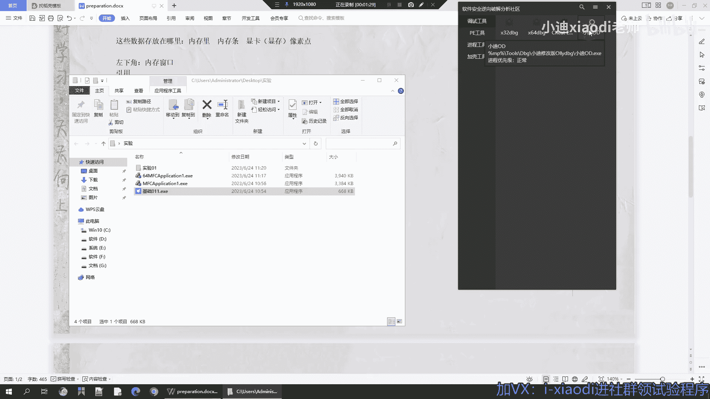

## 🪟 认识小迪OD界面

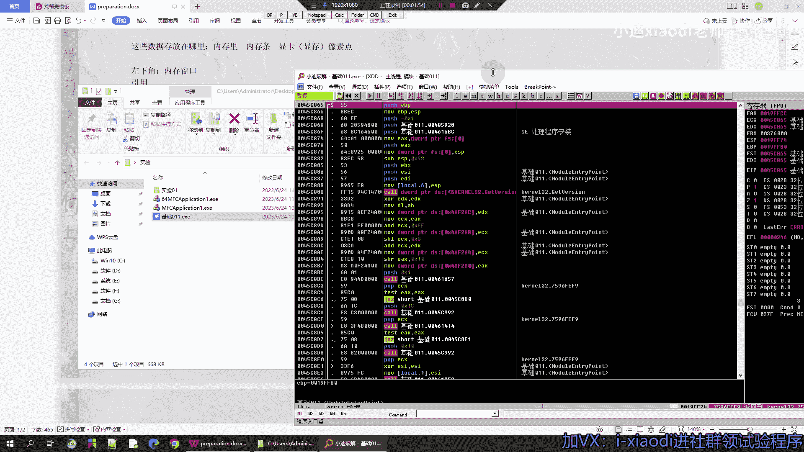

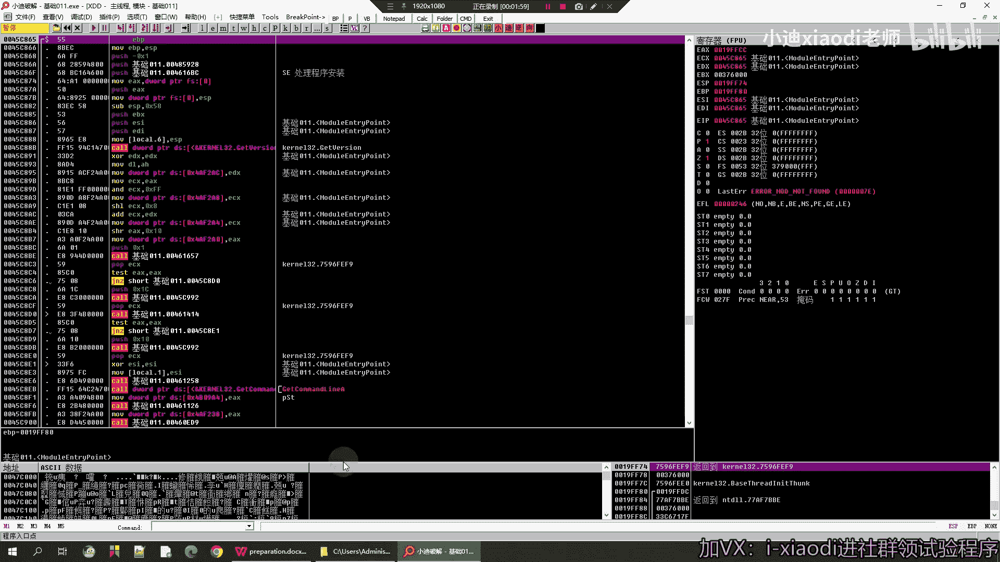

在准备好程序和工具后，本节我们来看看小迪OD的界面和基本操作。把软件直接拖过来，这样就建立起联系。然后会看到XDD主线程模块窗口，可以点击最大化，也可以双击；也可以把整个程序双击。上一节课学习的工具叫x32dbg，可以对比一下，两个软件很像：左上角、右下角、左下角、右上角四个窗口差不多，左下角都是内存窗口，这边也是内存窗口。

认识界面后，下一步是让程序运行起来。先让程序运行，点击相关的小三角；x32dbg也是点击这个位置，操作都一样。运行后关掉。今天说的是XDD这个程序。映入眼帘的是“请修改我的标题”这几个字。这几个字放在哪里？回顾上节课：这些字、这些数、这些密码之类的东西都放在内存里。所以这个东西也放在内存里，我们要找内存关键数据。用这个工具怎么找内存关键数据？左下角就是内存窗口。“请修改我的标题”这几个字就放在这里边。如果能思考到这一步，说明理解得很好。放到这里边怎么找？对应动作是搜。

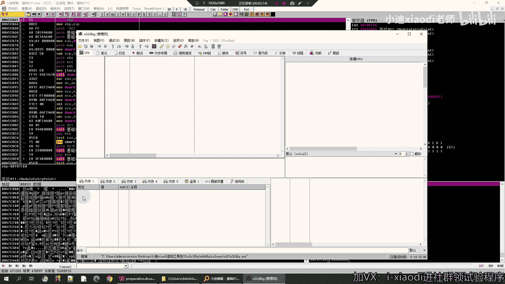

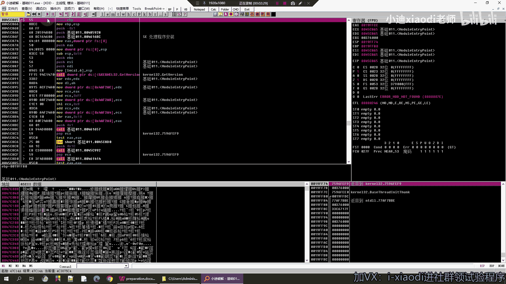

## 🔍 在内存中定位标题字符串

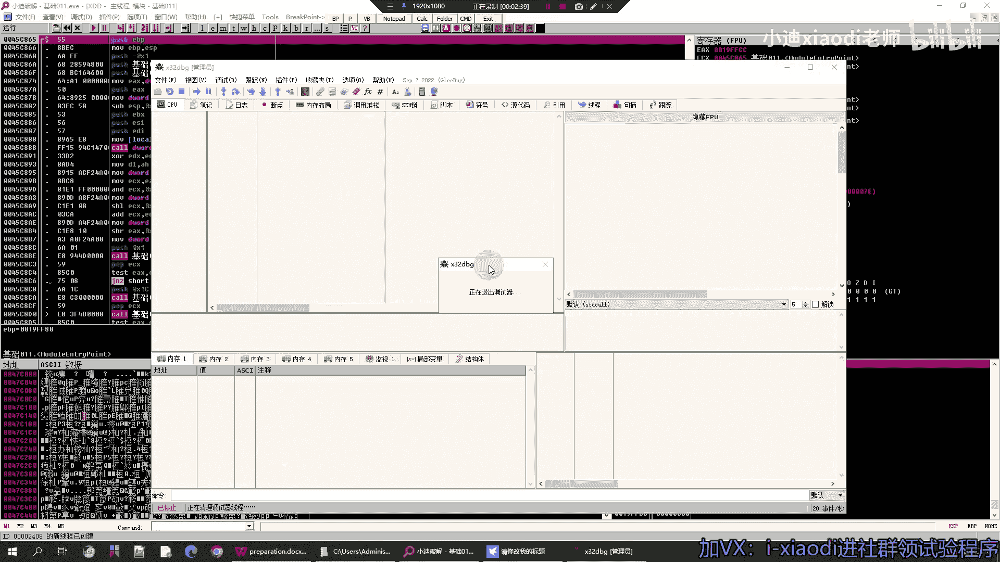

上一节我们认识了内存窗口，本节中我们来看看怎样在内存里定位标题字符串。具体操作是鼠标右键，然后查找；工具界面没有“搜”就点“查找”。查找内容是二进制字串。界面里可能有一些乱七八糟的内容，不用管，直接输入“请修改我的标题”。现在直接在这里打字：请修改我的标题，然后点击确定。这样就直接搜出来了。

如果界面和演示有差异，可以鼠标右键点击文本，然后点击X码是64，或者点击32，也就是鼠标右键文本X码即可。这样这边就是“请修改我的标题”，也就是那个字符串和文字。定位到字符串后，接下来就是修改。以下是定位和修改标题的关键操作清单，方便初学者对照练习：

- 鼠标右键，选择“查找”。
- 选择“二进制字串”。
- 输入“请修改我的标题”并点击确定。
- 如果界面不一致，鼠标右键文本，选择X码64或32进行调节。
- 选中搜到的字符串，鼠标右键选择“二进制编辑”。

定位到字符串只是第一步，真正修改时要注意长度。把“请修改我的标题”改成“我修改我的标题”。修改时一定要注意长度一致。长度不一致会出问题。可以用水杯来理解：水杯容积有多少，就给它多少水；超过容积，水就会溢出来。水溢出来可以擦桌子，但程序数据溢出来就不好处理，程序就会崩溃。所以长度要一致。核心约束可以用下面的公式和代码表示：

```
原标题：请修改我的标题
新标题：我修改我的标题
约束：len(新标题) = len(原标题)
```

掌握这个长度约束后，下一节我们看看怎样把修改保存到可执行文件。

## 💾 保存修改到可执行文件

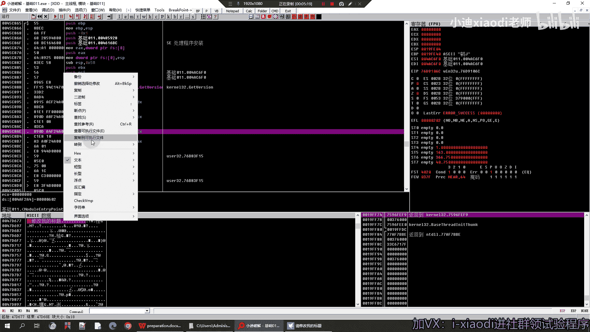

在完成二进制编辑后，本节我们来看看怎样保存修改。改完之后要保存。保存方法很简单：选中修改内容，鼠标右键，然后复制到可执行文件。选择时一定要选多一点，选多不选少，懂这个意思即可。鼠标右键选择“复制到可执行文件”，然后会弹出一个界面，这个界面在最顶层。对着它鼠标右键保存文件。可以给文件起名字，比如“修改后的”。回到文件夹看一下，这样修改就完成了。

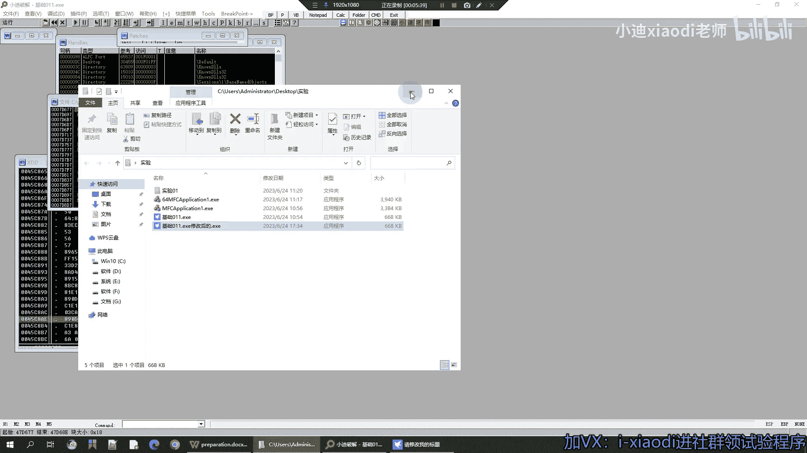

保存完成后还需要验证。以下是保存和验证的步骤清单，按顺序操作即可：

- 选中修改后的内容。
- 鼠标右键选择“复制到可执行文件”。
- 在弹出界面中鼠标右键选择“保存文件”。
- 给保存文件起名，例如“修改后的”。
- 回到文件夹查看文件，并运行验证标题是否变化。

运行修改后的程序，可以看到标题变成“我修改我的标题”。原程序标题是“请修改我的标题”。修改时一定要注意长度一致。如果记不住，就联想水杯容积：超过容积水会溢出来；程序数据溢出，程序就会崩溃。

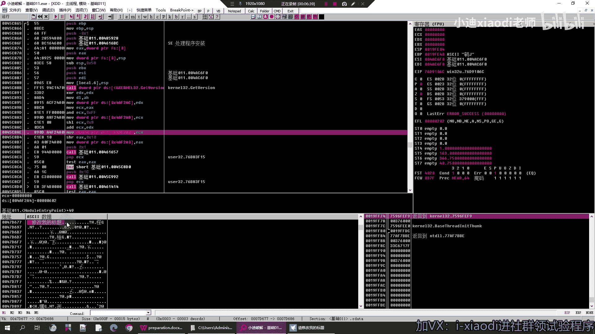

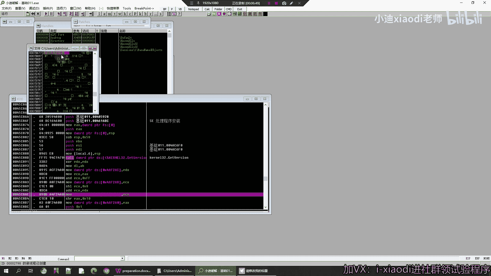

## ✅ 总结与练习

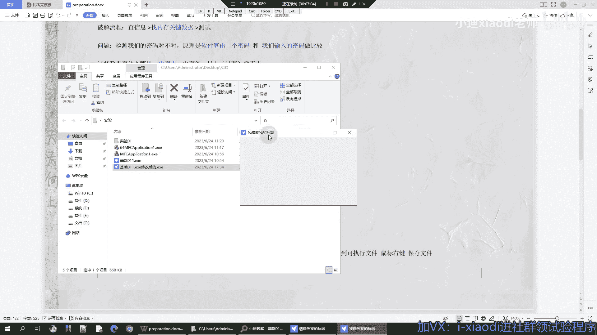

最后总结回顾一下今天的内容。第一步是把程序拖进去，然后在左下角的内存窗口直接搜索。搜索时如果觉得界面不一致，就鼠标右键文本进行调节。调节完成后，鼠标右键查找二进制字串。搜到之后选中并修改，选中后鼠标右键选择二进制编辑。修改时保持长度一致。保存时选中内容，鼠标右键复制到可执行文件，然后鼠标右键保存文件。这样文件就保存成功，运行后就能看到修改后的标题。

本节课中我们一起学习了软件标题修改的通杀方法一：通过内存窗口搜索标题字符串，用二进制编辑修改标题，保持新标题和原标题长度一致，再把修改复制到可执行文件并保存，最后运行验证。回去之后大家可以实践一下，有问题可以联系。下期再见，拜拜。

