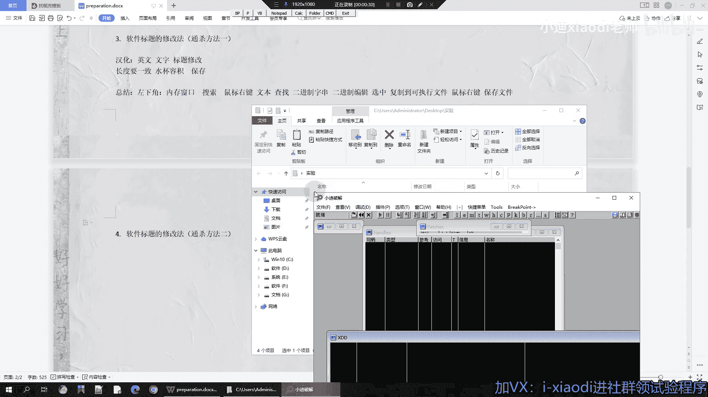
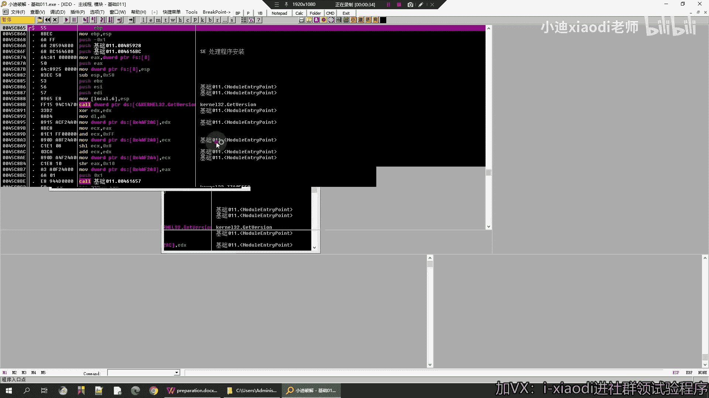
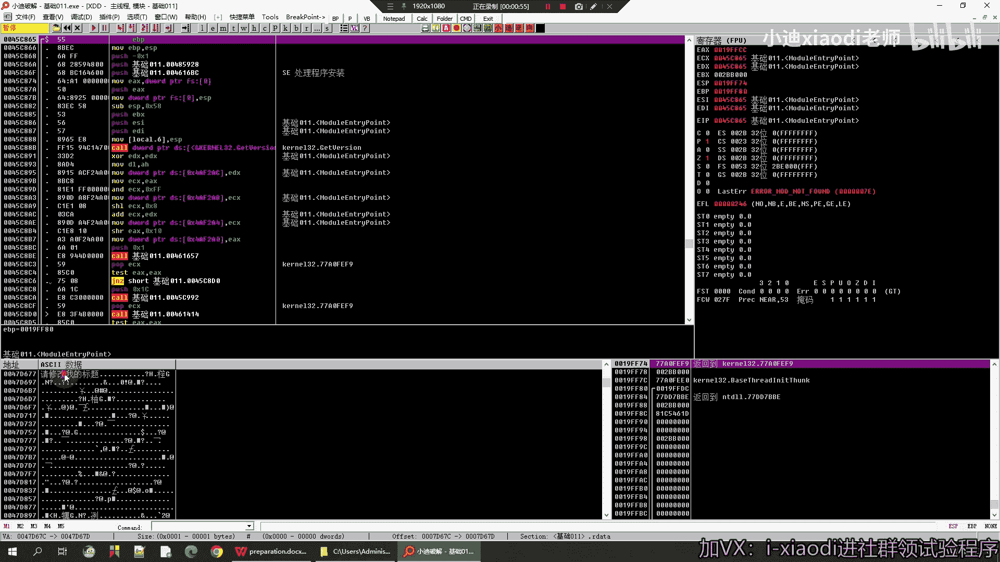
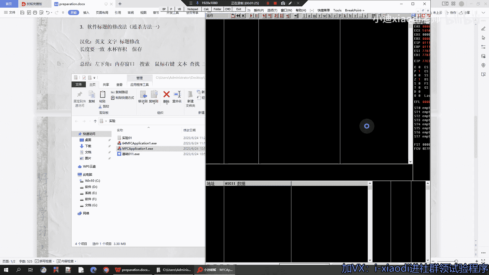
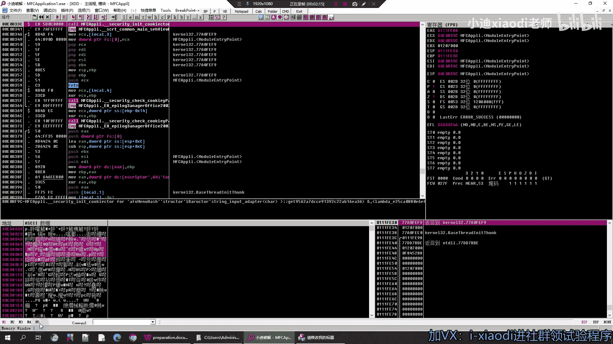
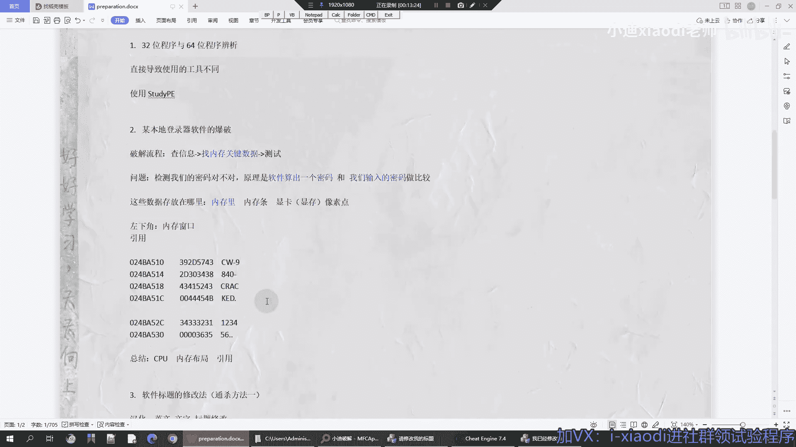

# 🛠️ 小白软件破解逆向工程师2023最新：04：通杀软件标题破解修改方法二



## 🧭 小白软件破解逆向工程师2023最新：04：本节概述



在本节课中，我们将要学习软件标题修改的通杀方法二。上一节介绍了方法一，本节中我们来看看方法二与方法一的相同点和差异。方法二依然围绕“找到标题字符串、修改标题、保存修改结果”这条主线展开，但会额外引入CE，也就是Cheat Engine，与OD配合使用。我们会先快速回顾方法一，再在实验程序`MFC Application One`上演示搜索不到字符串时怎么办，最后把修改后的标题保存到可执行文件中。下面内容会尽量用大白话说明每一步，方便初学者照着操作。



## 🔁 小白软件破解逆向工程师2023最新：04：快速回顾方法一

上一节我们介绍了方法一，本节中我们先快速回顾方法一，为后面的对比做准备。上节课破解的程序叫基础011，运行后会显示“请修改我的标题”。当时使用的工具是小DOD，也就是OD一类的调试工具。操作过程是把程序拖进DOD，最大化窗口，然后搜索“请修改我的标题”，直接找到对应的ASCII数据，再在找到的位置进行修改，标题就改掉了。这个思路可以概括为下面公式：



```
方法一：OD 搜索标题字符串 -> 找到 ASCII 数据 -> 直接修改 -> 保存
```

从上面的回顾可以看到，方法一的关键是OD能够直接搜到字符串。上一节我们介绍了这个顺利的流程，本节中我们来看看方法二在实验程序上是否也能这么顺利。方法二和方法一有很多相似的地方，也存在一些差异，差异主要出现在搜索字符串这一环节。

## 🧪 小白软件破解逆向工程师2023最新：04：方法二实验程序与搜索失败

上一节我们回顾了方法一，本节中我们来看看方法二的实验程序。方法二使用的实验程序是`MFC Application One`。同样可以把程序直接拖进DOD，也可以重新开一份小DOD再把程序拖过来。拖入后最大化窗口，鼠标右键进行查找，搜索“请修改我的标题”，然后点击确定。此时左下角会提示“条目未找到”，也就是没有搜到目标字符串。我们也可以先运行程序，确认界面上确实显示“请修改我的标题”，再回到DOD搜一遍；第一行查找没有反应，第二行输入“请修改我的标题”也仍然提示“条目未找到”。到这里，操作就遇到了僵局。

遇到这种情况，不能简单认为程序里没有这个字符串。之前已经说过，肉眼可见的界面文字通常放在内存中，并且会有特定的内存地址标号来标识它。标题字符串肯定在内存里，只是当前这个工具在搜索功能上有所欠缺，所以搜不到。上一节我们介绍了OD直接搜索的便利，本节中我们来看看当OD搜不到时应该怎么办。既然现有工具功能不够强，就需要换一个更强大的工具，这个工具就是CE；CE要与OD联合使用，才能完成搜索和保存这两个环节。

## 🔗 小白软件破解逆向工程师2023最新：04：用CE与程序建立联系

我们已经知道需要引入CE，本节中我们来看看CE如何与目标程序建立联系。先打开工具包，找到Cheat Engine，简称CE，运行它。运行过程中如果弹出一些错误提示，可以先不用管。CE打开后，界面里有进程选择区域；如果它在闪烁，并且显示“未选择进程”，说明它正在等待选择目标程序。点击这个位置，找到“请修改我的标题”这个进程，然后点击“打开”。这里要注意，应该点击“打开”，不要点击“调试器附加的进程”，点击“打开”即可。

CE打开进程之后，还需要调整搜索设置。以下是建立联系后要做的设置，按顺序操作即可：

- 这里不是调整扫描类型，而是把数值类型调整为字符串。
- 把“区分大小写”选项去掉。本例搜索的是汉字，大小写本身影响不大，但先去掉可以减少干扰。
- 把“可写”选项点成方块状态。原文操作是点一下再点一下，让它从顿号变成方块。
- 准备搜索“请修改我的标题”。

上面的设置完成后，就可以进行第一次尝试。第一次搜索“请修改我的标题”时，首次扫描结果为0。这个结果说明按当前设置没有搜到，需要继续尝试。第一次失败不代表结束，继续调整条件才是关键。上一节我们介绍了建立联系和基础设置，本节中我们来看看第二次尝试如何调整搜索条件。

## 🔍 小白软件破解逆向工程师2023最新：04：CE搜索字符串并直接修改

第一次搜索结果为0，本节中我们来进行第二次尝试。CE里能看到几种字符串筛选机制，本例不需要把所有机制都讲透，先围绕代码页和UTF-16这两种情况进行测试。UTF-16实际上是一种编码方式，这里先知道它是一种字符串筛选选项即可。汉字没有大小写区分，所以重点测试UTF-16。第二次尝试时勾选UTF-16，然后点击首次扫描。这一次可以直接找到目标字符串。找到后双击结果，可以看到对应的内容就是“请修改我的标题”。此时CE中显示的是字符串本身、字符串标号以及它对应的内存地址，也就是说这个标号所在的位置存放着这个标题内容。

找到地址后，可以直接在CE中修改。修改时要注意标题长度尽量保持一致。原文用了一个很直白的比喻：这就像水杯的容积是固定的，水超过容积就会溢出来，字符串超过原长度也可能造成意料之外的结果。可以用下面公式表示长度约束：

```
len(新标题) <= len(原标题)
```

> 注意：这里说的长度一致，是指新标题不要超过原标题占用的空间；超过后可能溢出，造成意料之外的结果。

本例把“请修改我的标题”改成“我已经修改掉了”，长度都是7个汉字，比较稳妥。在CE中改完后点击确定，就能看到内容已经变成“我已经修改掉了”。CE中修改虽然方便，但还没有真正保存到程序文件里，因为那边文件还没有变化。上一节我们完成了CE中的定位和修改，本节中我们来看看如何借助OD把修改保存下来。需要记住，OD具备保存文件的功能，CE不具备这个功能；所以CE负责搜索和直接改内存，OD负责转到地址并保存文件。

## 💾 小白软件破解逆向工程师2023最新：04：用OD转到地址并保存修改版

CE中已经改好内容，本节中我们来看看保存流程。之前保存文件时，需要先找到那一块内存区域，然后再进行保存。现在已经在CE中得到内存地址，例如本例中的`00EB4DCE`。接下来回到OD，双击主线程模块窗口，在左下角内存窗口鼠标右键，选择“转到表达式”，输入这个地址并确认。如果显示类型不是Unicode，可以在该位置鼠标右键调整文本显示方式，改成Unicode，这样能更清晰地看到“我已经修改掉了”。能够保存的原因是修改后的内容已经存在于内存中，OD只是把这个修改后的内存区域写回可执行文件。

OD自身在搜索时搜不到这个字符串，但借助CE搜索后可以得到内存地址，也就是数据标号或内存值。拿到地址后，在OD中转到这个地址，就可以进行保存文件的操作。以下是保存修改版的关键步骤，操作时按这个顺序进行：

- 在OD中转到CE给出的地址。
- 保存文件时遵循“选多不选少”的原则，宁可多选一些内存区域，不要少选。
- 鼠标右键选择“复制到可执行文件”。
- 再鼠标右键点击“保存文件”。
- 把保存结果命名为修改版，然后到文件夹运行修改版程序。

运行修改版后，可以看到标题已经变成“我已经修改掉了”，说明标题修改成功。到这里，方法二的核心流程已经跑通。上一节我们完成了保存和验证，本节中我们来做一个整体总结，把容易忘记的细节再串一遍。

## 🧾 小白软件破解逆向工程师2023最新：04：方法二总结与资源获取

本节课中我们一起学习了通杀软件标题破解修改方法二。总结来说，搜索数据时可能发现搜不到，标题明明在内存中，首次扫描结果却为0。遇到这种结果，就要借助CE去搜索。CE搜索汉字时提供了多种字符串筛选方式，原文提到代码页和UTF-16，本例测试UTF-16时成功找到。代码页可以不用重点测试；如果搜索英文，要注意区分大小写，中文则不用管大小写。搜到地址后双击下来，就能得到字符串和对应的内存地址。我们可以在CE中直接修改，操作很方便；修改完成后回到OD，转到这个地址，再按“选多不选少”的原则复制到可执行文件并保存。如果看不到清晰内容，可以把文本显示方式调整为Unicode。整个分工可以用下面代码概括：

```
CE：搜索字符串 -> 得到内存地址 -> 直接修改内存内容
OD：转到表达式/转到地址 -> 复制到可执行文件 -> 保存文件
```



也就是说，CE和OD联合工作，各司其职：CE负责搜数据，OD负责保存数据、保存文件。方法二与方法一相似，但多了CE辅助搜索这个关键环节。最后补充资源获取信息：如果需要测试程序，可以联系微信加入社区；也可以关注B站账号，动态里有海报，扫码加入，或者发私信。工具包获取可以关注公众号“之成课堂”，回复“逆向工具包”，注意不要落下“包”字。本节课内容到这里结束，感谢收看，我们下期再见。

