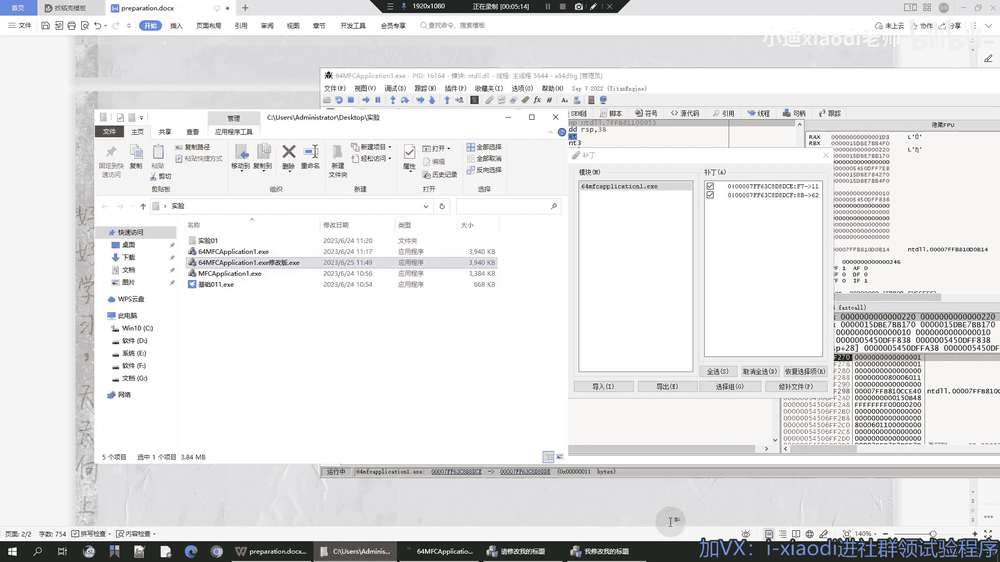

# 🛠️ 小白软件破解逆向工程师2023最新：05：64位程序标题破解修改方法三

## 📖 小白软件破解逆向工程师2023最新：05.1：课程概述与本节目标

在本节课中我们将要学习64位程序标题破解修改方法三。本课程属于第一期汇编逆向与破解实战第二章基础破解方法重点通用思路学习的第五节课，对应视频 BV1h14y127uy。今天讲软件标题修改法的通杀方法3，也就是64位程序标题破解。前几节课也讲过标题破解，但讲的是32位程序。本节会说明32位和64位程序怎么区分、调试工具怎么对应、64位程序标题怎么搜索和修改、最后怎么保存补丁。

## 🧩 小白软件破解逆向工程师2023最新：05.2：32位与64位程序及工具对应关系


上一节我们明确了本节目标，本节中我们来看看32位程序和64位程序怎么区分，以及工具如何对应。核心概念是：程序位数必须和调试器位数匹配，可以写成公式：`32位程序 -> x32dbg`，`64位程序 -> x64dbg`。区分方法是点击PE工具找到StudPE，把程序拖进去，看P类型显示32位还是64位；32位程序拖进去显示32位，64位程序拖进去显示64位。

这里的关键是工具不能混用。64位程序对应64位的分析工具，32位程序对应32位的工具。用调试工具小DOD拖64位程序会提示“不是有效的P文件”，意思是这个程序可能无效，或者不是32位程序；点“是”载入会出错。用x32dbg拖64位程序也没有效果、没有反应。所以破解64位程序必须使用x64dbg。下面列出工具对应关系，便于初学者直接照做。

```text
32位程序 -> x32dbg / 32位分析工具
64位程序 -> x64dbg / 64位分析工具
混用结果 -> 提示不是有效PE文件，或载入出错、无反应
```

## 🔍 小白软件破解逆向工程师2023最新：05.3：在内存布局中搜索标题数据

上一节我们介绍了工具对应关系，本节中我们来看看64位程序标题数据怎么搜索。标题属于内存数据，肯定放在内存中。之前讲工具时用到CPU、内存布局和引用这几个窗口，这里再记录一下：CPU、内存布局、引用。使用x64dbg载入程序后点击运行，再按之前的思路操作。点击内存布局，就能在这个窗口里搜索内存数据。具体操作是鼠标右键，选择“搜索匹配特征”，先试ANSI编码，搜索“请修改我的标题”。先复制这个标题，点确定后没有结果，显示匹配0个。没有搜到不要急，坚持就胜利。

接着再试Unicode编码。原理是：不知道目标是什么编码时，就挨个试，这是排除法，不是A就是B。操作是打开内存布局，鼠标右键搜索匹配特征，搜索Unicode。点确定后搜到两个结果，双击点过去。点过去后可能看不出来，因为这边用的编码是ANSI。可以换鼠标右键，文本，点击扩展ANSI试一下，没有内容；Unicode也显示不出来。之前用CE搜时发现它是UTF-16，所以再试UTF-16：鼠标右键，文本，点击代码页，找到UTF-16，点击确定，发现它就是UTF-16，内容是“请修改我的标题”。下面把搜索思路整理成流程，方便照着操作。

```text
右键内存布局 -> 搜索匹配特征
先试 ANSI -> 再试 Unicode
不知道编码 -> 用排除法逐个尝试
显示异常 -> 右键文本 -> 扩展ANSI / Unicode / 代码页UTF-16
```

## ✏️ 小白软件破解逆向工程师2023最新：05.4：在搜索结果中测试并修改内存

上一节我们找到了UTF-16编码的标题，本节中我们来看看搜索结果里哪个地址能修改。先选中“请修改我的标题”，鼠标右键，选择二进制编辑，把“请修改我的标题”改成一个新内容，点击确定，发现改不掉。这说明这块内存不允许修改。遇到不允许修改的情况，就换一个结果试。点击引用，点击第二个结果，双击过去，能看到“请修改我的标题”。选中它，鼠标右键，二进制编辑，编辑时选长一点，把“请修改我的标题”改成“我修改我的标题”，点击确定。这时发现修改成功。

这说明要在搜索结果中进行测试，也就是用排除法二选一，测试哪个结果能修改。能修改的就修改，不能修改的就换下一个。这里列出测试要点，初学者可以按这个顺序判断。

- 先双击搜索结果，确认目标字符串是否显示正常。
- 显示不正常时，尝试扩展ANSI、Unicode、代码页UTF-16等编码。
- 选中字符串后右键二进制编辑，尝试修改内容。
- 如果提示改不掉，说明该内存区域不允许修改，换下一个搜索结果。
- 修改成功后，进入保存补丁环节。

## 💾 小白软件破解逆向工程师2023最新：05.5：用创可贴补丁保存修改结果

上一节我们确认了可修改的搜索结果，本节中我们来看看修改后怎么保存。修改成功后需要保存，但在这个界面里没有普通意义上的保存，选择“保存到文件”也不对，这里保存不了。正确位置是“创可贴补丁”，也就是创口钉/补丁功能。点击创可贴补丁，能看到刚才修改的地方。然后点击修补文件，再点修补文件，给文件起名“修改版”，记得加上后缀`.EXE`，点保存。界面会提示两个补丁已经应用，点击OK。到文件夹查看并运行程序，标题就变成了“我修改我的标题”。

下面用代码形式概括保存流程，避免初学者点错位置。



```text
修改成功后
-> 点击 创可贴补丁
-> 点击 修补文件
-> 文件名：修改版
-> 后缀：.EXE
-> 保存
-> 提示：两个补丁已经应用，点击 OK
-> 到文件夹运行验证
```

## 🧠 小白软件破解逆向工程师2023最新：05.6：本节总结与编码尝试清单

本节课中我们一起学习了64位程序标题破解修改方法三。核心结论是：64位程序必须使用x64dbg；搜索内存要在内存布局里进行；搜索后得到结果，要在结果中测试，哪个能修改就修改；修改后点击创可贴/创口钉，点击修补文件，保存即可，文件就被破解。测试时如果标题显示不对，可以尝试多种编码。常用编码有UTF-16、UTF-32、ANSI、扩展ANSI、ASCII、扩展ASCII，可以在文本菜单和代码页菜单里来回测试，直到显示出正确结果。下面列出常用编码尝试清单，作为本节的操作复习。

- `UTF-16`：常见于Windows宽字符标题。
- `UTF-32`：部分程序可能使用，需要尝试。
- `ANSI`：原文口误为阿给，普通单字节编码，先试。
- `扩展ANSI`：ANSI显示异常时尝试。
- `ASCII`：原文口误为askK，普通英文字符编码。
- `扩展ASCII`：原文口误为扩展askK。
- 代码页菜单：找不到UTF-16时，在代码页中查找UTF-16。

本节课内容到这里结束，感谢收看，下期再见。
