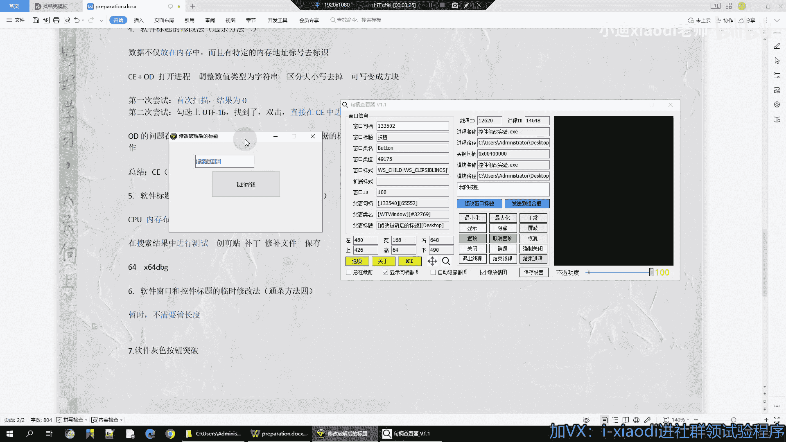

# 🧰 小白软件破解逆向工程师2023最新：06：软件窗口和控件标题的临时修改法

在本节课中，我们将要学习软件窗口和控件标题的临时修改法。临时修改法的核心特点是“临时”，也就是只做暂时性的修改；而之前我们接触的修改属于永久性修改。两者在效果和操作关注点上存在差异，学习时需要把这种差异分清楚。上一节我们介绍了永久性修改的思路，本节中我们来看看临时修改法具体怎样操作，以及它为什么不需要像永久修改那样关注长度问题。

## 🧭 小白软件破解逆向工程师2023最新：06：临时修改与永久修改的定位

在正式操作前，先明确临时修改法的定位。临时修改法主打的就是临时性，它只是暂时性的修改，不是永久性修改。之前我们提到的修改是永久性修改，因此要注意它们之间的差异和差别。暂时修改的核心就是“暂时”和“临时”，理解这一点后，后面的工具操作会更容易看懂。

## 🧪 小白软件破解逆向工程师2023最新：06：实验程序与工具准备

在了解临时修改的定位后，下面进入实验程序和工具准备。实验程序在指定位置，名称是“控件修改实验”，这个实验程序已经上传到星球。索要这个实验程序时，可以加我的微信，也可以直接搜索“软件安全意象破解分析社区”。搜索位置在知识星球，也就是在知识星球APP里搜索这个社区，然后就可以加入；或者联系我本人，我拉你进入也可以。工具包现在已经更新到1.2版本，也就是最新版本，这个版本已经给大家提供了窗口信息探测功能。今天我们就用这个工具来演示。

以下是获取实验程序、加入社区和准备工具的入口说明。

- 实验程序名称为“控件修改实验”，已经上传到星球。

- 索要实验程序可以加我的微信。

- 也可以直接搜索“软件安全意象破解分析社区”。

- 搜索位置是知识星球，在知识星球APP里搜索并加入。

- 或者联系我本人，我拉你进入。

- 工具包已经更新到1.2版本，是最新版本。

- 这个版本提供了窗口信息探测功能。

- 今天使用的工具就是这个带窗口信息探测功能的工具。

准备好实验程序和工具后，接下来看看怎样用工具定位窗口和控件。找到我们的实验程序，再找到我们的工具，就可以开始操作。


## 🔍 小白软件破解逆向工程师2023最新：06：用工具定位窗口和控件

上一小节完成了实验程序和工具准备，本节中我们来看看工具如何定位窗口和控件。工具用法很简单，这里有一个放大镜图标，会一闪一闪的。我们把放大镜拖过来，拖到目标位置。注意看，拖过来的时候右边会显示窗口信息。拖到它圈住整体窗口的时候，右边显示的就是这个窗口的信息；如果选在编辑框上，那选中的就是编辑框；如果选在按钮上，那选中的就是按钮；如果往上选到标题，显示的就是指示这个窗口的信息。

以下是使用工具定位窗口和控件的操作要点。

- 找到实验程序和工具。


- 工具中有一个一闪一闪的放大镜图标。

- 把放大镜拖到目标窗口或控件上。

- 拖到圈住整体窗口时，右边会显示这个窗口的信息。

- 选在编辑框位置，识别到的就是编辑框。

- 选在按钮位置，识别到的就是按钮。

- 往上选到标题位置，显示的就是指示这个窗口的信息。

完成定位后，就可以进入标题修改环节。定位是修改的前提，只有先选中目标，工具才能知道要修改哪个窗口或哪个控件。

## 🛠️ 小白软件破解逆向工程师2023最新：06：修改窗口标题和控件标题

在掌握定位方法后，本节中我们来看看怎样修改窗口标题和控件标题。窗口信息已经在左上角被探测出来了，其中包含句柄、标题等名词性和专业性的内容。这些专业名词先不用管，我们重点看“修改窗口标题”这一项。可以给窗口一个标题，例如输入“破解后的标题”，然后点击修改，窗口标题就被修改了。不仅窗口标题可以修改，控件的标题也可以修改。把放大镜拖到控件上，例如这是编辑框，就把标题改成“我的编辑框”，然后点击修改，编辑框标题就改成了“我的编辑框”。按钮的名字也可以修改，例如改成“我的按钮”，然后点击修改即可。

以下是修改窗口标题和控件标题的具体步骤。

- 在左上角查看工具探测出的窗口信息。

- 窗口信息中包含句柄、标题等专业名词，先不用管这些名词。

- 找到“修改窗口标题”输入项。

- 输入新的窗口标题，例如“破解后的标题”。

- 点击修改，窗口标题就会变化。

- 把工具拖到控件上，可以修改控件标题。

- 例如把编辑框标题改成“我的编辑框”，点击修改。

- 按钮名字也可以修改，例如改成“我的按钮”，点击修改。

完成这些操作后，会发现临时修改有一个非常重要的特征：不需要管长度。也就是说，修改标题时不需要考虑原长度，可以直接改。下面就来对比临时修改和永久修改在长度处理上的差异。

## 📏 小白软件破解逆向工程师2023最新：06：临时修改与永久修改的长度差异

上一小节我们完成了标题修改操作，本节中我们来看看临时修改为什么不需要管长度。大家会发现一个问题：临时修改的时候，它不管长度，也不需要管长度，这是一个非常重要的特征。之前永久修改时，我们会发现原来有多长，修改时就要有多长，目的是防止溢出、防止数据溢出，避免程序崩溃。临时修改则不需要改长度，不需要管长度，可以大胆修改、随便修改，放心修改。

以下是临时修改与永久修改在长度处理上的核心差异。

- 临时修改不需要管标题长度。

- 临时修改不需要考虑原长度是否一致。

- 临时修改可以大胆修改、随便修改。

- 永久修改需要关注原长度。

- 永久修改时原来有多长，修改时就要有多长。

- 永久修改关注长度是为了防止溢出。

- 防止数据溢出是为了避免程序崩溃。

可以用下面的公式直白表示两者的长度处理差异。

$$
\text{临时修改：标题长度不需要与原来一致}
$$

$$
\text{永久修改：len(新标题) = len(原标题)}
$$

也可以用代码流程表示工具操作的核心步骤。

```text
放大镜拖到目标窗口或控件
-> 右侧显示识别到的对象类型
-> 在“修改窗口标题”中输入新标题
-> 点击修改
-> 窗口标题或控件标题发生变化
```

这里给出一个需要注意的点。

> 临时修改只针对当前运行中的显示，不涉及永久写入程序文件；它和永久修改的定位不同。

理解长度差异后，就能明白临时修改法的操作重点不是长度校验，而是直接修改当前显示标题。工具使用临时修改法也非常简单，核心就是定位目标、输入新标题、点击修改。



## 📚 小白软件破解逆向工程师2023最新：06：课程总结

本节课中我们一起学习了软件窗口和控件标题的临时修改法。我们明确了临时修改法是暂时性的修改，和之前永久性修改不同；了解了实验程序“控件修改实验”已经上传到星球，可以通过加微信、搜索知识星球APP中的“软件安全意象破解分析社区”或联系本人拉入来获取；知道了工具包已经更新到1.2版本，并提供窗口信息探测功能。我们还学习了用一闪一闪的放大镜拖到窗口或控件上进行定位，修改窗口标题、编辑框标题和按钮标题，并重点理解了临时修改不需要管长度，而永久修改需要保持原长度以防止溢出和程序崩溃。今天的内容回去之后可以自己实验一下，我们下期再见。

