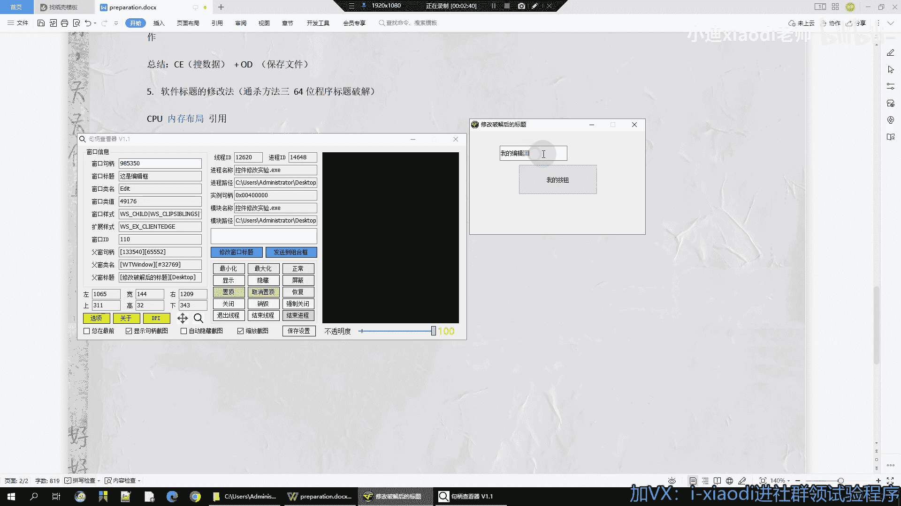

# 🧰 小白软件破解逆向工程师2023最新：07：软件灰色按钮一键突破


在本节课中，我们将要学习软件灰色按钮一键突破。课程会先说明课程交流和工具准备，再解释灰色按钮是什么，接着用CE和测试程序演示如何把灰色按钮恢复为可点击状态。整个内容面向初学者，用大白话说明原理和操作步骤。欢迎学习软件安全逆向破解第一期汇编逆向与破解实战课程。我的微信是I杠小迪，大家可以在B站联系到我。


如果需要获取相关工具包或实验程序，可以通过以下方式获取和交流：


- 在知识星球APP搜索“软件安全逆向破解分析学习社区”。


- 如果搜索不到，可以加微信I杠小迪，我拉你进去，进行内部技术交流。


- 工具包中包含本节使用的聚柄传感器、聚柄查看器或窗口信息探测查看神器，也包含测试程序。


课程交流和工具准备说明清楚后，下面进入本节的核心内容，也就是软件灰色按钮的突破。


## 🧭 小白软件破解逆向工程师2023最新：07-1：什么是软件灰色按钮


前面说明了课程交流和工具准备，本节来看看灰色按钮是什么。所谓软件灰色按钮，就是在使用一些软件时，如果没有注册，软件里的部分按钮不允许点击。按钮显示为灰色，用户无法使用对应功能，但用户又希望使用这些功能。这时就需要突破这个灰色按钮，让它恢复为可点击状态。用公式表示就是：


$$
\text{按钮可点击状态} =
\begin{cases}
\text{不可点击（灰色）}, & \text{用户未注册或未付费} \\
\text{可点击（正常）}, & \text{用户已注册或已付费}
\end{cases}
$$


用伪代码表示就是：


```text
if (未注册 == true || 未付费 == true) {
    按钮.Enabled = false;  // 按钮变灰，不能点击
}
```


恢复的思路可以理解为：


```text
按钮.Enabled = true;       // 按钮恢复，可以点击
```


这段伪代码表达的含义是：软件根据注册或付费状态决定按钮能不能点击。理解灰色按钮的含义后，下面看CE中的实际表现。


## 🧪 小白软件破解逆向工程师2023最新：07-2：CE中的灰色按钮现象


上一节我们解释了灰色按钮的含义，本节用CE举例。原文提供了一个CE调试工具。CE在不选择进程时，首次扫描和再次扫描无法点击。我们可以通过外部技术手段让它们可以点击。假设这个按钮就是登录、注册或功能使用按钮；如果用户没有注册、没有付费，就不允许点击。现在要突破，方法很简单，使用提供的聚柄传感器。CE展示说明按钮状态可以被外部工具改变，下面进入具体工具操作。


## 🛠️ 小白软件破解逆向工程师2023最新：07-3：用聚柄传感器恢复按钮


前面看到CE按钮变灰的情况，本节用聚柄传感器操作。这个聚柄传感器已经在工具包中，也可以称为窗口信息查看探测神器。操作思路跟上节课一样：找到放大镜，把它拖到按钮上，然后点击恢复。工具操作可以按以下步骤进行：


1. 打开聚柄传感器或窗口信息探测查看神器。


2. 找到放大镜。


3. 把放大镜拖到目标按钮上。


4. 点击恢复。


5. 观察首次扫描按钮，可以看到它可以点击。


这个例子不是付费功能按钮，可能没有特别特别还原真实付费场景，但表达的大概就是这个意思。再用一次：把放大镜拖到再次扫描按钮上，点击恢复，这时首次扫描和再次扫描都可以点击。可以先点击首次扫描，这个操作是可以的。工具操作说明清楚后，下面用测试程序验证。


## ✅ 小白软件破解逆向工程师2023最新：07-4：测试程序验证按钮和控件


前面用CE演示了恢复按钮，本节用测试程序验证。测试程序中有一个“我的按钮”。验证过程如下：


- 点击屏蔽，按钮变成灰色，无法点击。


- 点击恢复，按钮恢复，可以点击。


- 再次点击屏蔽，按钮再次变灰。


- 再次点击恢复，按钮再次恢复。


不仅按钮可以屏蔽和恢复，编辑框也可以，其他控件同样可以。对编辑框点击屏蔽，可以看到无法操作；点击恢复，又恢复正常。测试程序验证后，下面总结本节使用的工具和要点。




## 🧾 小白软件破解逆向工程师2023最新：07-5：课程总结


本节课中我们一起学习了软件灰色按钮一键突破。我们了解了灰色按钮的含义：未注册或未付费时按钮变灰不可点；也学习了用聚柄传感器或窗口信息探测查看神器，把放大镜拖到按钮上并点击恢复，使首次扫描、再次扫描以及测试程序按钮恢复可点击。还验证了编辑框等其他控件也可以屏蔽和恢复。本节使用的工具是聚柄查看器或窗口信息探测查看神器。本节内容到此结束，下集再见。

