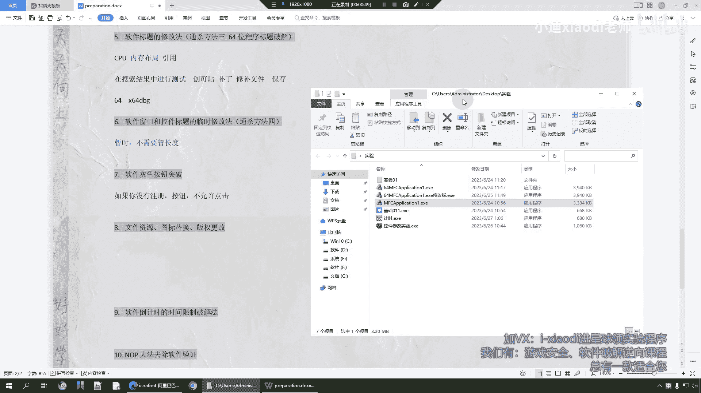
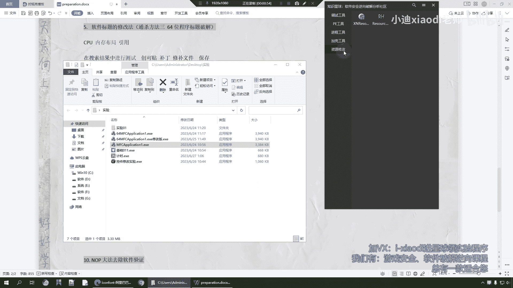
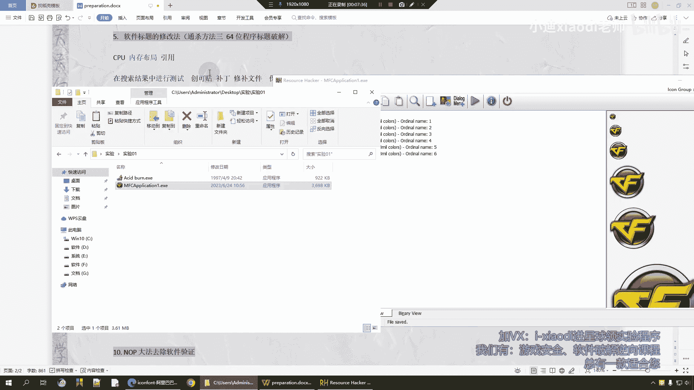

# 🛠️ 小白软件破解逆向工程师2023最新：08：文件资源、图标、版权修改

## 📌 小白软件破解逆向工程师2023最新：08-01：课程概述与学习目标

欢迎收看软件安全逆向破解第一期汇编逆向与破解实战第二章基础破解方法重点通用思路学习的第八节课，本课程对应 BV13F411d7yy。在本节课中我们将要学习程序文件资源的查看、图标的替换以及版权信息的更改，重点是把这些修改动作完整地落实到程序文件中。

程序里通常或可能存在一些图片资源，程序也可能带有自己的图标。示例程序的图标由三个小方块组成，方块上分别呈现 M、F、C 字样，这就是一个图标示例。程序还可能带有版权信息，查看方式是对程序鼠标右键，点击“属性”，再点击“详细信息”，这里就能看到版权信息。有时我们需要对这些内容进行修改，这就是本节要处理的内容。

上一节我们明确了本节目标，本节中我们来看看实验程序和工具准备。实验程序是之前提供给大家的 MFCap，接下来找到今天使用的工具。首先打开工具包，点击“资源修改”，再点击 Resource Hacker，也就是一个带 R、H 字样的黄色图标，运行这个工具。



## 🔍 小白软件破解逆向工程师2023最新：08-02：让工具与程序建立联系并查看资源



上一节我们准备好了工具，本节中我们来看看如何让工具和程序建立联系。运行工具后，程序和工具之间需要建立联系，建立联系的方法是直接把程序拖到工具上，不再多说，直接拖过去即可。

拖入后，工具会显示很多文件夹，这些文件夹里存放着程序的一些信息。下面列出查看资源时需要先注意的几个观察点，便于理解后续操作。

- 工具中会显示很多图标资源，但程序运行时肉眼不一定能直接看出来。
- 这些图标资源的确存在于程序中，只是被放在程序的其他位置。
- 可以查看 menu，也就是菜单资源，但示例程序没有菜单，因此这里看不出内容。

完成这些观察后，下一节我们重点查看更有用的 Dialog 资源。查看 Dialog，也就是对话框或窗口资源时，可以发现“请修改我的标题”这段文字与程序中显示的内容一模一样，Dialog 资源值得重点查看。

## ✏️ 小白软件破解逆向工程师2023最新：08-03：修改窗口标题与控件文本

上一节我们定位到了 Dialog 资源，本节中我们来看看如何直接修改窗口标题和控件文本。既然“请修改我的标题”可以直接在资源中看到，就可以在这个位置直接修改。把“请修改我的标题”改成“我修改我的标题”，这样就实现了程序标题的修改。

同样道理，控件文本也可以修改。下面是控件文本修改的示例说明，用大白话理解就是把按钮上显示的文字替换掉。

- 可以把“确定”改成“确定一”。
- 也可以把“确定”改成“我是”。
- 可以把“取消”改成“小迪”。

这些修改当然可以执行。测试前先把程序关闭，避免程序在工具操作时出现占用或其他问题。关闭程序后，点击向右的小三角，可以看到 `Compile succeed`，表示编译成功，但此时文件还没有保存。

## ⚙️ 小白软件破解逆向工程师2023最新：08-04：掌握修改、编译、保存的顺序并验证

上一节我们完成了资源文本修改，本节中我们来看看操作顺序。接下来还需要点击绿色的 C5 图标，先点击 Compile 编译，再点击保存。这里的关键顺序是：先修改，然后编译，最后保存。

下面用代码形式整理本节最重要的操作流程，后续修改任何资源都按这个顺序执行。

```text
修改资源 -> Compile（编译） -> Save（保存）
```

> 注意：每次操作都按“修改资源 -> 编译 -> 保存”的顺序执行，避免修改没有写入文件。

点击保存后，原文件会进行备份，备份文件名类似 `MFC application one original.EXE`，修改后的文件才是当前程序。运行修改后的程序，可以看到标题变成“我修改我的标题”，按钮文字也变成“我是”“小迪”等内容。

## 🖼️ 小白软件破解逆向工程师2023最新：08-05：修改版权信息

上一节我们验证了标题和控件修改，本节中我们来看看版权信息的修改。版权信息可以在 Version Info 中查看，这里可以看到公司名和“保留所有权利”等内容。程序属性中的公司名与这里的资源对应。

下面列出修改版权信息时可以采用的查看和操作路径，先定位再修改。

- 在工具中找到 Version Info 资源。
- 查看公司名和“保留所有权利”等版权字段。
- 把公司名改成“小迪小迪”。

修改完成后，仍然按照之前记住的顺序操作：先修改，再编译，最后保存。编译成功后保存文件。运行程序可以看到程序正常运行，鼠标右键点击“属性”，再点击“详细信息”，可以看到版权信息已经被修改。

## 🧹 小白软件破解逆向工程师2023最新：08-06：替换程序图标并处理缓存

上一节我们完成了版权修改，本节中我们来看看图标替换。工具中可以看到图标资源，第一个资源就是图标，这个图标可以替换。选中图标位置，鼠标右键，点击 Replace Icon，也就是替换图标，然后选择自己的图标文件。

下面用代码形式整理图标替换的关键要求和操作路径，重点是文件后缀与替换步骤。

```text
图标文件后缀必须为 .ICO
选中图标 -> 右键 -> Replace Icon -> 选择 Crossfire.ICO -> Replace -> 保存
```

找到自己的图标文件 Crossfire.ICO，后缀必须是 ICO，点击打开，再点击 Replace 进行更换。更换完成后直接点击保存。刷新后运行程序，可以看到标题已经变成“我修改我的标题”。由于缓存问题，图标或界面可能还没有立即变化，这时需要重启程序，或者换一个目录运行。换一个目录后运行即可看到变化。

## 📝 小白软件破解逆向工程师2023最新：08-07：课程总结



上一节我们处理了图标替换和缓存问题，本节中我们对整个流程做总结。本节课中我们一起学习了程序文件资源的查看、窗口标题与控件文本修改、版权信息修改以及图标替换，并掌握了先修改、再编译、后保存的操作顺序。修改资源时先关闭程序，保存后注意原文件备份，遇到缓存导致界面未更新时，可以重启程序或换目录运行。本期内容到这里，下期再见。

