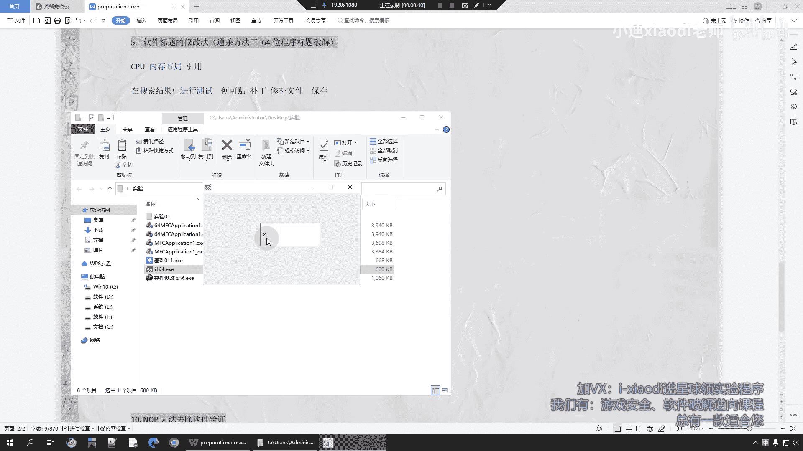
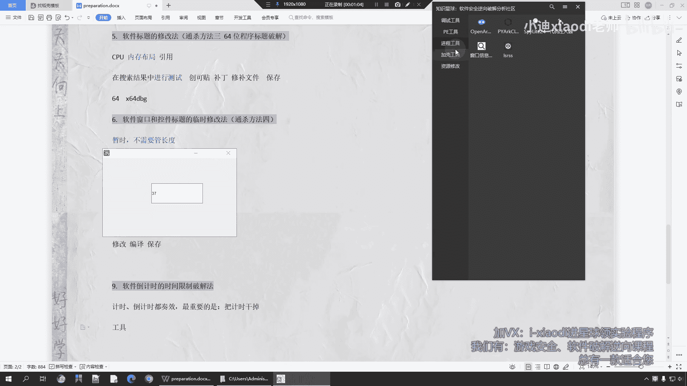

# 🧭 小白软件破解逆向工程师2023最新：09：软件倒计时的时间限制破解法

欢迎收看软件安全逆向破解第一期汇编逆向与破解实战第二章基础破解方法重点通用思路学习的第九节课。在本节课中，我们将要学习软件倒计时的时间限制破解法，也就是说，一些软件可能会带有计时功能，我们需要弄清楚这种时间限制该怎么处理。今天会用一个很小的例子、一个小软件来做测试，把观察、定位和移除定时器的过程完整走一遍。

不管软件显示的是计时还是倒计时，这类思路都奏效。接下来我们先观察这个计时程序，它只是随便写的一个小例子，运行之后会有一个东西控制时间不停往上走。当然，如果时间是不停往回减，也是同样的道理。真正重要的是，我们要把这个计时干掉，把计时干掉就可以了。

---

## 🧪 小白软件破解逆向工程师2023最新：09.1：认识计时程序与破解目标



上一节我们说明了本节课要处理的是软件时间限制问题，本节中我们来看看计时程序的表现和破解目标。首先观察这个计时程序，它只是随便写的一个小软件，运行之后，会有一个东西控制这个时间不停往上走。时间不停往回减也是同样的道理，本质上都是程序在自动更新时间。重要的是我们要把这个计时干掉。

把计时干掉就可以了，把计时干掉就可以了。那怎么干掉？工欲善其事，必先利其器，肯定要先使用合适的工具。这里给大家提供了一个工具，这个工具放在工具包里，工具包已经更新了。这个工具在进程工具里，里面有一个 `LRS`，我们运行一下。

计时类程序的核心逻辑可以用下面的公式来表示：

```text
定时器每次触发：显示时间 = 显示时间 + 1
或者：显示时间 = 显示时间 - 1
```



我们的目标可以写成：

```text
移除控制时间的定时器 => 显示时间不再自动变化
```

---

## 🛠️ 小白软件破解逆向工程师2023最新：09.2：用LRS查看并移除进程定时器

上一节我们明确了计时程序的基本表现和破解目标，本节中我们来看看如何用 `LRS` 找到并移除定时器。运行 `LRS` 之后，我们往下拉，找到刚才那个程序，也就是 `计时.exe`。找到程序后，对着它点击鼠标右键，先看清楚操作顺序，然后点击“查看”，找到“查看进程定时器”。

什么是定时器？定时器顾名思义，就像时钟一样，它会定期去做一件事，这样一个器具就叫定时器。这个工具可以对定时器进行移除操作。比如我们先移除一个定时器，可以看到 `78` 不动了，这很神奇，`78` 就不动了。然后关掉程序，我们再试一遍，再运行一次。

刷新一下进程，鼠标右键刷新，然后找到这个程序，鼠标右键点击“查看”，再点击“查看进程定时器”，移除一个定时器。它还在动，说明移除的不是那个控制时间的定时器，那么再移除一个。可以看到它不动了，停在 `19` 就不动了。这种程序的破解方法就是移除定时器，移除定时器。

下面是实际测试时可以遵循的操作顺序：

1. 先运行计时程序，观察数字是否持续变化。
2. 打开 `LRS`，在进程列表中找到目标程序 `计时.exe`。
3. 对目标程序点击鼠标右键，选择“查看”中的“查看进程定时器”。
4. 尝试移除定时器，观察数字是否停止变化。
5. 如果数字仍在变化，就继续移除其他定时器，直到数字停止。

> 提示：移除定时器是一种排查思路，实际软件可能还有别的保护机制，需要结合其他方法继续分析。

---

## 🧠 小白软件破解逆向工程师2023最新：09.3：定时器破解思路与适用范围

上一节我们通过 `LRS` 实际移除了定时器，本节中我们再来总结一下这种方法的思路和适用范围。定时器的作用，就是时时刻刻去操作一件事。比如在这个例子里，它的操作就是让数字加一，或者让时间加一。当然，在常规的软件破解里，它也可能是让时间减一。我们的思路就是只需要把这个定时器干掉就可以了。

当然，这只是方法之一，不能保证百分百奏效。软件有可能还有其他机制，或者其他方案来对抗，这也是有可能的。这里只是提供一种思路，大家可以从这种思路入手，也方便进行排除法。先判断时间变化是不是由定时器驱动，再尝试移除定时器，观察程序表现，这样就能一步一步缩小问题范围。

本节课中我们一起学习了软件倒计时的时间限制破解法。我们先观察计时程序的时间变化，再使用 `LRS` 查看目标进程的定时器，并通过移除定时器让时间停止变化。最后还说明了这种方法的适用范围：它是一种通用排查思路，不能保证对所有软件都百分百有效，但可以作为排除法的一部分继续深入分析。今天的内容就是这些，感谢大家收看，我们下期再见。

