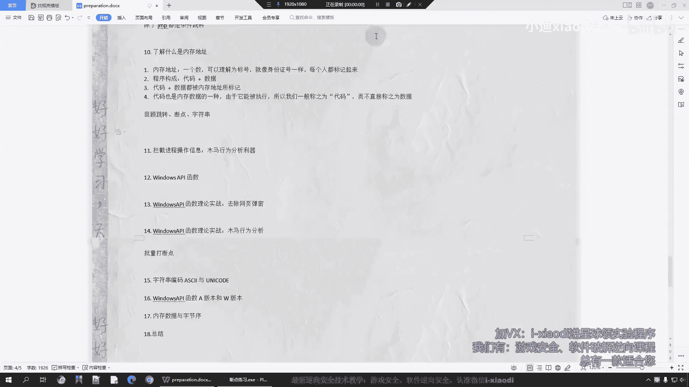
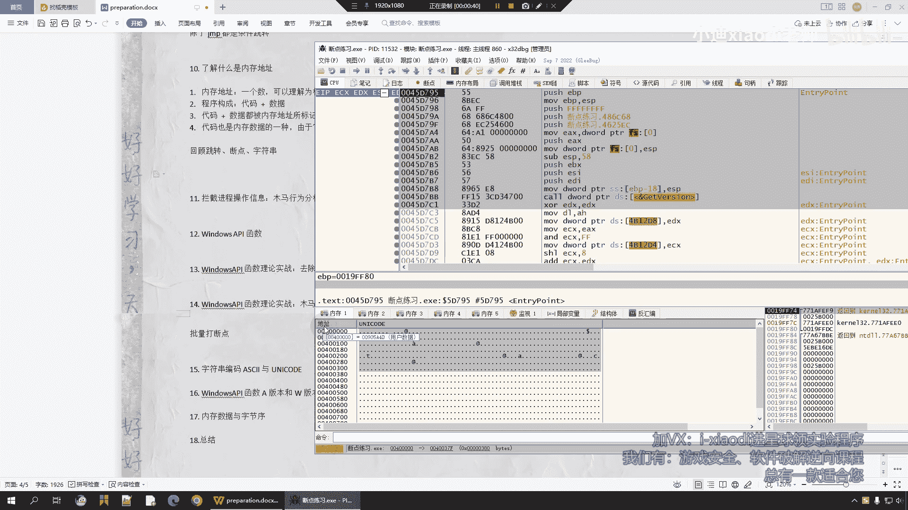
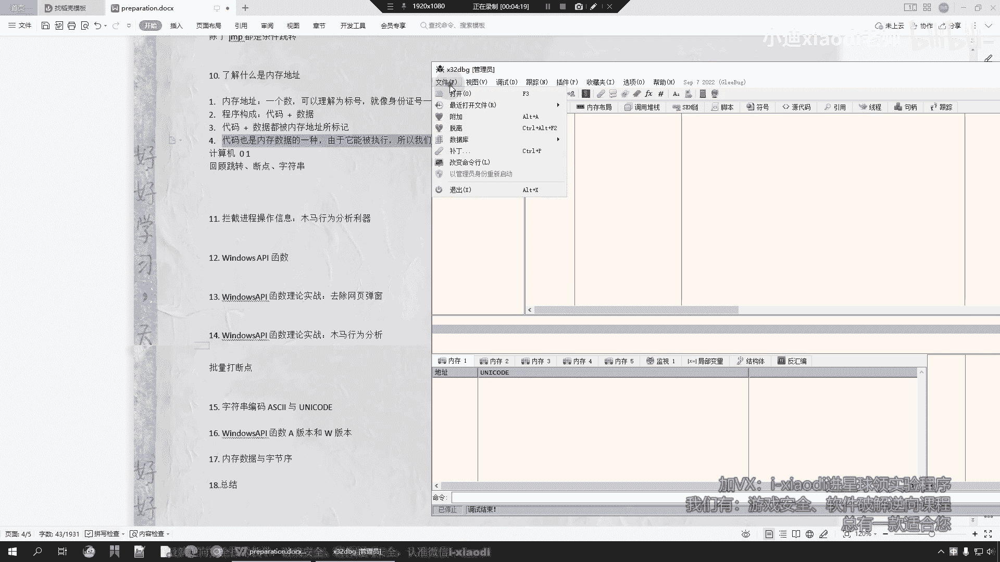
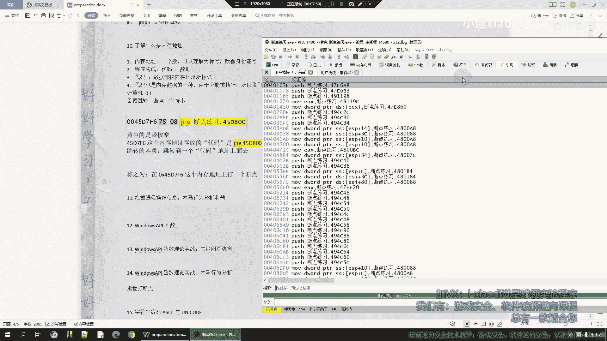
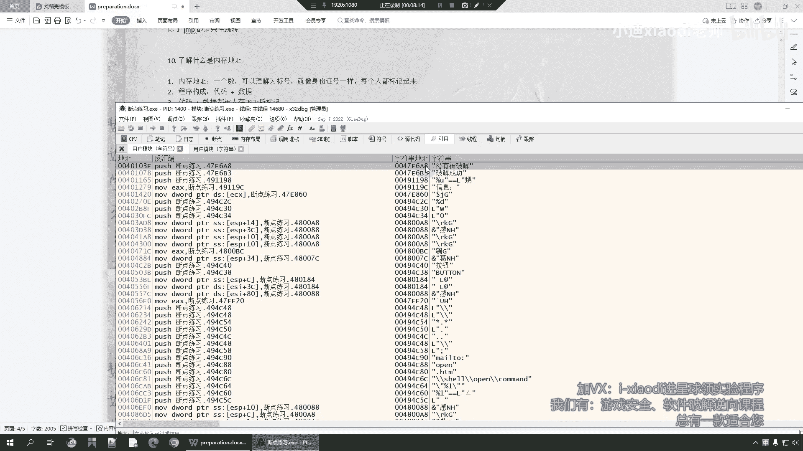
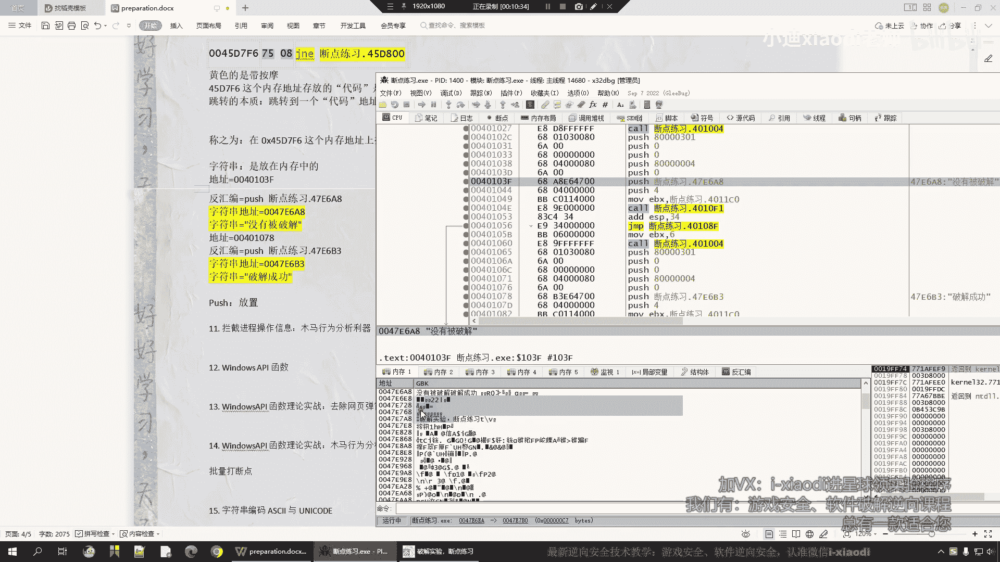

# 🧠 小白软件破解逆向工程师2023最新：3.10：小白详解内存地址、回顾深化理解跳转字符串断点



本节课中，我们将要学习内存地址这个概念。在正式开始之前，先交代一下背景：很多刚入门的小白朋友，对计算机的一些基本理论概念并不是特别清楚，这一点都不奇怪。因此，本节课特地抽出时间来，专门把“什么是内存地址”这件事讲透。除了讲内存地址本身之外，我们还会把之前学过的跳转、断点和字符串这三个知识点重新回顾一遍，帮助大家深化理解，把基础打得更加牢固。

## 🤔 什么是内存地址

先从最直白的说法开始：内存地址本质上就是一个数。这个结论请大家先牢牢记住，后面所有内容的理解，都建立在这个基础之上。



我们来看一下这个工具界面。在工具的主界面里边，对于这个界面的布局来说，左边最左边这一列，就是整个界面的第一列。大家注意看，整个界面总共有四列，其中第一列显示的全是一些类似 1234 这样的数字。这一列的内容，就是一个内存地址。换句话讲，在工具界面的左侧，第一列就是专门用来显示内存地址的。

再换一个地方看一下。在内存窗口中，最左边那一栏显示的也是地址。大家仔细看一看，那一栏上明明写着“地址”两个汉字，看得清清楚楚。所以说，不管是在主界面还是在内存窗口里，只要是最左侧的那一栏，它对应的概念就是内存地址。

那么，应该如何理解内存地址这个数？最简单的理解方式，就是把它看成一种标号。这个标号就像我们的身份证号一样，身份证号把每个人都标记起来，一查就知道是哪个人。咱们国家的身份证号制度，大家应该都很清楚，每个人的身份证号都是唯一的，绝对不会重复。

由身份证号制度，可以很自然地引申出户口制度。户口制度里边存放着各种各样的人口信息，相当于把每一个人都做了登记，并且把人们划分到不同的户头里，这也就是把人分片管理了。分片管理之后，在一定程度上就可以限制人口的流动，比如说过去农村户口向城市户口的流动，就会受到户口制度的影响和约束。内存地址的本质，其实就和身份证号、户口制度是类似的东西，它把内存里的所有东西都做了标记。

说得具体一点，内存地址把内存中的每一个数据、每一条指令都做了标记。比如说，看内存窗口中的这两个数据：左边这个点和右边那个艾特符号（@），它们俩就不是同一个“片”里的数据。打个比方，左边这个点可能位于山东，而右边那个艾特符号可能位于上海，它们分属不同的片区，彼此之间没有任何关系。不仅如此，每一个数据都拥有自己单独的区域、单独的位置，谁也不会跟谁挤在一起。

那么，这些独立的位置是被什么分割开来的？答案就是内存地址。地址与地址之间，天然就把内存划分成了一个个独立的小单元。数据这一块大家可以直接看到：内存窗口中显示着一排排的内存数据，它们被内存地址清清楚楚地分割开来，每一个数据都归属于自己专属的地址。

除了数据之外，代码同样也被内存地址分割。大家看反汇编窗口里的这些代码行：这一行代码位于 95 这个地址，而另外一行代码，它位于 96 这个地址。每一行代码都待在属于自己的地址空间里，彼此不占据对方的空间，各自都有各自的空间，各自安好，互不打扰。

从这一点上，我们也可以看出一个程序的基本构成。一个程序实际上由代码和数据两部分组成，这两部分都会被内存地址所标记。说白了，只要你这个东西进了计算机，就会被内存地址标记起来，这样做的目的是为了避免遗失。计算机毕竟是人类设计出来的工具，它是一个非常严谨、非常科学的东西，不可能允许任何数据没有归处或者出现遗漏，那是绝对不可能发生的事情。

> 💡 核心概念：内存地址本质上就是一个唯一的标号，用来标记和分割内存中的每一个位置。
>
> ```
> 内存地址 = 唯一的编号（类似于身份证号）
> 内存 = 被内存地址分割成一个个独立位置的空间
> 程序 = 代码 + 数据，二者均由内存地址标记
> ```

## 💾 数据和代码是如何被内存地址分割的

上一节我们介绍了内存地址的基本概念，知道内存地址就是一个标号，负责标记和分割内存空间。本节中，我们再来具体看看数据和代码究竟是如何被内存地址分割的。

数据这一块是最直观的。在内存窗口中，最左边那一列是地址，中间对应的列就是内存数据。每一个地址都对应着一份独立的数据，数据与数据之间被地址清清楚楚地隔开，谁也不会越界。这就好比每家每户都有自己的门牌号，门牌号把不同的住户区分开来，大家各住各的房子，互不侵扰。

代码这一块其实也是一样的道理。在 CPU 窗口（也就是反汇编窗口）中，每一行汇编代码都有自己对应的内存地址。比如说，某一行的代码位于 95 这个地址，而下面另一行代码就位于 96 这个地址。每一行代码都独占自己的地址空间，不会出现两行代码挤在同一个地址里边的情况。正因为如此，程序在执行的时候，才能按照地址一条一条地取出指令、执行指令，整个过程有条不紊。

所以说，“内存地址把一切东西都标记起来”这句话，在数据和代码这两个维度上都是成立的。数据被内存地址分割，代码也被内存地址分割，它们各自在自己的地址空间中安安静静地待着，凑在一起就构成了我们看到的程序。

## 💻 代码也是内存数据的一种

明白了数据和代码都是被内存地址分割的之后，接下来我们再深入一步，看看本节课的一个核心观点。这里要讲的第四点非常重要：代码也是内存数据的一种。那么，这句话应该如何理解？

先从具体的例子来看。比如说 push EBP 这条汇编指令，它对应的数据是 55。再比如说 mov EBP, ESP 这条指令，它对应的数据是 8B EC。看到这里，有同学可能会说：你说的这些我听不懂，什么 55、8BEC 的，完全摸不着头脑。没关系，听不懂很正常，我们先把这个疑问放在一边，再换一个更加本质的角度来解释。

计算机是由什么构成的？是不是归根到底由 0 和 1 构成的？没错，计算机底层的一切，最终都是二进制，也就是 0 和 1。既然如此，不管是代码还是数据，最终的归宿都是 0 和 1，没有任何例外。既然最终都是 0 和 1，那么从底层视角来看，代码怎么着都是数据。代码本质上就是一组排列好的 0 和 1，只不过其中有一部分数据比较特殊，它是能够被 CPU 直接执行的，因此具有一些非常特殊的意义。为了在概念上区分它们，我们就把那些能够被执行的、具有执行意义的数据称之为代码，而把那些不能直接被执行的数据称之为数据。



不过在真正的逆向破解分析过程中，我们其实不需要把思维跨到这么底层的这一步，完全没有必要每次分析问题都去纠结 0 和 1 的事情。这里给大家讲第四点，只是为了帮助大家理解计算机的本质。同时，它也解释了一个实际现象：我们在调试分析的时候，为什么左边会有 55 8B EC 这一栏数据？答案就是——因为代码本质上也是数据，所以调试器才会以数据的形式把它们展示出来。

> 💡 核心概念：
>
> ```
> push EBP      -> 机器码 55
> mov EBP, ESP  -> 机器码 8B EC
>
> 代码 = 可以被 CPU 执行的特殊数据
> 一切代码和数据的最终形态都是 0 和 1
> ```

## 🎯 回顾跳转：跳转的本质

理解了代码也是数据这一点之后，我们再来回顾一下跳转这个知识点。本节课要把跳转、断点和字符串三个内容串起来讲一遍，帮助大家把前面学过的知识点重新加深一下印象。

先来看跳转。我们把这个练习程序的界面往下翻，找到跳转相关的位置。这个练习程序在哪里？如果说你想跟着我们一起操作，就直接点击菜单栏的“文件”，然后在文件菜单里边找到“断点练习”这个程序，把它打开就可以了。打开之后，进来看到的地址是 45D795，然后你往下翻，翻到 45D7F6 这个位置。注意，45D7F6 就是一个内存地址。这个内存地址我们可以对它做什么操作？鼠标右键点击它，在弹出的菜单中找到“复制”选项，注意不是“二进制”那个选项，而是直接点“复制”，接着再点一下“复制选区”，把地址复制出来备用。

复制出来之后非常漂亮，我们先把最上面那一行多余的内容全部删掉，然后来看一下：45D7F6，这是一个什么东西？这是一个内存地址。再往下看，45D800，这又是什么？这也是一个内存地址。好，那么 45D7F6 里边存放的是什么？45D7F6 里边存放的是这行代码。这里为了讲得细一点，特别说明一下：黄色高亮显示的行是代码。那么，45D7F6 这个内存地址，它存放的是一条代码指令。注意，因为它存放的内容是代码，所以我们直接说：这个内存地址存放的是 JNZ 条件跳转指令。而 45D800 这个地址，它里边存放的也是一条代码。

看到这里，相信大家已经发现了跳转的一个本质：跳转，实际上就是跳转到一个内存地址上去。更准确地说，是跳转到一个代码地址上去。跳转指令本身没有什么神秘的魔法，它做的事情就是告诉 CPU：请到另一个代码地址去，从那里开始继续执行代码。我们把这个结论写下来：跳转的本质，就是跳转到一个代码地址上去。具体到我们这个例子中，JNZ 条件跳转指令的跳转目标，就是 45D800 这个代码地址。

回到机器码的层面继续看。前面刚说过代码也是数据，那么 45D7F6 里边的这段代码，究其本源，它等于什么数据？它等于 75 D8。这里需要注意一下字节的显示顺序，把字节顺序倒过来捋顺之后，它的本质就是 75 D8。换句话说，45D7F6 这个内存地址存放的数据，就是 75 D8 这两个字节。

> 💡 核心概念：
>
> ```
> 跳转的本质 = 跳转到一个代码地址
> 45D7F6（地址）处存放 JNZ 条件跳转指令，其跳转目标是 45D800
> 45D7F6 地址上存放的机器数据：75 D8
> ```

## ⏸️ 回顾断点：在内存地址上打断点

回顾完跳转之后，我们接着来看断点。跳转指令往往是程序的关键判断位置，那么一般情况下，当我们分析程序的时候，通常都会在跳转指令上面打一个断点。具体操作非常简单：把光标定位到跳转指令所在的那一行，然后按下 F2 键即可。

按 F2 打断点这个操作，我们把它称之为？一般来说，我们会这样说：在 45D7F6 这个位置打一个断点。更严谨一点的表达方式是：在 0x45D7F6 这个内存地址上打一个断点。也就是说，打断点的准确说法，叫做“在这个内存地址上打一个断点”。

以后大家在群里交流问题的时候，就可以把话术说得严谨一些了。比如说“我在 0x45D7F6 这个内存地址上打了一个断点”，别人一听就能明白你把断点下在了哪里，完全不会产生歧义。断点这个概念本身也很好理解：程序运行到你设置的断点所在的地址时，就会自动暂停下来，方便你去观察当时的寄存器、内存等各种状态。

> 💡 核心概念：
>
> ```
> 断点 = 让程序运行到指定内存地址时暂停
> 操作方式：在目标地址所在的行按下 F2 键
> 规范说法：在 0x45D7F6 这个内存地址上打一个断点
> ```



## 🔤 回顾字符串：字符串也存放在内存地址中



断点的事情讲清楚之后，我们再来回顾一下字符串。回忆一下我们当时搜索字符串的操作方法：在反汇编窗口中，鼠标右键，选择“搜索”，然后再选择“所有用户模块字符串”。搜索结果出来之后，就能看到“破解成功”和“没有被破解”这两个字符串了。

在搜索结果的窗口中，大家注意看一下，其实这个时候不一定非得点过去。为什么这么说？因为这一栏上边写着“字符串地址”这样的字样，后面跟着的内容就是“没有被破解”。这说明什么？说明“没有被破解”这几个字，是放在某个具体地址里边的，大家发现了吗？这个细节非常关键，它意味着字符串是有自己固定的存放位置的。

搜索字符串这个操作，本质上就是在内存中查找这些文本数据。那么，字符串放在哪里？答案是：字符串放在内存地址中。我们来把这两个字符串记一下笔记。先选中“没有被破解”和“破解成功”这两个字符串，然后点击复制，再粘贴出来看一看。可以看到：“没有被破解”这几个字，放在内存地址 4716A8 里边；而“破解成功”这四个字，放在内存地址 4716B3 里边。所以说，字符串同样也是数据，它是数据的一种，同样也是放在内存地址中的。

我们可以动手验证一下。双击字符串那一行，跳转到对应的指令位置，你会看到一条 push 指令。这里顺便说一下英文：不知道大家的英文水平怎么样，不过后边我们会经常遇到相关的词汇。英文单词“放”，对应的就是 push，翻译过来就是“放置”的意思。所以说，汇编语言其实是一种非常人性化的语言，push 这个指令本身，就是把某个东西放置到另一个地方去。具体到我们这个例子中，就是把“没有被破解”这几个字放进去。说得完整一点：把内存地址 4716A8 所标记的“没有被破解”这几个字，放置到内存里边去。它现在已经放过去了，我们应该怎么在内存窗口中查看它？操作步骤是这样的，大家可以跟着一步一步来：

- 先点击“2G”按钮（也就是切换到对应的内存视图），完成视图切换。
- 然后鼠标右键，在右键菜单中选中“在内存窗口中转到”。
- 接着在弹出的对话框中输入地址 4716A8，点击确定。
- 这个时候，如果显示的是 Unicode 编码，可能看不出中文来。
- 继续鼠标右键，选择“文本”，把编码调成“GBK”。
- 如果说你的菜单里边找不到 GBK 这个选项，你可以点击“代码页”，然后找到 GBK，点击确定。

完成以上步骤之后，再看内存窗口，就能看到“没有被破解”和“破解成功”了。你会发现，这两个字符串在内存中是挨着摆放的，一个紧挨着另一个，中间没有什么间隔。

再继续往下翻，还能看到“破解实验断点练习”这样的文本。这个东西有可能是程序的标题，具体标题叫什么，我们可以看一眼确认一下。如果你修改了这个地方的内容，说不定就把程序的标题给破解掉了。

最后再说一个重要的知识点：字符串在内存中的显示，是通过编码来进行的，我们查看中文的时候，需要调整一下编码。这里先请大家记住一个小知识点：中文的编码是 GBK。这个知识点虽然小，但是非常实用，后面我们会在合适的时机做一些总结。现阶段大家先把这句话记住：中文编码是 GBK。

> 💡 核心概念：
>
> ```
> "没有被破解" -> 存放在内存地址 4716A8
> "破解成功"   -> 存放在内存地址 4716B3
> 查看方法：在内存窗口中转到对应地址，再把文本编码调整为 GBK
> 中文编码 = GBK
> ```

## 📝 本节课总结

到这里，本节课的内容就全部讲完了。我们来一起回顾一下今天都学习了哪些知识点。

本节课中，我们一起学习了内存地址的概念。内存地址本质上就是一个数，可以把它理解为像身份证号一样的标号，它用来标记和分割内存中的每一个位置。数据被内存地址分割，代码同样也被内存地址分割；程序从构成上讲，就是由代码和数据两部分组成的，而这两部分都离不开内存地址的标记。我们还深入理解了“代码也是内存数据的一种”这个重要的观点，并通过 push EBP 对应机器码 55、mov EBP, ESP 对应机器码 8B EC 这样的具体例子，说明了代码在底层其实就是由 0 和 1 组成的数据。



在回顾部分，我们重新梳理了跳转、断点和字符串三个知识点：跳转的本质是跳转到一个代码地址上，例如 JNZ 条件跳转指令跳转到 45D800 这个代码地址；断点就是让程序在指定的内存地址处暂停，规范的说法是在 0x45D7F6 这个内存地址上打一个断点；字符串也是数据的一种，同样存放在内存地址中，例如“没有被破解”存放在 4716A8，“破解成功”存放在 4716B3，而查看中文时需要使用 GBK 编码，这一点请大家务必记住。

最后，感谢大家的收看。本节课的知识点虽然偏向基础，但是它们都是后续逆向破解分析中不可缺少的基石。咱们下期再见。
