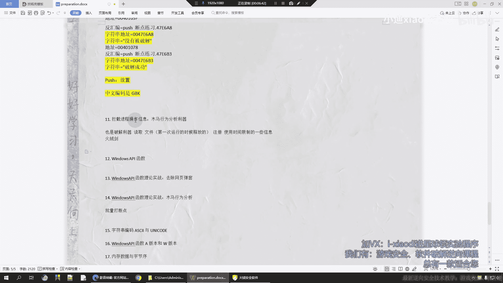

# 🧭 小白软件破解逆向工程师2023最新：3.11：进程运行启动信息拦截分析——木马、注册文件分析利器

在本节课中我们将要学习第十一课的内容，主题是拦截进程操作信息，并用它来做木马行为分析。这个能力同时也是破解分析中的实用工具。学习这一节不需要一开始就记住所有事件名称，重点是把操作流程跑通：先选目标程序，再开启监控，最后查看程序运行时产生了哪些事件。下面会先说明一个常见场景，再介绍火绒剑的使用方法，最后通过普通程序和加壳程序做一次对比观察。


## 🎬 小白软件破解逆向工程师2023最新：3.11.1：问题场景与读取释放文件

上一节概述了本节课要完成的目标，本节中我们来看看软件运行时读取释放文件的具体场景。可以构想这样一个场景：有一些软件在运行时，会读取本地的一个文件，而这个文件是它已经释放过的。这个文件可能保存着注册信息，也可能保存着使用时间限制信息。软件在第一次运行或者安装、运行的时候释放出这个文件，然后在后期运行时把这个文件读出来，再从中读取注册信息和使用时间限制信息。

如果程序存在这样的行为，我们就要分析它到底做了什么。我们需要定位它读取的是哪个文件，也需要知道它执行了哪些操作，也就是所有做过的事情。想知道这些内容，就需要拦截这个软件的操作信息。这里可以用公式描述分析目标：

```text
目标行为 = 读取(程序释放过的文件) → 提取(注册信息 + 使用时间限制)

分析目标 = 定位(程序读取的文件路径) + 记录(程序执行的全部操作)
```

## 🛠️ 小白软件破解逆向工程师2023最新：3.11.2：工具准备与路径过滤

上一节我们说明了要拦截程序操作信息，本节中我们来看看具体使用什么工具。拦截操作的方法很简单，使用火绒剑。火绒是一个杀毒软件，火绒剑是火绒其中的一个工具。这个杀毒软件非常轻巧，可以直接下载，平时可以不用它，但可以使用它里面的安全工具。打开火绒后，点击安全工具里的火绒剑，火绒剑属于高级工具，点一下就会启动出来。

启动火绒剑之后，如果要监控一些信息，就点击过滤，再勾选路径过滤。路径过滤的作用是只监控指定路径的程序，避免无关程序产生大量事件。找到需要监控的程序，例如要监控断点练习，就先确认它所在的文件夹，然后点击添加，填入断点练习的 EXE 文件，再点击确定。这里可以用代码描述工具入口和过滤条件：

```text
工具入口 = 火绒 → 安全工具 → 火绒剑

监控条件 = 路径过滤(目标程序.exe)
```

## ▶️ 小白软件破解逆向工程师2023最新：3.11.3：开始监控与进程创建事件

上一节完成了火绒剑和路径过滤的设置，本节中我们来看看如何开始监控并观察事件。先把这个软件关掉，再点击开始监控。因为程序还没有运行，所以现在没有任何事件。接着运行断点练习，程序一启动，它做的事情立刻就会显示出来。由于这个程序没有执行其他操作，所以我们只监控到了这些行为。


在这些行为中，`EXEcreate` 表示进程创建，这个事件归属于目标程序自身。其他事件是阿里巴巴相关程序从外部对它的一些调用，阿里巴巴的一些程序会从外部调用一些内容。监控过程中可以点击停止监控，也可以点击清空按钮，也就是停止和清空两个按钮。因为这个程序没有做任何额外操作，所以监控不到更多内容，可以点击停止监控。

> 提示：监控前先关闭目标程序，开始监控后再运行目标程序，这样更容易看清启动阶段的行为。

核心事件含义如下：

```text
EXEcreate = 进程创建事件

归属行为 = 目标程序自身创建进程

外部调用 = 其他程序从外部发起的调用
```

## 🧪 小白软件破解逆向工程师2023最新：3.11.4：换程序测试与加壳程序行为差异

上一节用断点练习观察了进程创建事件，本节中我们来看看换用其他程序后的监控结果。可以换一些程序，例如从 MFC 程序换到 GMP 程序，也可以查看加壳程序，例如选择带 VMP、SE 之类壳的程序来测试。点击路径过滤，对过滤条件进行修改，把路径过滤中的程序名改成目标程序，再点击确定。然后开始监控并运行程序，程序运行起来后，简单查看事件列表。

可以看到计时、`fopen` 等事件，加壳程序会多一些内容，它的确会多一些内容。打开文件相关事件会多一些，加壳程序不够干净，就是这种情况。因为我们这些程序没有执行特别的操作，所以在监控时没有看到很特殊的行为。这里可以用公式概括加壳程序的常见差异：

```text
加壳程序行为集 ⊃ 普通程序行为集

fopen = 文件打开事件
```

## 📌 小白软件破解逆向工程师2023最新：3.11.5：课后练习与课程总结


上一节我们对比了普通程序和加壳程序的监控结果，本节中我们对本次课程做总结。今天的内容就是拦截进程操作信息并观察程序行为。回去之后可以下载火绒，打开火绒剑，随便选一些程序做测试，查看它们的操作信息。以下是课后可以自己动手练习的步骤。

1. 下载并安装火绒，打开安全工具中的火绒剑。


2. 点击过滤，勾选路径过滤，添加要观察的目标程序。

3. 关闭目标程序，点击开始监控，再运行目标程序。


4. 查看事件列表，重点观察进程创建、文件打开等行为。

5. 停止监控并清空记录，换一个加壳程序重复测试。



按照这些步骤多试几个程序，就能逐渐熟悉火绒剑的监控方式，也能更直观地看到程序启动时执行了哪些操作。本节课中我们一起学习了程序读取释放文件的场景、用火绒剑设置路径过滤、开始监控并观察 `EXEcreate` 进程创建事件、换用加壳程序测试行为差异，以及课后练习的操作流程。本次课程到此结束，下期再见。

