# 🧩 小白软件破解逆向工程师2023最新：3.12：Windows API函数详解

## 🧭 概述

在本节课中我们将要学习第十二课的内容，也就是Windows API函数。Windows API函数看起来是一个比较专业的概念，只要把它拆开来看，就会变得通俗易懂。本节课会先解释Windows是什么，再解释API是什么，然后通过一个程序例子观察这些函数是怎么被调用的，最后说明这些知识对软件破解和逆向分析有什么帮助。对于初学者来说，这一节不需要一开始就记住很多代码细节，重点是把“微软提供接口，程序通过接口完成操作”这个思路理解清楚。

上一节我们先把Windows这个概念拆开来看，本节中我们来看看API到底是什么，以及它为什么会和Windows放在一起。

## 🪟 Windows是什么

Windows是一个微软的操作系统。比如当前运行的操作系统就是微软的Windows 10。大家应该也知道Windows 7、Windows XP、Windows 8，现在常见的是Windows 10，最新还有Windows 11。这些系统都是微软的操作系统，本质上都是一种操作系统。理解这一点很重要，因为后面讲的Windows API，正是建立在微软操作系统这个基础之上的。也就是说，程序运行在Windows上，很多操作都要按照Windows提供的规则来完成。

讲完Windows这个基础概念之后，接下来就要看API是什么，以及为什么API要和Windows放在一起讲。

## 🧱 API是什么

API实际上是英文首字母的缩写，全称是Application Programming Interface，也就是应用程序编程接口。可以把它理解成微软操作系统提供的一些接口，允许程序员或者开发人员去调用。比如微软提供了一个删除文件的接口，程序只有通过这个接口才能删除文件；微软也提供了打开网页的接口，程序只有通过这个接口才能打开网页。程序不能随随便便删除文件，微软不允许这样做；程序也不能随随便便打开网页，微软同样不允许这样做，必须使用它提供的接口。

可以用一个类比来理解这件事。中国在芯片制造上会遇到困难，一些高级设备比如光刻机很关键，要造芯片就得使用别人的光刻机。原因在于对方有专利和技术，不把技术提供出来，自己没有其他办法。Windows上的情况类似，程序员要在Windows上删除文件或者打开网页，也不能随便操作，因为相关能力掌握在微软手里。微软只提供一个接口，至于这个接口内部怎么实现，并不会告诉开发者。打开网页也是这样，微软提供接口，但不说明内部实现。

因此，Windows API可以这样理解：Windows API是微软这家公司提供的操作系统中的能力，具体表现为预先定义好的一些东西、一些函数和接口，这些接口可以叫做接口函数。它的目的是让应用程序和开发人员能够基于软件或硬件访问一组例程的能力。换句话说，微软赋予程序删除文件的能力，微软赋予程序打开网页的能力，并不是程序自己天生就具备这些能力，而是微软把这些能力提供给程序。在微软操作系统上，几乎一切操作都受到它的管控，都需要遵循它的规矩。接口也可以理解为规矩，程序必须按照这个规矩来。

可以用下面的公式来概括核心概念：

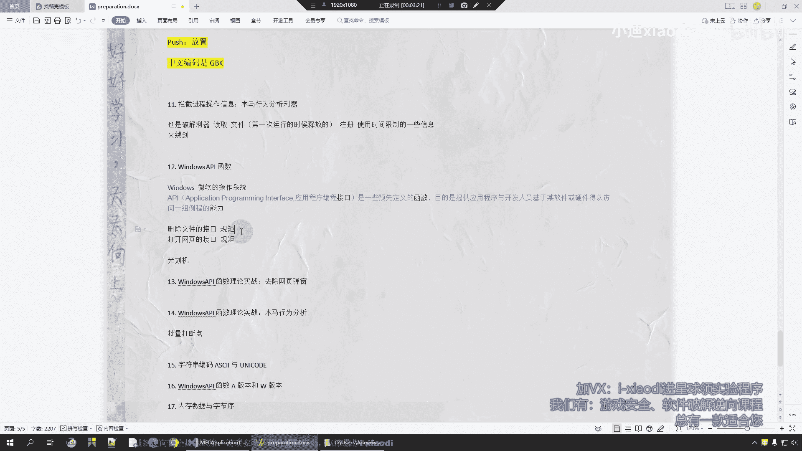

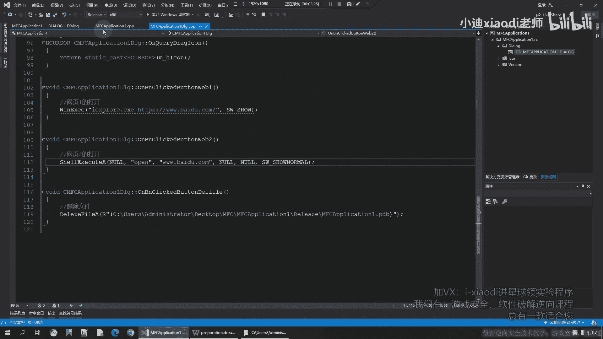

```
API = Application Programming Interface = 应用程序编程接口

Windows API = 微软操作系统预先定义好、供程序调用的接口函数集合
```

接口可以理解为规矩，程序必须按照这个规矩来。

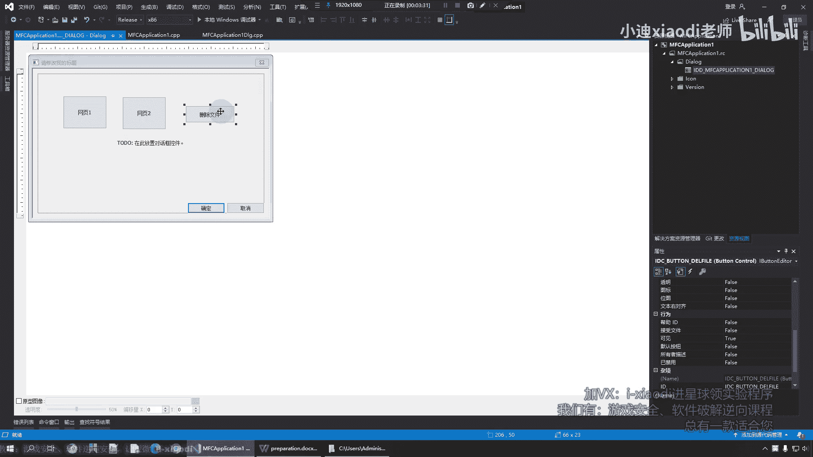

## 💻 程序例子：打开网页和删除文件

前面解释了Windows和API的基本概念，本节中我们来看一个程序例子。大家现在可能还不懂代码，大概了解即可，不需要一开始就掌握代码细节。这个程序写了三个功能：打开网页一、打开网页二、删除文件。观察它的实现会发现，打开网页的时候，代码里调用了一个东西，这个东西就是函数。打开网页二的时候，也是调用一个函数，这个函数也是Windows API函数。删除文件的时候，比如一个木马，或者写一个杀毒软件要删除一个木马，删除文件同样调用了Windows API函数。因此在微软操作系统上，基本上所有这类操作能力都是微软赋予给程序的。

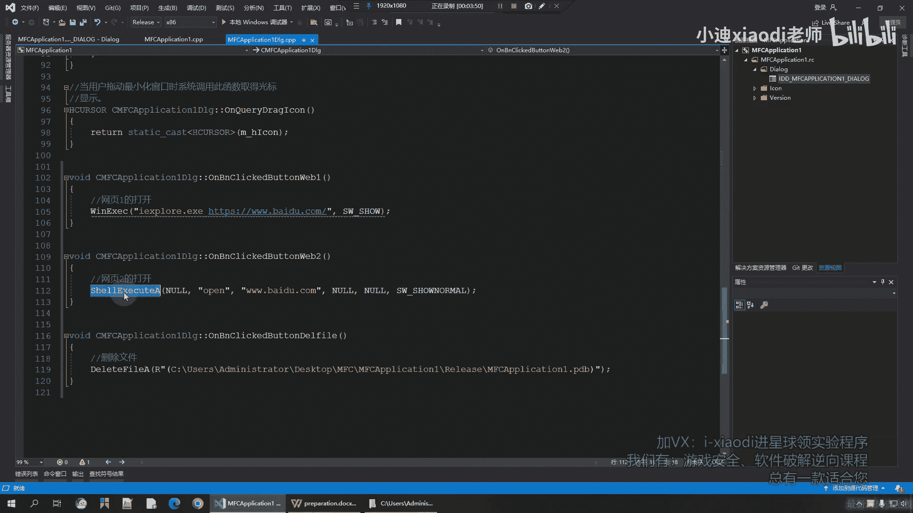

下面用伪代码展示前面程序里三个功能与函数调用之间的关系，方便初学者理解：

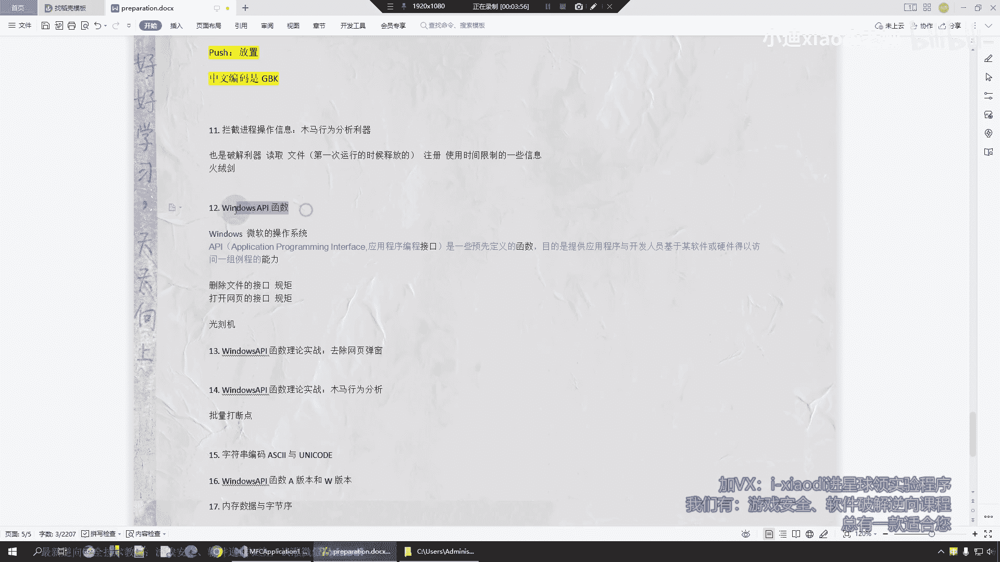

```
打开网页一 -> 调用某个 Windows API 函数

打开网页二 -> 调用某个 Windows API 函数

删除文件   -> 调用某个 Windows API 函数
```

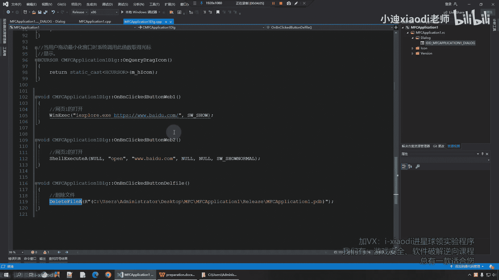

这个程序可以运行起来。先看删除文件，要删除的文件是MFC application.pdb，现在这个文件夹里还有1个PDB文件。点击删除文件，程序使用的是微软赋予的能力来删除这个文件。点击之后，这个文件就没有了，这就是微软给予程序的能力。如果要删除文件，就绕不过这一环。再打开网页试一下，打开百度，打开网页二，也打开了。这两个打开网页以及这个删除文件，全部都是微软赋予程序的能力。因此在微软上进行一些操作，都跑不了这一环。这个现象不仅说明API的存在，也为后面的逆向分析提供了一个很直接的观察入口。


## 🔍 对逆向分析和破解的意义

上一节通过程序例子看到了功能背后会调用Windows API函数，本节中我们来看看这个规律对破解和逆向分析有什么帮助。这个特点给破解和逆向分析带来了一些便利性。如果一个软件具备某些功能，就可以猜测它使用了哪方面的能力，也就意味着可以推测它调用了哪一个或者哪一类Windows API函数。删除文件有删除文件的函数，打开网页有打开网页的函数。因此可以根据函数推断目标程序使用的Windows API函数，然后进行定位，再进行破解。破解的方式可以是改跳转、NOP等，或者更改程序执行的一些流程。这就是一个基本的理论思路。

可以用下面的公式概括这个分析流程：


```
软件功能 -> 推测 Windows API 类别 -> 定位调用点 -> 破解（改跳转 / NOP / 改执行流程）
```

在这个思路中，常见的破解方式包括以下几种，下面列出这些方式，方便初学者先有一个大概印象：

- 改跳转：修改程序跳转逻辑，让程序走向发生变化。

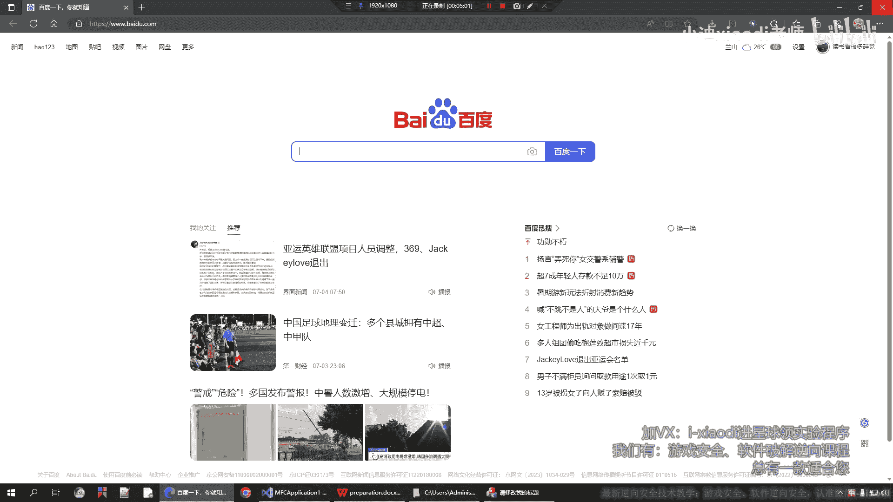

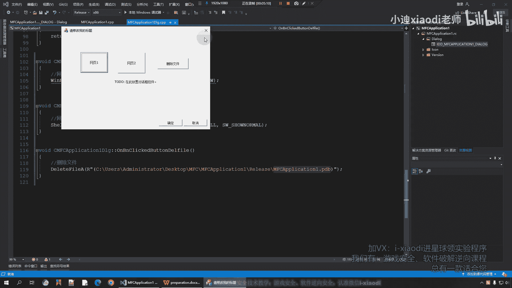

- NOP：把某些指令替换成空操作，让相关功能不再按原逻辑执行。

- 更改程序执行流程：调整程序执行顺序或分支，让目标功能失效或改变。

## 🧪 应用：去除网页弹窗和拦截删除

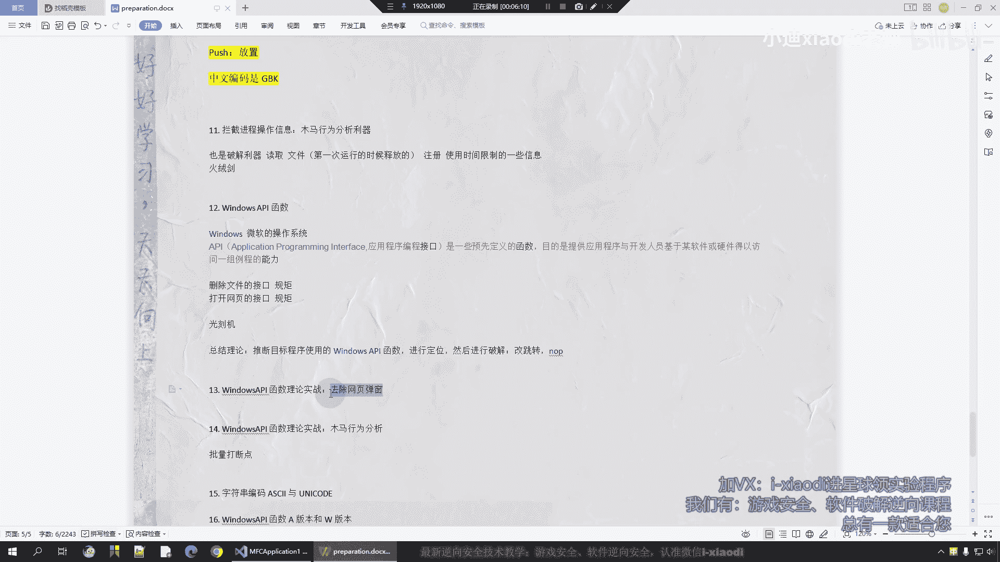

得到前面的理论总结之后，就可以做进一步操作，比如去除网页弹窗。刚才那个程序是不是有弹窗，再运行一遍，打开网页一，会出现一个弹窗或者一个网页，就可以去掉这个网页。打开网页二，也会出现一个网页，同样可以去掉这个网页。删除文件功能也可以处理，可以拦截它删除文件，让这个删除文件功能失效。由此可以看出，了解这些内容之后，就可以更改程序，让程序里的函数失效。甚至可以删除别的文件：本来它是删除那个文件，更改之后可以让它删除别的文件；本来它是打开这个网页，也可以让它打开你的网页。因此这是一个非常灵活的东西。只要了解了微软这个程序执行的本质，就可以进行比较灵活的操作。

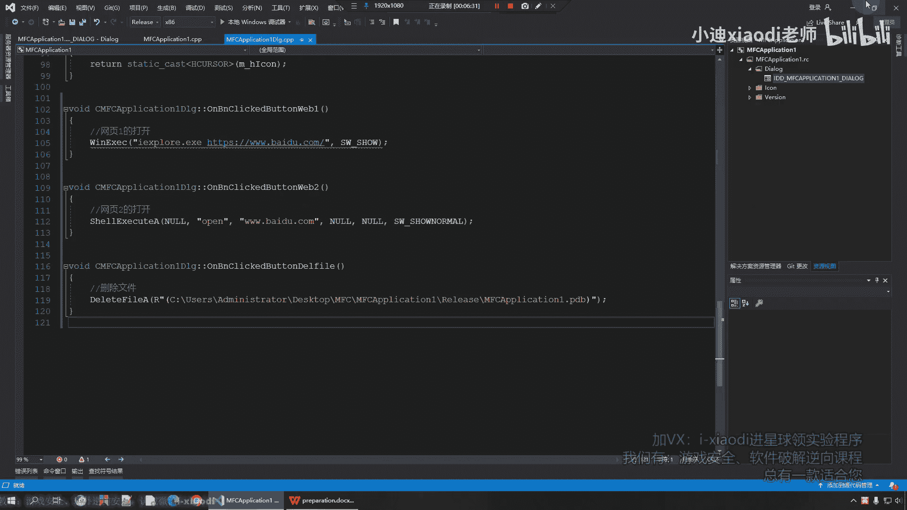

下面列出基于上述思路可以尝试的几类操作，这些操作都建立在前面“定位Windows API函数调用”的基础上：

- 去除网页弹窗：让程序不再打开原来的网页或弹窗。

- 让删除文件失效：拦截删除动作，使原本的删除功能不起作用。

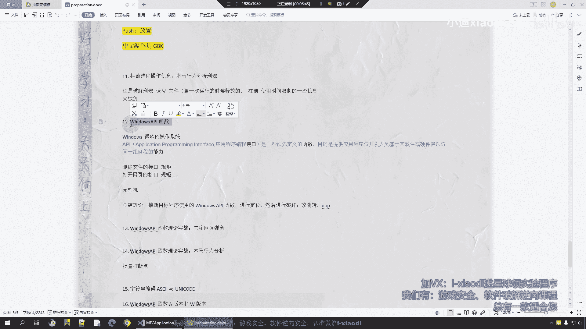

- 更改删除对象：把原本要删除的文件改成别的文件。

- 更改打开网页地址：把原本打开的网页改成你指定的网页。

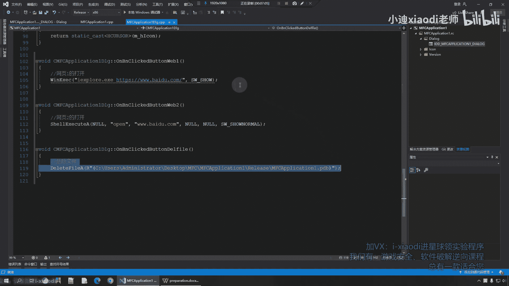

## 📌 总结

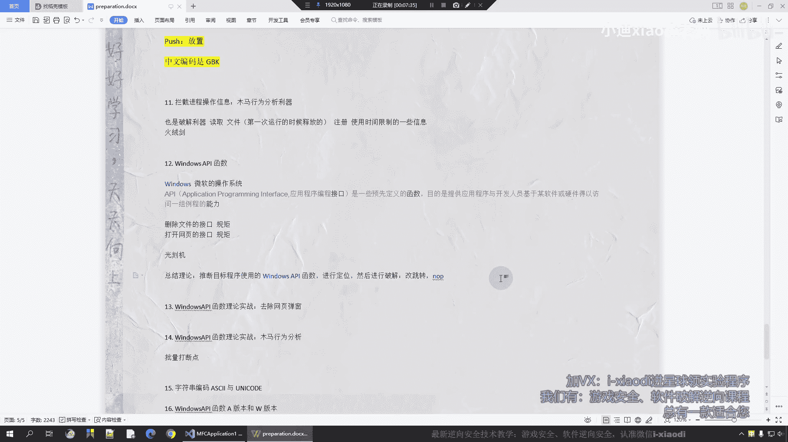

本节课中我们一起学习了Windows API函数的基本概念。Windows是微软的操作系统，API是应用程序编程接口，Windows API就是微软操作系统预先定义好、供程序调用的接口函数集合。程序删除文件、打开网页等操作，背后通常都要调用Windows API函数。通过程序例子可以看到，这些能力都是微软赋予程序的。理解这一点之后，就可以根据软件功能推测它使用的Windows API函数，进而定位调用点，再进行改跳转、NOP或者更改执行流程等破解操作。回去之后，懂编程的可以自己写一些程序练习，不懂编程的可以多看两遍本节课，也可以百度一下Windows API函数，知道它是微软赋予程序员的一种能力，并且必须遵循它的规矩。下期再见。

