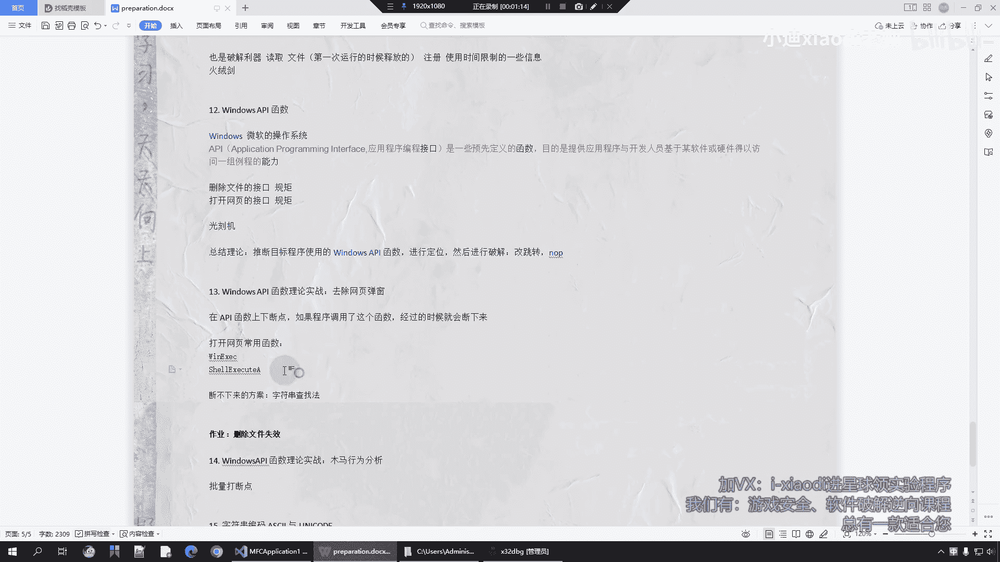
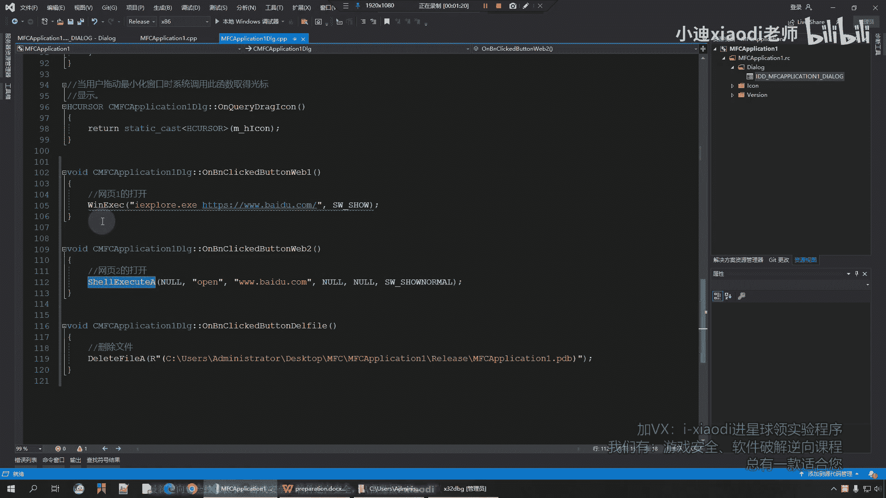
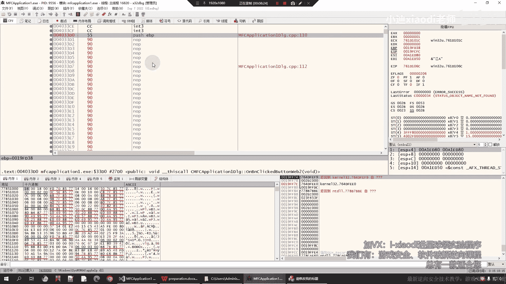
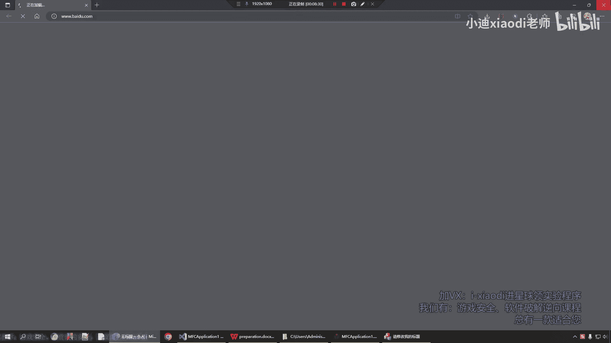
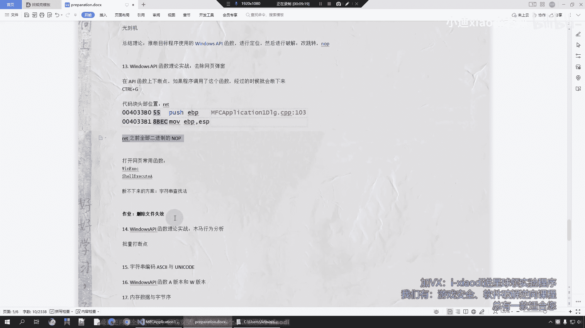
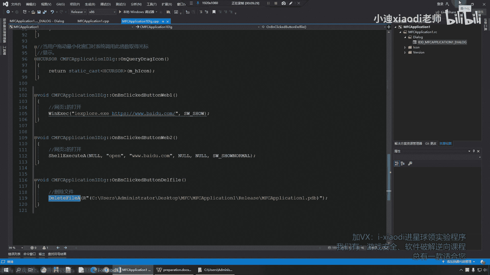
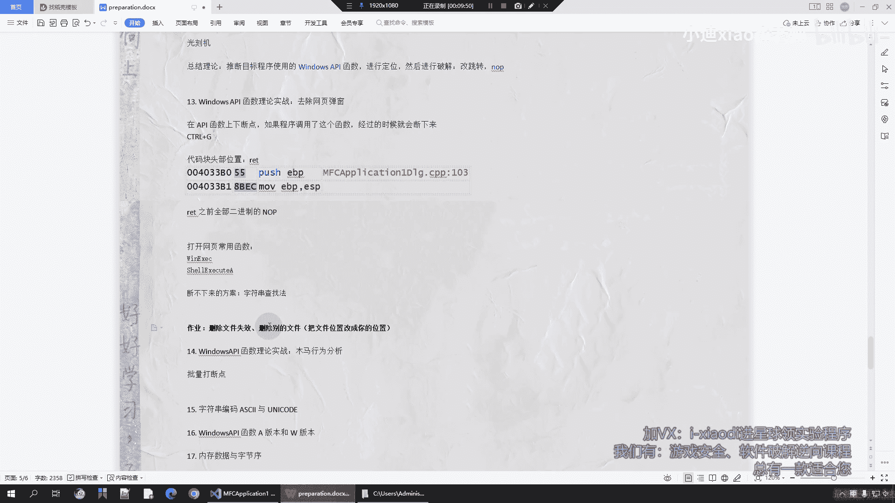

# 🧭 小白软件破解逆向工程师2023最新：3.13：Windows API函数理论实战——去除网页弹窗（BV19F411R7f8）

在本节课中，我们将要学习Windows API函数理论实战中的去除网页弹窗。上一节课我们总结了一个理论：先推断目标程序使用了哪个Windows API函数，然后进行定位，最后进行破解。本节我们就把这个理论落到实际操作中，看看怎样在API函数上下断点、怎样观察程序调用位置，以及怎样用两种常见方案让网页弹窗失效。整个流程并不复杂，核心就是让程序在关键位置停住，然后再修改它的执行逻辑。

为了先建立整体印象，可以把本节的核心流程概括成下面的公式：

```text
去除网页弹窗流程 = 推断 Windows API 函数 → 定位调用位置 → 下断点 → 修改执行逻辑

断点 = 程序执行到指定位置时暂停的点
```

接下来我们先从断点这个概念讲起，因为后面的定位和破解都要围绕断点展开。





## 🧩 小白软件破解逆向工程师2023最新：3.13.1：断点是什么——程序暂停的“邂逅点”

上一节我们提到了API函数定位，本节先来解释断点。去除网页弹窗的具体流程，实际上就是在API函数上面下断点。什么是断点？断点就是暂停的点，是让程序暂停的点。如果程序执行到这个位置，并且程序调用了这个函数，那么它就会断下来；简单点说，程序经过这个位置时就会停下来，这个停下来的点就是断点。

原文用了一个直白的比喻：你在大街上和一位美女相遇，在那个相遇的点你停住了，看一眼觉得漂亮，然后停下来的那个点就是断点。只有你经过那个位置并停下来，那个点才叫断点，也可以理解为一次邂逅的“桃花点”。这个比喻虽然生活化，但意思很明确：断点不是随便一个位置，而是程序经过并暂停的那个关键位置。理解了这个概念，后面在API函数上下断点就不会觉得抽象。

了解了断点是什么以后，本节我们来看看Windows中打开网页常用的API函数有哪些。

## 🧩 小白软件破解逆向工程师2023最新：3.13.2：打开网页常用的两个Windows API函数

前面我们知道了断点是程序暂停的位置，本节要认识打开网页常用的函数。Windows API函数中，打开网页常用的函数可以先简单了解两个，这两个也是程序里会用到的函数。原文口语中提到了类似“SQA”的写法，结合后面的操作，可以理解为`ShellExecuteA`这一类函数。以下是本节课会用到的两个常用API函数：

- `WinExec`

- `ShellExecuteA`（原文口语中类似“SQA”）

这两个函数先认识即可，下面我们会分别试一下，看看程序经过它们时是怎样断下来的，熟悉一下断点触发的效果。认识函数只是第一步，真正要掌握的是怎样在调试工具里找到它们并下断点。

在认识常用函数之后，本节我们来看看工具准备和实际操作环境，因为后面的步骤都要在调试工具里完成。

## 🧩 小白软件破解逆向工程师2023最新：3.13.3：工具准备与程序加载

上一节我们认识了打开网页常用的API函数，本节先准备工具和程序。首先拿到这个程序，然后打开我们的工具，这个工具放在知识星球里。如果大家想要获取这个工具，可以联系我的微信，加入我们的学习社区；学习社区目前仅售68元，预计更新200个时，工具包全部提供，所以这是一个非常优惠、非常实在的内容。我们已经讲了很多知识，工具和课程内容都会持续提供，方便大家跟着练习。

准备好工具以后，把程序拖进来，拖进来运行就可以了。程序加载并运行起来以后，就可以进入下一步：在API函数上下断点。这个过程看起来简单，但每一步都要确认状态，否则后面观察调用位置时容易混乱。

程序运行起来以后，本节我们来看看怎样在API函数上下断点，并观察程序断下来后的调用位置。

## 🧩 小白软件破解逆向工程师2023最新：3.13.4：在API函数上下断点并定位调用位置

前面我们准备好了程序和工具，本节进入核心操作。怎么下断点？怎么在函数上下断点？方法很简单，按`Ctrl + G`。按下`Ctrl + G`以后，输入API的名字，比如先输入`WinExec`，然后点击确定。到这里以后，按`F2`下一个断点；下了断点之后，断点会显示为红色。可以来回切换一下，左下角会显示“断点已删除”“断点设置”等状态，看到这些状态就说明断点操作生效了。

设置好断点之后，点击网页一。当程序经过这个位置时，也就是前面比喻中“美女经过这边”的时候，程序经过这一条时就会断下来。断下来之后，会发现这里有一个“返回到”的信息，可以直接按回车过去。此时可以先放开断点，然后返回；返回后可以看到这里就是它调用的一个位置。接着运行程序，程序就跑起来了，说明它是从这边执行的。

往这边拉一下，可以看到`3W点百度点com`。这时可以发现，程序实际上把这个网址放在这里。可以鼠标右键选择“内存窗口转到”，这里就是网址。这个网址可以清空，也可以改成自己的网址。网址所在位置的代码会执行，那么怎样让它不执行？下面教两种方案。第一种方案是先了解直接在头部写`ret`。`ret`的意思是返回，表示这个程序结束了，也就是这个函数、这块代码结束了。直接在头部`ret`，直接在最顶层`ret`，它就不执行了。点一下网页，可以看到网页弹窗失效了。

第二种破解方法要先恢复一下，恢复选区。以前是这样子的：注意`push ebp`、`mov ebp, esp`，这是一个非常典型的代码块头部；后面我们会说栈平衡等内容，这里先暂时了解，这是一个代码块头部位置。头部位置做什么？写`ret`就可以。要注意，这边是`ret`，我们就写`ret`；它有可能在`ret`后边加别的东西，比如`ret4`、`ret2`之类，现在它是`ret`，所以先填一个`ret`，跟着实验程序先来。这些堆栈内容涉及栈平衡，后面再说；先按头部`ret`操作。看到`push ebp`、`mov ebp, esp`这种非常典型的代码块头部后，就照葫芦画瓢，在这样一个位置选择第一条第一行，双击，回空格，输入`ret`就可以了。这是第一种方式。

第二种方式也很简单：给它通通处理掉，从`ret`之前全部把二进制用`nop`填充，确定。这样原来的指令全没了，只剩下一个`ret`，也可以让弹窗失效。这样处理更干净，两种方式都行。顾名思义，也就是照葫芦画瓢，根据代码块头部和返回指令去修改。

定位到调用位置以后，本节我们继续看网页二对应的`ShellExecuteA`函数，并验证第二种破解方案的细节。

## 🧩 小白软件破解逆向工程师2023最新：3.13.5：网页二与ShellExecuteA函数的处理

上一节我们在网页一上验证了`ret`和`nop`填充的思路，本节换到网页二。网页二调用的是`ShellExecuteA`函数，跳过去，确认对应“SQA”这类写法，确定过来。然后按`F2`打一个断点，点一下网页，可以看到程序断下来了。先把断点放开，因为待会儿还要运行程序；让它先断着，然后双击过来。过来以后可以看到`3W点百度点com`，运行一下程序，默认情况下弹窗就弹出来了。

接下来怎么办呢？第一种方法看`ret`：它是`ret`，代码块头部也是`ret`，直接在头部`ret`。试一下，点一下网页，可以看到弹窗失效了，效果符合预期。我们先恢复一下选区。第二种破解方案是直接从头到尾，在`ret`之前鼠标右键选择二进制，用`nop`填充，确定后粗略看一下，弹窗也没了。这里一度怀疑是不是把程序关掉了，于是重新打开`ShellExecuteA`相关流程，过来下断点，断下来后按`F2`，双击过来，然后把全部二进制用`nop`填充，再运行程序。结果程序好像坏掉了，说明这个方案在当前情况下好像不行，那就换一个方案。

如果直接全部用`nop`填充导致程序异常，就说明修改范围不能随意扩大，需要根据程序实际结构选择更稳妥的方式。到这里，网页二的处理也验证了：头部`ret`是可行方案之一，而`nop`填充方案要看具体位置和范围。

如果在两个函数上都断不下来，本节我们来看看字符串查找法，这是一种备用定位思路。

## 🧩 小白软件破解逆向工程师2023最新：3.13.6：断不下来时使用字符串查找法

前面我们尝试了`WinExec`和`ShellExecuteA`两个函数，本节处理一种情况：如果大家在这两个函数上下断点都断不下来，怎么办？它有可能用了其他方案去打开网页。这时候可以使用字符串查找法：打开字符串查找，范围选择所有模块、所有用户模块字符串，然后查找`3W点百度点com`。可以看到百度网址就在这里，这里就是那个位置，也就是需要关注的位置。



刚才发现直接全部进行清空是出问题的，于是再来一遍，看一下会不会出问题。这一次没有问题，说明刚才应该是断点连打导致的，这会儿没有问题。弹窗失效了，可以看到效果。然后恢复一下原序，全部恢复一下，恢复选区。程序是没问题的，这个破解方案也是没问题的。接着再验证头部`ret`，应该是断点连打导致的，这次网页也失效了。所以这就是两个方案：一个是在代码块头部写`ret`，另一个是在`ret`之前全部用二进制`nop`填充。两个方案都要根据程序实际情况选择。如果函数断不下来，就用字符串查找法去定位网址，再结合前面的修改思路处理。



到这里，本节的主要操作已经完成，下面留一个作业，用来巩固删除文件相关API的修改思路。

## 🧩 小白软件破解逆向工程师2023最新：3.13.7：作业与扩展练习

上一节我们处理了网页弹窗，本节留一个作业。今天回去给大家留一个作业：让删除文件失效。这个删除文件的API是`DeleteFileA`，自己回去弄一下。以下是本节可以尝试的练习方向：

- 使用`DeleteFileA`，让删除文件功能失效，完成基础作业。

- 如果有精力，可以尝试删除别的文件，把目录改掉，把文件位置改掉，把文件位置改成你的位置。





- 体会自定义修改的灵活性，破解本身是非常灵活的东西，基本上可以DIY程序。

这些练习的目的不是死记步骤，而是多动手尝试。只要理解了API函数定位、断点和修改执行逻辑这条主线，就可以根据程序的不同情况灵活变通。



## 🧩 小白软件破解逆向工程师2023最新：3.13.8：本节总结

本节课中我们一起学习了Windows API函数理论实战中的去除网页弹窗。我们先理解了断点就是程序执行到指定位置时暂停的点；然后认识了打开网页常用的`WinExec`和`ShellExecuteA`函数；接着用`Ctrl + G`定位函数、用`F2`下断点，并通过点击网页观察程序断下来后的调用位置；随后验证了两种破解方案：一种是在代码块头部写`ret`，另一种是在`ret`之前全部用二进制`nop`填充；如果两个函数都断不下来，还可以用字符串查找法定位`3W点百度点com`。最后我们留了`DeleteFileA`的作业，并鼓励大家改目录、改文件位置，多动手尝试。本节内容到这里结束，下期再见。

