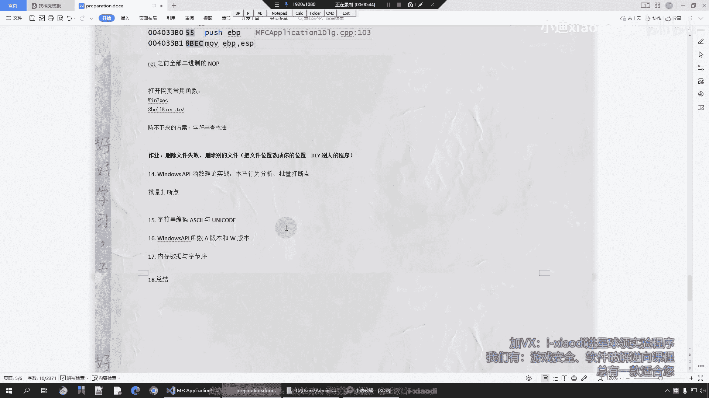
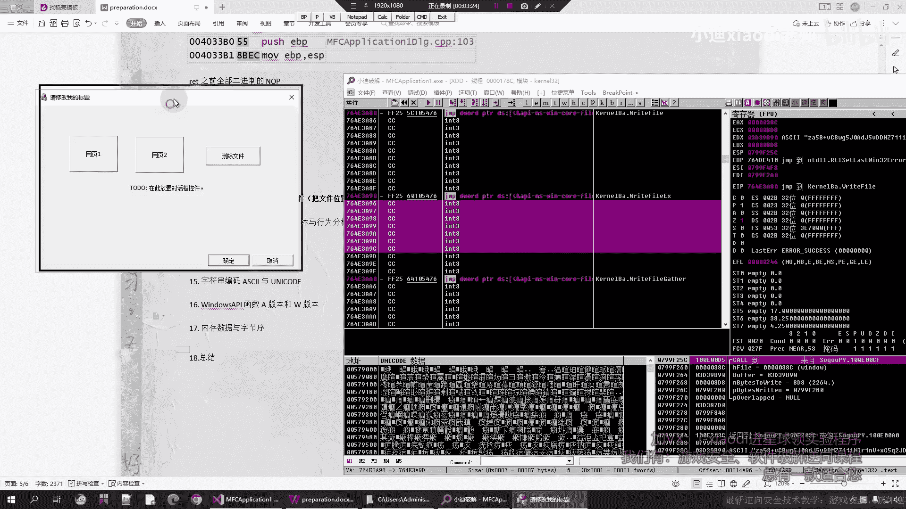
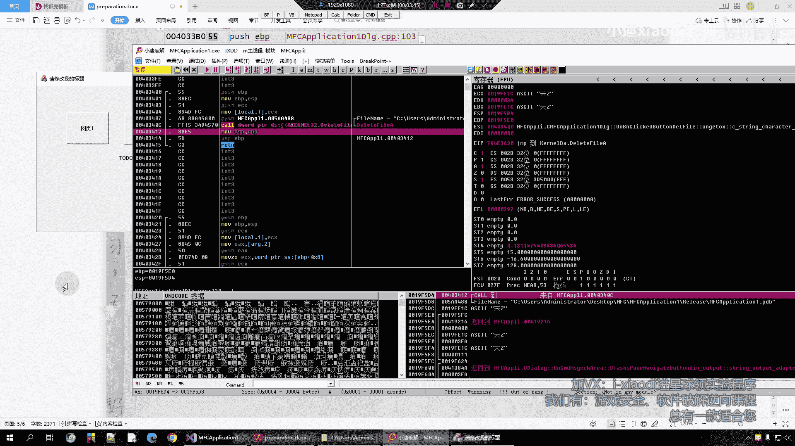
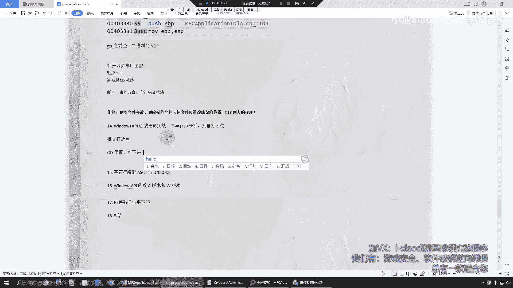
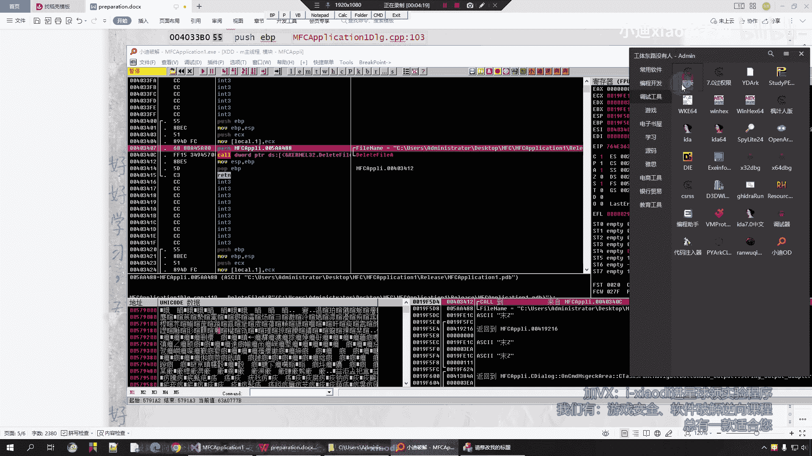
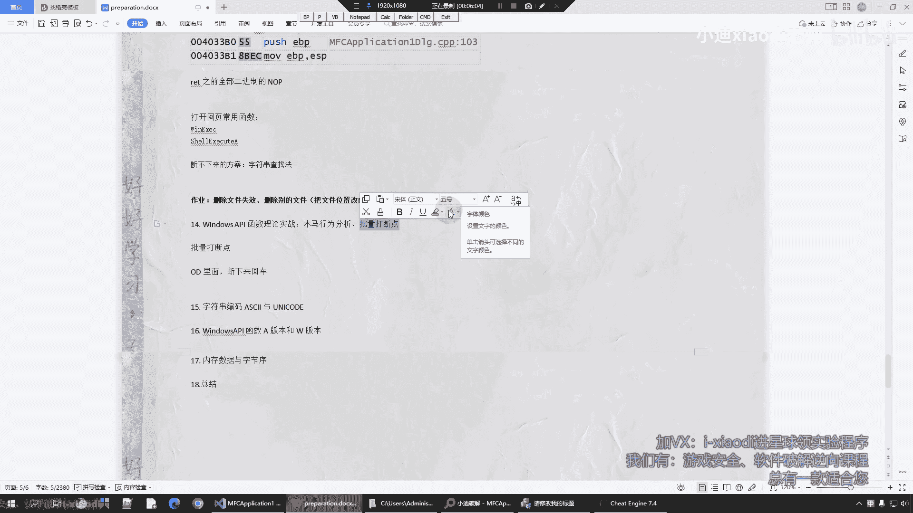
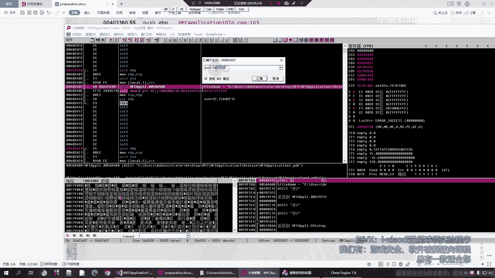
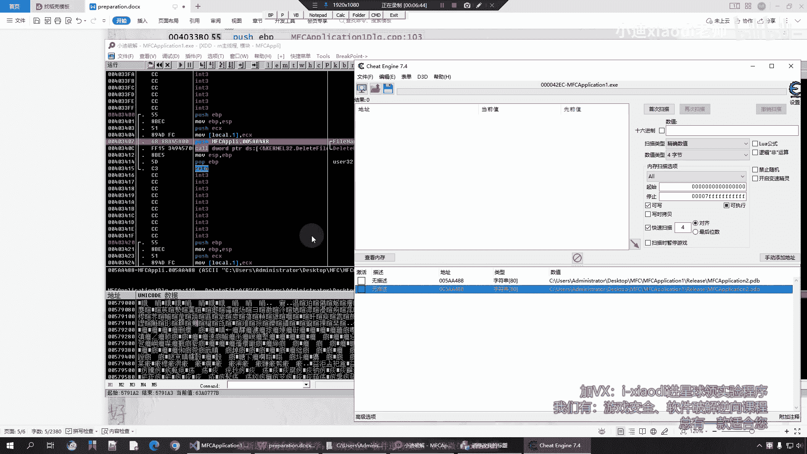
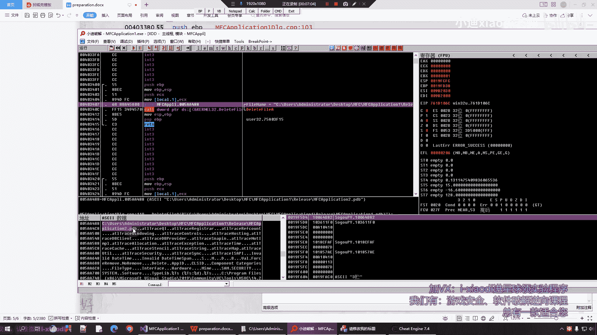
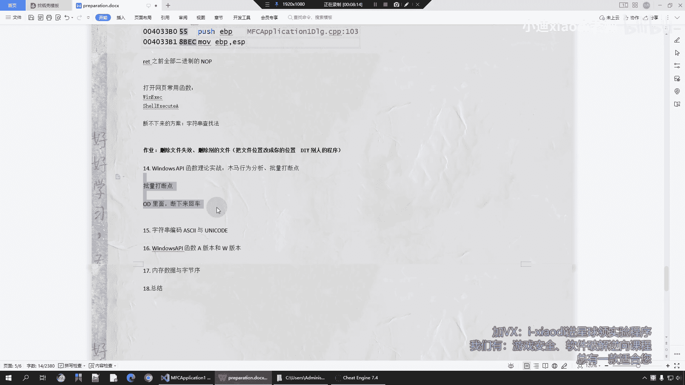

# 🧰 小白软件破解逆向工程师2023最新：3.14：Windows API函数理论实战——木马行为分析与批量断点

## 📌 小白软件破解逆向工程师2023最新：3.14.1：本节概述

在本节课中我们将要学习Windows API函数理论在实战中的用法，重点包括木马行为分析、批量打断点，以及如何DIY目标程序。学习目标很直接：拿到一个程序、一个木马，或者一个需要破解的软件时，即使一时不知道它到底调用了哪些Windows API函数，也能通过批量下断点的方式，把程序运行过程中经过的关键API拦下来，再根据断点命中的位置分析行为，修改数据，甚至保存一个修改版程序。

这里先给出本节的核心思路公式，方便初学者建立整体框架：

`未知程序行为 -> 批量API断点 -> 命中关键调用 -> 分析参数与调用栈 -> 修改数据/DIY -> 保存可执行文件`

上一段把整体路线搭起来了，本节我们来看看为什么需要批量打断点。理解这个原因后，后面的工具操作和案例分析会更容易看懂。

## 🧭 小白软件破解逆向工程师2023最新：3.14.2：为什么需要批量打断点

在概述之后，本节我们来看看批量打断点的必要性。拿到一个程序、木马，或者要破解的软件时，基于你的理论知识覆盖范围，或者说你的经验积累，可能比较少。你一下子不知道这个程序到底用了哪些函数，也不知道它到底用了哪些Windows API函数。这些程序都要调用Windows API函数，运行过程中都要经过这些API。经过的时候就会断下来，但具体经过哪一个API并不清楚，所以就要批量打断点。



这就像人海战术，是日常逆向分析中正常会用的方法。核心概念可以用公式描述：

`程序运行 = 调用一系列Windows API`

`批量断点 = 在多个API入口设置断点，等待程序命中`

明白了为什么要用批量断点后，接下来需要准备工具和目标程序。下面先介绍本节演示会用到的工具，以及目标程序运行后的基本现象。

## 🧰 小白软件破解逆向工程师2023最新：3.14.3：工具准备与目标程序

上一节说明了批量断点的作用，本节我们来看看具体用什么工具来演示。今天用到的工具是小DOD，原因是它里面有一个很实用的插件，叫做API断点设置工具，其中包含常用断点设置。今天就用这个工具来演示批量断点的操作。

以下是本节用到的工具和目标程序的基本情况，先有个整体认识：

- 工具：小DOD，配合API断点设置工具中的常用断点设置功能。

- 目标程序：把程序拖进来，拖入之后运行。

- 运行后可以看到提示内容：请修改我的标题，网页一、网页二、删除文件。

工具和目标程序准备好后，下一步就是打开插件并设置常用API断点。下面进入具体操作。

## 🧩 小白软件破解逆向工程师2023最新：3.14.4：常用API断点设置

上一节准备好了工具和目标程序，本节我们来看看如何在小DOD中设置常用API断点。操作路径是点击插件，点击API断点设置工具，再点击常用断点设置。打开之后会看到多种函数分类，这些分类覆盖了程序常见行为，方便我们在不知道具体API时先批量下断点。


以下是常用断点面板中常见的函数类别，原文中列举的内容可以整理为：

- 对话框函数。

- 限制程序功能函数，例如限制窗口显示、限制菜单等。

- 文件处理函数，例如删除文件、打开文件、移动文件、写文件等各种文件操作函数。

- 注册表处理函数。

- 时间处理函数，例如取得系统时间，程序可能通过系统时间判断卡密是否过期。

- 进程函数，例如打开进程、打开外部程序、退出进程，以及各种退出原因相关函数。

- 磁盘处理函数，例如获取磁盘信息。



- 枚举目标等各类函数。

这些函数非常多。今天以一个为例，选择删除文件函数所在的文件处理函数。可以直接全选，然后点击确定。设置完成后，程序上来就会断下来。第一次断下来的可能是`open my`这类无关调用，没有实际作用，所以先把断点放开，按F2放开断点并运行。接着可能遇到`CreateFile`，但目标程序并没有打开文件，实际是搜狗拼音在起作用，搜狗输入法造成了干扰。把断点放开继续运行，`read`读文件也是搜狗拼音，继续去掉。月宵相关调用同样是搜狗拼音的月宵，也去掉。把这些因素去掉后，程序暂时没有异常断点。

这里要特别说明：程序断下来，不一定是目标程序本身产生的问题，可能是其他外部程序造成的。输入法可以渗透在每一个程序中，你可以在目标程序里输入内容，也可以在录像程序里输入内容，还可以在文档里输入内容，所以输入法经常是影响断点命中的因素。把所有干扰因素全部去掉，包括搜狗输入法的因素后，程序不再无故断下来。此时点击删除文件，可以看到程序断下来了，断下来后就把相关信息拦截下来，信息来源就是当前这个目标程序。



可以用伪代码描述这个过程：



```text
for api in 常用断点集合:
    在 api 入口设置断点

命中断点:
    查看调用来源与参数
    判断来源是否为目标程序
    如果是外部程序干扰，则放开断点继续运行
```

断点命中删除文件后，双击查看信息不一定方便，它和x64或x32版本还是有点区别，可以使用回退操作。回退在OD里就是回退，工具之间存在差异，回退之后就能回到调用位置。下面我们继续看命中删除文件后的参数分析。

## 🔍 小白软件破解逆向工程师2023最新：3.14.5：分析删除文件断点与参数地址

上一节通过批量断点拦到了删除文件调用，本节我们来看看断下来之后怎么分析。回退之后可以发现，程序正在执行删除文件操作，这一边就是删除文件的数据，程序`push`了这样一个数据，也就是把文件路径等参数压入栈中。这个数据可以用跳转的方式查看，例如按原文记录的`0X5V`跳转过去。也可以在CE里跳转，这里演示打开CE的方法。

以下是使用CE查看并修改这个字符串参数的操作步骤，适合初学者按顺序理解：



- 打开CE。这里使用的是自己电脑上的工具包，不是星球发的工具包，大家可以自己准备一个类似工具包，打开工具包中的工具即可。

- 打开目标进程，进程对应“请修改我的标题”。

- 手动添加地址，把刚才记录的地址添加进去。

- 勾选字符串，长度设置长一点，例如先给50，再点击确定。

- 可以直接在CE里修改这个字符串，也就是更改字串。

- 如果改成`ME`，长度可能不够，改成60仍然不够，设置到80后内容显示出来，可以看到它带有后缀，例如`MF乘1`这样的后缀。

- 把后缀改成`2`，或者改成其他文件名，然后点击确定。这里先把`PTB`相关路径改掉，再补一个`2`，把名字改成`2`。

- 原本要删除的是`1`，现在路径改成`2`，运行后删除的肯定就是`2`。

这一部分的核心概念可以写成：

`删除文件API参数 = push到栈中的文件路径字符串地址`


`修改路径 = 修改字符串内容 -> 改变API实际操作对象`

修改后运行程序，可以看到`2`没了，`1`还在，这说明路径已经被改掉。通过这种方式，我们就验证了批量断点拦截和参数修改的效果。接下来我们看看命中之后如何回到代码位置，并进行更灵活的DIY数据。

## 🛠️ 小白软件破解逆向工程师2023最新：3.14.6：人海战术与DIY数据


上一节通过CE修改字符串验证了删除路径可以被改变，本节我们来看看命中之后如何回到代码块并DIY数据。批量断点本质上就是人海战术：在你不知道程序用了什么API的时候，你的认知可能很有限，学的东西少，脑袋里没有足够信息，肚子里没有足够墨水，那就批量下断点，用数量覆盖不确定性。断下来之后，在右下角回车，就能看到当前位置，这里是代码块的头部。可以在头部右键，也可以全部二进制搜索，还可以自定义修改。



以下是命中删除文件API后定位和DIY数据的常见操作要点，方便把前面的操作串起来：

- 断点命中后，在右下角回车查看代码位置。

- 看到代码块头部后，可以在头部右键操作。

- 也可以使用全部二进制搜索的方式定位。



- 还可以自定义修改，例如打开CE，添加字符串，直接选择字符串，把长度改长一点，例如80。

- 修改字符串内容后，程序删除时就会删除别的东西，这样就实现了一种DIY数据。

用公式概括就是：



`DIY数据 = 定位API参数地址 + 修改字符串内容 + 让程序继续执行`

数据修改完成后，还可以保存这个程序。下面进入保存修改版程序的操作。

## 💾 小白软件破解逆向工程师2023最新：3.14.7：保存修改版程序与思路拓展

上一节实现了DIY数据，本节我们来看看如何把修改保存成新的程序。修改之后可以保存程序，先跳转到修改位置，在文本区域可以看到这是我们修改过的地方。然后复制到可执行文件，再进行保存文件，命名为修改版。原本是删除`1.pdb`，保存之后改成删除`2`，把相关名字改一下，改成`2`。回到修改版程序，点击删除文件，它会把`2`删除，不再删除`1`。运行验证可以看到，修改版确实删除了`2`。



以下是把修改保存成新程序的操作顺序，适合按步骤复盘：

- 定位刚才修改过的字符串位置。

- 复制到可执行文件。

- 保存文件，命名为修改版。

- 原本删除`1.pdb`，保存后改为删除`2`。

- 运行修改版，点击删除文件，验证删除对象发生变化。


这种思路可以用在多个领域，例如游戏外挂、游戏辅助、游戏逆向分析、软件破解，以及其他类似方案。伪造一个注册文件，让程序去读取，也是一样的思路。核心在于掌握学习逆向分析的思路，不要只是机械跟着练习，要先练后拓展，打通思路和任督二脉。

## ✅ 小白软件破解逆向工程师2023最新：3.14.8：本节总结

本节课中我们一起学习了Windows API函数理论实战中的木马行为分析、批量打断点和DIY目标程序。我们明确了批量断点的意义：不知道程序调用哪些API时，用常用断点设置覆盖文件、注册表、时间、进程、磁盘、枚举等函数类别，通过命中结果判断目标行为。我们还处理了外部程序干扰，尤其是输入法这类会渗透到多个程序中的因素。随后以删除文件函数为例，从断点命中、参数地址分析、CE修改字符串，到保存修改版程序，完整走了一遍流程。

最后用一组核心公式回顾本节内容：


`批量断点 -> 命中API -> 分析push参数 -> 修改字符串 -> DIY数据 -> 保存修改版`



本节内容到此结束，下期再见。
