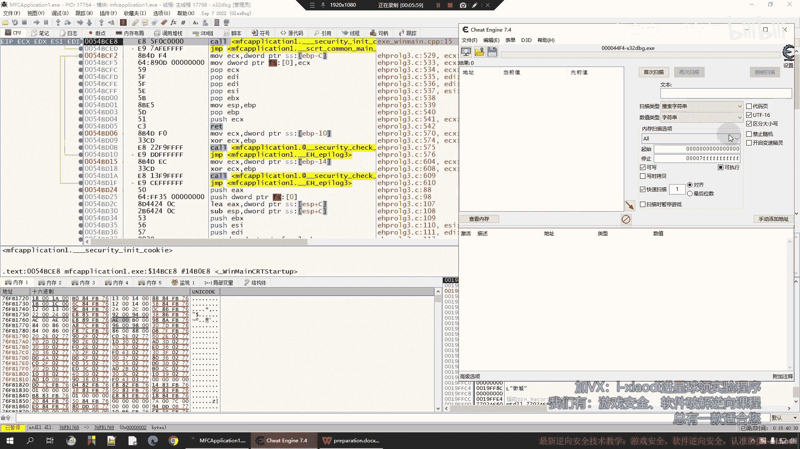

# 🧩 小白软件破解逆向工程师2023最新：3.15：字符串编码ASCII与UNICODE

在本节课中我们将要学习字符串编码中的ASCII与Unicode。课程一开始先不展开这两个术语，而是从最基础的“字符串是什么”讲起，再逐步说明计算机为什么会出现不同编码，以及ASCII、Unicode、UTF系列之间的关系。本课属于第十五课，内容围绕内存数据、字符编码和工具中的观察方法展开，目标是让初学者能看懂这些概念之间的基本区别。

## 🧵 小白软件破解逆向工程师2023最新：3.15.1：认识字符串与内存数据

上一节概述了本课目标，本节先认识字符串和内存数据。字符串实际上就是一串文字。这串文字会放在内存中，因此它也是一种内存数据。普通字母ABCD、数字1234、符号等，都是内存数据，都是数据。它们在内存中的表现形式本质上一样。如果追到本源，它们都是零和一。理解这一点后，就不会把字符串看成脱离内存的神秘内容，而是可以把它当作一段有规则的数据来看待。

以下是理解字符串与内存关系时需要先建立的几个基本认识：

- 字符串是一串文字。
- 字符串存放在内存中，所以属于内存数据。
- 字母、数字、符号和字符串在内存中都是数据。
- 追到最底层，它们都由零和一组成。

## 🏛️ 小白软件破解逆向工程师2023最新：3.15.2：ASCII编码的由来与单字节规则

上一节说明了字符串是内存数据，本节来看早期计算机为什么采用ASCII编码。计算机由美国人发明。刚开始发明计算机时，设计者不会优先考虑中文。原文用八国联军侵华作历史比喻，用来说明当时的背景不会把中文放在优先位置。早期设计只会优先考虑ABCD这类拉丁字母，也会考虑1234、标点符号和特殊符号等内容。

随着国际化推进，随着中国、日本、韩国和东亚地区的发展，全球化展开。中文、日文、韩文这些非拉丁字母慢慢被美国接受。计算机只做内销不够，还要卖给中国。中国是美国很大的市场，也是很大的买家，很多产品需要中国市场来支撑。因此，中文需要被设计进计算机编码体系。先看以前的设计：以前只设计ABCD、1234或其他符号。对这种字符串或字符进行编码的方式，就叫编码。刚开始使用的码是ASCII码。

ASCII码的核心规则是一个萝卜一个坑，一个字节代替一个字母。可以用十六进制工具观察这个规则。例如，看到一个可能是拉丁系的符号，它对应F0这一个数据。界面上一个格、两个格、三个格、四个格，其中一个格就对应这个符号的数据位置。另一个符号也用一个格代替。一个萝卜一个坑，没有给汉语留下额外余地。一个字节代替一个字母，这就是ASCII。

以下是ASCII在本课中的核心规则：

```text
ASCII：1 个字母或符号 = 1 个字节
```

\[
\text{ASCII}：1\ \text{字符} \rightarrow 1\ \text{字节}
\]

## 🌏 小白软件破解逆向工程师2023最新：3.15.3：Unicode用双字节接纳中文等字符

上一节介绍了ASCII的单字节规则，本节看中文等非拉丁字符出现后如何处理。国际化、全球化之后，中文出现，中国崛起，计算机必须接纳中文。设计者需要想办法变通，于是用两个字节代表一个汉字。原因是一个字节已经用来代替字母和符号，汉字没有继续占用单字节的空间。用两个字节代表一个汉字，这种编码方式就叫Unicode。

可以在工具中做简单切换来观察。鼠标右键文本显示方式，切换到扩展ASCII。按课程演示理解，这里的扩展ASCII实际上对应Unicode显示方式，只不过当前区域没有数据。也可以切换到十六进制扩展ASCII。随便选择一个符号时，例如选择某个符号或点，会发现这边选中了两个字节。再在右边点一个字符，它会同时选中两个字节，这就是Unicode的表现。继续点，继续选中两个字节，仍然是两个。切换回ASCII后，点一下只选中一个字节。通过这个现象看本质：ASCII是一个字节代替一个字母和符号，Unicode是两个字节代表一个字母或符号。Unicode也能代表字母和符号，只是使用两个字节，有时会造成浪费。

以下是ASCII与Unicode在观察方式上的对比：

```text
ASCII：点选一个字符 -> 选中 1 个字节
Unicode：点选一个字符 -> 选中 2 个字节
```

\[
\text{Unicode}：1\ \text{字符} \rightarrow 2\ \text{字节}
\]

为什么可能浪费？切换过去观察，例如AE代表了这个符号，但后边是00。这个00位置就浪费了，因为它没有表示任何数据。Unicode也可以表示汉字。汉字再复杂，也可以用两个字节组合，通过各种组合表示出来。这里要抓住的核心是：本课用双字节理解Unicode对非拉丁字符的表示。

> 记忆提示：在本课演示里，ASCII看单字节，Unicode看双字节；双字节比单字节宽，所以后面会看到“宽字节”“宽字符”“宽”这些说法。

## 🔍 小白软件破解逆向工程师2023最新：3.15.4：宽字符、UTF与后续Windows API

上一节比较了ASCII和Unicode的字节差异，本节继续看宽字符和UTF系列。ASCII用来表示字符、字母，使用单个字节，也就是一个字节。Unicode主要用来表示除英文之外的语言，也就是非拉丁系语言，使用两个字节。两个字节比一个字节宽。因此在一些情况、一些情境中，经常会看到宽字节、宽字符、宽这样的概念。wide表示宽，widely也表示宽。看到这些概念时，要联想到它对应的就是Unicode。

之前还看到过文本、代码页、UTF等内容。之前切换过UTF-16、UTF-32，实际上还有UTF-8等。用Cheat Engine搜索字符串时，会看到UTF-16，之前也见过一次。UTF-16、UTF-32这些东西实际上就是Unicode进一步引申和进化而来的编码形式。看到UTF系列时不要害怕，它就是Unicode的进化版。

以下是本课需要记住的编码关系：

```text
ASCII：单字节编码，主要覆盖拉丁字母、数字和符号
Unicode：本课用双字节理解，主要覆盖英文之外的非拉丁系语言
UTF-16、UTF-32、UTF-8：Unicode进一步引申和进化出的编码形式
宽字节、宽字符：看到“宽”时，联想到Unicode
```

\[
\text{宽字符/宽字节} \rightarrow \text{Unicode}
\]



这些结论如果暂时不理解，至少要先记住。记不住就回来多看几眼。这些内容最终会在Windows API函数的一些版本上体现得很明显。下节课会专门介绍Windows API相关版本中的体现。理解ASCII与Unicode的差别，是后面观察字符串、识别编码和理解API字符版本的基础。

## 📝 小白软件破解逆向工程师2023最新：3.15.5：本节总结

本节课中我们一起学习了字符串编码ASCII与Unicode。我们从字符串是一串文字讲起，认识到字符串存放在内存中，也是内存数据；继续追到本源，所有数据都是零和一。接着回顾早期计算机由美国人发明，早期设计优先考虑拉丁字母、数字和符号，于是出现ASCII码。ASCII的规则是一个字节代替一个字母或符号，也就是一个萝卜一个坑。

随后我们进入Unicode部分。随着国际化、全球化和中国等东亚市场的发展，中文、日文、韩文等非拉丁字符需要被接纳。课程用两个字节代表一个汉字来解释Unicode，并通过工具中点选字符时选中一个字节还是两个字节的现象，对比ASCII与Unicode。还观察到双字节表示字母时可能出现00这样的浪费位置，但双字节可以组合表示汉字。最后我们记住：ASCII对应单字节，Unicode对应双字节，看到宽字节、宽字符、宽的概念要联想到Unicode；UTF-16、UTF-32、UTF-8是Unicode的进一步进化形式，并会在Windows API函数的一些版本中体现。本课内容到此结束，下节课再见。

