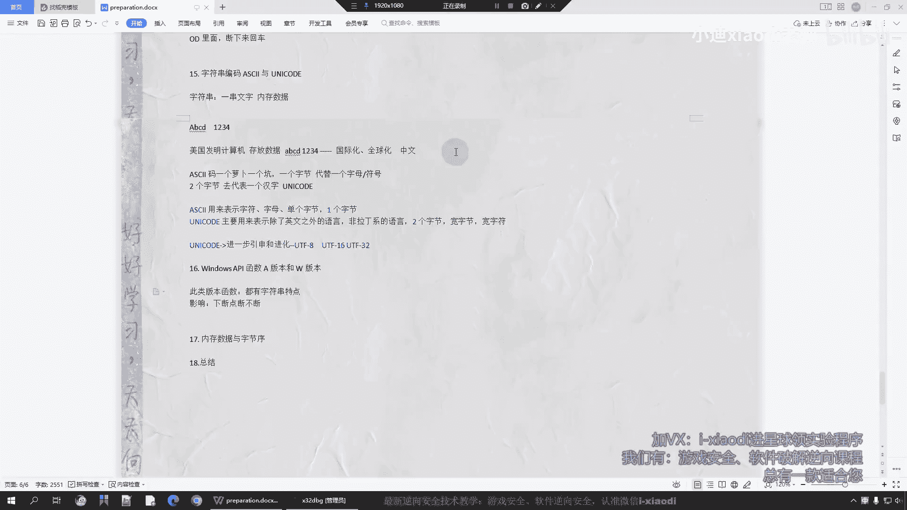
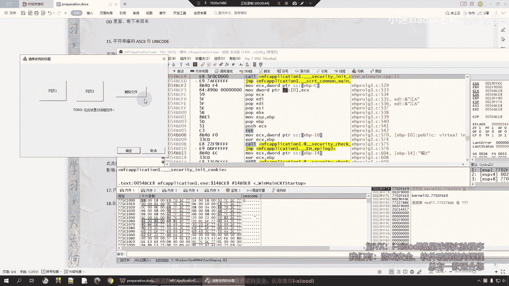
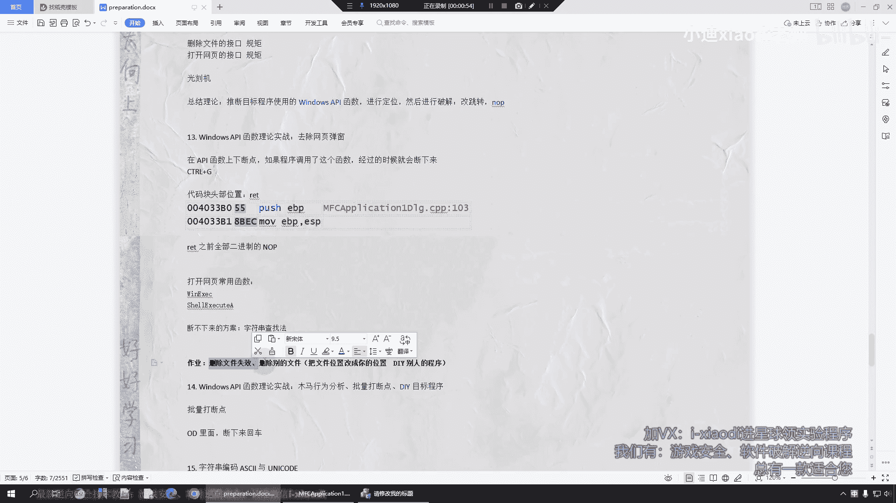
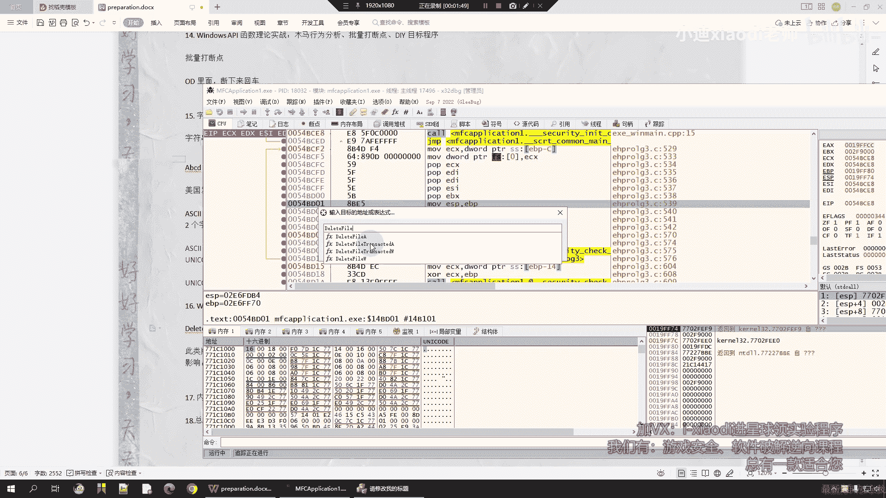
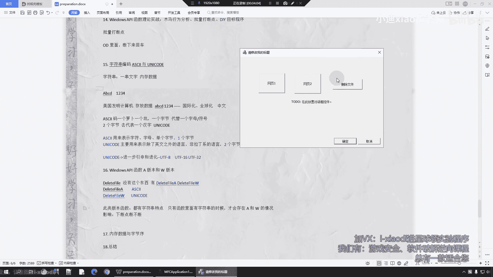
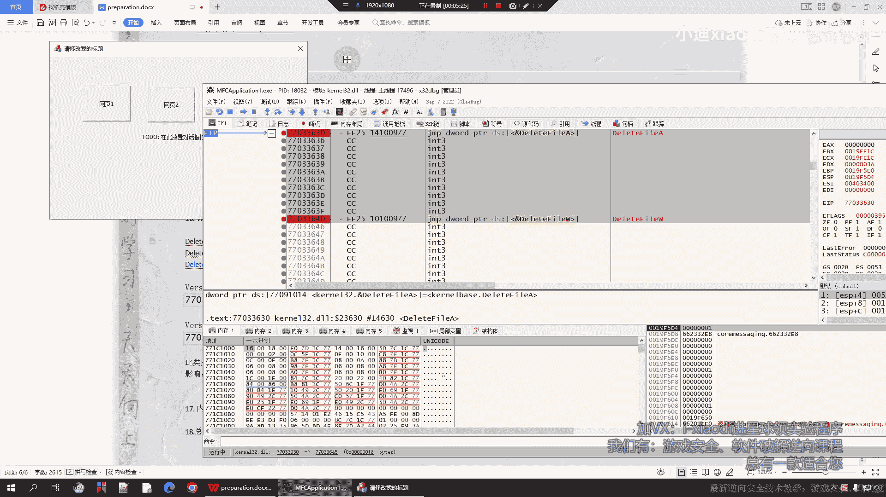
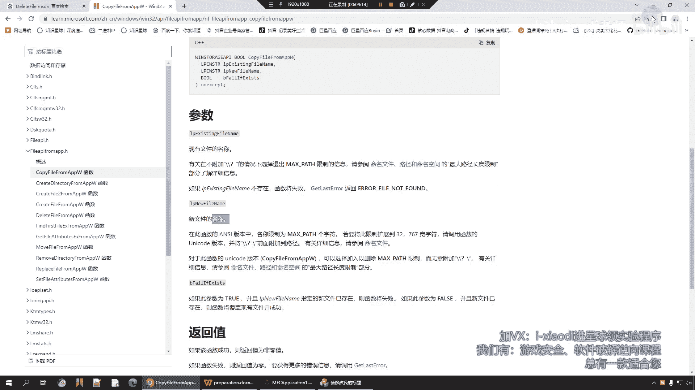

# 小白软件破解逆向工程师：第 16 章：Windows API 函数的 A 版本与 W 版本 🪟

## 📘 本章概述

本章将介绍 Windows API 函数中的 A 版本和 W 版本，以及它们与字符编码、函数调用地址和调试断点之间的关系。我们还会通过 `DeleteFile` 函数的例子，学习如何判断函数参数是否包含字符串，以及如何使用微软官方文档查询函数用法。理解这些内容后，遇到相关问题时就能更有方向地分析程序。

## 🔁 回顾：什么是 Windows API 函数





上一节我们分析了程序的运行过程，本节先来回顾 Windows API 函数的含义。Windows API 是微软提供给 Windows 操作系统编程人员使用的应用程序编程接口，也就是微软提供给程序员的一组功能和能力。

可以把它理解为程序与 Windows 操作系统之间的一座桥梁。程序通过调用 Windows API，可以使用操作系统提供的功能，例如删除文件。

## 🗑️ 观察 `DeleteFile` 函数

在之前调试分析过的程序中，运行程序并执行删除文件操作后，程序会删除指定的文件。为了分析删除操作，我们曾尝试在 `DeleteFile` 函数上设置断点。



在调试器中搜索 `DeleteFile` 后，可以发现，系统并没有直接提供一个名为 `DeleteFile` 的函数入口，而是提供了两个版本：

- `DeleteFileA`
- `DeleteFileW`

因此，我们先记住这个现象：在这个例子中，看到的是 `DeleteFileA` 和 `DeleteFileW`，而不是一个不带后缀的 `DeleteFile` 函数。

这说明 Windows API 中的一些函数会提供 A 版本和 W 版本。接下来，我们来看看这两个后缀分别代表什么。

## 🔤 A 版本与 W 版本的含义

上一节我们观察到了 `DeleteFileA` 和 `DeleteFileW`，本节来解释它们与字符编码的关系。

- **A 版本**通常表示使用 ANSI 字符编码。
- **W 版本**表示使用 Unicode 字符编码。

可以用下面的方式记忆：

```text
A 版本 → ANSI 编码
W 版本 → Unicode 编码
```



A 版本和 W 版本的主要区别与字符串的编码方式有关。Unicode 常被称为宽字符编码，因此 W 后缀也可以联想到英文单词 `wide`，意思是“宽”。

并不是所有 Windows API 函数都有 A 版本和 W 版本。只有当函数涉及字符串时，字符编码才会影响函数的调用，因此这类函数才可能分别提供 A 版本和 W 版本。如果函数不处理字符串，编码方式不会对它产生影响，通常也就不需要 A、W 两个版本。

## 🧭 编码版本会影响断点位置

上一节我们了解了 A 版本和 W 版本的区别，本节来看看它们对调试有什么影响。

以 `DeleteFile` 为例，删除文件时需要传入文件路径，而文件路径是字符串。因此，程序可能调用 `DeleteFileA`，也可能调用 `DeleteFileW`。这两个函数是不同的函数入口，地址也不同。

例如，在调试器中查看时，可能会看到类似这样的地址：



```text
DeleteFileW：地址以 40 结尾
DeleteFileA：地址以 30 结尾
```

这里的地址只是示例，重点是 A 版本和 W 版本对应不同的函数地址。程序调用其中一个版本时，另一个版本上的断点不会触发。

实际调试时，如果程序调用的是 `DeleteFileA`，那么在 `DeleteFileA` 上设置的断点会触发；设置在 `DeleteFileW` 上的断点则不会触发。反过来，如果程序调用的是 `DeleteFileW`，情况也相反。

如果还不清楚程序究竟调用哪个版本，可以同时在 A 版本和 W 版本上设置断点。程序运行后，实际被调用的那个版本就会触发断点。简单来说，先都设置好，再根据断点命中的位置判断程序走的是哪条路径。

## 🔎 如何判断函数是否处理字符串

上一节我们看到，字符串参数会影响函数是否需要 A、W 两个版本。本节继续通过 `DeleteFile` 来判断它的参数是否包含字符串。

`DeleteFile` 用于删除文件，而删除文件必须知道文件路径。文件路径由盘符、文件夹名称和文件名称等内容组成，例如：

```text
C:\新建文件夹\文件.txt
```

这些路径内容都是字符串。因此，`DeleteFile` 函数需要接收字符串参数，这也解释了它为什么会有 A、W 两个版本。

遇到不熟悉的函数时，可以先从函数功能推测它的参数。例如，删除文件需要路径，路径是字符串；如果函数需要名称、文件名或路径，这些内容通常也都是字符串。对于无法确定的情况，可以查询函数文档。

## 📚 使用微软官方文档查询函数

上一节我们根据函数功能推测了参数类型，本节来看看如何查证。查询时，可以在搜索引擎中输入函数名和 `MSDN`，例如：

```text
DeleteFile MSDN
```

搜索结果中应优先查看带有 Microsoft 标志的官方页面。进入微软官方文档后，可以查看函数的功能说明、参数、参数类型以及使用限制等信息。

文档中如果出现 `STR`，通常表示字符串。例如，`STR` 是 `string` 的缩写，意思是“字符串”。参数说明中如果出现名称、文件名或路径等内容，这些也通常是字符串。

其他函数也可以用同样的方法查询。查看函数文档时，可以留意以下常见线索：

- `STR` 通常表示字符串。
- `name` 通常表示名称。
- `path` 通常表示路径。
- 文件名、名称和路径等参数通常都是字符串。

如果函数参数中包含字符串，就要留意它是否提供 A 版本和 W 版本。不同函数的具体参数和编码要求可能不同，应以官方文档为准。

## ✅ 本章总结



本章介绍了 Windows API 中 A 版本和 W 版本的含义，以及它们对调试断点的影响。A 版本通常使用 ANSI 编码，W 版本使用 Unicode 编码；当函数需要处理字符串时，常会提供这两个版本。由于 A 版本和 W 版本是不同的函数入口，程序调用其中一个版本时，另一个版本上的断点不会触发。如果不确定程序调用哪个版本，可以同时设置两个断点，再通过实际命中的位置进行判断。

此外，我们还学习了如何根据函数功能判断参数是否可能是字符串，以及如何通过函数名加 `MSDN` 搜索微软官方文档，进一步确认函数的用途和参数信息。

