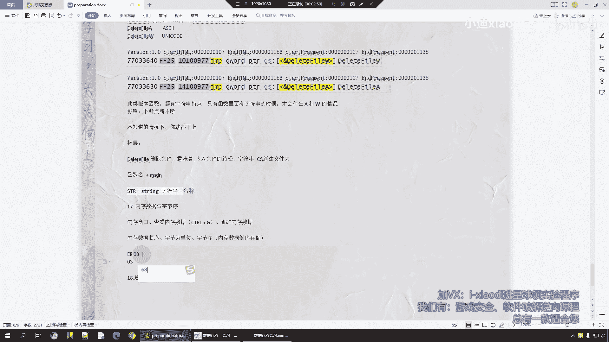

# 小白软件破解逆向工程师2023最新：3.17：内存数据与字节序 🔍

本节课程将讲解内存数据与字节序。这一块内容比较简单，描述的是一种现象，是计算机在设计时就规定好的存储规则。理解这部分知识，对后续逆向分析中查看和修改内存数据很有帮助，能避免一些常见的困惑。

## 课程准备 🛠

我们先准备一下演示程序。这个程序可以到星球下载。它是一个数据存取工具，我们来用它观察内存数据的变化。

打开程序后，再打开x32dbg调试器。

在x32dbg中点击文件（File），然后点击附加（Attach），找到我们的目标程序，点击附加按钮，这样调试器就和目标程序建立了连接。

## 内存窗口查看数据 📊

上一节我们已经认识了调试器的基本界面，接下来复习一下内存窗口的使用方法。

界面中不是有四个窗口嘛，左上方、右上方、左下方、右下方，那么大一片区域，到底哪个才是内存窗口呢？能看到地址和二进制数据的那一边就是内存窗口。具体来说，就是界面右下角这个区域，它专门用来显示指定内存地址处的字节内容。

怎么查看内存中的具体数据呢？很简单，在内存窗口这个位置，按下键盘上的Ctrl+G组合键，会弹出一个地址输入框。

在弹出的地址输入框中，输入要跳转的内存地址。比如我们数据存放的地址是4A66A0，那就直接在对话框中填上4A66A0，然后按回车键。这样内存窗口就会跳转到这个地址，我们就能看到这个内存地址处的数据了。

## 修改内存数据 ✏️

了解了如何查看数据后，我们看看如何修改内存中的数据。

修改操作也非常简单，直接在内存窗口中进行二进制编辑就行。你可以定位到想要修改的字节上，一个一个地修改数值，这就是直接修改内存数据的过程。这种修改在调试中非常常用，比如想改某个变量的值、改某个标志位，都可以直接操作内存。

## 字节与十六进制显示 🧮

为了理解内存数据，我们先基本了解一下相关的概念。

现在，我们往这个内存地址中存入一个数据。先存一个数字1。存进去之后，大家会发现，在这个地址对应的位置变成了1，原本的数据多了一个1。好，我们再存一个数字2看看效果。

再看一下，存了2之后，这个内存位置的数据变成了2。这也没什么奇怪的，对吧？也就是说，当我们往地址里存数据时，它直接对着这个地址、以字节为单位把数据写进去了。这种单位叫字节（Byte），一个字节能表示0到255之间的数据，整个存储过程很直接。

当存很小的数字时，比如1、2、100，这些数字都在一个字节的范围内，所以只占用一个字节的存储空间。存100的时候，也是用了一个字节，显示为64（十六进制）。那如果是存一个比较大的数据，比如1000呢？

在十进制下输入1000确认后，你会发现内存中显示的数据变成了E8 03。E8 03是什么？E8 03是一个十六进制数，对吧？内存数据一般以十六进制显示。计算机普遍采用十六进制来展示内存数据，因为这比一长串十进制数字看起来简洁，而且与二进制转换方便。看到没，这边显示的这些都是十六进制数。

## 字节序：倒序存储的真相 🔄

观察1000这个数据的内存表示，我们思考一个问题：它是按经济E8 03存储的，还是按03 E8存储的呢？到底哪种才是正确的读法？

我们来做个实验验证一下。打开Windows计算器，按Win+R键，输入calc，然后按回车。计算器打开后，点击左上角的菜单，切换到程序员模式。

好，这里需要看一下。DEC是十进制的意思，平时我们日常生活中使用的数字都是十进制，HEX代表十六进制，除此之外还有八进制、二进制等。十六进制也是常用的一种进制。

先把1000输入到计算器里，默认是十进制状态，直接输入1000。然后切换到HEX（十六进制），看到显示的是3E8，前面补一个零就是03E8。仔细观察一下，我们存进去的是1000（十进制的1000，十六进制是03E8），但内存中显示的却是E8 03。

发现规律了吗？内存中的数据是倒过来存的！

也就是说，我们存的是一个整数，但在内存中，它的字节顺序和正常的阅读顺序是相反的。我们存了03E8这个十六进制数，但存进去之后变成了E8 03。所以大家要记住这种现象，内存存储时它按照一种倒序的顺序来放置数据。这种存储方式有个专有名词，叫做小端字节序。

## 实际应用：直接判断数据 🧠

理解了倒序存储规则，今后遇到内存中的数据，我们就可以直接判断它本来是什么数值了。

以后再看到类似的数据，就不用再拿计算器去比对了。假如你知道某个地址处存了一个完整的数据，看到内存中是27 10，那么它代表的数值就是2710（十六进制），而不是1027。什么是2710呢？你可以直接在计算器里切换到HEX，输入2710，十六进制数2710就是十进制的一万。反过来，如果你想存一个一万，那么它在内存里显示为2710。熟练之后，看到内存里的数据，就能立刻在脑子里反应过来它实际是多少。

掌握这个倒序存储的特点后，在今后调试中遇到具体问题时，就不容易产生混淆了。很多时候，一个很小的知识点，反而会带来很大的困惑，让你怎么都找不到问题出在哪，然后在那边反复调试，头疼不行。现在我们明白了字节序这个东西，以后再分析数据就多了一份底气。

## 总结 📝

在本节课中，我们一起学习了内存数据与字节序的核心知识。我们复习了内存窗口的查看方法，知道了如何通过Ctrl+G跳转地址，也知道了如何直接编辑内存数据。最关键的是，我们通过实际实验，观察到了1000这个数在内存中的表示是E8 03，和它正常的十六进制形式03E8正好相反，从而明白了计算机在内存中存储多字节数据时采用的倒序规则。这个概念虽然简单，但对理解程序内部数据表示方式很有帮助，在今后的逆向学习和调试中可以避免一些不必要的困惑。
