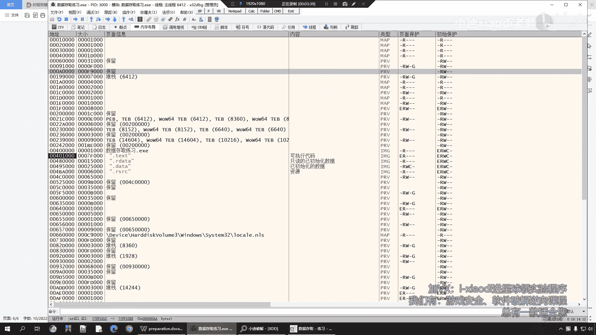
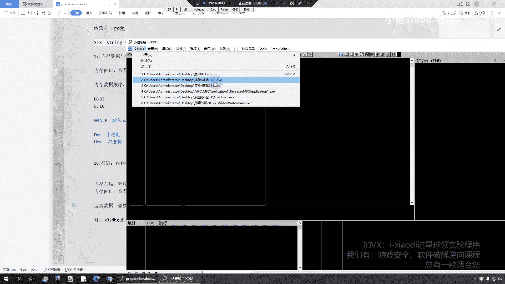
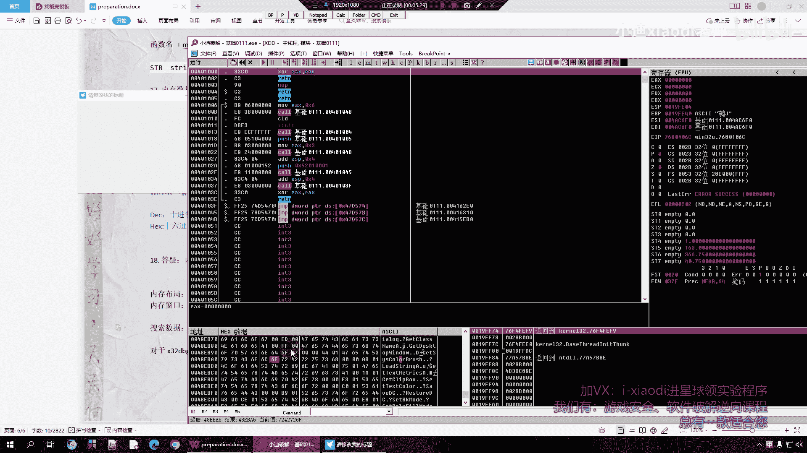
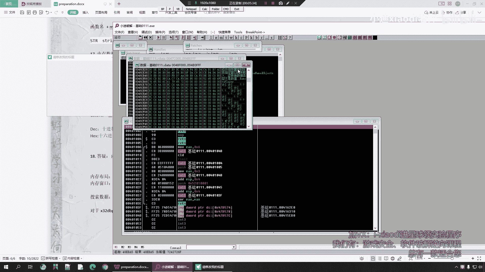
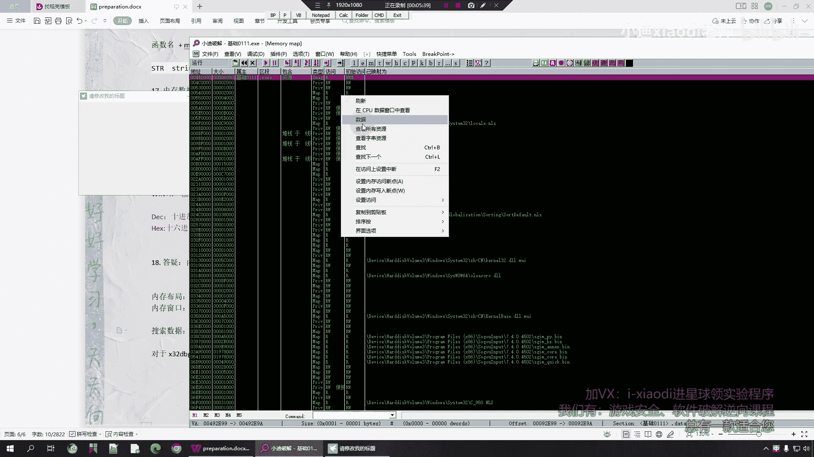
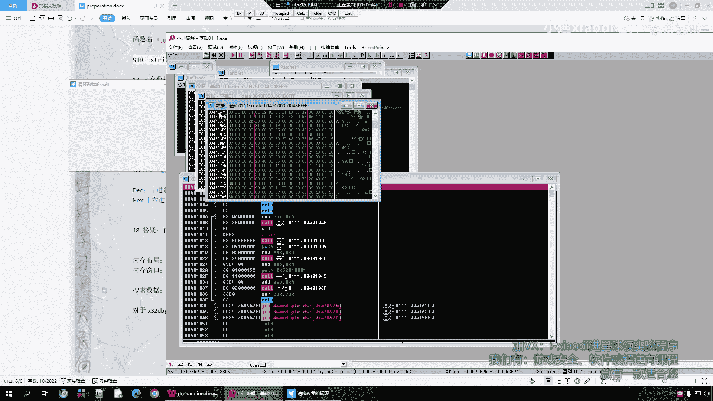
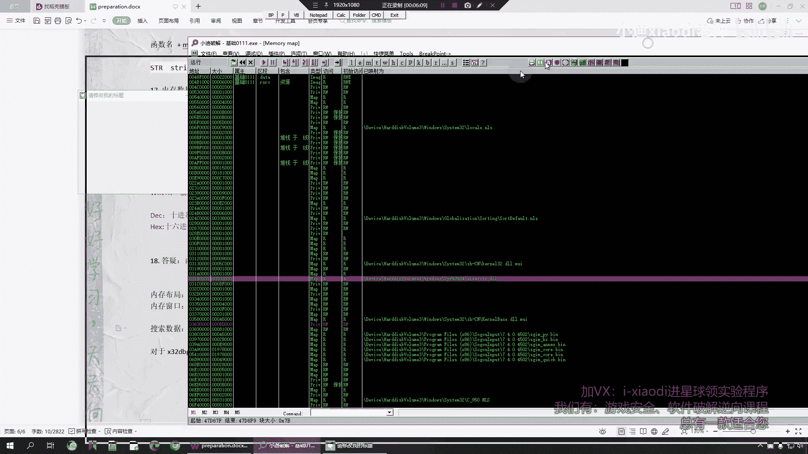

# 🧠 小白软件破解逆向工程师2023最新：3.18：答疑：内存布局与内存窗口关系

## 📌 小白软件破解逆向工程师2023最新：3.18.1：课程概述

本课是第十八课，主题是答疑，专门解释内存布局与内存窗口之间的关系。这个疑问由群内提出，问题很有价值，先把概念分清，后面看工具操作时就不容易迷路。

在正式看工具之前，先记住一个总原则：内存布局看的是程序全部内存，内存窗口看的是某块区域的内存。一个偏整体，一个偏局部。下面先把最核心的结论摆出来，后面的例子都围绕这个结论展开。

## 🧩 小白软件破解逆向工程师2023最新：3.18.2：核心结论

上一节说明了本课要解决的问题，本节先看最直白的结论。用一句话概括就是：内存布局代表程序全部内存，它显示的是程序全部内存；内存窗口只查看某块区域的内存，只是一部分。

下面用代码形式描述这两个概念，方便初学者建立整体印象。

```text
内存布局 = 程序全部内存（整体）
内存窗口 = 某块区域内存（局部）
```

这里要明白整体和局部的区别，不要把局部窗口当成全部内存。可以先记住这个判断：内存布局是整体，内存窗口是局部。

> **一句话结论：内存布局看整体，内存窗口看局部。**

理解整体和局部的区别后，我们进入 x32dbg 看具体现象，这样更容易把概念和界面操作对应起来。

## 🛠️ 小白软件破解逆向工程师2023最新：3.18.3：x32dbg中的内存布局与内存窗口

上一节给出了核心结论，本节我们来看看 x32dbg 中实际显示是什么样。先随便打开一个程序并运行起来，然后观察左下角的内存窗口。

在 x32dbg 中，可以按下面这些步骤观察内存布局和内存窗口的差别。

- 程序运行后，左下角内存窗口的开头是 `779F1000`，向下拉到 `77B10FF0` 结束，这里只显示程序的一小块。
- 这一小块不是程序全部的内存数据。
- 点击“内存布局”，可以看到从 `10000` 开始，一直往下到 `7` 开头的区域，这些都是程序内存中存在的数据。
- 在 CPU 窗口旁查看时，内存窗口显示的是局部，不是整体。
- 可以点击内存1，也可以点击内存2、内存3，实际观察内存2、3、4、5显示一致。
- 在 x32dbg 的 8G 内存场景下，内存2、3、4、5显示的是程序运行中的一些内存。
- 对于 x32dbg 的内存窗口来说，内存2、3、4显示的是程序运行的内存，但它们仍然属于局部。

从这些现象可以看出，界面上的内存窗口只是方便查看某一块区域，真正要看整体范围，还是要回到内存布局。看到这里，整体和局部的界面差异已经清楚，下一节再看它如何影响搜索数据。

## 🔎 小白软件破解逆向工程师2023最新：3.18.4：在 x32dbg 中搜索数据



上一节我们从界面上看到了整体和局部的区别，本节看看这个区别对搜索数据有什么实际影响。搜索数据时，如果想获得最精准、最大范围中的搜索结果，就应该在内存布局里搜索，而不是只在局部内存窗口里搜索。

可以先记住下面这个搜索原则，它把本课的核心结论和实际操作连在一起。



```text
最大范围 + 最精准搜索 = 内存布局 / OD 的 M 窗口
```

在 x32dbg 中，搜索数据可以按下面这些步骤操作。

- 在内存布局里随便找一个位置，右键，选择“搜索匹配特征”，然后搜索数据。
- 这样搜索的范围更全面，这是内存布局能带来的有价值结论。
- 虽然内存2、3、4也能显示和搜索程序运行中的一些内存，但它们仍是局部。
- 搜索程序中的各类数据时，可以用内存2、3、4这些窗口，但最终要获得最大范围、最精准的搜索，还是要回到内存布局中搜索。

搜索范围的判断很关键，先分清整体和局部，再动手搜索，效率会高很多。x32dbg 的思路讲完，下一节换到 OD，看看同样的整体入口在哪里。

## 🧰 小白软件破解逆向工程师2023最新：3.18.5：OD 中的内存窗口与 M 窗口

上一节说明了 x32dbg 中的整体与局部，本节中我们来看看 OD 里对应的操作。OD 同样有局部内存窗口和整体内存布局入口，先看如何打开程序并观察地址。

在 OD 中，可以按下面这些步骤进入整体内存视图。

- 点击“文件”，选择基础0111或 MFC application，随便找一个程序。
- 程序运行后，可以看到起始地址从 `47C000` 开始，`47C000` 可以显示为 HEX。
- 这个窗口不是程序全部内存。
- 点击“M”，鼠标放到该位置时，左下角会出现显示内存窗口的标记。
- 点击后打开的窗口与内存布局一样，也能看到 `1000` 这样的区域，二者一致。
- 用 OD 进行最大范围搜索时，应点击“M”进入整体内存视图，再进行查找数据。

OD 的 M 窗口就是整体入口，下一节看具体搜索和返回地址的操作。



## 🗺️ 小白软件破解逆向工程师2023最新：3.18.6：在 OD 中搜索并返回地址



上一节找到了 OD 的整体入口，本节看看如何在 OD 中搜索数据并返回目标地址。在 OD 中查找数据时，重点是先进入 M 窗口，再查找并定位地址。



可以按下面这些步骤完成搜索、记录和返回定位。

- 在 M 窗口中查找数据，例如查找修改，再按条件挨个查找。
- 搜索到结果后，可以记录目标地址，例如 `47D679` 这个地址，它对应某块内存数据。
- 返回时点击“E”，双击模块名字，回到 CPU 整体窗口；左下角会出现内存窗口。
- 如果忘记地址是 `47` 多少，就重新查看、重新搜索；如果点错了，也重新查找。
- 重新点击“M”，再点击查找，找到 `47D679` 后双击，在 `47D679` 处点击确定（OK）或回车，就能定位到该地址。
- 定位后即可进行修改。
- 如果普通窗口里搜索不到，应点击“M”进行搜索，因为 M 窗口代表整体范围。



到这里 OD 的搜索和返回流程讲完，最后我们把本课结论总结一下，方便以后遇到类似问题时快速判断。

## ✅ 小白软件破解逆向工程师2023最新：3.18.7：课程总结



本节是总结，我们把这堂课的关键点再串一遍。下面用几条结论回顾本课内容。

- 内存布局代表程序全部内存，是整体；内存窗口只查看某块区域，是局部。
- x32dbg 中，左下角内存窗口只显示一小块，点击内存布局才能看到从 `10000` 到 `7` 开头的整体范围。
- x32dbg 的内存2、3、4、5显示程序运行中的内存，但仍然属于局部。
- 要获得最大范围、最精准的搜索，应优先在内存布局或 OD 的 M 窗口中搜索。
- OD 中点击 M 进入整体视图，查找数据并记录地址如 `47D679`，再通过 E 和双击模块名返回 CPU 窗口定位修改。
- 本节问题由群内提出，价值很高；记住 OD 中点击 M 即可进入整体搜索入口。

本节课中我们一起学习了内存布局与内存窗口的整体、局部关系，也分别看了 x32dbg 和 OD 中的搜索操作。这是一个很小的细节，但会影响搜索范围的判断，下期再见。

