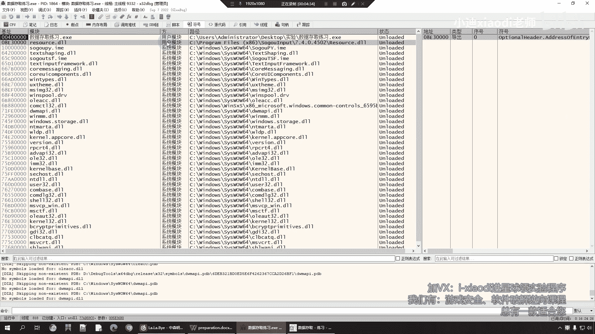
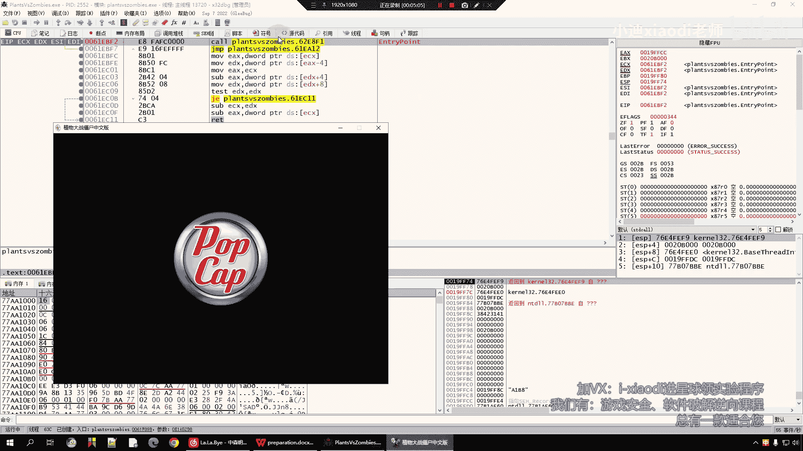
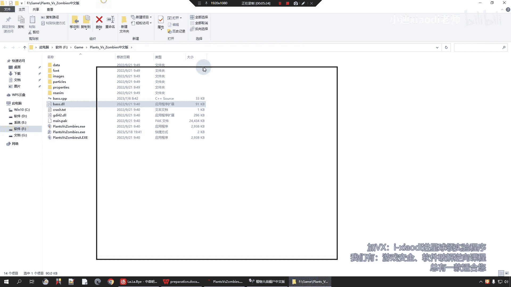

# 🧱 小白软件破解逆向工程师2023最新：3.19：认识程序模块


## 📌 小白软件破解逆向工程师2023最新：3.19.0：本节概述


在本节课中我们将要学习“认识程序模块”这个基础概念。这个知识点本身不复杂，但不知道还不行，因为后面看程序、看调试器里的模块列表时，都会用到它。本节会先说明程序模块是什么，再通过 `x32dbg` 观察主模块、DLL 模块、用户模块和系统模块，最后把需要记住的概念串起来。下面先从最直观的比喻开始，让初学者先建立感觉，再去看工具里的实际现象。


## 🧩 小白软件破解逆向工程师2023最新：3.19.1：什么是程序模块


在概述之后，我们先看程序模块到底像什么。写程序或者程序运行起来的时候，它有点像大积木。小时候搭过积木，玩过益智类玩具，用大积木搭一个城堡，程序也是这样。程序运行起来之后，有很多“积木”一样的东西，把它一个一个堆积起来，才变成一个程序。也可以理解成建筑，建筑是一块砖一块砖垒上去的；也可以理解成人，人是一个胳膊、一个细胞、一个细胞堆积起来的。程序也是如此，它不是浑然一体的，它是由很多东西组合成的。程序模块需要记住的概念有几个，很好记，不需要担心。


以下是理解程序模块时最直观的组成关系：


- 程序不是一整块不可分割的东西，而是由多个模块组合而成。
- 模块可以理解成程序运行时的一块块“积木”。
- 先建立这个直觉，再看工具里的模块列表，就不会觉得陌生。


```text
程序 = 主模块 + 若干依赖模块
模块 ≈ 组成程序的一块块“积木”
```


## 🏠 小白软件破解逆向工程师2023最新：3.19.2：主模块就是程序名所在的模块


上一节我们建立了“程序像积木”的直觉，本节中我们来看看第一个必须记住的概念：程序名就是主模块。光说没有用，需要实际看到。所有现象基本上都要通过工具体现，这里使用 `x32dbg`。点击“文件”，找到“数据存取练习”。跟着操作可以看到“模块”里有“数据存取练习”，它就是一个模块。此时还不知道它是不是主模块，可以点击“符号”，看到 `数据存取练习.exe`，这里只有这一个程序，所以它就是主模块。记住这个概念即可：程序名就是主模块，带有程序名的这个就是主模块，它就是我们运行起来的那个东西。


以下是主模块的判断要点：


- 在 `x32dbg` 中点击“文件”，找到“数据存取练习”。
- 在“模块”中可以看到“数据存取练习”，说明它是一个模块。
- 点击“符号”，看到 `数据存取练习.exe`，并且只有这一个程序。
- 因此 `数据存取练习.exe` 就是主模块，也就是程序名所在的模块。


```text
主模块 = 带有程序名的模块
示例：数据存取练习.exe
```


## 🔗 小白软件破解逆向工程师2023最新：3.19.3：DLL模块是程序运行时依赖的动态链接库


上一节我们认识了主模块，本节中我们来看看第二个概念：DLL 模块。DLL 模块可以简称 DLL，也可以直接说 DLL 模块，它的格式是 `xxx.dll`。它是程序运行时需要依赖的动态链接库。为什么叫动态链接库？因为 DLL 是英文 `Dynamic Link Library` 的缩写，翻译过来就是动态链接的库，简写为 DLL。眼前也能看到，主模块下面这些模块，全部都是“数据存取练习”这个主模块运行时所依赖的外部其他模块。这样一来，DLL 模块的概念就清晰了，是通过实际程序观察出来的。


以下是 DLL 模块需要记住的要点：


- DLL 模块的格式是 `xxx.dll`。
- DLL 是 `Dynamic Link Library` 的缩写。
- DLL 的中文含义是动态链接库。
- 主模块下面列出的很多模块，就是主模块运行时依赖的外部模块。


```text
DLL = Dynamic Link Library = 动态链接库
DLL模块格式：xxx.dll
```


## 🗂️ 小白软件破解逆向工程师2023最新：3.19.4：用户模块与系统模块


上一节我们说明了 DLL 模块是程序运行时依赖的动态链接库，本节中我们来看看这些模块合起来怎么分类。所有模块加起来，可以分为用户模块和系统模块。先看系统模块。系统模块实际上是 Windows 操作系统自带的模块，没有这些东西，其他程序也跑不起来。不要只盯着当前这个程序，QQ、微信、抖音、模拟器、网页都打不开，所以系统模块是必要的东西，每一个程序运行都需要。把程序运行起来之后，又会多一个用户模块。用户模块有一个特点，它比较特殊，可能是搜狗输入法。输入法无处不在，可以存在于任何程序中，所以看用户模块时，输入法除外。什么是用户模块？用户模块就是程序目录中本来就自带的模块。当前这个“数据存取练习”程序像一个单身汉，没有自带其他模块，只有这一个模块，输入法先不管。整个“数据存取练习”程序只有几个模块，用户模块只有一个，可以理解为它的目录中只有它自己。再换一个程序看，比如打开“植物大战僵尸”这个游戏并运行，点击“符号”，这里的模块就是用户模块。用户模块会标注路径，除了输入法，这些路径都是目录中真实存在的文件，可以去目录中找，也可以在资源管理器中浏览。像 `base.dll`、`GDI42.dll` 这类文件都是真实存在的，输入法除外。这就是模块的概念，也就是用户模块和系统模块的概念。




以下是模块分类的核心判断方式：




- 所有模块加起来分为用户模块和系统模块。
- 系统模块是 Windows 操作系统自带的模块，其他程序运行也离不开它。
- 用户模块是程序目录中本来就自带的模块，观察时输入法除外。
- “数据存取练习”没有自带其他模块，只有一个用户模块，目录中只有它自己。
- “植物大战僵尸”的用户模块会标注路径，除输入法外都是目录中真实存在的文件。


```text
所有模块 = 用户模块 + 系统模块
用户模块（观察时排除输入法）= 程序目录中本来就自带的模块
系统模块 = Windows 操作系统自带、程序运行必须依赖的模块
```


> 学习提示：看用户模块时先把输入法排除，再看路径是否位于程序目录中，这样判断用户模块会更直接。


## 🧪 小白软件破解逆向工程师2023最新：3.19.5：课后练习与概念巩固




前面几节已经把主模块、DLL 模块、用户模块和系统模块串起来了，本节中我们做一个收束和巩固。今天回去可以自己打开一些程序，简单认识一下模块。首先，程序名就是主模块。DLL 模块是动态链接库，英文是 `Dynamic Link Library`，是程序运行时需要依赖的动态链接库，也是第三方依赖的一些东西。有没有不是第三方的？有，那就是程序目录中本来就自带的模块，这些模块一般也是 DLL 模块，当然输入法除外。剩下的就是系统模块。今天的内容就是认识模块，看到模块列表这个东西，不需要担心，也不需要再产生其他疑问。它实际上就是程序或者目录中存在的一些 DLL，或者系统、软件运行时必须要依赖的操作系统必要文件，也是一个依赖文件，记住这一点即可。不管后缀是 DLL 还是别的什么，只要出现在模块列表里，全都是模块。这个标题叫“模块”，里面列出来的东西全都是模块。今天的内容到这里，下期再见。


以下是课后需要反复确认的几个要点：


- 打开一个程序，先找到它的主模块，主模块通常带程序名。
- 观察主模块下面依赖的 DLL 模块，理解它们是运行时依赖。
- 区分用户模块和系统模块，用户模块看程序目录，系统模块看 Windows 自带。
- 看用户模块时排除输入法，再看路径是否真实存在于程序目录。
- 不管后缀是什么，只要出现在模块列表里，就按模块来理解。


```text
判断流程：
找主模块 -> 看依赖DLL -> 分用户模块/系统模块 -> 用户模块排除输入法 -> 看路径是否在程序目录
```


## ✅ 小白软件破解逆向工程师2023最新：3.19.6：本节总结


本节课中我们一起学习了“认识程序模块”。程序像大积木，是由多个模块组合起来的，不是浑然一体的。程序名就是主模块，带有程序名的模块就是我们运行起来的程序。DLL 模块是 `Dynamic Link Library`，也就是动态链接库，是程序运行时依赖的外部模块。所有模块可以分为用户模块和系统模块，系统模块是 Windows 自带、每个程序运行都需要的模块；用户模块是程序目录中本来就自带的模块，观察时输入法除外。最后记住，不管后缀是 DLL 还是别的什么，只要出现在模块列表里，全都是模块。本节内容到此结束，下期再见。


