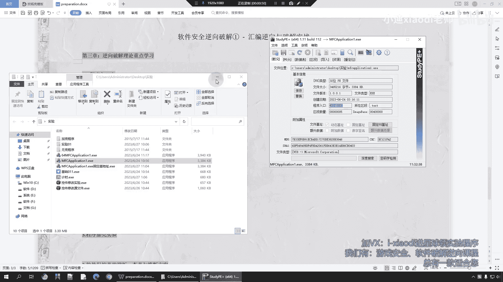

# 🚪 小白软件破解逆向工程师2023最新：3.1：程序入口点


在本节课中我们将要学习软件逆向破解里的程序入口点。课程属于软件安全逆向破解第一期汇编逆向与破解实战第三章逆向破解理论重点学习的第一课。我们会先弄清楚程序入口点是什么，再讲程序往哪里进入、这个位置如何查看，以及如何用OD和PE工具去验证。最后还会说明固定基地址变随机基地址、加壳导致假入口点这些特殊情况。对初学者来说，可以先把这个“点”理解成程序开始执行的位置，后面再结合PE文件结构深入理解。


## 🧭 小白软件破解逆向工程师2023最新：3.1.1：课程背景与准备


欢迎大家收看软件安全逆向破解课程。之前有同学在微信上问过程序入口点是怎么回事，当时我说后边会讲，今天开始讲解这个内容。程序入口点就是我们要分析的程序往哪里进入，这个口在哪里，怎么进，这是一个值得思考的问题。点肯定是一个位置，具体来说它就是一个位置。接下来我们就讲程序入口点往哪入，以及这个位置是什么样。首先需要找到用于演示的程序，今天先用基础011，另外还有计时和控件修改实验这三个程序。这三个程序会提供给大家，放到知识星球app里的软件安全逆向破解分析学习社区中。


以下是本节课需要准备和使用的程序列表：


- 基础011：用于演示最基础的程序入口点查看。
- 计时：用于举一反三，查看另一个程序的入口点。
- 控件修改实验：用于演示修改后的程序入口点计算与查看。
- MFC application固定基地址示例：用于观察固定基地址与随机基地址的差异。
- 加壳示例：用于观察加壳后出现的假入口点。


准备好这些程序后，我们进入实际查看环节。本节先说明课程背景和材料来源，下一节中我们来看看如何把程序拖入OD观察入口点。


## 🚪 小白软件破解逆向工程师2023最新：3.1.2：用OD观察入口点


上一节我们准备了演示程序和课程背景，本节中我们来看看如何用OD观察程序入口点。先把基础011拖到OD里，可以看到界面显示暂停，并且有一个点，这个点表示程序暂停在一个位置。这个位置之前说过，不叫卡住，叫断下来，或者说暂停住。软件看起来像卡住，但不叫卡住，叫断下来了。断下来的这个点就叫断点，断下来的这个位置就是断点。这个位置也就是程序的入口点，程序入口点就是断下来的这个点，或者说断下来的这个位置。因此对于基础011来说，它的程序入口点是45C865。


以下是使用OD观察入口点时需要记住的要点列表：


- 程序拖入OD后显示暂停，说明程序断在一个位置。
- 软件看起来卡住，不叫卡住，叫断下来或暂停住。
- 断下来的点叫断点，断下来的位置就是断点。
- 程序入口点就是断下来的这个点或这个位置。
- 基础011在OD中显示的入口点是45C865。


查看完基础011后，举一反三看计时程序。把计时拖入OD，程序同样会断下来，断下来的点叫断点。因为这个断点是程序刚拖进来时产生的，所以这个程序的入口点是451AE1。原文在这里还提到位置45111，不同示例或实际显示需要以拖入OD后的结果为准。这个断下来的位置就叫做程序入口点。OD可以查看程序入口点，还有一个工具也可以查看，那就是PE工具StudyPE。下一节中我们来看看如何用StudyPE计算入口点。


## 🧮 小白软件破解逆向工程师2023最新：3.1.3：用StudyPE计算入口点


上一节我们用OD直接观察了入口点，本节中我们来看看如何用PE工具StudyPE进行计算和验证。先把基础011拖入StudyPE查看，示例中可以看到Image Base为400000，程序入口为5C865，把这两个数相加得到45C865。也就是说，程序入口点等于Image Base加上程序入口。这里的Image Base和程序入口是两个比较专业的词汇，它们与PE文件结构相关。现在先记住这个关系，后边再讲PE文件结构具体是什么。现阶段只需要记住，一般情况下两个数字相加就是程序入口点，也就是程序入口的位置。


核心概念可以用下面的公式表示：


```text
程序入口点 = Image Base + 程序入口（AddressOfEntryPoint）
```


基础011的示例可以写成：


```text
400000 + 5C865 = 45C865
```


> 学习提示：Image Base和程序入口都与PE文件结构相关，当前先掌握“两个数相加”的验证方法，后续再展开PE结构。


以下是使用StudyPE计算入口点的步骤列表：


- 把基础011拖入StudyPE。
- 查看Image Base，示例中为400000。
- 查看程序入口，示例中为5C865。
- 将两个数相加，得到45C865。
- 用OD拖入基础011，验证显示位置与计算结果一致。


再看控件修改实验，这个是修改后的程序。原文示例中，计算下来是45111，查看计时结果也是45111。通过这个例子可以继续熟悉“两个数字相加得到程序入口点”的方法。正常情况下的计算与OD显示能对上，但实际分析中也会遇到特殊情况。下一节中我们来看看固定基地址变成随机基地址时会出现什么现象。


## ⚠️ 小白软件破解逆向工程师2023最新：3.1.4：特殊情况一——固定基地址变随机基地址


上一节我们验证了一般情况下两个数相加能得到入口点，本节中我们来看看特殊情况之一，也就是固定基地址变成随机基地址。先看一个比较正常的MFC application固定基地址示例。把它拖过来后，按示例计算，400加上相关入口值，会得到54B33C，拖入OD后显示与计算一致，说明这个示例中入口点能对上。原文这里也提到54B3C和54B33C，实际以具体程序显示为准。接着注意附加属性里原本是固定基值，再拖入另一个程序时会发现它变成动态基址。动态基址也叫随机地址，采用的是一种动态地址。此时如果直接把两个数相加，看似仍然得到54B33C，但拖入OD后显示的是6AB3C，两个数字相加对不上了。这就是固定基地址与随机基地址带来的特殊情况，了解这个现象即可。


以下是判断固定基地址与随机基地址情况时可以参考的要点列表：


- 固定基地址示例中，计算结果与OD显示通常一致。
- 附加属性中可能是固定基值，也可能是动态基址。
- 动态基址也叫随机地址，采用动态地址。
- 随机基地址情况下，直接相加可能与OD显示不一致。
- 出现不一致时，要意识到这属于特殊情况，不能只靠简单相加下结论。


固定基地址变成随机基地址会让计算结果和OD显示对不上，但特殊情况不只有这一种。下一节中我们来看看加壳后的程序为什么会出现假入口点。


## 🧱 小白软件破解逆向工程师2023最新：3.1.5：特殊情况二——加壳后的假入口点


上一节我们讲了随机基地址导致的计算不一致，本节中我们来看看加壳后的假入口点。原文示例中看到40和11B580这样的值，把它拖入OD后会看到一些提示，比如被压缩、被加密或者其他提示。这种情况是程序加了壳之后出现的，OD提示的位置实际上不是程序真正的入口点，这个位置是假的入口点。再看没有修改的程序，真实入口点示例为5EFA1，拖入OD后显示的才是真正的程序入口点。修改后的程序拖入时会先提示被压缩、加密等，提示出来的入口点是假入口点。加壳相关的内容后边会继续分析，这里先了解真假入口点的区别。


以下是加壳示例中需要了解的要点列表：


- 加壳后的程序可能出现被压缩、被加密等提示。
- 提示出来的位置不一定是真正入口点。
- 加壳示例中显示的入口点可能是假入口点。
- 未修改示例中的真实入口点示例为5EFA1。
- 修改后的程序可能先提示压缩或加密，再显示假入口点。
- 加壳相关内容后续会继续分析。




到这里，一般情况、随机基地址情况和加壳情况都已经过了一遍。下一节我们对程序入口点做一个整体总结。


## ✅ 小白软件破解逆向工程师2023最新：3.1.6：总结


本节课中我们一起学习了程序入口点。一般来说，程序入口点就是两个数字相加，也就是Image Base加上程序入口，得到程序入口的位置。把程序拖进OD之后，OD显示的位置通常与计算出来的数字一致，也就是两个数加起来和拖到OD里显示的位置一样。但也有特殊情况。特殊情况之一是固定基地址变成随机基地址，动态基址也叫随机地址，此时直接相加可能与OD显示不一致。另一种特殊情况是加了壳，加壳后的提示位置是错的，是假入口点。加壳相关内容后续会继续分析。现阶段先记住，一般情况下两个数字相加，得到的那个点就是程序入口点。随着知识不断积累，随着厚积薄发，我们会越来越清晰程序入口点真真假假的情况。今天的内容就是这些，感谢大家收看，下节再见。
