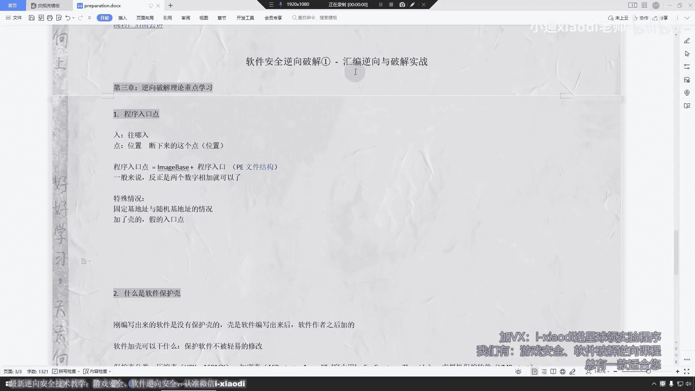
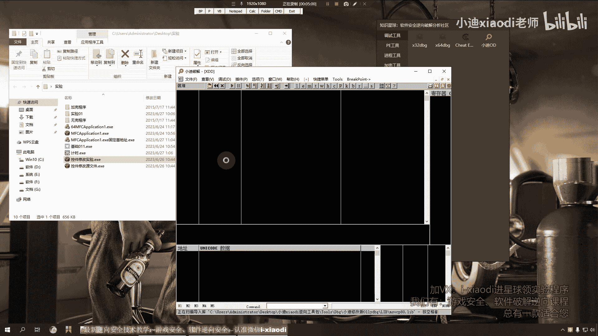
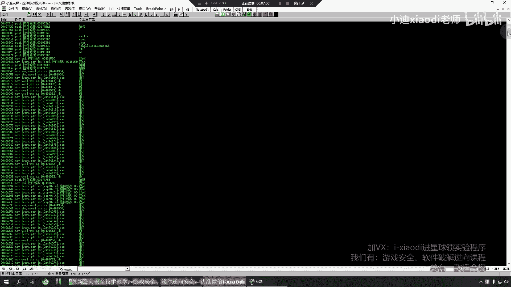
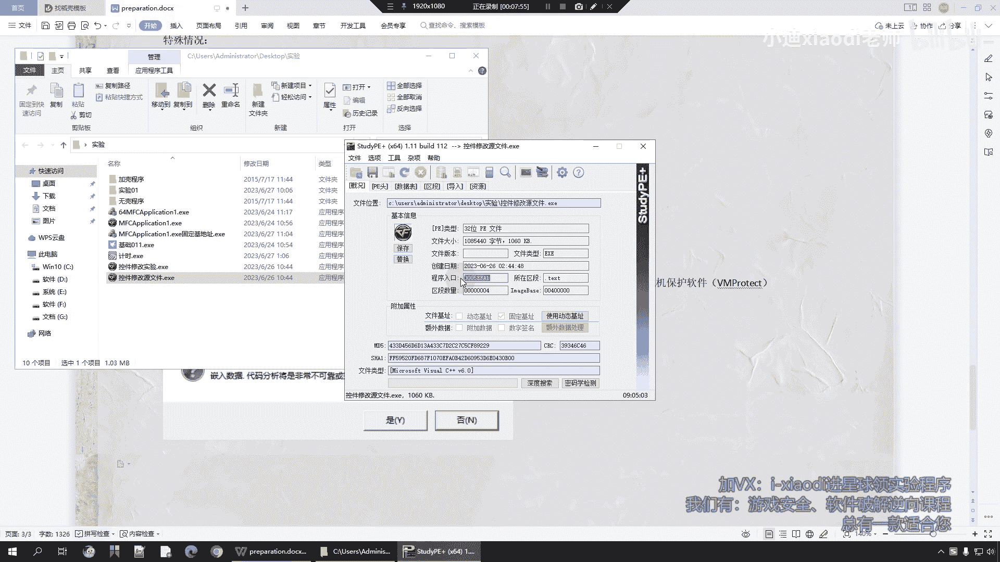

# 🧰 小白软件破解逆向工程师2023最新：3.2：什么是软件保护壳、加壳

在本节课中，我们将要学习什么是软件保护壳，以及加壳的基本过程。课程会先明确“刚编写出来的软件没有保护壳”这一基本概念，再说明保护壳是软件编写完成后由软件作者加上去的，接着介绍保护壳的常见分类，最后通过实际工具观察加壳前后软件在区段、入口点和分析提示上的区别。学完这一节，初学者应能直白地理解：保护壳是用来保护软件不被轻易修改的东西，加壳则是让软件从没有壳变成有壳的过程。

在进入分类之前，我们先把这个最基础的概念讲清楚：刚编写出来的软件没有保护壳，就像人刚出生时不穿衣服；壳不是软件天生就有的，而是软件作者在软件编写完成之后加上去的，类似人出生后由医生或父母给穿上衣服，而“穿衣服”这个技能是后来才学到或被赋予的。下面我们来看看无壳与加壳的基本关系。

## 🧱 小白软件破解逆向工程师2023最新：3.2.1：无壳与加壳的基本概念

上一部分我们明确了软件刚写出来时没有壳，本节中我们来看看“加壳”到底指什么。软件保护壳是被加上去的，软件从没有壳到有壳的这样一个过程，有一个术语叫作**加壳**。加的是什么壳？加的是保护壳。保护壳顾名思义，可以保护软件不被轻易修改。需要注意，保护壳不是让软件完全不能改；软件可以改，但加壳后不容易被轻易修改。原文用“有没有来、如来还没有来”的梗来表达这个意思，核心含义就是：能改，但不是轻易改。

从概念上可以写成下面这个公式：

```text
原始程序（无壳） --加壳--> 加壳程序（带保护壳）
```

也可以这样理解保护壳的目标：

```text
保护壳目标 = 让程序仍然能够运行 + 让程序不易被轻易修改 + 让代码分析不可靠或错误
```

明白了加壳的基本概念后，我们自然要问：保护壳有哪些类型？接下来就进入分类部分。

## 🗂️ 小白软件破解逆向工程师2023最新：3.2.2：保护壳的常见分类

上一节我们介绍了加壳是给软件加上保护壳的过程，本节中我们来看看保护壳可以分成哪几类。保护壳可以通过几种形式或几种专业类型来分类，常见分为三类：压缩壳、加密壳、虚拟机保护软件。下面先给出分类列表，方便初学者建立整体印象。

以下是保护壳的常见分类：

- **压缩壳**：常见有 UPX、ASPack。原文特别说明，UPX 是一种软件，ASPack 也是一种软件；这类压缩壳本身是软件，可以给写出来的软件进行加壳。
- **加密壳**：例如 ASProtect（原文提到可称为“穿山甲”）、ExeCryptor Protector、TMD壳等。
- **虚拟机保护软件**：常见简称 VMP 壳，也就是虚拟机保护壳；TMD壳也常被提到。

为了更直观，可以把分类写成代码形式：

```text
保护壳分类：
1. 压缩壳：UPX、ASPack
2. 加密壳：ASProtect、ExeCryptor Protector、TMD壳
3. 虚拟机保护软件：VMP壳
```

这些类型在软件保护中非常常见。理解分类之后，只看名词还不够，我们需要实际看一下加壳和没加壳的软件有什么区别。下面通过工具观察来验证前面的概念。



## 🔍 小白软件破解逆向工程师2023最新：3.2.3：加壳前后的实际区别

上一节我们列出了保护壳的常见分类，本节中我们来看看实际软件加壳前后的区别。首先打开 StudyPE 查一查一个已经加壳的软件，这个软件加的是压缩壳，具体是 UPX 压缩壳。压缩壳顾名思义，它会把程序压缩，所以一个很明显的特征是程序变小了。原文演示中可以看到原文件和压缩后大小出现差异，例如出现 6571000 这类数值对比，核心现象就是压缩后程序大小发生变化，通常会变小。

把这个 32 位 PE 文件拖到工具里查看，可以发现它仍然可以被识别出区段，但区段里会加上一些看起来乱七八糟的特征。工具中能看到名字显示为 UPX，说明它明显是 UPX 压缩壳。加壳后程序入口也会做一些更改。再对比原文件，正常区段应该是另一种样子，原文件的程序入口是真正的入口，而加壳后的程序入口是假入口。原文强调：加壳之后，它会给你一个假的入口点，这是直观现象。

接下来用调试工具观察。原文先提到 x32dbg 这类工具，后改用“小DOD”；32 位程序可以优先使用“小DOD”这个调试工具。把源程序拖过来，一切正常，没有任何错误提示。把压缩后的、也就是加了壳的程序拖过来，第一次运行时会出现提示。原文演示时为了排除缓存影响，会先清理相关配置再运行，因为之前拖过程序，工具可能默认执行弹窗配置。第一次跑带有压缩壳或加壳的程序时，工具会提示：压缩代码，可能被压缩加密，或大量嵌入数据，代码分析将是非常不可靠或完全错误的，并询问是否继续分析。这个提示非常显著，出现这种提示就说明软件被加了壳。

这个提示可以引用如下：

> 压缩代码，可能被压缩加密，或大量嵌入数据；代码分析将是非常不可靠或完全错误的；是否继续分析？

面对这个提示，点“是”或点“否”都一样，因为工具分析到的这些代码并不是真正的程序代码。这里可以理解为“明知山有虎，偏向虎山行”，但无论怎么选，分析结果都不可靠。加了壳之后的程序本身运行没有问题，因为加壳的本质是让程序依然能够运行，同时又把一些东西加密或隐藏起来。

还可以通过搜索字符串来观察。搜索加壳程序的字符串，会发现搜到的内容很少，原文演示中只有一个“贼”字；而把原程序拖过来运行后再搜索，会发现搜到的内容特别多。这个对比说明，加壳会真正把各种数据抹杀掉，或者全部隐藏起来。无论具体手段是隐藏还是其他方式，最终都可以用一句话概括：代码分析将是非常不可靠或完全错误的。



通过上面的实际观察，我们已经看到了区段变化、假入口和分析提示等现象。最后我们把这一节的核心内容收束一下，并总结保护壳的定义和显著特征。

## ✅ 小白软件破解逆向工程师2023最新：3.2.4：本节总结与显著特征

上一节我们通过 StudyPE 和调试工具观察了加壳前后的区别，本节中我们对内容做总结。什么是软件保护壳？直白地说，就是保护软件不被轻易修改的东西。保护壳可以分为压缩壳、加密壳和虚拟机保护软件。加壳的显著特征也需要记住，以下是几个关键观察点。

以下是加壳后的显著特征：

- **区段变化**：在 PE 工具中查看区段时，会有很明显的变化，可能看到 UPX 等特征名称。
- **程序入口变成假入口**：加壳后会给出一个假的程序入口，原文件中的真入口会被替换或隐藏。
- **分析工具出现提示**：把加壳程序拖到 OD 等分析工具中，会提示压缩代码、可能被压缩加密、大量嵌入数据，代码分析非常不可靠或完全错误。



本节课中我们一起学习了软件保护壳与加壳的基本概念，明确了软件刚写出来没有壳，壳是软件编写完成后由作者加上去的；加壳是软件从无壳到有壳的过程；保护壳用于保护软件不被轻易修改，但软件仍然可以改，只是不容易改；常见分类包括压缩壳、加密壳和虚拟机保护软件；实际观察中可以通过区段变化、假程序入口和分析工具提示来判断加壳现象。下一节课将进行软件加壳的实验。

