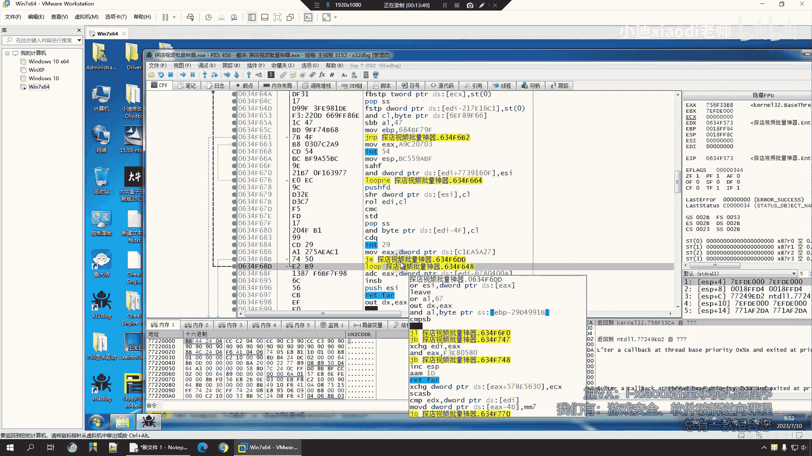

# 🧭 小白软件破解逆向工程师2023最新：3.21：实战破解：某探店视频批量软件网络验证爆破--BV1bx4y1o7Gb-


在本节课中我们将要学习一次实战破解流程。经过第三章重点破解基础理论的学习之后，我们至少要做一下向外的拓展，把前面学过的思路放到真实程序里走一遍。本节使用的程序是一个探店视频批量神器，我们会先运行程序查看大概信息，再梳理网络验证流程，然后依次尝试查壳、判断反调试、搜索字符串、在消息框函数下断点、回溯调用栈、修改跳转指令，最后用 NOP 填充让程序绕过卡密错误提示。整个教程面向初学者，尽量用直白的话解释每一步在做什么，以及为什么这样做。


## 🎯 小白软件破解逆向工程师2023最新：3.21.1：程序运行与网络验证流程


在明确本课目标之后，我们先把程序跑起来，看看它需要我们输入什么、点击什么，以及它大概会走哪条验证链路。运行这个程序后可以看到，它需要我们输入卡密，然后点击登录，这个动作应该就是去发送网络数据包。为了不把思路弄乱，我们可以先把这个流程打一下，也就是先把验证链路写出来。

整个验证流程可以先用下面的伪代码表示，方便初学者把思路串起来：

```text
输入卡密
-> 发送网络数据包到服务器
-> 服务器返回成功或失败，以及卡密相关的账号信息
-> 软件在点击登录按钮时进一步判断
```

从这段流程可以拆出以下关键环节，理解这些环节有助于后面决定从哪里下断点：

1. 首先需要输入卡密，这个卡密会被发送到服务器。
2. 程序会发送网络数据包到服务器，服务器再返回成功与否，或者返回各种相关的账号信息和卡密相关信息。
3. 服务器可能返回卡密的所有信息，也可能返回登录成功或登录失败的信息。
4. 有了这些返回信息之后，软件会进一步判断，判断的时机就是点击登录按钮的时候。


把这条链路看懂之后，下一节我们再来看看应该从哪些位置切入破解，也就是先梳理破解思路。这里要说明的是，流程看起来简单，但它决定了后面所有断点和修改是否有效，所以初学者不要跳过这一步。


## 🧩 小白软件破解逆向工程师2023最新：3.21.2：破解思路梳理


上一节我们介绍了程序的网络验证流程，本节中我们来看看破解时可以走哪些思路。围绕这个流程，我们大概有三个思路，第一个是查找卡密字符串，第二个是定位登录按钮功能，第三个是走其他情况。为了更直观地理解，可以把思路写成下面这个公式：

```text
破解思路 = 查找卡密字符串 + 定位登录按钮功能 + 其他情况（消息框断点）
```

以下是三个思路的具体说明，初学者可以先把它们当成排查顺序：

1. 第一个思路是查找卡密。我们可以输入一个卡密，然后看内存里有没有这个卡密。如果有，就可以像第一章或第二章前几章讲的那样，考虑它可能在本地做一些校验，也可以看看能不能搜到字符串。如果搜不到字符串，这条线索就放弃。
2. 第二个思路是登录按钮。也就是通过按钮去找这个按钮功能的位置，但登录按钮相关的内容现在还没有学到，所以暂时不能走这条路线。
3. 第三个思路是其他情况。什么是其他情况？我们点击登录后可以看到有一个信息框，这个信息框实际上调用了 Windows API 函数，一看就是消息框。

这里的消息框函数就是 `MessageBox`，它分为 A 版本和 W 版本，本质上是一个信息框，也就是消息框函数。函数显示的内容是“卡密错误，请检查卡密是否正确”。如果想获取它的一些信息，不妨在这个消息框上下一个断点。思路明确后，下一节我们先做破解流程的第一步，也就是查壳。


## 🛡️ 小白软件破解逆向工程师2023最新：3.21.3：查壳与反调试初探


上一节我们梳理了三个破解思路，本节中我们来看看破解流程的第一步：查壳。查壳的目的是先确认程序有没有被壳保护，以及壳的类型大概是什么。我们可以先用 ExeInfo PE 查一下壳信息，把程序拖进去后，它提示一个 `SVMP2` 初步信息，也就是说它推断这个程序有可能是 VMP 壳，也就是 VMProtect 这类壳。到底是不是 VMP 壳，可以点击区段查看，看到 `VMP`、`VMP`、`VMP` 这样的字样。查看区段时，如果看到 VMP 字样，就说明它有可能是 VMP 壳。


以下是查壳时可以观察的两个工具和判断点，方便初学者按步骤确认：

1. 使用 ExeInfo PE 拖入程序，查看初步信息，提示 `SVMP2`，推断可能是 VMP 壳。
2. 点击区段查看，看到 VMP 字样，说明它有可能是 VMP 壳。
3. 也可以使用 StudyPE 查看，把程序拖进去后点击区段，看到 VMP、VMP、VMP，这也是 VMP 的一个特征。也就是说，这些信息给我们的提示是：它极有可能是一个 VMP 壳。


查壳之后还要看它有没有反调试。我们可以先按 64 位调试方式尝试运行，直接把程序拖过来，调试器提示请使用 x32dbg 调试，于是我们打开 x32dbg，再把程序拖过来。运行后可以看到入口点，也就是入口断点。这个入口断点看起来是真的还是假的？实际是假的。继续运行后没有发现反调试，所以可以直接在这个调试器里跑起来。查壳和运行环境确认之后，下一节我们进入字符串搜索，看看输入卡密后能不能在内存里找到线索。


## 🔍 小白软件破解逆向工程师2023最新：3.21.4：字符串搜索尝试


上一节我们完成了查壳和反调试初探，本节中我们来看看第一个思路：字符串搜索。我们可以先点击登录，输入 `123456789`，然后点击登录，接着查看内存中有没有这个 `123456789`。搜索时可以选择当前模块，当前模块就是主模块，也可以搜索所有用户模块，然后按字符串搜索。稍等一会儿，搜索完成后，可以看到结果里看不到我们输入的 `123456789`，相关结果也不像我们要找的内容。


以下是字符串搜索时的观察过程，初学者可以跟着这个顺序排查：

1. 输入 `123456789` 并点击登录，然后搜索字符串。
2. 搜索范围可以先选当前模块，也就是主模块，也可以选所有用户模块。
3. 搜索结果中看不到输入的 `123456789`，相关结果也不像目标字符串。
4. 点击引用查看其他结果，也不是目标内容，很多结果一看就不像。
5. 其中有一条是 `0123456789`，前面多了一个 `0`，但我们并没有输入 `0`，所以这条线索不行。

通过字符串搜索没有找到明显入口，而通过登录按钮去找按钮功能位置的内容还没有讲到，所以只能走其他情况。其他情况的关键就是前面提到的消息框，因为点击登录后它会弹出信息框。下一节我们就在 `MessageBoxA` 上下断点，看看能不能断到关键位置。


## 🧷 小白软件破解逆向工程师2023最新：3.21.5：MessageBox断点与调用栈回溯


上一节我们尝试了字符串搜索但没有找到合适线索，本节中我们来看看其他情况，也就是围绕消息框下断点。因为程序点击登录后会弹出消息框，所以我们可以回到 CPU 窗口，按 `Ctrl+G` 输入 `MessageBoxA`，先在 A 版本上下一个断点。当不知道具体位置时，可以先把相关断点都打上，我们先在 A 上做测试，按 F2 下断点，然后点击登录。可以看到程序弹出“卡密错误，请检查卡密是否正确”，同时程序直接断下来了。断下来说明有一些关键信息就在这一带，双击可以看到这里就是调用的位置。

> 提示：`MessageBoxA` 和 `MessageBoxW` 是 Windows API 的消息框函数，A 和 W 是不同版本，实际程序可能调用其中一个。

不过这一层还没有特别关键的位置，我们可以往下看，但没有发现明显关键点。没有关键点时，后面会讲其他处理方式。现在我们双击来到 `BD` 这样一个位置，这是返回的位置。接下来可以点击调试，再点击运行到返回。稍有停顿后点击确定，继续运行到返回，然后按 F8。F8 的意思是执行完这段代码。走到这一层，仍然没有特别关键的位置。再点击运行到返回，再按 F8，这边也没有特别关键的地方，关键性的跳转也没有出现。再运行到返回并按 F8，走到这一步就稍微有点意思了。


以下是回溯调用栈时可以关注的变化，初学者可以按这个顺序观察：

1. 从当前位置往上看，可以看到程序是从某个位置跳出来的。
2. 上方有一个箭头，这个箭头刚好能跳过去，也能跳回来。
3. 箭头所在位置对应的是卡密错误分支。
4. 如果把这里的跳转直接改成 `JMP`，就可以强制跳过去。

将这里改成 `JMP` 后，可以看到程序跳过去了，再点击登录，仍然提示卡密错误。此时消息框和刚才不一样了，说明下面还有判断，仍然提示“卡密错误，请检查卡密是否正确”。点击确定后继续往下看。跳过来之后，程序从当前位置跳到另一个位置，然后继续往下走。往下走的过程中，可以看到这里有一个跳转，那里还有一个跳转。查看 `1A37` 位置，它跳转到 `1A37`，距离还有点远。跳到 `1A37` 后可以看到“登录成功”字样，这里有一个很关键的东西，就是登录成功。也就是说，如果做简单测试，从当前位置跳到目标位置，再一步步执行，最后强制往下跳一下，就能到登录成功。所以可以把这里改成 `JMP`，点击确定。程序往下走时会直接跳转到登录成功，按回车确认后可以看到登录成功。

不过实际点击登录后仍然提示“卡密错误，请检查卡密是否正确”，说明还有一个跳转，这个跳转可能出了一些问题。下一节我们继续在这个位置下断点，把剩下的跳转处理掉。


## 🛠️ 小白软件破解逆向工程师2023最新：3.21.6：修改JE为JMP并定位登录成功


上一节我们通过消息框断点回溯到了登录成功附近，本节中我们继续修正跳转。我们在这里按 F2 下一个断点，然后点击登录，程序断下来了。接着按 F8，可以看到它没有按预期走，而是往下执行了。也就是说，程序执行到这个位置时，里面可能进行了一些其他操作。如果我们不想让下面的代码执行，不管它做了什么，都不想让它执行，可以直接把 `JE` 改成 `JMP`。

以下是修改跳转时的操作顺序，初学者可以按步骤理解：

1. 把断点取消，把 `JE` 直接改成 `JMP`。
2. 点击确定，这样程序会跳到目标位置，然后再跳到另一个位置，最终登录成功。
3. 点击登录后仍然提示“卡密错误，请检查卡密是否正确”，说明还有分支需要处理。
4. 再从这里下一个断点，按 F8 单步走，观察它到底怎么跳。
5. 单步执行后发现，在登录成功这里还有一个选择性跳转，这个跳转变红了，说明它要跳到下面去，而下面就是卡密错误。
6. 不想让它出现卡密错误，就直接把这个跳转的二进制用 `NOP` 填充。

到这里，跳转关系可以用下面的代码表示，方便记忆：

```text
JE -> JMP
跳转到卡密错误分支的指令 -> NOP 填充
```

下一节我们实际运行程序，验证 NOP 填充后的效果。


## 🧪 小白软件破解逆向工程师2023最新：3.21.7：NOP填充与程序自动关闭现象


上一节我们找到了需要处理的跳转，本节中我们实际运行软件验证效果。先运行软件，点击确定。刚才已经把断点取消掉，返回去，回到刚才下断点的位置，按 F2 取消断点，然后按回车，来到对应位置。把这个跳转的二进制用 `NOP` 填充，点击确定，然后点击登录。此时可以看到登录后显示“5 秒后自动关闭”，也就是 5 秒后自动关闭，随后这个程序就自动关闭了。

以下是本节的验证现象和说明，方便初学者理解结果：

1. 对跳转指令做 `NOP` 填充后，程序不再走卡密错误分支。
2. 点击登录后出现“5 秒后自动关闭”的提示。
3. 随后程序自动关闭。
4. 当然这个程序有没有功能另说，这是从网络上搜集的一个程序，有可能没有完全破解完。
5. 但这个流程展示了最基本的思路，先给大家看一下，最基本的思路就是如此。

验证完现象后，下一节我们说明实验程序的获取方式和后续学习方向。


## 📦 小白软件破解逆向工程师2023最新：3.21.8：实验程序获取与后续学习


上一节我们看到了 NOP 填充后的运行现象，本节中我们说明实验程序获取和后续学习安排。如果大家想要获取这个实验程序，可以加一下知识星球。知识星球怎么加，在以往的视频里都有说明。也可以加我的微信，然后获取相应的一些工具，再加入知识星球。这个内容就是我们的拓展，目的是了解这个程序、这个软件到底是怎么破解出来的，它是一步又一步通过观察代码流程得出的。

以下是后续学习中需要了解的内容，初学者可以提前有个印象：


1. 破解时会看到很多汇编代码，这些内容在今后会给大家做相应演示和讲解。
2. 了解汇编代码之后，就可以自己去编写一些脚本，所以这个内容还是比较有用的。
3. 回去之后要自己动手练习，能掌握就掌握，不能掌握也先看一遍，大概知道流程即可。
4. 最好拿着实验程序亲手操作一遍。
5. 然后再去拓展操作其他软件，看看有没有不同。不同软件肯定有差异，不是所有程序员写代码都一个样。如果真是一个样，直接把所有代码复制粘贴不就行了。

完成这些说明后，最后我们做一个总结，把本课的实战流程串起来。


## ✅ 小白软件破解逆向工程师2023最新：3.21.9：课程总结与练习建议


前面我们完成了查壳、字符串搜索、消息框断点、调用栈回溯、跳转修改和 NOP 填充，最后我们总结本课内容。本节课中我们一起学习了某探店视频批量软件的网络验证爆破实战：先运行程序查看信息，梳理输入卡密、发送网络数据包、服务器返回结果、点击登录时进一步判断的流程；然后整理出查找卡密字符串、定位登录按钮功能、走其他情况三个思路；接着查壳发现 VMP 特征，确认没有反调试；字符串搜索没有找到合适线索后，转向 `MessageBoxA` 下断点；通过运行到返回和 F8 回溯调用栈，找到卡密错误分支和登录成功分支；再把 `JE` 改成 `JMP`，把跳转到卡密错误分支的指令用 `NOP` 填充，最终程序出现“5 秒后自动关闭”并自动关闭。需要再次说明的是，这个程序是从网络上搜集的，有可能没有完全破解完，但本课展示的是最基本的观察代码流程和修改跳转的思路。



以下是本课建议的练习方式，方便初学者巩固：

1. 拿着实验程序亲手操作一遍，把每个断点和跳转都走一遍。
2. 再拓展操作其他软件，观察不同软件之间的差异。
3. 不要假设所有程序员写代码都一个样，不同软件肯定有差异。
4. 看一遍教程，大概知道流程即可，能掌握就掌握，不能掌握也先保留印象。

本节课中我们一起学习了网络验证爆破的基本流程和跳转修改思路。下期再见。

