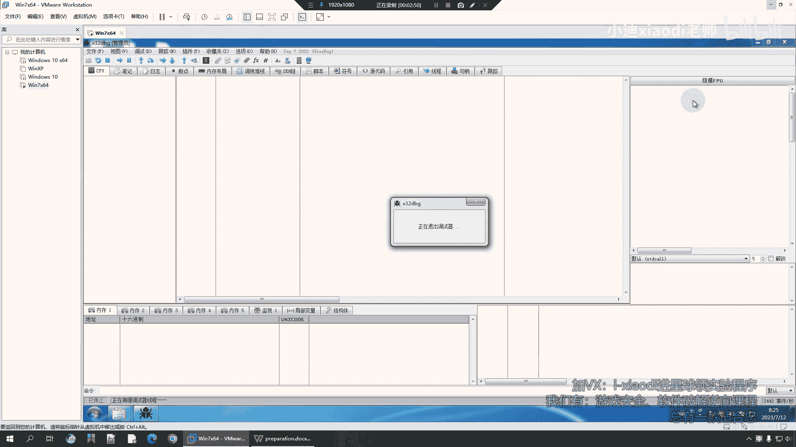
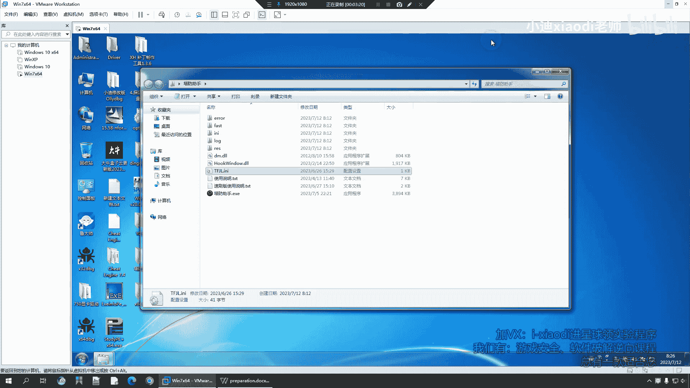

# 🧰 小白软件破解逆向工程师2023最新：3.22：实战破解某视频下载器网络验证爆破窗口--BV1EV411T7yV-

## 🧭 小白软件破解逆向工程师2023最新：3.22.1：本节概述

在本节课中我们将要学习一个实战案例：某视频下载器的网络验证爆破窗口。本篇是第二三课，再说一个实战，主题是60%通杀辅助网络验证卡密破解技术。大部分网络认证辅助都能用这个思路去破解，方法很简单，没有特别高的技术含量，只需要用工具即可。对应视频编号为BV1EV411T7yV-。本教程会把口语化步骤整理成可照着做的流程，尽量用大白话解释，让初学者也能看懂。上一段概述了本节要处理的目标和核心思路，下面进入实战目标与准备环节。

## 🎯 小白软件破解逆向工程师2023最新：3.22.2：实战目标与准备

本节先弄清目标对象。这个目标不是辅助，实际上是一个下载器，是之前在网上收集的。首先运行这个下载器，运行后会要求输入卡号。随便输入卡号并点击登录，它会提示“卡号不存在”。这一步说明正常的卡密校验正在拦截登录请求。以上是初步现象，下面看看用工具附加进程后会发生什么。

## 🛡️ 小白软件破解逆向工程师2023最新：3.22.3：附加进程与反调试检测

上一节看到的是“卡号不存在”，本节用工具附加这个进程。附加好之后点击登录，它会提示“发现非法工具”。出现这个提示说明目标程序有检测、有反调试检测。核心判断可以用下面这个公式描述：

```text
登录按钮点击 && 调试器已附加 -> 弹窗“发现非法工具”
```

碰到这种情况，不一定非要跟反调试硬钢。点确定后程序会退出。遇到这种程序不一定非要硬钢，先看今天用的方法。处理时先关闭有点卡的工具，然后重新运行目标程序，再打开附加。附加完全没问题。以下是附加阶段的基本操作：

- 第一步，把目标程序跑起来。

- 第二步，打开工具并附加进程，确认附加正常。

这里解释一下，先关闭工具再重开，是为了避免卡顿影响后续操作；附加正常则说明工具已经连上目标进程。接下来要切换主模块，下面进入主模块操作环节。

## 🧩 小白软件破解逆向工程师2023最新：3.22.4：切换主模块

上一节完成了进程附加，本节点击符号。符号里面是模块列表，需要切换到主模块。这是之前讲过的知识点：点击符号，然后双击切换到主模块。流程可以用下面的代码描述：

```text
符号 -> 模块列表 -> 双击主模块
```

完成主模块切换后，下一步进入插件操作。以下是切换到主模块后的关键动作说明：

- 点击符号。

- 在符号里找到模块列表。

- 双击主模块完成切换。

这一步的意义是让后续插件针对正确的模块工作。主模块切换完成后，就可以进入一键暴力测试环节。

## 🧨 小白软件破解逆向工程师2023最新：3.22.5：插件一键暴力测试

上一节切到了主模块，本节点击插件，然后点击EWND，点击Open Window，再直接点击这里的一键暴力测试。功能就出来了，界面直接出来了。界面出来意味着破解成功，软件可以直接使用。核心结果可以用下面这个公式描述：

```text
破解成功 = 一键暴力测试后功能窗口出现
```

这个工具非常好用，操作路径可以再强调一次：点击插件，点击Open Window，在里面执行一键暴力测试，功能就出来了。以下是本节的关键操作路径：

```text
插件 -> EWND -> Open Window -> 一键暴力测试 -> 功能窗口出现
```

这段路径就是本节的核心。到这里，爆破窗口已经完成。下一步看看这个插件适用于哪些程序。

## 📦 小白软件破解逆向工程师2023最新：3.22.6：适用范围与下集预告

上一节完成了一键暴力测试，本节说明适用范围。这个插件适用于易语言开发的程序，也就是E语言开发工具开发的程序。大部分辅助、很多小工具和小程序都是易语言开发的，用这个工具都能破掉。适用范围可以用下面的公式概括：

```text
目标程序 ≈ 易语言开发的小工具/辅助 -> 可尝试一键暴力测试
```

到这里今天的内容基本讲完。下面是下集预告，先关闭当前程序。以下是下集要处理的对象和观察点：



- 下集讲塔房助手，看一下怎么处理。

- 塔房助手打开后会有新版本提示。

- 出现收费等提示，需要把这些提示过掉。

- 过掉提示后，查看里面所有的窗口。

- 这个应该是可以看到的辅助工具，写得挺板正，非常板正。

- 下节课就处理它，跟它碰一碰。

以上是下集预告内容。下节课再见。



## ✅ 小白软件破解逆向工程师2023最新：3.22.7：本节总结

本节课中我们一起学习了：针对某视频下载器，先运行并输入任意卡号，看到“卡号不存在”；用工具附加进程后点击登录，出现“发现非法工具”，据此判断存在反调试检测；遇到检测不硬钢，改为关闭卡顿工具、重新运行程序、附加进程、点击符号并双击切换主模块，再通过插件EWND的Open Window执行一键暴力测试，功能窗口出现即表示破解成功；该插件主要适用于易语言开发的小工具和辅助程序。下节课将处理塔房助手的新版本和收费提示，并查看其所有窗口。以上就是本节教程内容。

