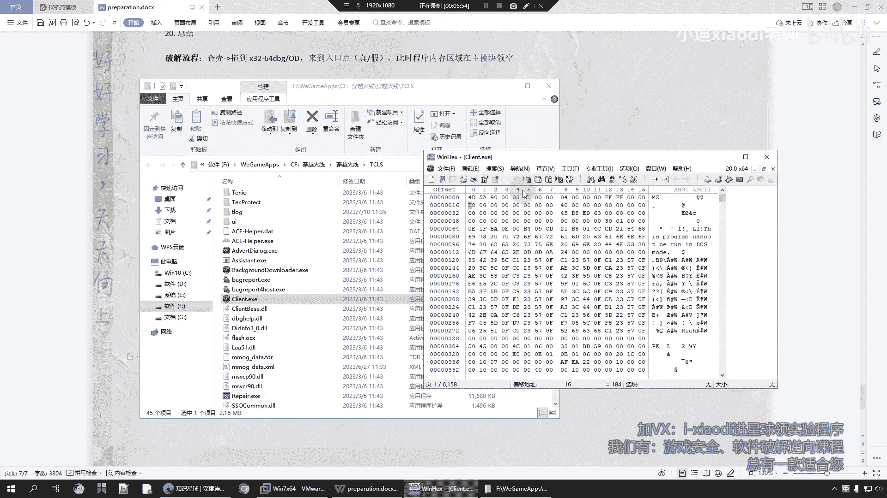

# 🔐 小白软件破解逆向工程师2023最新：3.22：继续跟进——二进制文件查看，窥探不让你看的东西


在本节课中，我们将要学习如何查看二进制文件。上一节课我们进行了一个软件的破解操作，在破解过程中产生了一个文件，这个文件双击打开是看不到任何东西的。那么这类文件到底是什么？里面保存了什么信息？我们应该用什么工具去查看它？带着这些问题，我们进入今天的内容。

## 💾 从破解遗留文件说起：一个打不开的文件

先来回顾一下上节课的操作。我们在破解一个软件的时候，软件会要求我们输入卡密，当我们点击"记住卡密"这个按钮之后，程序就会在某一个位置上生成一个文件，这个文件是在我们破解完成之后才产生的。


现在我们找到这个文件，双击运行它，你会发现它根本打不开。这其实就暴露了一个问题：当遇到这种打不开的文件时，我们应该怎么办？它里面到底藏着什么秘密？如果我们特别想看看这个文件的内容，又应该怎么做？

其实这个问题并不复杂，解决思路也非常简单，我们只需要借助一个专门用来查看二进制文件的工具就可以了。这个工具的名字叫做 WinHex，我们已经把它上传到了对应的工具包板块里面。大家可以看到在资源区有一个"工具包"版块，WinHex 就放在里面，直接下载就行。

下载完成之后，我们把它运行起来，打开之后的界面就是这样的。这个工具是中文版的，操作上比较友好。我们需要做的操作非常简单：直接把那个打不开的文件拖拽到这个工具的窗口里面，松开鼠标，就能看到文件的内容了。

## 🔍 二进制保存：文件背后真正的面目


当我们把文件拖进 WinHex 之后，屏幕上会显示出一堆看似杂乱无章的数据。但你有没有想过，这到底是什么东西？实际上，这个文件就是我们点击"记住卡密"之后，软件把它保存在本地的一个卡密信息。看到这里，你可能会觉得，原本神秘无比的文件，这时候就一点也不神秘了。

那么这种保存方式到底是怎么一回事？这里要给大家解释一下文件保存的方式。这种文件保存方式在计算机世界里被称作二进制保存，也就是二进制保存方式。用这种方式保存的文件，它的文件后缀通常不是常见的 .txt、.doc 或者 .xlsx，所以其他常规软件都打不开它。它只是通过二进制的方式把数据写进文件里，读取的时候，也要用二进制的方式去读取。

说白了，二进制保存和读取，就是计算机最底层的数据处理方式。我们可以用下面的公式来理解这个过程：

```
文件内容 = 二进制编码存储
读取方式 = 二进制方式读取
修改方式 = 二进制方式修改
```

也就是说，二进制文件的数据，本质上就是一堆用 0 和 1 表示的字节序列，只不过 WinHex 这类工具会用十六进制把它显示出来，方便我们人类观看和修改。所以，二进制文件本身并没有任何神秘之处，它的本质就是通过二进制的方式进行增删改查而已。

## 🗂️ 二进制文件的常见应用场景

了解了二进制保存的基本概念之后，我们再来看看这种保存方式到底在哪些地方会出现。实际上，这种二进制保存方式在日常使用中还是比较常见的，比如游戏、某些商业软件，还有带有注册文件的程序。

有一些软件在安装或者使用的时候，会生成带有注册性质的文件。这类注册文件有一个特点，就是它可能会把使用时间的限制信息写在本地文件中。比如，你安装了一个限时试用的软件，它可能会在你本地的某一个特殊文件里记录下你第一次使用的日期，然后根据这个日期来计算你的试用期什么时候结束。如果哪天你发现了这个文件，并且它的后缀名看起来特别奇怪，不知道是什么类型的文件，那么你就可以用我们今天讲的 WinHex 这个工具，把它拖进去看一看。


拖进去之后你会发现，这个文件里面可能就很清楚地记录着你的使用时限日期。如果找到了这个日期，你把它修改一下，比如把截止日期改成好几年之后，那么你就可以绕过时间的限制，实现无限期使用。也就是说，你就成功破解了它的时间限制。

当然，这种方法有一个大前提：就是软件本身不联网。不联网的软件是可以这样操作的，因为你不联网，软件就没有办法把本地的修改结果和服务器上的数据进行比对。一旦软件联网，服务器那边就会记录下你的真实使用状态，光改本地文件就没有意义了。

## 🎮 实战案例：穿越火线游戏文件中的二进制内容

上面我们说的注册文件，只是二进制文件场景中的一个例子。接下来我们再看一个大家更熟悉的例子，那就是游戏文件。我们随便拿一个游戏来演示，比如说穿越火线（CrossFire）。

在穿越火线的安装目录下，你会发现里面有很多文件。其中有一个文件叫 TDR，你可能就不知道这个文件是什么类型的。说实话，一般情况下，我们确实也不知道 TDR 文件到底是个什么东西。不过没关系，既然不知道，我们就干脆直接把它拖进 WinHex 里看一下里面大概是什么内容。

拖进去之后，你就会发现，这个文件实际上就是一些通过二进制方式保存的数据。从 WinHex 右侧的文本显示区域，你可以看到它里面写着类似于"2012"这样的年份信息，还有一些看起来像文件名或者校验码的东西。再往下看，你还会发现这段数据里面记录的内容，其实是对整个目录下的文件做一些校验。也就是说，游戏在启动的时候会读取这个文件，用它来验证安装目录里的文件有没有被人改动过，如果有变动，游戏可能就会报错或者拒绝启动。

接下来我们再看看另一个文件，比如 DET 后缀的文件。同样把它拖进 WinHex 里面，你会看到里面有 "PNG" 字样，这说明它引用了 PNG 图片素材。继续往下翻，还能看到 "name"、"size"、"style" 之类的字段，这就表示文件中保存了一些资源的名称、大小和样式信息。再往上看，还能看到 "UTF-8" 的编码标记，说明这部分文本信息是用 UTF-8 格式编码的。

所以说，用 WinHex 这个工具，我们确实能够从这些二进制文件中看出一些门道来。虽然不能百分之百还原原始结构，但至少能让你大致猜到这个文件是干什么用的、里面存了哪些数据。

## 🧠 多文件同时查看的小技巧

最后再给大家分享一个使用 WinHex 时的小细节，虽然内容不多，但是对于提升操作效率非常有帮助。

当你一次性拖入多个文件到 WinHex 里查看的时候，如果你发现某个之前打开过的文件找不到了，不要着急。在 WinHex 的右上角有一个标签按钮，你点一下这个按钮，所有刚才打开过的文件就会全部列出来了。你可以挨个关掉不需要的标签，也可以双击任意一个文件切换到对应的内容，还可以直接拖动这些标签栏来调整顺序。这样即使文件开多了，也不会弄混，查找起来也方便很多。

## 📝 总结



本节课我们一起学习了二进制文件的查看方法。我们首先从破解软件后遗留的一个打不开的文件说起，引出了二进制保存这个概念。然后我们介绍了 WinHex 这款工具的基本用法，通过把一个打不开的文件拖进去，发现它其实保存的是本地的卡密信息。我们还用公式的方式总结了二进制文件的核心特征，就是说二进制文件以二进制方式保存，也以二进制方式读取。此外，我们一起探讨了二进制文件在注册文件和游戏文件中的实际应用场景，看到了 TDR、DET 等游戏文件中保存的校验信息和资源描述数据。最后我们还学会了如何管理 WinHex 中多个已打开的文件标签。希望这节课的内容能帮助大家理解二进制文件的本质，以后再遇到后缀奇怪、打不开的文件时，就知道怎么去窥探它里面的秘密了。
