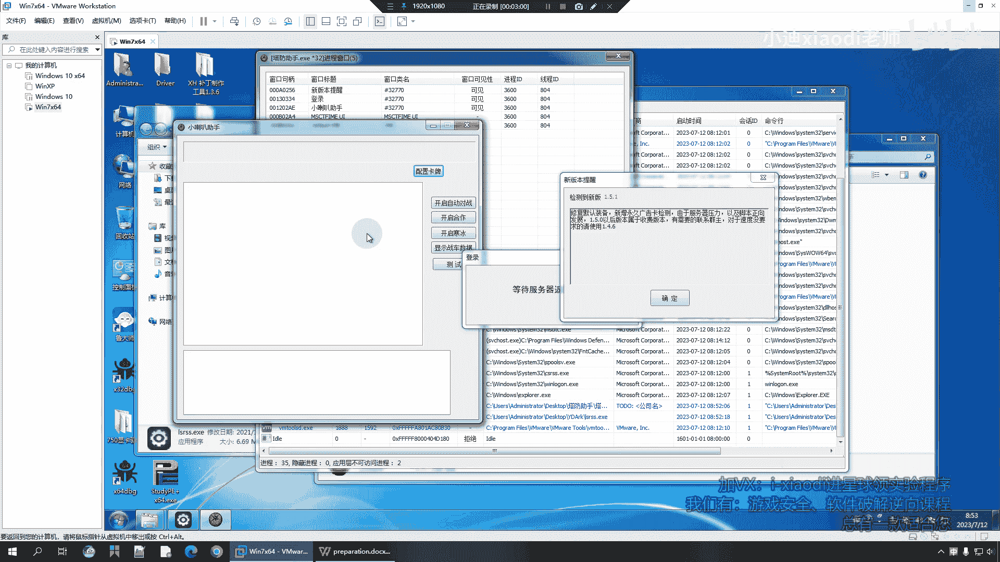

# 小白软件破解逆向工程师2023最新：3.24实战破解：某塔防助手辅助程序窗口爆破 🔧

## 📋 本节概述

在本节课中，我们将要学习如何对某塔防助手辅助程序的弹窗进行实战爆破。上节课已经预告过这个案例，这节课我们正式进入操作环节。我们的主要任务是绕过程序运行时的“新版本提醒”窗口，从而进入程序内部，查看它真正有用的功能。

---

## 🧐 程序初步分析

在开始破解之前，我们先来了解一下这个程序的基本情况。当我们运行某塔防助手之后，程序会弹出一个新版本提醒窗口。我们需要观察这个程序的界面和表现，来判断它大概是用什么语言编写的。

这个程序看起来像是 **Visual C++ 编译的 MFC 程序**（即 C++ 编写的 Windows 桌面应用），当然这只是一个推测。有一点可以确定的是，它**不是易语言**编写的程序，因为从界面的风格和控件的样式来看，不太符合易语言程序的特征。原始文件名是“super”开头的某个名称，这里我们不具体展开了。

当程序启动时，我们点击关闭新版本提醒窗口，瞬间会有一个大窗口弹出来。这说明程序在编写代码的时候，其实主窗口已经创建并加载了。但是程序检测到版本号不符合要求（或者触发了其他条件），于是就把主窗口隐藏起来了，只显示一个次窗口来提示用户升级版本。这个次窗口就是我们在屏幕上看到的新版本提醒弹窗，而主窗口是背后那个大窗口，只是被隐藏了而已。

---

## 🛠️ 爆破工具准备

要完成爆破操作，我们需要使用一个专用的窗口爆破工具。这里使用的工具已经上传到知识星球了，大家可以在工具包板块自行下载。工具的安装和打开非常简单，我们直接运行它即可。运行起来之后，工具的主界面会显示当前系统中所有正在运行的进程列表，我们只需要在列表中找到目标进程即可。

---

## 🔍 查看进程窗口

工具运行起来之后，我们需要在进程列表中找到塔防助手的进程。操作步骤如下：


在进程列表中找到“塔防助手”，然后点击鼠标右键，在弹出的菜单中选择“查看”，接着点击“查看进程窗口”。这时，工具的窗口中就会列出该进程关联的所有窗口信息。

通过这个操作，我们会看到如下几个窗口：**新版本提醒**、**登录**、**小喇叭助手**。其中“新版本提醒”就是我们想要绕过的弹窗，而“小喇叭助手”则是程序的主要功能窗口。此外还有一个“登录”窗口，里面显示着“等待返回服务器数据”的提示信息。这些窗口信息能够帮助我们了解程序的窗口结构，从而确定需要处理哪些窗口。

---

## ⚡ 激活与冻结窗口操作

现在我们看到了这些窗口，但是遇到了一个问题：**点击“小喇叭助手”窗口，发现点不动，无法操作**。这是因为当前“新版本提醒”窗口处于最顶层，它处于激活状态，抢占了用户交互的焦点。而左边的“小喇叭助手”窗口处于冻结状态，也就是说它虽然存在，但无法接收用户的鼠标和键盘输入。

解决办法非常简单，操作步骤如下：

在工具中选中“小喇叭助手”，点击鼠标右键，然后选择“激活窗口”按钮。这样就能让“小喇叭助手”窗口变为激活状态，可以正常交互了。

激活之后，我们再回到“新版本提醒”窗口，在工具中选中它，点击鼠标右键，选择“冻结窗口”。这样就能让“新版本提醒”窗口失去焦点，不再抢占交互。经过这两步操作，基本上就没有什么问题了，主窗口成功被爆破出来了。

```text
激活窗口（选中目标窗口 → 右键 → 激活窗口）
冻结窗口（选中目标窗口 → 右键 → 冻结窗口）
```

---

## ✅ 验证爆破结果

窗口被成功爆破出来之后，我们可以看到“小喇叭助手”的完整界面，大窗口已经显示出来了，我们可以尝试点击界面中的一些功能，比如卡牌之类的选项。程序的主界面已经完全暴露出来了，说明爆破成功。关于卡牌的具体玩法，这里就不赘述了，因为不是本课程的重点，重点是整个爆破窗口的流程和思路是可行的。



---

## 💡 方法总结与适用性说明

以上就是一个完整的爆破窗口的实战过程。这种方法适用于很多程序，但并不是一种百分百能够实现的方法。在实际操作中，我们大多通过**排除法**来试验，也就是说，如果一个方法不行，就换另一种方法去尝试。比如对于这类带有弹窗的程序，我们就可以直接使用工具来爆破窗口、激活窗口、冻结窗口，操作起来非常方便。这就是本节课的全部内容，感谢大家的观看，我们下节课再见。
