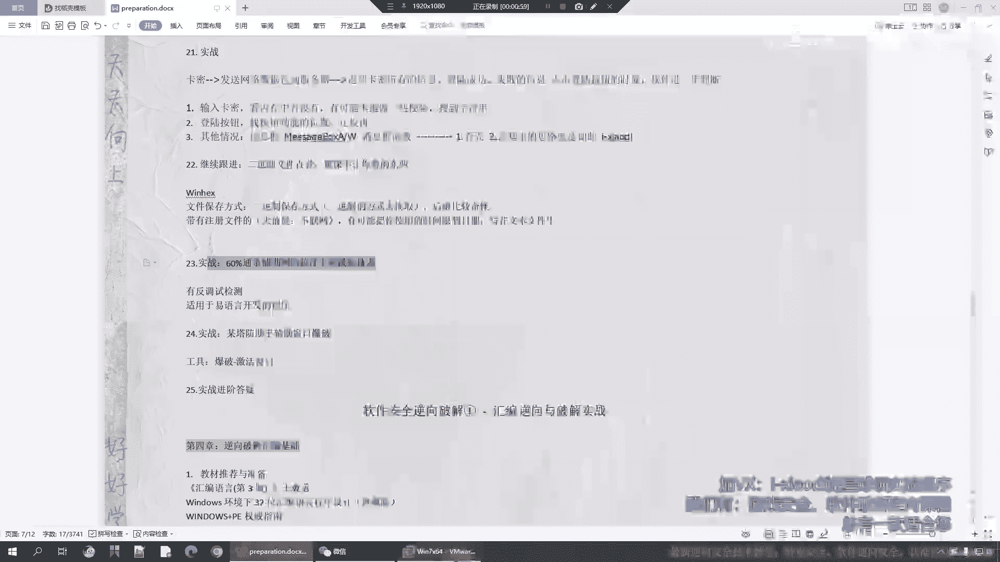
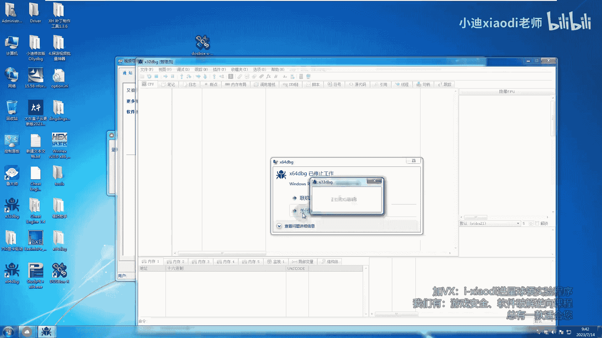
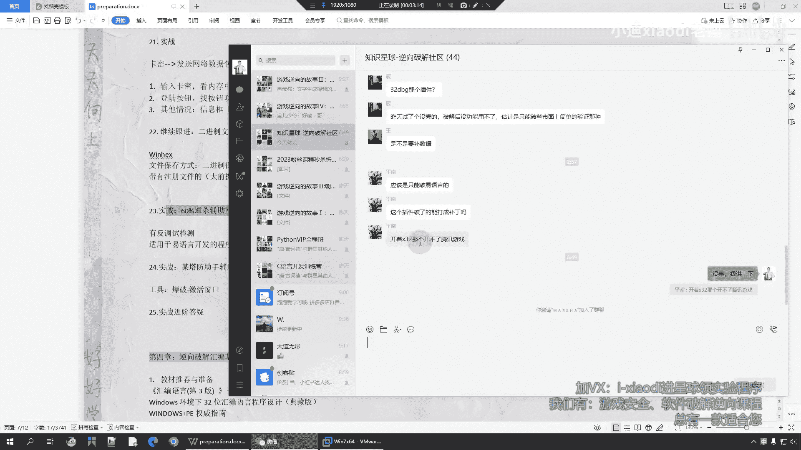

# 小白软件破解逆向工程师2023最新：3.25：实战卡密爆破通杀进阶答疑 🧰


在本节课中我们将要学习第三章第二十五节课“实战进阶答疑”的内容。本节对应视频BV1aP411k7Gx-，主要把大家在学习过程中提出的疑问穿插到第三章实战板块里进行说明。课程会围绕插件破解反馈、破解流程还原、脱离调试后的功能验证，以及关闭x32的临时处理思路展开。整体内容偏向实操答疑，目的是让初学者能看懂每一步在做什么，以及遇到类似问题时该从哪里入手理解。


## 小白软件破解逆向工程师2023最新：3.25.1：问题背景与本节目标 🎯


在进入具体操作之前，本节中我们来看看课程一开始提到的用户反馈和疑问。这些反馈来自“平南铁铁”，他提到插件可以直接破解，并认为视频真好使。这个反馈对应的内容是第23课《实战60%通杀辅助网络验证卡密破解技术》。他还表示自己试了不少都能直接破，相当于“光速变成脚本小子”。从一定程度上说，这也是对视频教程的一种认可，说明教程可以较快地让学习者掌握相关破解技术。

以下是本节中整理出的反馈和疑问：

- 平南铁铁反馈：插件直接破解了，视频真好使。

- 这个反馈说的是第23课《实战60%通杀辅助网络验证卡密破解技术》。

- 他试了不少都能直接破，光速变成脚本小子。

- 这从一定程度上认可了视频教程可以快速让学习者掌握破解技术。

- 他还问：应该是只能破1元的插件，已经破了的能打补丁吗？

- 他还提到：开着x32就开不了腾讯游戏，他破解的肯定是一个腾讯游戏相关的辅助。


这些反馈说明，大家在实操中不仅关心“能不能破”，还会关心“破完之后能不能打补丁”和“开着x32会不会影响腾讯游戏”。因此，本节就把这个问题录一下，重点说明怎么绕过这一环，也就是怎么才能关掉x32。理解了这些背景后，下面我们进入破解流程的还原。


## 小白软件破解逆向工程师2023最新：3.25.2：破解流程还原与关键操作 🔄


在了解了前面的反馈和目标之后，本节中我们来看看破解流程的还原。课程首先假设当前打开的是一个辅助程序，然后打开破解程序并进行附加，附加成功后进入后续操作。第一步是切换到主模块，切换过来之后直接点击插件，再点击Window，直接进行暴力测试。插件出来之后，其他内容先不用管，直接点击文件，再点击脱离即可。点击脱离之后，就可以把这个程序关掉，看到程序关掉即可。



以下是还原出来的关键操作流程：

- 假设当前打开的是辅助程序。

- 打开破解程序并附加，附加成功。

- 第一步切换到主模块。

- 切换过来之后，直接点击插件，再点击Window，直接暴力测试出来。

- 插件出来之后，其他不用管，直接点击文件，再点击脱离。

- 直接点击脱离即可。

- 然后可以把程序关掉，看到关掉即可。


为了更直白地表示这个过程，可以把核心流程写成下面的公式：


\[
\text{附加目标进程}\rightarrow\text{切换主模块}\rightarrow\text{插件+Window暴力测试}\rightarrow\text{文件+脱离}\rightarrow\text{关闭程序}
\]




也可以用伪代码表示同样的操作顺序：


```text
附加(目标进程)
切换到主模块
插件 -> Window -> 暴力测试
文件 -> 脱离
关闭(破解程序)
```


这样脱离之后，程序就可以继续使用，功能还是可以用的。完成上面的脱离操作后，本节中我们来看看脱离后的功能验证，以及再次附加另一个程序的演示。


## 小白软件破解逆向工程师2023最新：3.25.3：脱离后的功能验证与再次附加演示 ✅


在完成上面的流程之后，本节中我们来看看脱离后的功能是否还能正常使用。课程中演示了设置保存目录，可以直接设置一下；其他一些东西点击开启，可以看到监听启动成功，这些都能用。也就是说，直接点击脱离就可以完成操作。比如双击一个程序，点击文件，点击脱离，再次点击文件，点击脱离，就可以脱离那个调试程序。脱离之后，这里会显示脱离成功，大概这边的数据就不显示了，然后就可以关掉。

以下是功能验证和再次附加演示中的操作要点：

- 这样脱离之后就可以使用，功能还是可以用的。

- 设置保存目录时，可以直接设置一下。

- 其他一些东西点击开启，监听启动成功，这些都能用。

- 直接点击脱离就可以；例如双击一个程序，点击文件，点击脱离，再次点击文件，点击脱离，就可以脱离调试程序。

- 脱离之后这里显示脱离成功，大概这边不显示数据，然后就可以关掉。

- 随便再附加另外一个程序：先关掉，启动任务模拟器，结束进程数，随便开一个程序，比如wix，来附加。

- 然后脱离，现在显示运行中，然后脱离，显示已停止调试结束，就什么也没有了，这时候关掉即可。


这些演示说明，脱离调试之后并不影响基本使用，关键是把附加、测试和脱离的步骤走顺。功能验证完成后，本节中我们来看看关闭x32的临时处理思路，以及为什么这里不直接讲打补丁。


## 小白软件破解逆向工程师2023最新：3.25.4：关闭x32的临时思路与补丁说明 🛠️


在验证功能之后，本节中我们来看看碰到不能开着x32时该怎么处理。课程说明，这种情况就是当你碰到不能开着x32的问题时，x32会被腾讯游戏检测为非法工具、黑客工具之类。因此这里不用打补丁，打补丁会比较麻烦，所以不用打补丁。后面课程会说怎么去打这种补丁，当然这种东西也会讲。本节只是先说一个临时的解决方案，帮助大家理解当前这一环的处理思路。

以下是本节关于x32和补丁的说明：

- 这个内容对应的是：当你碰到不能开着x32的问题时，需要绕过这一环。

- x32会被腾讯游戏检测为非法工具、黑客工具之类。

- 所以不用打补丁，打补丁比较麻烦，不用打补丁。

- 后面会讲怎么去打这种补丁，这种东西也会讲。



- 本节说的是一个临时解决方案。


到这里，本节关于实战进阶答疑的内容就整理完了。本节到此结束，下节课再见。


## 小白软件破解逆向工程师2023最新：3.25.5：本节总结 📝


前面几节中，我们围绕第三章第二十五节课的答疑内容进行了整理。本节课中我们一起学习了用户对第23课《实战60%通杀辅助网络验证卡密破解技术》的反馈，包括插件直接破解、试了不少都能直接破、光速变成脚本小子，以及视频教程能在一定程度上帮助快速掌握破解技术。我们还还原了破解流程：附加目标进程、切换主模块、点击插件和Window进行暴力测试、点击文件和脱离、关闭程序。随后验证了脱离后的功能仍然可用，并演示了设置保存目录、点击开启、监听启动成功以及再次附加其他程序的流程。最后说明了关闭x32的临时处理思路，以及x32会被腾讯游戏检测为非法工具、黑客工具之类，因此本节不打补丁，后面再讲打补丁的方法。本节到此结束，下节课再见。
