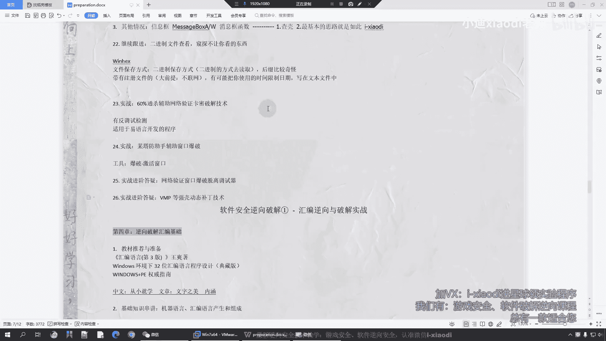

# 🧰 小白软件破解逆向工程师2023最新：3.26：实战进阶答疑——VMP等强壳动态补丁技术

在本节课中我们将要学习VMP等强壳程序的动态补丁技术。本课是第三章第26课，属于实战进阶答疑内容，原文来源标识为BV1F14y197Yb-。课程围绕一个核心问题展开：当程序加了VMP等强壳后，往往无法直接保存修改后的文件，这时就需要换一种思路，用补丁工具在运行时修改代码。本教程会把原文口语化的操作过程整理成更直白的步骤，方便初学者理解。需要说明的是，本教程仅用于合法授权环境下的逆向学习与软件安全研究，请不要把技术用于未经授权的破解行为。

## 🧭 一、先识别VMP强壳与文件保存限制

上一节概述了本课要解决的问题，本节中我们来看看第一步：识别程序是不是加了VMP强壳。原文第一步是查壳，查壳后发现程序是VMP。接着点击区段，会看到区段里有很多VMP特征。对于这种文件，一般来说没有办法直接保存修改后的文件。保存不了的情况下，就必须考虑打补丁。原文还提到，可以随便试一下附加，然后看连接符号，再用探点神器先随便找一些位置观察。

以下是识别强壳时需要记住的几个现象：

- 查壳后发现程序是VMP。
- 点击区段，可以看到很多VMP特征。
- 附加程序后查看连接符号，使用探点神器随便找位置观察。
- 这些位置没有代码；加壳程序就是这样，点击符号后也没有内容。

用公式概括这一节的结论：

```text
查壳 -> 发现VMP -> 区段出现VMP特征 -> 无法直接保存文件
```

这一步看起来简单，但对初学者来说，先理解“为什么保存不了”，比一上来就乱改代码更重要。只有确认程序确实被强壳保护，后面的补丁思路才有意义。

## 🎯 二、用MessageBox断点定位登录提示

上一节我们确认了强壳会导致无法直接保存文件，本节中我们来看看如何用断点定位关键位置。原文按照之前的破解思路，下一个MessageBox断点，也就是MessageBoxA断点。为什么要下这个断点？因为程序点击登录时会弹出一个信息框，所以这个断点和登录行为直接联系，程序会断下来。原文强调，下断点不要乱下，要围绕目标行为来下。

以下是定位登录提示时用到的操作流程：

```text
F2
Ctrl + F9
点击确定
F8
Ctrl + F9
F8
Ctrl + F9
F8
```

按这个流程走，会来到一些关键位置。例如运行程序后点击登录，会出现“卡密错误，请检查卡密是否正确”的弹窗。这里要注意这个弹窗，它是一个带字母I的Information信息框。用代码形式表示这个提示的含义：

```text
I = Information，表示信息框
```

理解这个信息框很关键，因为后面修改代码后，我们会通过信息框的变化来判断补丁是否生效。原文还提到断点不要乱下，要知道为什么下这个断点，再决定下在哪里。

## 🧩 三、修改条件跳转并观察信息框变化

上一节我们通过MessageBox断点走到了关键位置，本节中我们来看看如何修改跳转并观察变化。原文查看附近还有JG、JMP、JL、JE等跳转指令，然后把JE改成JMP。原文口述为“GE改成GMP”，结合上下文应理解为把条件跳转`JE`改成无条件跳转`JMP`。修改代码后，程序好像出现异常；这时不用慌，把不知道什么时候加上的断点取消掉，再回到程序。

以下是修改跳转的核心概念：

```asm
; 修改前，可能是条件跳转
JE  ...

; 修改后，改为无条件跳转
JMP ...
```

修改完成后再点击登录，信息框已经不一样了，这说明代码确实被修改了。但是按照之前的逻辑，点击“创可贴”相关按钮，再点击补丁，会发现这里没有任何内容。也就是说，加壳程序无法直接补丁，也无法直接保存文件。

用公式表示这一现象：

```text
加壳程序 => 不能直接保存文件/不能直接生成补丁
```

这一步的意义在于：你已经验证了代码可以被修改，但还需要一种方式把修改固定下来，并作用到程序运行过程中。接下来就要讨论强壳处理的两种逻辑。

## 🛠️ 四、强壳处理的两个逻辑：脱壳或打补丁

上一节我们看到加壳程序无法直接保存文件，本节中我们来看看常见的两条处理路径。原文明确指出，加了强壳的程序没有办法直接保存文件；没有办法保存文件时，有两个逻辑。第一个逻辑是脱壳，但脱壳比较费劲，也很麻烦。第二个方法就是打补丁，今天讲的就是打补丁。

以下是两条路径的简单对比：

- 脱壳：可以处理强壳，但过程费劲、麻烦，对初学者不友好。
- 打补丁：不直接保存文件，而是在运行时修改代码，本课重点讲这个方法。

用公式概括：

```text
无法保存文件 => 脱壳(费劲) 或 打补丁(本课选择)
```

所以本节的重点不是去硬碰硬保存文件，而是换一个角度，用补丁工具在程序运行时完成修改。原文还提到打字时可能调出计算器，这是操作中的小插曲，不影响主线。

## 🧪 五、补丁工具的使用流程

上一节我们选择了打补丁这条路径，本节中我们来看看补丁工具怎么用。原文说补丁工具已经上传到星球，大家可以加入星球下载。运行工具后，它会提示“请选择文件或者拖拽进来，支持拖拽破解”。于是把目标程序直接拖过来。这个程序比较大，有70兆，所以拖过来后要稍等一下，工具会稍微卡一下，等它处理完即可。

以下是打补丁的关键步骤：

- 运行补丁工具，选择文件或把程序拖拽进工具。
- 等待工具处理70兆大小的程序。
- 找到要破解的位置，例如`100016DE`这个位置。
- 在十六进制/ESE位置写入，也可以鼠标右键选择二进制，然后点击复制。
- 点击地址并粘贴过来，选中刚才修改掉的位置。
- 原文口述“鼠标有电”，实际操作为鼠标右键选择二进制，然后复制。
- 把修改后的代码放到对应位置，点击添加。
- 点击生成补丁，例如命名为“新补丁”。
- 点击保存，出现“配置补丁成功”即可。

核心流程可以写成：

```text
目标地址：100016DE
操作：右键 -> 二进制 -> 复制
在补丁工具中粘贴地址 -> 选中修改位置 -> 添加 -> 生成补丁
补丁名称：新补丁
保存后提示：配置补丁成功
```

这一步的关键是找到要修改的位置，并把修改后的代码正确放进补丁工具。强壳程序并没有想象中那么可怕，打个补丁就行；最关键的是定位准确，地址和代码不能放错。

## ✅ 六、验证补丁是否生效

上一节我们生成了补丁，本节中我们来看看如何验证补丁是否生效。原文说，如果破解成功，程序会显示一个带叉的“卡密错误/看门错误”提示，这说明代码被修改掉了，而不需要保存文件。接着把原程序全部关掉，直接运行“新补丁”程序，点击破解，补丁程序就出来了。然后点击登录，会看到“卡密错误”提示，这个框已经不是以前那个框了。

再对比一下源程序：把补丁程序关掉，用源程序点击登录，会看到Information信息框，和补丁程序里的提示不一样。这说明我们打的补丁、改的代码生效了。

用公式表示验证结果：

```text
源程序登录 => Information信息框
补丁程序登录 => 带叉的卡密错误/看门错误提示
=> 补丁修改代码生效
```

生效意味着以后不需要直接保存文件，只需要有一个补丁程序，点击破解、运行并破解，再点击登录，就可以完成验证。这里要理解的是，补丁技术改变的是运行时的代码，而不是原文件本身。

## ⚙️ 七、补丁工具的其他配置与风险提示

上一节我们验证了补丁可以生效，本节中我们来看看原文还提到了哪些补丁工具配置。补丁技术还有很多其他内容，例如特征设置里有一些选项，还有inline hook，这个以后再说。其他配置还包括自定义信息、运行后弹窗等。你可以把自己的弹窗改成临时QQ号，加上你的QQ号；生成后还可以自己再加一遍壳。

以下是原文提到的其他功能和配置：

- 自定义信息、运行后弹窗，可以改成自己的弹窗并加上QQ号。
- 生成补丁后还可以自己加壳，再加一遍壳也可以。
- 检测到内存监视器时，原文提到可以让程序蓝屏、格盘、使用硬盘炸弹。
- 检测到OD时，可以删除自身、结束进程。
- 还可以加皮肤、改图标，把图片改成二维码等。
- 破解可以延时，也可以做破解增强。
- 拖拽破解可以设置为只允许拖拽破解。
- 还有校验功能。
- 补丁授权可以启用授权功能；原文提到破解别人的软件再拿去卖，属于“黑吃黑”。
- 编码转换里有一些常见工具。

> 原文提到的蓝屏、格盘、硬盘炸弹、删除自身、结束进程等功能风险很高，仅作概念说明，不应在实际环境中使用。学习逆向技术应在合法授权范围内进行，避免对他人系统或软件造成破坏。

这些配置说明补丁工具不只是“改一个跳转”这么简单，它还包含很多运行时的辅助功能。对初学者来说，先掌握最基础的地址定位、代码修改、生成补丁和验证效果，再去了解其他配置会更稳妥。

## 📌 八、总结

本节课中我们一起学习了VMP等强壳程序的动态补丁技术。我们从查壳发现VMP开始，看到区段中的VMP特征，理解加壳程序无法直接保存文件的限制；然后通过MessageBoxA断点定位登录提示，修改JE为JMP并观察信息框变化；接着明确强壳处理有脱壳和打补丁两条逻辑，本课选择打补丁；再使用补丁工具完成地址复制、代码添加、生成补丁和保存；最后通过源程序与补丁程序的信息框差异验证补丁生效。原文还补充了补丁工具的其他配置和风险功能，这些内容仅作概念了解。感兴趣可以自己在合法授权环境中练习，下期再见。

