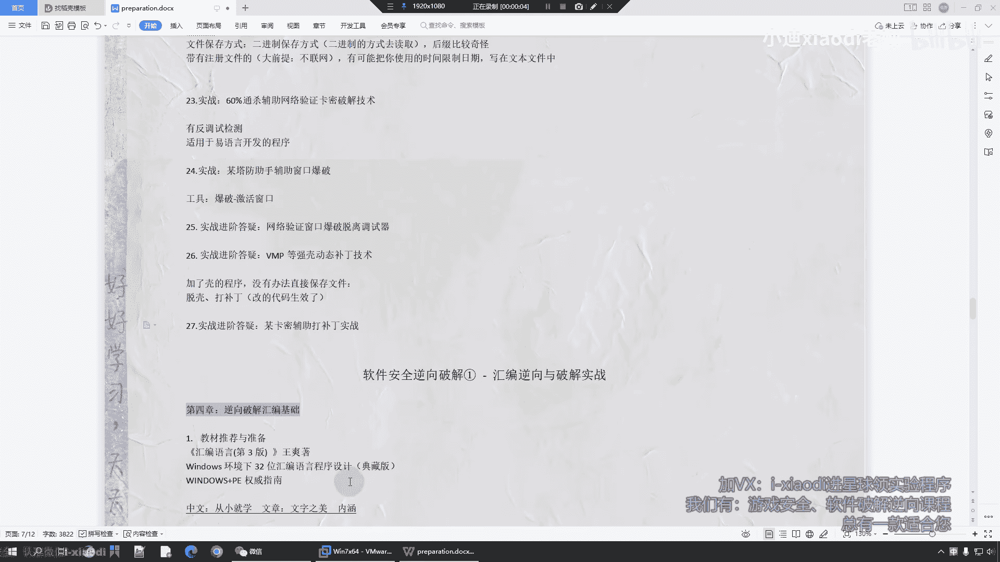
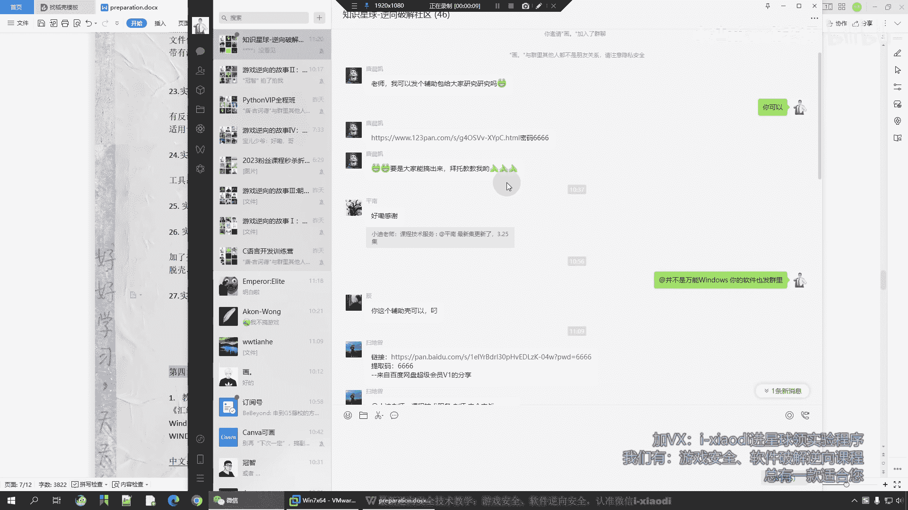
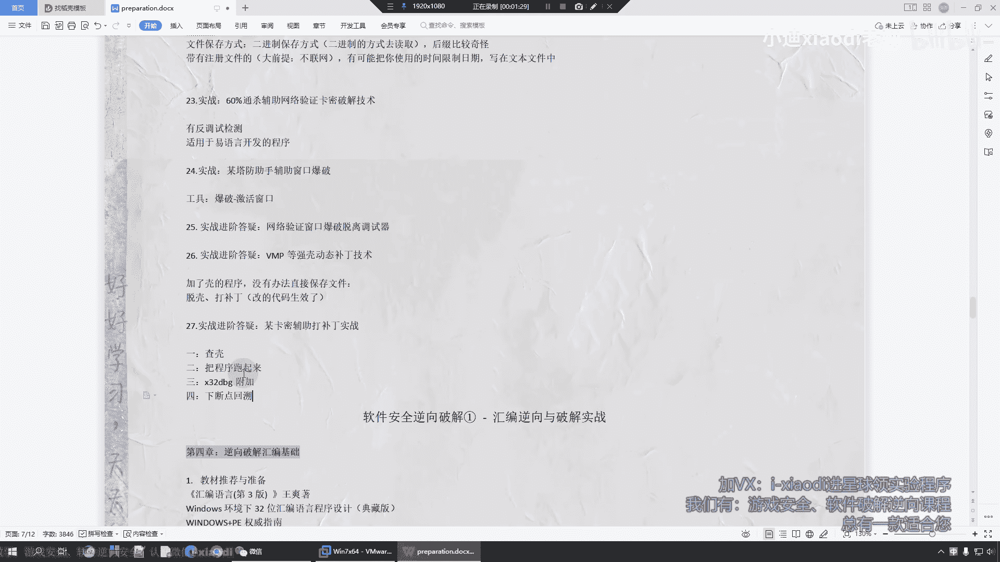
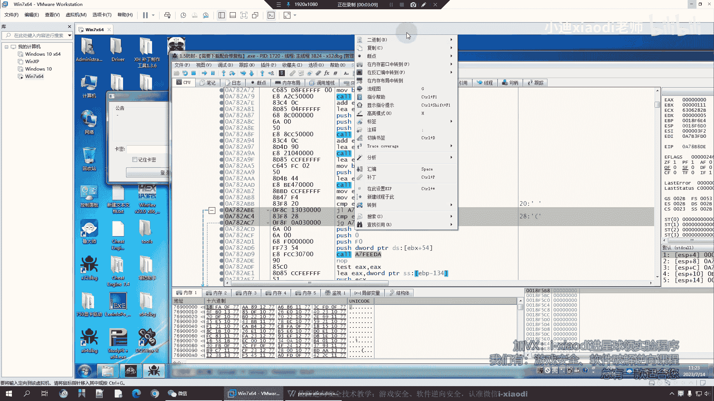
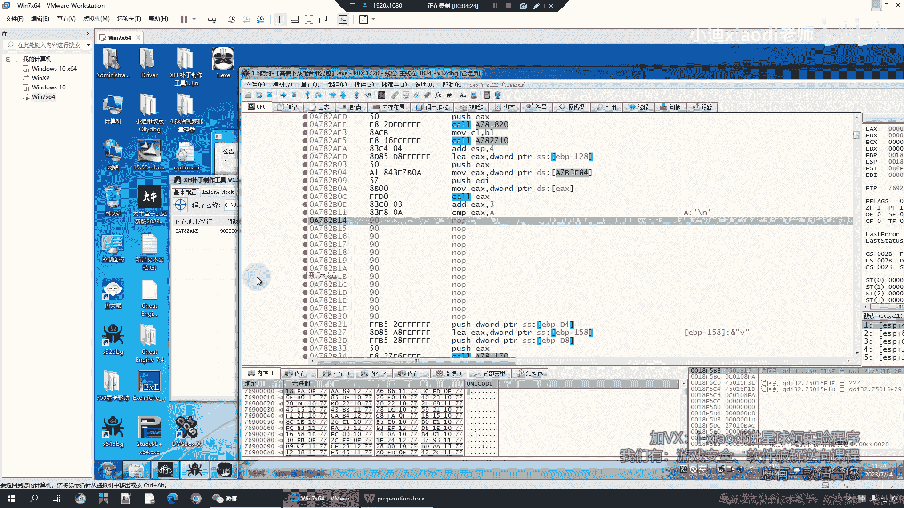
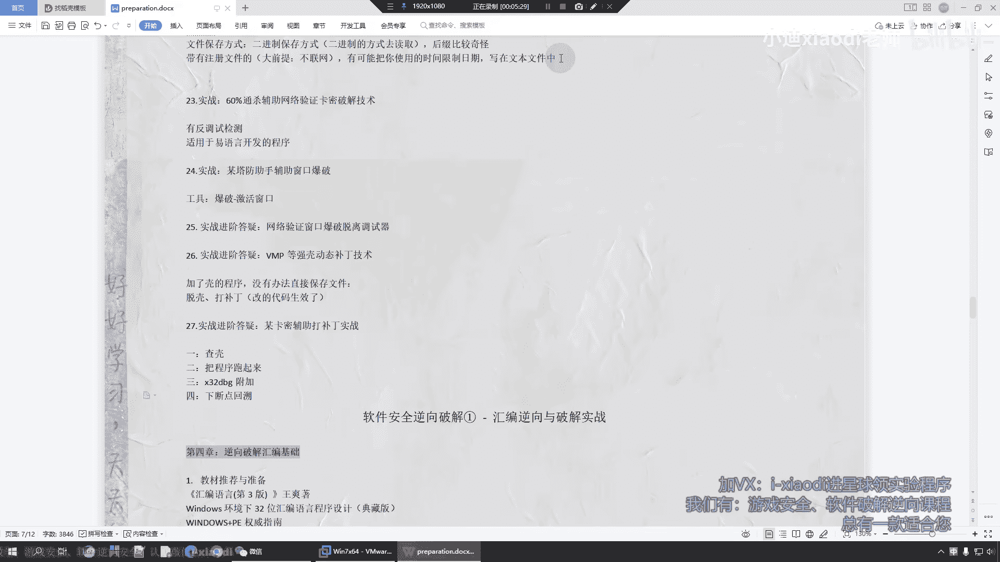

# 小白软件破解逆向工程师：3.27：实战进阶答疑：某卡密辅助打补丁实战



## 📋 概述

在本节课中，我们将要学习如何对一个带有大量VIP壳的卡密辅助程序进行打补丁实战。上一节我们刚讲解了大补丁技术的基础原理，而这一次，我们将直接拿一个真实的程序来练手。这个程序是唐老师发在群里的，既然他把链接都发出来了，我们就趁机用他提供的这个程序做一个实验，把之前学到的补丁技术实际应用一遍。请注意，这个程序的壳特别多，但不要害怕，我们一步一步来。



## 🧩 第一步：查壳并分析程序

首先，第一步是干什么？第一步是查壳。我们看到他之前发的消息中说了什么？他说这个程序的VIP壳特别多，问可不可以搞，说太难搞了，VIP太多。但这里我们要记住：不要害怕，壳多不代表破解不了。

打开ESEin（Exeinfo PE）这个查壳工具，把程序拖进去。拖进去之后，我们会发现什么？可以发现这个程序确实是VIP壳，然后我们再看一下区段。看这个区段上，看到没有？VP有很多。当然，你也可以用另一个工具叫stud_PE去看，拖过来看区段，同样会发现VP段非常多。这都是正常现象，不要被吓到。

在动手之前，我们先把整个流程梳理一下，方便你有个整体的认知。以下是本次实战的操作步骤：

- 第一步：用查壳工具（比如ESEin）查看程序，确认壳的类型。
- 第二步：把目标程序正常运行起来。
- 第三步：用x32dbg附加到正在运行的程序进程上。
- 第四步：下断点，通过回溯调用栈找到关键校验代码。



## 🚀 第二步：运行程序并附加调试器

查完壳之后，第二步就是把程序跑起来。程序启动后，我们观察一下界面。点击登录按钮，程序给出了一个提示，说“卡密长度错误”，对吧？好，这个弹窗提供了一个信息，一个消息框，这就是一个切入的关键点。

接下来，回到x32dbg，点击文件菜单，然后点击附加，选择刚刚运行的那个进程。附加完成之后，我们直接下断点。在这里我们需要下一个API断点，也就是MessageBoxA的断点。在x32dbg的命令行或断点窗口中，直接下 `MessageBoxA` 这个断点，然后点击确定。按F2键把断点打上。完成之后，回到程序那边，再次点击登录按钮，这时程序会弹窗并且触发断点。

断点被触发后，程序会暂停在 `MessageBoxA` 的入口处。此时我们按 `Ctrl+F9` 执行到返回，也就是运行到当前函数的返回地址处。然后程序会弹出一个框，我们点击确定，再按F8单步。然后再按一次 `Ctrl+F9`，再按F8，这样一步一步走，就能走到上一层的外层调用代码。我们会看到这附近有一个跳转指令。这个跳转就是校验逻辑中的一个关键跳转位置。

## 🔍 第三步：定位校验代码

我们通过回溯来到了外层代码区域。现在仔细观察这里的跳转指令。按下回车键，进入这个跳转所在的分支内部查看。整个校验逻辑应该就在这里。我们往下滚动代码，仔细看，看到没有？这里有“登录成功”的字符串。如果程序运行到这里，就会弹出登录成功的提示。

那我们怎么破解呢？思路应该是从上往下看这些跳转。你看，这里有一个短跳转，短跳转不用管它，因为它只是局部的小跳转，不影响大的逻辑。好，下面有一个长跳转，长跳转跳到哪去了？按回车键进去看一下，原来是跳到“卡密长度错误”的地方去了。我们按减号键（`-`）返回原来的位置。

我们的目标就是让程序不跳转到错误分支，而是继续向下走到“登录成功”。所以，我们要把这三条关键的跳转指令全部改成空操作（NOP）。注意观察，这里还有一个长跳转，我们把这三条指令用鼠标右键选择“二进制”，然后选择“NOP填充”（也就是用0x90覆盖），把它们全部NOP掉。

在修改之前，需要先把程序跑起来，这样后面打补丁才能对照修改。好，现在我们开始操作。



## 🛠️ 第四步：制作补丁

我们先选中刚才需要修改的代码区域，鼠标右键选择“二进制”，然后选择“NOP填充”。修改完成后，代码会变成红色，表示已经改动。我们边修改的时候，边打开打补丁工具。这个辅助程序体积比较大，加载需要稍等一会儿。稍等一下，好，补丁工具加载完成了。

接下来，在x32dbg中，鼠标右键复制当前修改位置的地址，然后把地址粘贴到补丁工具的地址栏中。然后，选中你已经修改的变成红色的字节，鼠标右键选择“二进制”，再选择“复制”。这就说明把这些修改后的字节复制出来了。然后在补丁工具中，点击“添加”，把这些字节粘贴进来。看，已经添加成功了。

接着我们继续往下走代码。走啊走，走到这里，看到没有？这里又出现了跳转了。这两个跳转都是往下跳的，我们需不需要让程序往下跳？不需要。为什么呢？因为“登录成功”的代码就在下边，我们想让程序自然地往下执行，所以不应该让它跳过这段。因此，这两条跳转指令也需要用二进制NOP掉。

操作方法同之前一样：
- 第一步，复制当前地址，粘贴到补丁工具的地址栏。
- 第二步，把修改后变红的字节用二进制复制，粘贴到补丁工具中，点击添加。

添加好之后，直接点击“生成补丁”按钮。然后随便起一个名字，比如“补丁2”，点击保存，显示保存成功。这样就生成了一个独立的可执行补丁文件。



## 💡 第五步：验证补丁效果

打完补丁之后，怎么验证呢？可以直接在x32dbg中点击文件菜单，选择“脱离”（或者直接关闭调试器），然后关掉被调试的程序。当然，你也可以直接把程序关掉，都是可以的。

现在，我们有了两个东西：一个是刚刚生成的补丁程序，另一个是原始辅助程序。我们运行补丁程序，然后点击“破解”按钮（补丁程序通常带有注入或破解功能）。再点击登录按钮，看到没有？程序提示“登录成功”。当然，这个辅助有没有实际功能是另一回事，因为它下面可能还有进一步的校验。登录成功之后，程序内部可能还会有其他验证逻辑，这需要你自己去细化分析。但是今天这节课的重点是打补丁实战，我们就是要告诉大家：遇到这种强壳不要害怕，直接用打补丁的方式就可以了。

## 📌 总结

本节课中，我们一起学习了如何对一个带有大量VIP壳的卡密辅助程序进行打补丁实战。我们回顾了整个流程：先查壳确认程序特征，然后运行程序并用x32dbg附加，接着通过下`MessageBoxA`断点回溯到关键校验代码，找到“登录成功”和“卡密长度错误”分支，然后NOP掉所有导致错误分支的跳转指令，再用补丁工具生成可执行的补丁文件，最后验证补丁效果。我们用到了几个核心操作，可以用下面这个简单的伪代码来描述核心思路：

```plaintext
if (卡密长度错误) -> 跳转到错误分支 (需要NOP)
if (校验失败) -> 跳转到错误分支 (需要NOP)
else -> 到达登录成功 (保留)
```



所以，以后你再遇到壳特别多的程序，不要害怕。只要找到关键校验点，把不要的跳转用NOP填充，然后生成补丁，就完成了。好了，这就是咱们今天的内容，咱们下期再见。
