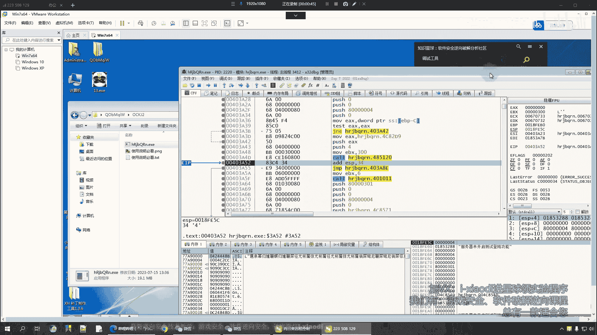
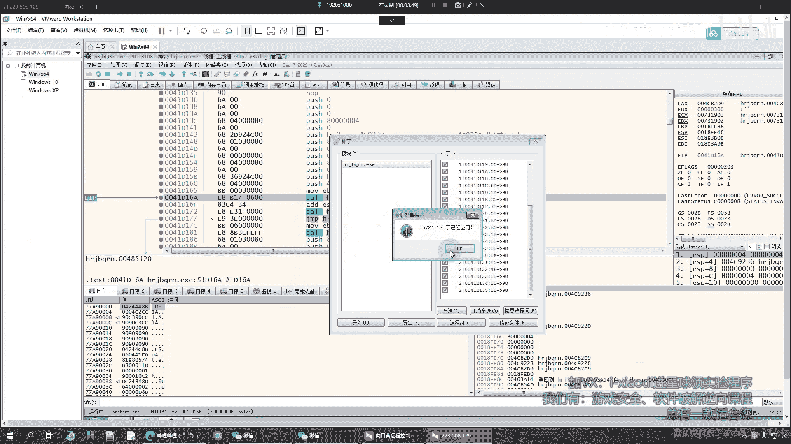
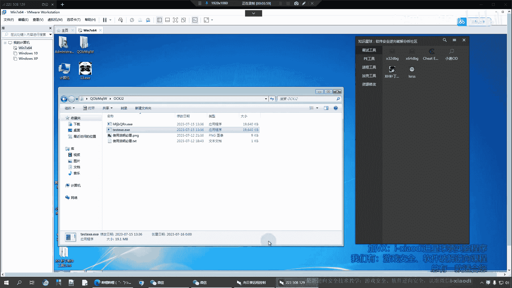
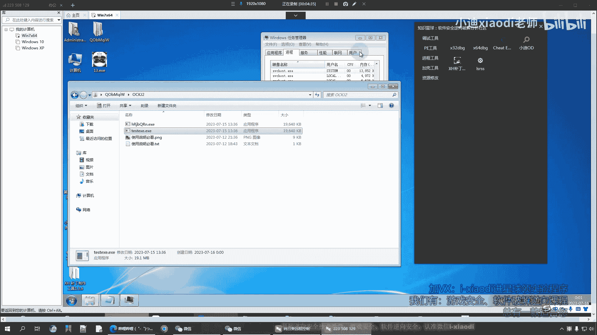

## 🧰 小白软件破解逆向工程师2023最新：3.28：实战某rust辅助破解指导


在本节课中我们将要学习实战某 rust 辅助破解指导。内容从把辅助程序拖入调试器开始，依次完成 `MessageBox` 断点、登录失败定位、跳转修改、二进制 NOP、激活码校验处理、驱动载入失败处理和保存修复验证。整节按实际调试顺序推进，尽量用大白话说明每一步在做什么，让初学者能跟着观察程序行为，而不是死记按键。调试时如果长时间沉默会让人难受，因此过程中可以适当交流并确认下一步操作。


> 学习提示：本节按实际调试顺序推进，先观察跳转，再用 NOP，最后保存修复并验证注入。


### 🔍 小白软件破解逆向工程师2023最新：3.28.1：下消息框断点并定位登录失败


开始之前，先把辅助程序直接拖进调试器。因为程序里有一个消息块，所以要在 `MessageBox` 这里下断点。原来考虑从某个位置开始，后来决定干脆从头开始破解。运行之后程序断下来，这个位置就是消息框断点。确认后按 `F2` 取消断点，按 `Ctrl+F9` 运行，随后会出现一个消息框，点确定，再按 `F8` 单步，接着按 `Ctrl+F9`，再按 `F8` 跳出来。把窗口拉大一点，方便观察后面的分支和跳转。




登录失败的位置会显示出来。先从上往下看，确认程序没有绕过登录失败；再往上看一点，可以看到这里存在跳过登录失败的分支；因此继续往上看，寻找更合适的位置。函数头部之前已经跑过，所以可以直接围绕当前区域判断。调试过程中可以适当交流，避免长时间沉默让人难受，确认后继续。这里干脆在目标位置下断点，运行后断下即可。断点处没有发生跳转，没有变红就说明没有跳；按 `F8` 单步后会看到程序把跳转跳过去了，这表示程序会走登录失败。因此要阻止它跳，调试时可以双击修改这个跳转。


白话说，调试器里能临时改跳转，但实际破解时要换一种方式。下面先用代码描述这一节的观察流程：


```text
MessageBox 断点 -> 运行断下
F2 取消断点
Ctrl+F9 运行 / 返回
F8 单步
跳转未发生 -> 继续观察失败流程
跳转被跳过 -> 程序会走登录失败
```


具体操作顺序如下：


- 把辅助程序拖入调试器。
- 在 `MessageBox` 下断点并运行，确认消息框断点。
- 按 `F2` 取消断点，按 `Ctrl+F9` 运行，点确定消息框。
- 按 `F8` 单步，按 `Ctrl+F9`，再按 `F8` 跳出。
- 拉大窗口，从登录失败位置开始，先从上往下确认没有绕过，再往上寻找可跳过失败的分支。
- 在目标位置下断点并运行，观察是否发生跳转。
- 用 `F8` 单步确认程序跳过分支，判断会登录失败；调试时双击修改跳转。


到这里，调试时的跳转修改已经观察清楚，接下来看看实际破解中的二进制 NOP 思路。


### 🧩 小白软件破解逆向工程师2023最新：3.28.2：破解时的二进制 NOP 思路


上一节介绍了在调试器里双击修改跳转的办法，本节来看看实际破解时怎么处理。实际破解或打补丁时，使用二进制 NOP。这里的场景甚至不用单独打补丁，直接保存程序也可以。先单步到目标位置，先看二进制；后来决定先跑一遍到 `F2`，再继续判断。程序跑通之后，先把相关指令 NOP 掉。程序跑通说明内部有这个功能，按 `F7` 跟进去。之后继续按单步跟进，一路走到接近激活码的位置。


核心概念可以用下面的代码表示：


```asm
jmp target   ; 原来的跳转
nop          ; 用 0x90 填掉跳转
```


也就是说，`NOP = 0x90`，把跳转指令替换成空操作，程序就会继续往下走。二进制处理的关键点如下：


- 破解或打补丁时使用二进制 NOP。
- 当前场景可以直接保存程序，不一定单独打补丁。
- 单步到目标位置，先观察二进制内容。
- 先跑一遍到 `F2`，确认程序能跑通。
- 程序跑通后，把相关指令 NOP 掉。
- 程序跑通说明功能存在，按 `F7` 跟进。
- 继续按单步跟进，走到激活码附近。


完成这一步后，程序已经接近激活码区域，下一节处理输入激活码后的校验。


### 🔑 小白软件破解逆向工程师2023最新：3.28.3：处理激活码校验


上一节把程序跟到了激活码附近，本节处理输入激活码后的校验。程序跳过来之后，会提示输入激活码。刚才已经看过，输入激活码后程序会出问题并退出，所以这里就是输入激活码的校验位置。对这个位置同样用二进制 NOP 掉。按 `F8` 单步跑，又会出现问题：驱动载入失败，辅助加载不出来。这说明上面的分支才是成功分支。既然上面是成功，就让它成功，直接把导致失败的分支 NOP 掉。处理后程序成功，继续往下跑。


这一段的判断可以用下面的伪代码描述：


```text
输入激活码 -> 校验失败 -> 程序退出
校验跳转 NOP -> 进入成功分支
驱动载入失败 -> 上方分支才是成功
失败分支 NOP -> 程序成功
```


激活码校验的处理步骤概括如下：


- 跳到激活码提示位置，确认需要输入激活码。
- 回顾输入后出问题并退出的现象。
- 把该校验位置的跳转用二进制 NOP 掉。
- 按 `F8` 单步运行，观察是否出现驱动载入失败。
- 驱动载入失败说明辅助加载不出来，也说明上面分支是成功。
- 将失败分支 NOP 掉，让程序进入成功分支。




到这里，激活码校验和驱动载入失败已经处理完，下一节完成保存、修复和注入验证。


### 🚀 小白软件破解逆向工程师2023最新：3.28.4：跑通后保存修复并验证注入




上一节已经让程序进入成功分支，本节完成保存、修复和验证。继续跑到程序跑通，我记得这里已经跑通；驱动加载成功，等待菜单自动弹出，然后到游戏大厅时手动注入。之前已经分析过注入流程，确认是否记得，确认记得就可以继续。此时可以保存程序。点击修复文件，选择 `text.exe`。点击确定后关闭程序，再重新运行，查看进程是否存在。进程应该在后台运行，因为后面要注入；刚才看进程不在，但刚看到 `text` 进程在，实际是在后台开着。游戏一登录，它就注入 DLL，也就是注入程序。可以拿去测试。最后再自己跑一遍，避免忘记；视频上传，课程到此结束。


保存和验证的流程可以用下面的代码表示：


```text
驱动加载成功 -> 等待菜单自动弹出
进入游戏大厅 -> 手动注入 DLL
保存程序 -> 修复文件 text.exe -> 重新运行
查看进程是否存在 -> 游戏登录后注入 DLL
```


保存和验证的流程如下：


- 跑到程序跑通，确认驱动加载成功。
- 等待菜单自动弹出，到游戏大厅手动注入。
- 确认之前分析过的注入流程。
- 保存程序，点击修复文件并选择 `text.exe`。
- 确定后关闭程序，再重新运行。
- 查看进程是否存在；进程应在后台运行。
- 游戏登录后注入 DLL，完成注入程序。
- 拿去测试，并再自己跑一遍避免忘记。




本节课中我们一起学习了实战某 rust 辅助破解指导的完整调试流程：从拖入调试器、下 `MessageBox` 断点，到定位登录失败、观察跳转、使用二进制 NOP，再到处理激活码校验、驱动载入失败、保存修复和验证注入。整个流程的关键是先让程序停在关键位置，确认分支走向，再决定修改跳转或 NOP 指令，最后保存并重新运行验证。对初学者来说，按这个顺序观察和操作，比只记按键更容易理解每一步的目的。

