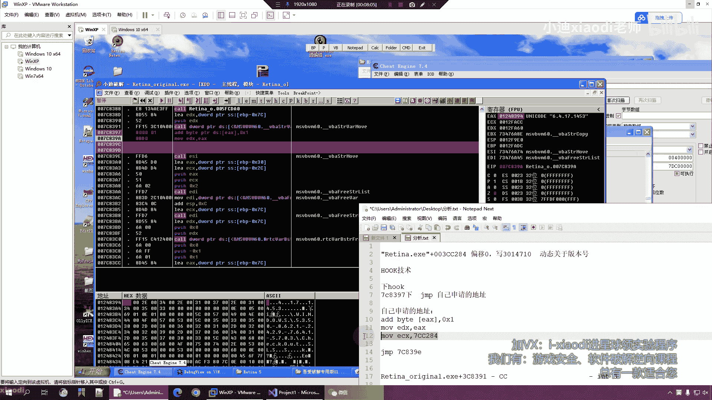
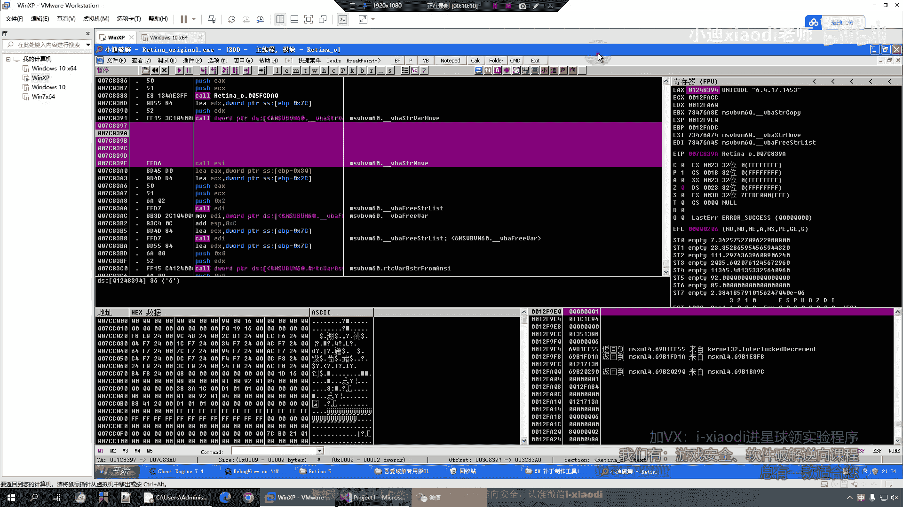
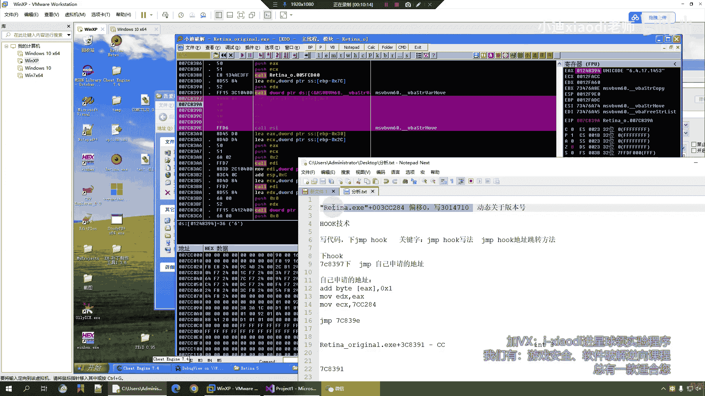

# 小白软件破解逆向工程师 2023 最新：3.29：实战单子某VB程序版本号修改01 🔓

在本节课中，我们将要学习如何修改一个 VB 程序的版本号。这个例子非常典型，它会把逆向分析中最常用的一整套思路串起来：先用 Cheat Engine（CE）在内存中搜索目标数据，再用 OllyDbg（OD）定位到处理这段数据的关键代码，最后通过 Hook 技术修改程序的运行逻辑。我们会把一个版本号从 5.4.17.1453 改成 6.4.17.1453，亲手演示一遍完整的实战过程。整个课程里没有任何需要提前掌握的高深理论，只要跟着步骤走，每一步都能看懂，初学者也可以放心往下学。

## 1️⃣ 用 Cheat Engine 搜索版本号数据 🔍

我们先来看一下这个程序要改什么地方。当前原程序的版本号显示为 5.4.17.1453，也就是大家看到的这个数字串。我们要做的，就是把这个版本号变成 6.4.17.1453。无论要修改什么程序，第一步永远是先学会搜索数据，也就是想办法找到这个数据在内存里到底存放在哪个位置。数据都找不到的话，后面的一切修改都无从谈起。

搜数据用什么工具？答案就是 Cheat Engine，通常简称为 CE。CE 是逆向分析中最常用的内存搜索工具，在课程前面的章节中已经对它的使用方法做过详细介绍，这里我们直接拿它来实战。总的思路非常简单：把版本号字符串当成关键字，让 CE 在整个进程的内存空间里帮我们找出所有包含这个字符串的位置，然后锁定目标。

以下是使用 CE 搜索版本号的具体操作步骤：

- 打开目标程序，让程序的版本号界面正常显示出来。
- 打开 Cheat Engine，把 CE 附加到目标程序的进程上。
- 在 CE 的搜索框中输入版本号字符串 5.4.17.1453，选择字符串类型，然后执行首次搜索。
- 从搜索结果中筛选出真正存放版本号数据的那一个地址，并把这个地址记录下来，后面会用到。

搜索到地址之后，我们来看一下这个地址里的内容。在 CE 的数据区域中，把显示类型切换成字符串，就可以清清楚楚地看到字符 5，这正是版本号的第一位。我们最终要修改的目标就是它。实际上，想让版本号变成 6.4.17.1453，只需要把这里的 5 改成 6 就可以了。听起来是不是很简单？核心工作就集中在这一个字节上，后面所有复杂操作也都是围绕这个字节展开的。

## 2️⃣ 动态地址的烦恼 ⚠️

找到地址之后，我们立刻尝试在 CE 里直接修改：把那个 5 改成 6。改完之后再回到程序里，点击 Help 菜单，版本号果然变成了 6。这说明直接修改数据是有效的，效果立竿见影，版本号马上按照我们的意愿发生了变化。

但是这个修改有一个致命的问题：它没有办法保存。为什么？因为这个地址是一个动态地址。所谓动态地址，通俗地讲，就是程序每次运行时，同一个数据在内存中的位置都可能不一样。这就好比同一个客人每次住酒店都会换一个房间，你这次记住了他的房间号，下次他可能就住到别的房间去了。我们这一次在这个地址找到了版本号，下次程序重新启动，版本号可能就跑到完全不同的地址去了。这样一来，之前在 CE 里做的所有修改就全部失效了，没有保存的意义。


因此，我们不能停留在修改数据这个层面，必须再往下深挖一层：找到程序创建这个版本号、计算这个版本号、或者说读取这个版本号的那一段代码。只要定位到这段代码，我们就能在代码层面上动手脚，让程序每次运行的时候都自动计算出我们想要的版本号，而不是靠我们手动去改内存。这才是真正治本的办法，也是逆向工程的核心思路之一。


## 3️⃣ 用 OllyDbg 定位计算版本号的代码 📍

那要怎么找到这段关键代码呢？这里就要用到另一款核心工具：OllyDbg，通常简称 OD。OD 是一款调试器，可以让我们单步跟踪程序的每一条指令，亲眼看到程序运行时到底执行了什么，数据又是在哪一步被加载出来的。先说明一下，这个程序我已经提前分析过了，所以可以直接把答案告诉大家：关键代码位于 7C8391 这个地址。不过，为了让大家真正学会定位的方法，我还是要讲一讲当初的思路。

定位的具体思路如下：

- 先把目标程序关闭，然后用 OD 重新加载程序，把程序拖进 OD 的工作区。
- 在 OD 中按 Ctrl+G，弹出地址跳转窗口，输入 7C8391，直接跳转到这个位置。
- 在 7C8391 处下断点，让程序运行到这里时自动停下来。这个位置就是计算版本号的地方。
- 我当初是通过在 CreateWindowEx 这个 API 函数上下断点找到这里的。CreateWindowEx 是 Windows 创建窗口的底层函数，程序创建窗口时必定会经过它。在这个函数上下断点，再结合版本号出现的时机，一步一步顺藤摸瓜，最后就定位到了计算版本号的代码位置。
- 在 OD 中看到的地址 7C8391，本质上是一个绝对地址。它换算成模块偏移的形式就是：7C8391 = 模块基址 + 3C8391。这个偏移量在后续下 Hook 的时候可以直接复制使用，所以先在这里记住它。

> 核心地址：7C8391，对应模块偏移 3C8391。换算关系为 `7C8391 = 模块基址 + 3C8391`。

由于我已经分析完毕，所以直接让程序断在 7C8391 这个位置。然后按一下 F8，单步执行一行代码。神奇的事情发生了：看数据窗口，5、4、17、1453，这不就是版本号？也就是说，程序执行到这一带的时候，版本号的每一位数字都已经被计算并加载到内存里了。这一片内存区域，正是版本号数据的源头，而版本号的第一位字符 5 就存放在 ESI 寄存器指向的地址加 1 的位置上。

既然定位到了关键代码，我们的目标就变得非常明确了：想尽办法修改这一段代码，让程序最终计算出来的版本号变成 6 点几，而不是 5 点几。只要能把这一段代码控制住，版本号就牢牢掌握在我们手里，程序每次运行都会按照我们的要求显示版本号。

## 4️⃣ 直接修改代码字节的尝试 🧪

找到关键代码之后，最直接的想法就是：直接修改代码字节，把那个 5 改成 6。在 OD 的数据窗口中，让数据跟随到这一行，找到版本号第一位字符 5 对应的字节 0x35。选中这个字节，使用二进制编辑功能，把它改成 0x36。这样字符 5 就变成了字符 6。改完之后，因为刚才我们已经重新启动过程序，所以直接运行程序看看效果。看到没有？版本号已经变成 6.4.17.1453 了。这证明直接修改代码的思路是行得通的，程序确实按照修改后的逻辑输出了新的版本号。

但是这里隐藏着一个大问题：直接改字节的话，代码长度不够。咱们来实际演示一下，先用二进制编辑把那个字节改回 5，也就是恢复成原来的 0x35。然后按 F8 单步执行，数据确实又变成了 6，看起来效果不错。不过就在这个时候，你仔细检查一下周围，会发现有些关键代码已经被我们改掉了。问题出在哪里？出在那个位置本身的空间太小了。原来那两行关键代码总共只有两个字节的长度，而我们写入的新指令远远超过了两个字节。硬要把新指令塞进去，多出来的部分就会全部压到周围的关键代码上，原程序被破坏得七零八落。

你可以自己验证一下：把这些修改撤销掉，然后重新运行程序。程序的状态已经完全不正常了，运行起来直接就崩了，根本跑不起来。刚才的演示中，程序就已经终止了，这就是强行修改代码的代价。第一次演示的时候还遇到了一个小插曲：检查之后发现之前的断点被取消掉了，于是重新加载程序再来一遍。重新设置好断点，再次 F8 单步，数据照样变成了 6，原理还是一样的。

所以问题不在于修改思路不对，而在于空间不够用。直接改代码字节这条路，在这个位置走不通。那该怎么办？这时候就要请出今天的核心主角：Hook 技术。

## 5️⃣ Hook 技术：把执行流程钩走再钩回来 🪝

Hook 技术，中文叫钩子技术，核心思想非常直白：在原程序的代码流程当中找一个合适的位置，把程序的执行流程钩到我们自己的代码里，执行完我们自己的逻辑之后，再跳回原程序继续运行。这样一来，我们完全不需要覆盖原始的代码，也能插入自己的逻辑。这就好比在一条必经之路上搭了一座临时检查站，让所有车辆都绕到检查站过一遍，检查完再回到原来的路上。原来的路没有被破坏，但每一辆车都经过了我们的处理。

回到这个程序，具体的设计思路是这样的：

- 程序执行到 7C8397 这个地址的时候，时机刚刚好。此时 ESI 寄存器已经指向了版本号数据所在的内存地址，数据已经准备好了。
- 再往下执行，程序马上就会弹出版本号窗口。我们希望在弹窗之前，把版本号的第一位字符改掉。
- 版本号为 5 的时候，在 ESI 指向的地址加 1 的位置上，存放着字符 5，也就是字节 0x35。
- 我们只需要把这个字节加 1，让它变成 0x36，字符 5 就变成了字符 6。



为什么加 1 就能从 5 变成 6？因为查一下 ASCII 码表就明白了：字符 5 的十六进制值是 0x35，字符 6 的十六进制值是 0x36。0x35 加 1 正好等于 0x36。所以完全不需要把整个字节重新赋值，直接加 1 就是最简单、最优雅的写法。用公式表示就是：

`[ESI + 1] = 0x35`，执行加 1 之后：`[ESI + 1] = 0x36`，对应的字符从 `'5'` 变成了 `'6'`

用代码来描述整个 Hook 方案，就是这个样子：


```asm
; 在 7C8397 这个地址下 JMP Hook，这里的指令长度足够容纳 5 个字节的 JMP
7C8397:  E9 <自己申请的地址>     ; 一条 5 字节的 JMP 指令，跳到我们自己申请的代码空间

; 在自己申请的地址中写入以下代码
INC BYTE PTR [ESI + 1]          ; 把版本号第一位的字符加 1，从 '5' 变成 '6'
JMP 7C8391                      ; 跳回原程序，继续执行后续代码
```


这段代码的执行流程是这样的：程序运行到 7C8397 时，被 JMP 指令带到了我们自己申请的内存地址。在那里，我们执行一条 INC BYTE PTR [ESI + 1]，把版本号字符加 1。做完之后，再用一条 JMP 指令跳回原程序继续执行的位置，也就是演示中填写的 7C8391。整个过程在弹窗之前瞬间完成，用户根本察觉不到。当然，返回地址在实际操作中一定要根据自己 Hook 的位置选择正确，保证跳回去之后程序流程是连贯的，不会反复执行 Hook 代码。


这里必须再强调一句：这个 Hook 一定要自己写程序来实现，光靠调试器手工改是完不成的。你要写一个小程序，对 7C8397 这个地址下 JMP Hook，让 JMP 跳转到自己申请的地址；在自己申请的地址里写入上面那几行关键代码；最后再跳回原位置。说白了，就是完成一个跳走、执行、跳回的完整闭环。写程序的时候不用担心那些指令有多神秘，它们本质上是机器码，写出来就是一堆数字，不要被它吓到。机器码其实就是数字，我们只是把这些数字正确地填到该填的地方而已。

## 6️⃣ 两个窗口界面与全局版本号 🖥️

最后还要说明一个细节：这个程序是有两个窗口界面的。前面那个界面所对应的逻辑，决定了整个程序全局的版本号。也就是说，全局版本号是在前面那个界面的代码路径中确定下来的。这一点非常重要，因为不同的界面意味着不同的代码路径，修改目标也会完全不一样，搞混了就会改错地方。



不过这里有一个限制。通过刚才那种 Hook 方式去修改，只能改到后面出现的那个版本号。第一个界面的版本号是改不了的，原因是程序启动的时候，第一个界面的版本号会立刻显示出来，我们的 Hook 根本来不及在它显示之前生效，时间上完全赶不上。所以，如果你想把全局的版本号都修改掉，让程序从头到尾都显示新的版本号，就应该去找控制全局版本号的那段代码，也就是前面那个界面所对应的位置。搞清楚这两个界面的区别之后，你就能根据自己的实际需求，选择正确的修改目标了。



## 总结 ✅

本节课中，我们一起学习了完整的逆向修改流程。首先，我们用 Cheat Engine 搜索到了版本号字符串 5.4.17.1453 在内存中的位置，并且认识到它是一个动态地址，直接修改无法保存。接着，我们通过 CreateWindowEx 断点，在 OllyDbg 中定位到了计算版本号的关键代码地址 7C8391，还看到了版本号 5.4.17.1453 被逐一加载出来的过程。然后，我们尝试了直接修改代码字节，结果因为字节长度不够，破坏了关键代码，导致程序崩溃。最后，我们学习了 Hook 技术：在 7C8397 下一个 JMP Hook，跳到自己申请的代码空间，执行 INC BYTE PTR [ESI + 1]，把版本号第一位的字符从 5 变成 6，再跳回原程序继续执行。我们还弄明白了两个窗口界面的区别，知道了要修改全局版本号，必须去找控制全局的那段代码。希望大家课后自己动手写一个 Hook 程序，亲自实践一遍。只有亲手写过一次，才能真正掌握这门技术。
