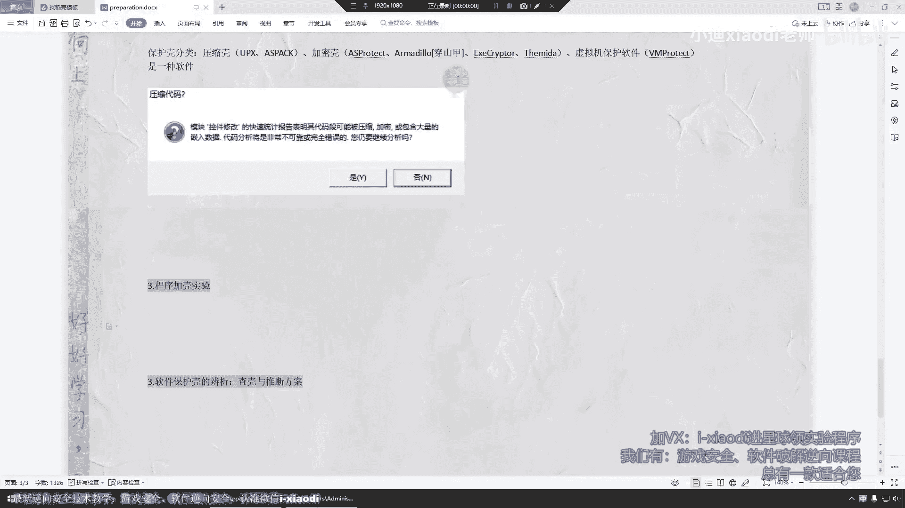

# 🧪 小白软件破解逆向工程师2023最新：3.3：程序加壳与壳的识别

在本节课中我们将要学习程序加壳与壳的识别。课程会先用UPX壳做演示，再用ASPack壳做对照实验，并通过大P、PEiD、ExeInfo、DIE等工具观察加壳前后的变化。学习目标是理解加壳的基本操作、常见识别信号，以及面对加壳程序时应有的分析思路。

接下来先进入实验准备。本节中我们来看看如何选择一个没有加壳的程序，并把它交给UPX工具处理。

## 🧰 实验准备：选一个没有加壳的程序

在开始加壳实验前，我们需要准备一个程序样本。程序可以准备多个，随便选一个没有加壳的程序即可，例如基础011。回去之后也可以用UPX工具做同样的实验，这样能加深对加壳过程的理解。

以下是实验准备阶段需要完成的动作：

- 准备一个没有加壳的程序，例如基础011
- 打开UPX工具
- 把程序直接拖到UPX工具窗口中
- 工具会自动读取程序路径
- 点击选项，查看可配置的压缩项目

打开选项后可以看到压缩图标、图标资源、输出表、资源、重定位等内容。还不了解这些术语没有关系，反正各种东西都会被压缩。这里的压缩级别调到最高，因为这个工具是另一个团队开发的，软件会把压缩级别调到最高程度。设置完成后点击确定，再点击开始。

以下是UPX加壳压缩后的体积变化核心概念：

```text
加壳前体积：668 KB
加壳后体积：275 KB
结论：加壳后体积 < 原始体积
```

进度条走完后压缩完成。压缩完成后，文件立刻从668KB变成275KB。接下来继续观察加壳结果，并进入UPX壳的识别环节。

## 🔍 UPX加壳与壳的识别

上一节我们完成了UPX加壳压缩，本节中我们来看看如何用PE工具和查壳工具识别UPX壳。先点击PE工具，用大P查看加壳程序。把加壳后的程序拖过来，可以看到所在区段是UPX；再把源程序拖过来，点击text，可以看到它与加壳程序的区段区别。这是第一个工具的观察结果。

以下是使用大P观察UPX加壳程序与原程序区别的要点：

- 加壳程序所在区段显示 `UPX`
- 原程序区段与加壳程序不同
- 通过区段名称可以先获得壳的线索

接着用PEiD查看。原程序拖过来，PEiD能正常读取出来；加壳程序拖过来后，PE never变成unknown，EP段变成UPX-1，PEiD second变成UPX。PEiD把壳的类型识别出来了。

再用ExeInfo查看。这个软件第一次打开时比较慢，需要稍等一下，不要以为软件卡住，它刚开始运行就是比较慢。原程序一切正常，不仅正常，还读出了E language，也就是易语言。易语言是中国的一个编程开发工具，ExeInfo把开发工具信息读出来了。再把修改后的程序拖过来，这里还有no pack、no packet之类的信息。no packet表示没有加壳，pack表示打包、包裹、加壳。把加过壳的程序拖过来，可以看到UPX，也有UPX 0.89到3.x的版本范围猜测。工具会推断程序加了UPX壳。

以下是UPX加壳后常见识别信号：

- 区段名称出现 `UPX`
- EP段可能显示 `UPX-1` 等信息
- 查壳工具可能显示 `UPX` 或 `UPX 0.89~3.x`

通过加壳实验可以知道，程序加了壳之后，是可以被查出一些信息的。加壳后的程序再运行一下，运行不受任何影响。先关掉第一个壳子的工具，删除压缩后的程序，再把原程序恢复。然后加另一个壳，进入ASPack实验。

## 📦 ASPack加壳与壳的识别

上一节我们介绍了UPX加壳和识别方法，本节中我们来看看ASPack这个压缩壳的加壳过程和识别结果。ASPack也是压缩壳。查看它的选项，里面有压缩资源、创建备份、使用这个选项，还有保留额外数据，这里选择不保留。这里还有一个段名称设置，比如入口段等区段名称。前面多次谈到区段这个术语，区段名称是可以修改的。UPX壳加完后会出现UPX区段，ASPack壳加完后会出现ASPack区段。

以下是ASPack实验的操作顺序：

- 选择ASPack工具
- 查看压缩资源、创建备份、保留额外数据等选项
- 设置段名称
- 语言选择Chinese JB，也就是简体中文
- 点击打开文件，找到实验目录中的基础011
- 打开后工具自动进行压缩
- 压缩完成后运行程序验证

打开文件后，工具会自动从打开文件界面跳转到压缩界面，并自动完成压缩。压缩后程序变成297KB，运行完全没有问题。先关掉ASPack工具，再用大P查看。把程序拖过来，所在区段变成P/ASPack，文件类型也发生了变化，这就是加过壳的程序特征。

接着用PEiD查看。拖过来后，EP段显示PE never，PEiD second也识别出了结果，壳信息被识别出来。再用ExeInfo查看，拖过来后EP段显示ASPack，ASPack信息也被读取出来。当然还有一个工具叫DIE，也可以把程序拖过来查看，Packer信息会显示加了什么壳，壳类型会被取出来。

以下是使用多个查壳工具观察ASPack加壳程序的关注点：

- 大P：观察所在区段和文件类型变化
- PEiD：观察EP段和壳类型信息
- ExeInfo：观察EP段和ASPack名称
- DIE：观察Packer信息与壳类型

完成两种壳的演示后，我们需要理解加壳的作用和识别背后的思路。加壳可以保护软件，加壳是用一个软件给程序加壳，这个软件是别人已经设计好的，会对代码资源进行压缩或加密。它是从外部对软件进行操作，是对代码资源做整体性的处理。

以下是查壳识别的核心概念：

```text
查壳识别结果 = 区段名称 + EP段信息 + 壳签名/版本猜测
UPX常见信号：区段UPX、EP段UPX-1、壳类型UPX
ASPack常见信号：区段ASPack、EP段ASPack、Packer信息ASPack
```

需要记住一点，程序加了壳之后是可以被识别的，是可以被识别出来的。而且壳用得越广泛，比如全世界用的人特别多，被逆向分析的机会也越多。

这里要记住一句通俗的话：

> 枪打出头鸟。

壳被用得越多，研究的人越多。所以碰到加壳不要害怕，研究加壳的人特别多。查壳术语和整体性的查壳与推断方案，会在下一节课进行整体讲解。今天只是顺带讲一下，加了壳是可以被识别出来的。还要记住这个思维：枪打出头鸟。壳用得比较多，研究的人也会特别多，破解手段也会非常多，可以参考的文章、视频也会特别多，所以面对加壳不要害怕。

## 🧾 总结

到这里，本节教程的主要内容已经完成。本节课中我们一起学习了程序加壳与壳的识别。我们用UPX做了加壳实验，观察到文件从668KB变成275KB；又用ASPack做了加壳实验，观察到文件变成297KB。通过大P、PEiD、ExeInfo、DIE等工具，我们看到了区段名称、EP段信息、Packer信息等识别信号。加壳可以保护软件，但加壳后的程序仍然可以被识别。壳越流行，研究的人越多，可参考的资料也越多。下一节课将整体讲解查壳与推断方案。感谢大家收看，拜拜。

