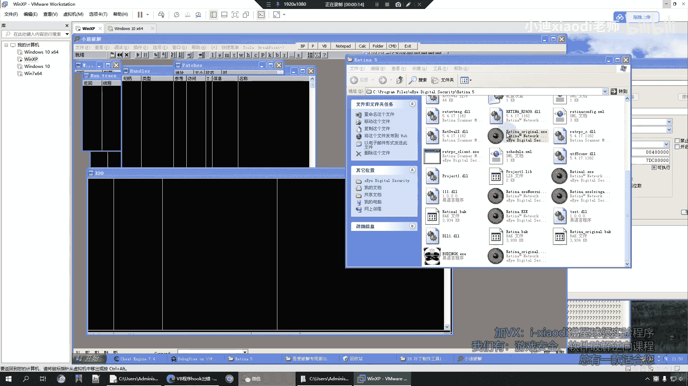
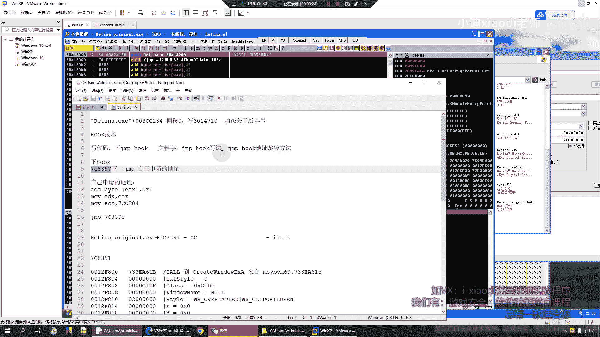
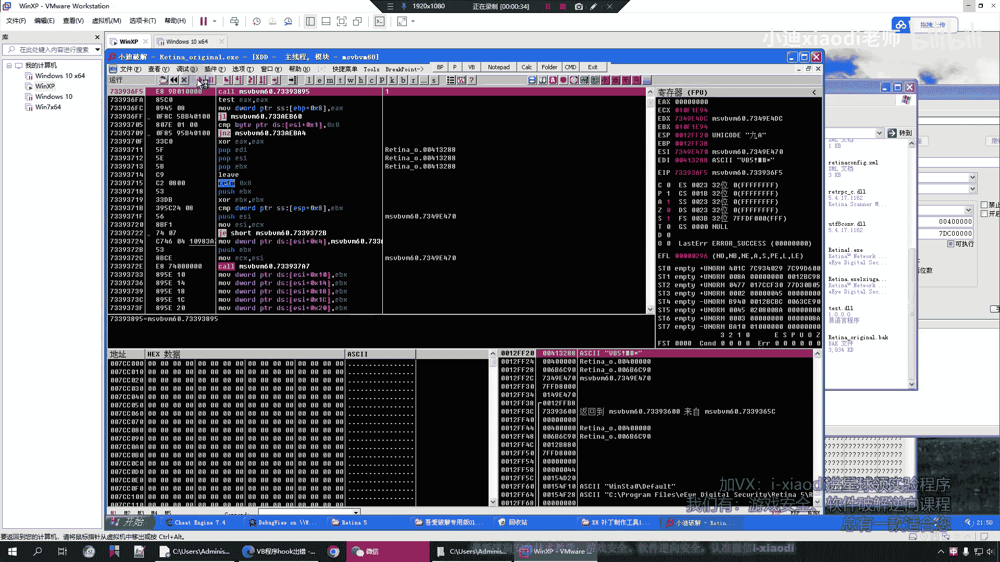
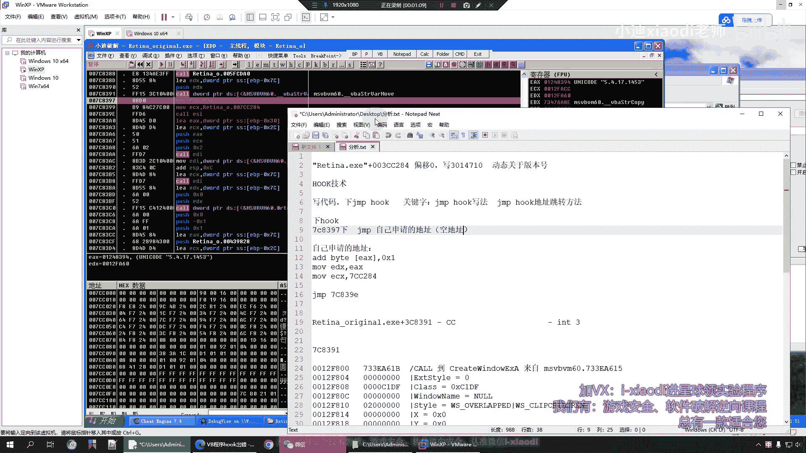
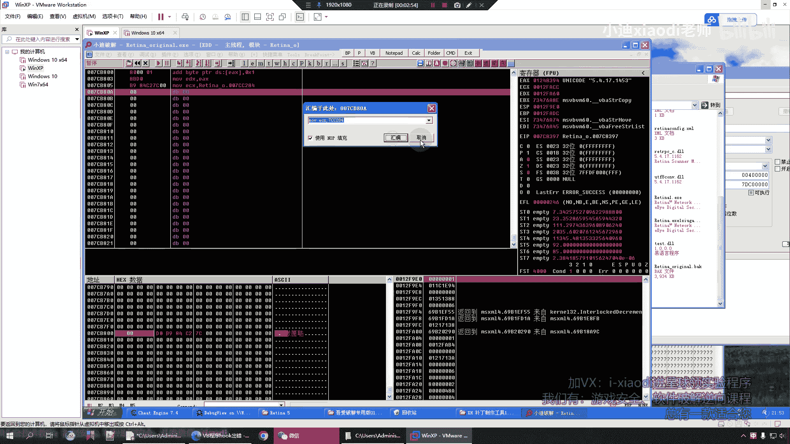
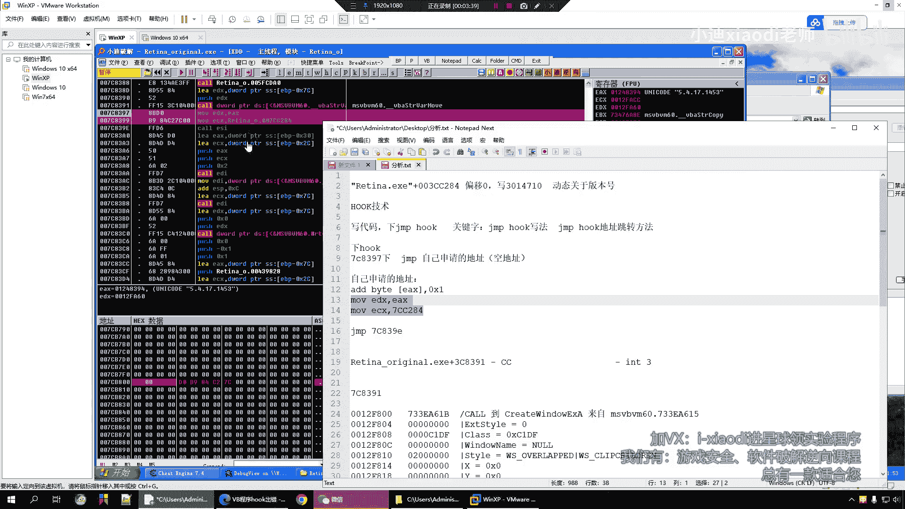
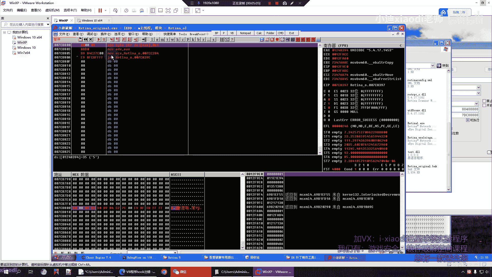
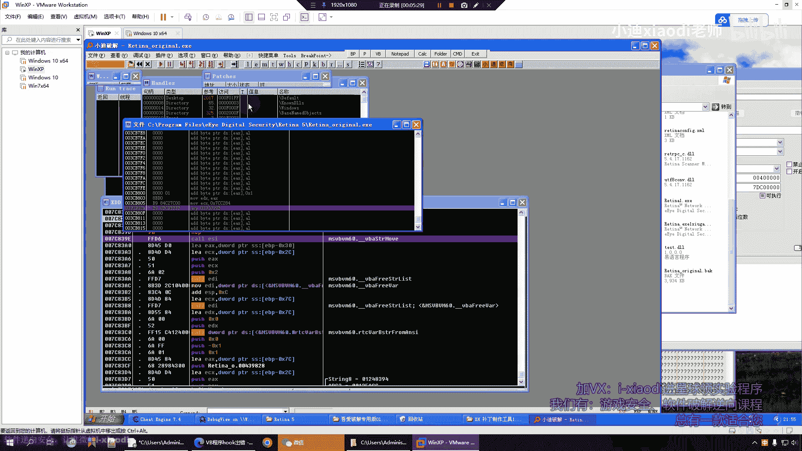
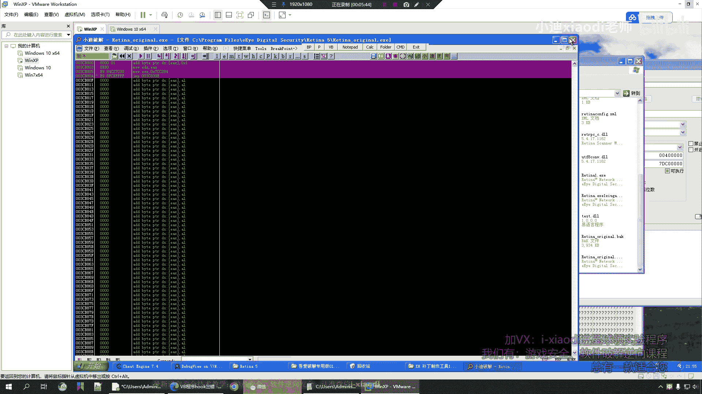
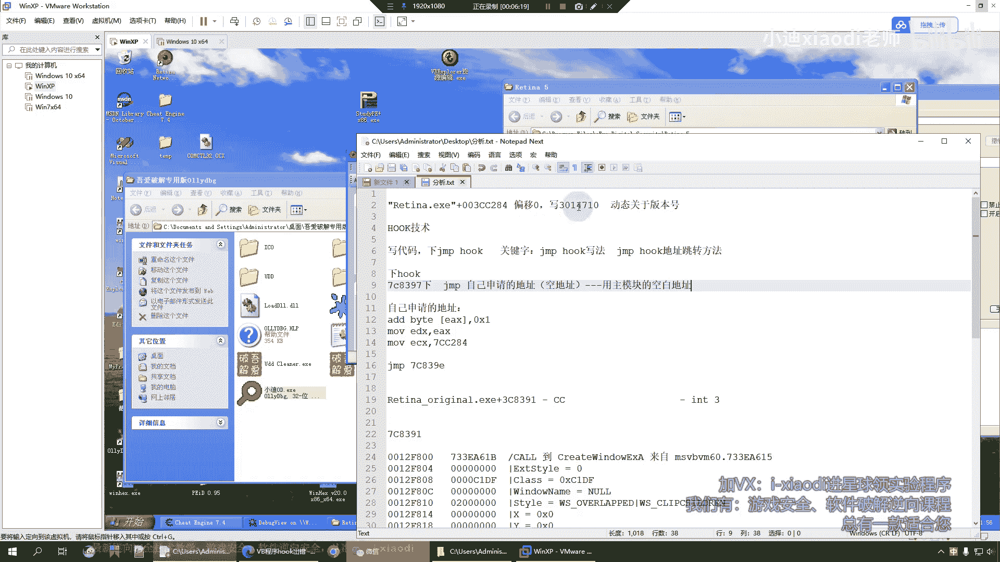

# 🐞 小白软件破解逆向工程师2023最新：3.30：实战单子某VB程序版本号修改完美版本02-JMPHOOK技术


## 🧭 小白软件破解逆向工程师2023最新：3.30.1：课程概述与目标



在本节课中我们将要学习如何通过 JMP HOOK 技术修改某个 VB 程序的版本号。课程进度比较快，已经进入第二课，所以直接进入实战操作。首先打开 OD，把目标程序拖进去，观察程序版本信息，原文中显示为 5.4.x 一类版本，编号是 504667。随后要确认关键地址，这个关键地址就是 `7C8397`，它是本次修改的核心位置。

上一段我们确定了整体目标，本节中我们来看看关键地址为什么关键。通过分析可以发现，程序执行到 `7C8397` 附近时，界面就会显示出 `5.4017` 这个版本号。也就是说，这个位置和版本号显示直接相关，我们唯一的目的就是修改它。修改方式可以采用 JMP HOOK，也可以自行编写代码实现；自行写代码是可行的，不自行写代码同样有办法完成。这里先采用 JMP HOOK 的思路，把程序执行流程临时引到一块空白内存，执行补丁后再跳回原流程。



从原理上看，可以把这次修改概括为下面这个公式。



```text
新版本号 = 原版本号 + 1
演示结果：5 → 6
```

> 提示：JMP HOOK 的核心是先用 JMP 跳到空白区域执行补丁，再用 JMP 跳回原流程，保证程序继续运行。


## 🔍 小白软件破解逆向工程师2023最新：3.30.2：定位关键地址与确认版本号

上一节我们说明了课程目标，本节中我们来看看如何定位关键地址并确认版本号。打开 OD 后，把程序拖过来，先查看程序版本信息，原文中看到的是 5.4.x 一类版本，编号为 504667。关键地址已经找到，就是 `7C8397`。这个地址之所以关键，是因为分析程序执行过程后可以发现，执行到此处时，`5.4017` 这个版本号就会显示出来。



确认版本号之后，目标就非常明确：修改这个版本号。修改不一定只能靠手写完整代码，也可以使用 JMP HOOK 这种跳转补丁方式。也就是说，可以先让程序跳到一块空白地址，在空白地址里执行修改动作，再跳回原来的执行位置继续运行。这样既能完成修改，又能尽量不破坏原程序流程。

为了便于理解，可以把关键地址和版本号关系记成下面这样。

```text
关键地址：7C8397
显示版本号：5.4017
目标：修改版本号显示结果
```

接下来我们就要为 JMP HOOK 寻找合适的空白内存地址，并准备写入跳转代码。


## 🛠️ 小白软件破解逆向工程师2023最新：3.30.3：寻找空白内存地址

上一节我们确认了关键地址和版本号，本节中我们来看看如何寻找空白内存地址。JMP HOOK 需要一块可以写入补丁代码的地方，自己申请到的地址通常是空白地址，可以把它理解成一片空旷土地。但当前讨论的这块区域并不是空旷土地，因为这里全都有数据。因此要找的是没有数据的区域，也就是内容全部为零的区域。全部为零的区域非常适合写入补丁，操作起来也更方便。

原文中先演示了从 `7D7600` 开始寻找，并提醒记住这个地址，同时说明这边内存并不是特别干净。随后又回头查看 `7C0000` 附近，因为之前是从 `7C0000` 开始找空地址。查找过程中看到某些位置已经有数据，有数据的位置就不要修改。最终选择在 `7CB800` 这里修改，把这个地址作为补丁代码的存放位置。

下面是原文中涉及的地址选择思路，供初学者对照理解。

- `7D7600`：原文中先提出的候选跳转地址，用于演示寻找空地址的过程。



- `7C0000`：原文中回看的查找起点，从这里开始寻找空白区域。

- `7CB800`：最终选定的补丁地址，后续把代码复制到这里进行修改。

地址确定后，下一步就是把原程序的相关代码搬到 `7CB800`，并在关键位置加入跳转。


## 🧩 小白软件破解逆向工程师2023最新：3.30.4：编写JMP HOOK修改版本号

上一节我们选定了 `7CB800` 作为补丁地址，本节中我们来看看如何编写 JMP HOOK。首先把原程序的相关代码复制到 `7CB800`，原文说明这是原程序的代码，以前的程序跑的就是这两行代码。回过去查看后，可以确认以前的两行代码对应这里的两行代码。现在要做的关键动作是：在执行这两行代码之前，把版本号中的 5 加一个 1。



这个 1 加在哪里，原文给出的答案是加在寄存器中存放数值的位置。原文说数值在 EX 里，因此对 A 的一个字节加一。用汇编表达就是 `ADD AL, 1`，也可以理解为 `AL = AL + 1`。这是一个很灵巧的方法，所以学习汇编很重要；不学习汇编，就不容易知道应该改这里，也不容易理解这里的加法操作。原文中按加号键过去，继续处理后续跳转。

补丁代码执行完以后还要跳回原程序，跳回的位置是 `839E`。因此整体流程是：程序执行到关键地址时跳到 `7CB800`，在 `7CB800` 执行加一补丁，再跳回 `7C839E` 继续执行。原文中把关键位置改为 `JMP 7CB800`，这样程序执行到这里就会跳转到补丁区域。改完之后会出现一个新的执行流程：程序执行到关键地址时跳到这里，执行补丁代码，再执行原来的两行代码，于是在无形之中把 5 加了一个 1，变成 6。

原文还说明，这里不一定要加 1，也可以加 8，想怎么改就怎么改。甚至可以一直更新版本号，把每次更新版本都做成收费点。这个说法体现了补丁位置的灵活性，但实际使用时要遵守法律和软件许可要求。补丁代码执行完后，再用 JMP 跳回原来的位置继续执行。

可以用下面的示意代码理解整个过程。

```asm
; 关键地址处改为跳转
7C8397: JMP 7CB800

; 7CB800 补丁区域
7CB800: ADD AL, 1
        ; 原程序的两行代码放在这里
        ; ...
        JMP 7C839E
```

到这里，跳转和修改逻辑已经完成，下一步就是保存修改并运行验证。


## 💾 小白软件破解逆向工程师2023最新：3.30.5：保存修改与验证运行

上一节我们完成了 JMP HOOK 的代码修改，本节中我们来看看如何保存并验证。原文解释了为什么这里能够保存数据：当前操作位于主线程模块，也就是程序模块内部；所选的空地址同样位于程序模块内部，因此可以修改，也可以保存。这个条件很重要，因为如果补丁地址不在可保存的模块范围内，修改就可能无法落到可执行文件中。

保存时，使用“复制到可执行文件”中的“所有修改”功能，把全部修改复制进去。原文中看到上面有 A 相关的内容，还有之前修改过的内容，全部都被选中。也可以再来一遍：鼠标右键，选择复制到可执行文件的所有修改，全部复制，然后保存。保存时可以给文件起名为 `222`，这个名字无所谓，只要方便识别即可。保存后关掉窗口，再检查生成的文件是不是 `222`，确认后运行程序。

验证时，原文看到程序运行结果显示为 6，说明版本号修改基本成功。下面是验证流程的简要整理。



- 使用“复制到可执行文件”中的“所有修改”功能，复制全部补丁。

- 右键选择复制到可执行文件的所有修改，全部复制并保存。



- 文件名可以设为 `222`，名称不影响补丁效果。

- 关闭窗口后重新打开生成的文件，运行并查看版本号是否变为 6。

验证成功后，本次 JMP HOOK 实战就完成了。




## 🧠 小白软件破解逆向工程师2023最新：3.30.6：两种思路与课程总结

上一节我们完成了保存和运行验证，本节中我们来看看 JMP HOOK 的两种实现思路并做总结。原文说明，JMP HOOK 技术的大致思路是相通的，可以自己编写代码实现，也可以直接使用程序内部地址。具体来说，有两种思路：一种是自己申请地址，把补丁写到申请到的空白地址；另一种是使用主模块中的空白地址，把补丁写进程序模块内部。原文最终演示采用的就是主模块空白地址这一思路。

这两种思路的核心区别在于补丁地址的来源，但都离不开“跳过去、执行补丁、跳回来”的基本结构。可以把它概括为下面这个流程公式。



```text
原流程 → JMP 补丁地址 → 执行修改 → JMP 原流程继续位置
```

本节课中我们一起学习了如何用 JMP HOOK 修改 VB 程序版本号：先打开 OD 并定位关键地址 `7C8397`，确认版本号 `5.4017`，再寻找空白地址 `7CB800`，把原代码搬到补丁区，使用 `ADD AL, 1` 修改版本号，最后通过 JMP 跳回 `7C839E` 继续执行。完成修改后，使用“复制到可执行文件的所有修改”保存为 `222`，运行验证显示为 6。原文最后希望学习者学有所成，建议认真练习汇编和 JMP HOOK 的基本流程。

