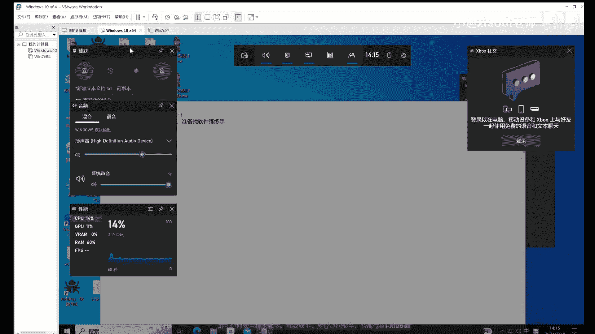
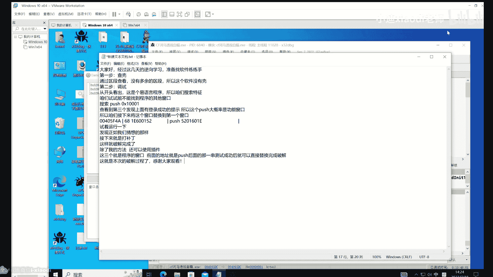

# 🧭 小白软件破解逆向工程师2023最新：3.31：学员实战：某XF透视自瞄辅助网络验证破解

在本节课中我们将要学习一条课程标题的整理方式。原标题是“小白软件破解逆向工程师2023最新：3.31.学员实战：某XF透视自瞄辅助网络验证破解--BV1nu411L73R-”。这句话包含课程名称、章节编号、章节名称和视频编号。我们会把这些信息拆开说明，并用大白话解释“网络验证”在这个标题里的基本含义。为了让初学者能看懂，下面只做标题含义和概念流程的整理，不展开具体破解操作。

## 📌 课程标题拆解

上一段我们说明了整体目标，本节中我们来看看标题由哪些信息组成。标题虽然只有一行，但信息密度不低，拆开后更容易理解。标题中的分隔符和编号只是课程组织方式，不影响我们对内容的判断。以下是标题元素列表：

- 课程名称：小白软件破解逆向工程师2023最新

- 章节编号：3.31.

- 章节名称：学员实战：某XF透视自瞄辅助网络验证破解

- 视频编号：--BV1nu411L73R-



## 🧠 核心概念大白话

上一节我们把标题拆成了几个部分，本节中我们来看看“网络验证”这个核心概念。用大白话说，网络验证就是客户端先向服务器询问“这次能不能用”，服务器检查后返回“能”或“不能”。这个过程可以用公式表示：

`客户端请求 -> 验证服务器 -> 返回验证结果`

也可以用伪代码表示：

```text
request = client.send(check_request)
result = server.verify(request)
client.use(result)
```

这里的公式和代码只描述请求与响应的基本流程，目的是帮助初学者理解标题中的“网络验证”在讲什么，不涉及具体绕过方法。看懂这个流程后，再回看标题，就能明白“网络验证破解”这个说法指向的是对验证流程的研究主题。

## 🎯 学习目标与边界



上一节我们解释了网络验证的基本流程，本节中我们来看看这条课程标题对应的学习目标。标题指向的是学员实战，主题是某XF透视自瞄辅助的网络验证破解。对初学者来说，先看清标题结构和概念边界，比直接记操作步骤更重要。以下是学习目标列表：

- 认识课程标题由课程名称、章节编号、章节名称和视频编号组成

- 理解网络验证的基本请求与响应流程

- 明确实战课主题是某XF透视自瞄辅助的网络验证破解

- 知道本整理只做标题翻译和概念说明，不展开具体破解步骤

## ✅ 总结

本节课中我们一起学习了如何整理“小白软件破解逆向工程师2023最新：3.31：学员实战：某XF透视自瞄辅助网络验证破解”这条课程标题。我们拆出了课程名称、章节编号、章节名称和视频编号，并用公式与伪代码说明网络验证的基本流程。最后再强调一次：本节只整理标题含义和基础概念，不提供具体破解操作。
