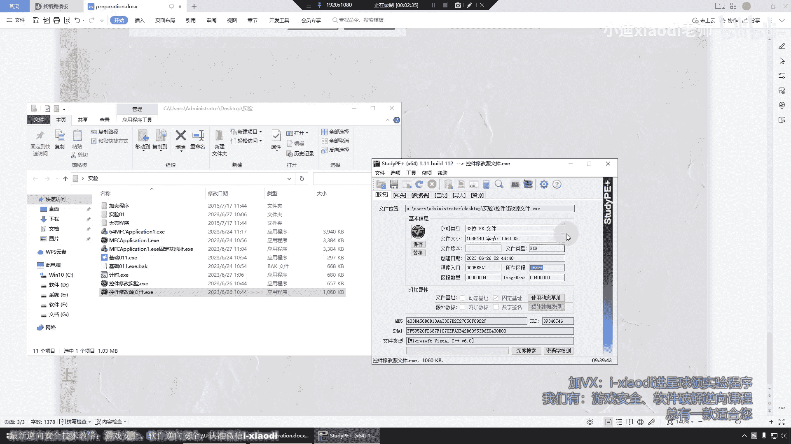
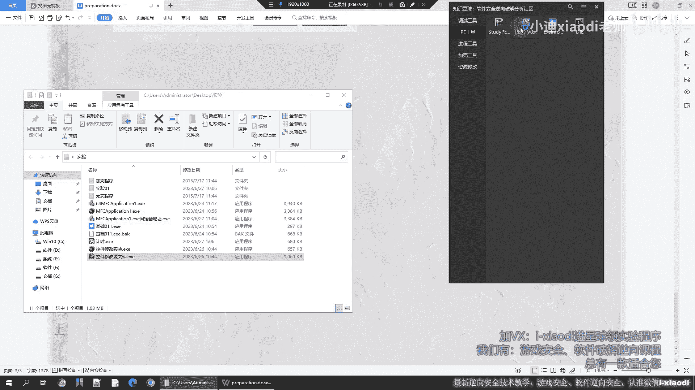
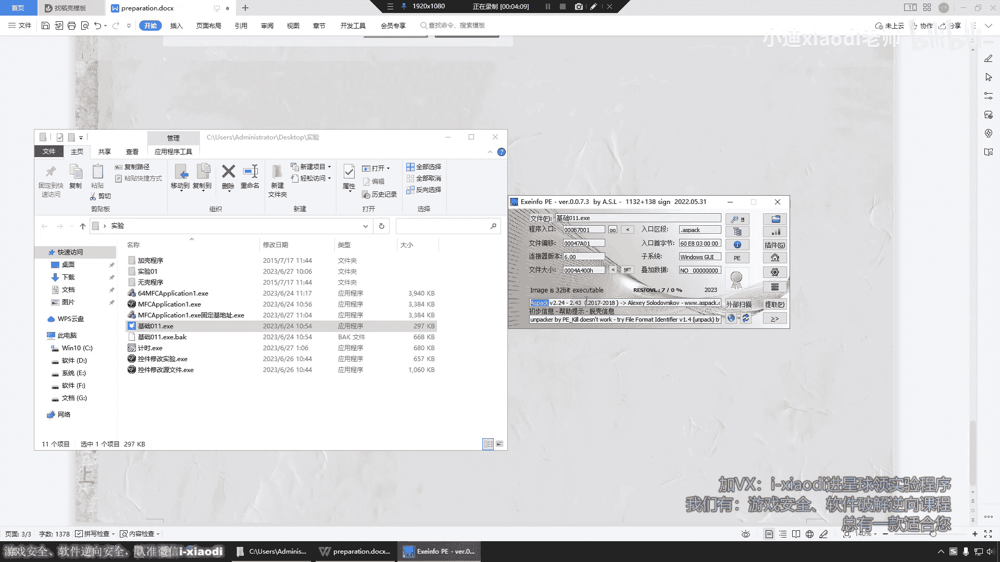
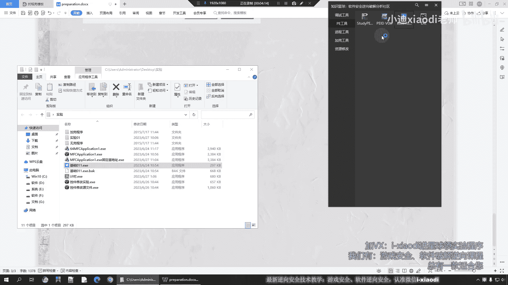
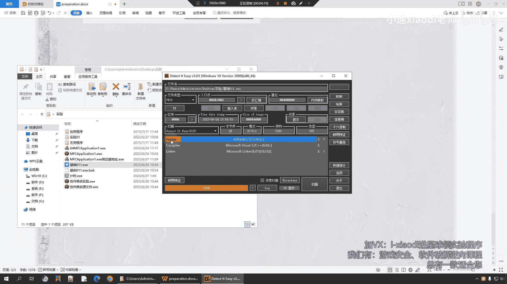
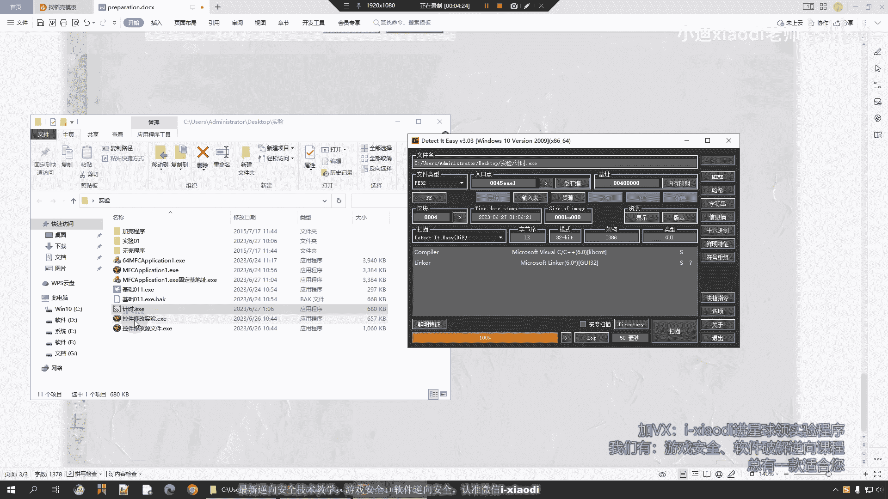
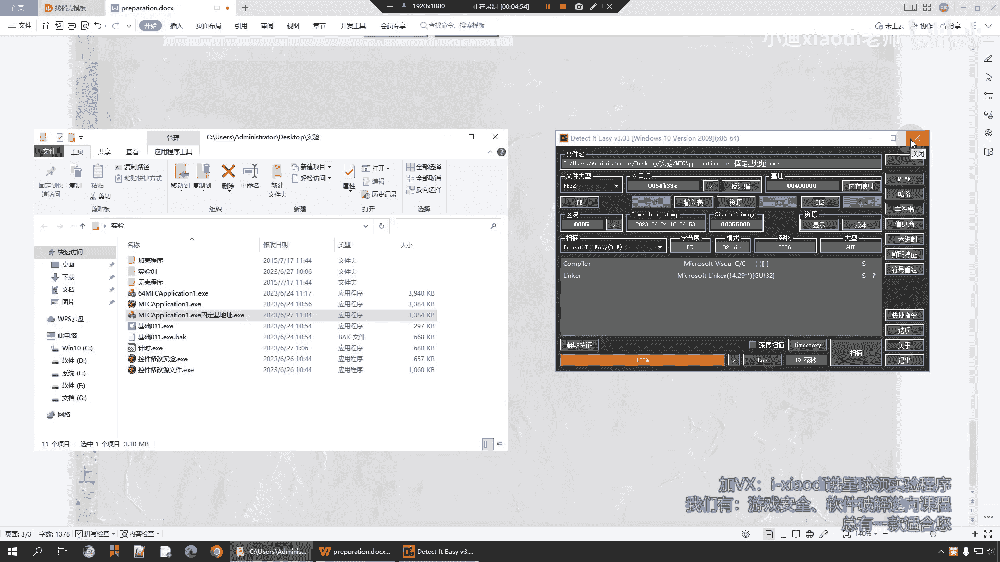
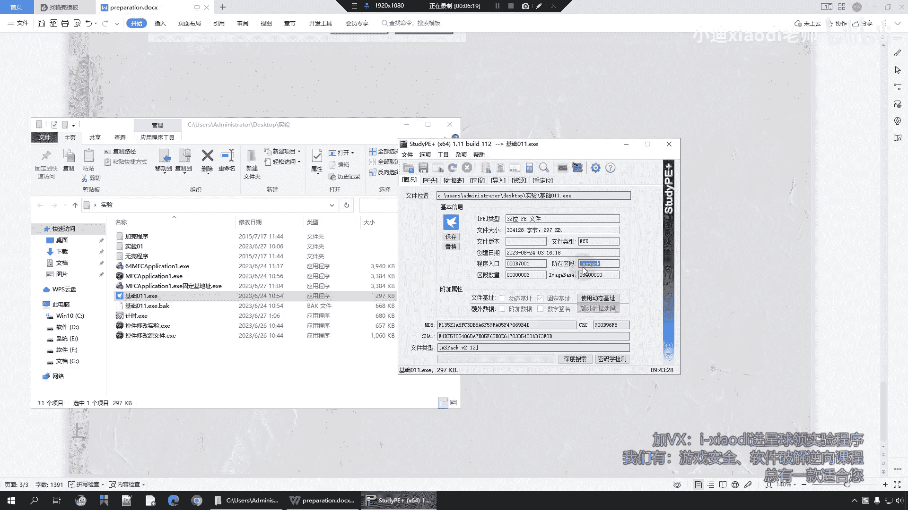
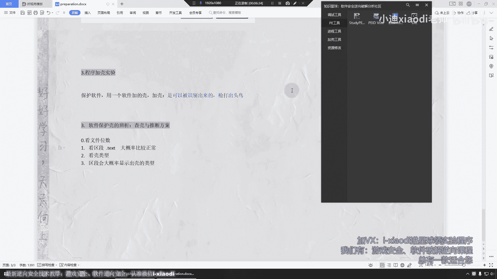

# 🧩 小白软件破解逆向工程师2023最新：3.4：软件保护壳的辨析：查壳与推断方案


在本节课中我们将要学习软件保护壳的辨析，也就是常说的查壳与推断方案。本节课是第三课，上一节课简单顺带过查壳方案，本节把查壳思路详细展开。拿到一个软件后，我们不需要一上来就做复杂操作，而是先通过PE工具观察文件位数、区段名、壳类型和入口位置，逐步推断它是否加壳、可能是什么壳。下面先给出整体判断思路，方便初学者建立框架。


```text
查壳核心判断：
PE位数 -> 选择对应工具
区段名 -> 初步判断有无壳
壳类型 -> 用PEiD、EXE、DIE等工具确认
入口所在区段 -> 判断入口真假
```


## 📌 小白软件破解逆向工程师2023最新：3.4.1：课程概述与查壳总体思路


上一段我们建立了整体框架，本节中我们来看看具体课程目标和基本思路。本节课是第三课，主题是软件保护壳的辨析、查壳与推断方案。上一节课简单顺带过查壳方案，本节再详细说明。拿到一个软件后，第一步之前是用starPE，把程序拖过来，先看32位PE文件类型，看它是32位还是64位文件类型。不同位数对应不同工具，所以在之前先看位数。接下来从今往后第二步看区段。整体思路就是先用PE工具看基本信息，再结合区段和工具识别结果做推断。以下是本节要掌握的关键点，先列出来帮助理解：


- 先看PE位数：判断是32位还是64位程序。
- 再看区段：正常程序通常显示`.text`区段。
- 然后看壳类型：用PEiD、EXE、DIE等工具辅助识别。
- 最后看入口所在区段：判断入口是真入口还是假入口。


上面这些点看起来简单，但实际排查时很实用，因为查壳不是只看一个结果，而是多个信息互相印证。接下来我们先从最直观的文件位数和区段看起。


## 🛠️ 小白软件破解逆向工程师2023最新：3.4.2：第一步看文件位数与区段




上一节我们列出了整体关键点，本节中我们来看看第一步如何看文件位数与区段。拿到软件后，第一步之前是用starPE，把程序拖过来，先看32位PE文件类型，看它是32位还是64位文件类型。不同位数对应不同工具，所以在之前先看位数。接下来第二步看区段。如果一个区段比较正常，应该显示`.text`段，这是正常文件。再拿一个文件看，比如一个正常文件没有壳，可以看到`.text`段；64位程序也可以看到`.text`段；把程序拖过来看`.text`段；再看计时相关程序也可以看到`.text`段。所以第一步先看区段，如果它是`.text`段，大概率就是比较正常的文件，大概率没有加壳。


```text
正常无壳的高概率特征：区段 = .text
```



如果是一个加固壳的程序，可以观察压缩过的程序，拖过来后区段变了，变成了壳名字的区段。它肯定是人为修改过了。很多人出去旅游喜欢在一些地方刻上谁谁谁到此一游，留下一些东西、留下一些痕迹，往往并不是好事，因为这会让我们知道他是谁。还有一个压缩过的程序，拖过来可以看到`UPX1`（原文口语提到UPSX杠1）。所以我们通过四大类PE工具先看所在区段。如果它不是`.text`段，而是其他段，大概率就是被加壳了。再看原程序，拖过来可以看到`.text`段。这是第一种方案，这种方案比较直接，因为我们在看它是32位还是64位程序时，就把相应信息看出来了。接下来我们继续看第二种方式，也就是用工具直接识别壳类型。


## 🔍 小白软件破解逆向工程师2023最新：3.4.3：用PEiD等工具识别壳类型


上一节我们用区段做了初步判断，本节中我们来看看第二种方式：看壳类型。可以用PEiD（原文写作PID）看壳类型，壳类型会在PE或PEiD这边显示出来。拿原程序试一下，原程序会显示你是什么编程开发平台；拿压缩过的程序试一下，大概率会把壳识别出来，或者这里直接变成unknown，表示识别不出来，例如这是一个UPX壳。再把基础011拖过来，可以直接把相关信息和PEiD这边全部显示出来。所以第二种方式就是查壳类型。除了这个工具，我们再顺带看看其他工具，比如EXE工具，来基础011看一下。可以发现都识别出来了，比如`S pack`；再看UPX程序，UPX大概率能够识别出来。再看其他程序，正常程序会显示开发平台，没有那些乱七八糟的信息。以下是几种常见工具的观察方式，便于初学者对照：




- `PEiD`：查看壳类型，原程序显示开发平台，压缩程序可能显示壳名或`unknown`。
- `EXE工具`：拖入基础011可以看到`S pack`，UPX程序大概率识别为UPX。
- `DIE工具`：稍后单独说明，用来看是否显示`packer`等压缩标记。




这些工具的结果可以互相参考，不要只依赖单一工具。接下来我们继续看DIE和区段细节，进一步确认壳的类型和入口真假。


## 🧪 小白软件破解逆向工程师2023最新：3.4.4：用DIE与区段进一步确认




上面看了PEiD和EXE工具，本节中我们来看看DIE工具与区段细节。把程序拖到DIE里可以看到`ASPack`，它会显示`packer`，`packer`就是说程序专门压缩过。再看原来的正常程序，如果正常程序没有压缩，就不显示`packer`选项，可以看到没有`packer`那个选项。压缩过的程序会显示`packer`类型，正常程序不会显示`packer`，也就是没有压缩过，所以不显示。再看其他正常程序，也是正常程序，可以看到这就是没有壳的程序。壳的类型大概率会通过区段进行显示，壳的类型可以直接在工具里看，或者看区段，区段大概率会显示出壳的类型。只需要看一些关键字符串就可以了，比如把4来的PE拖过来，可以看到所在区段是`S pack`；另一个可以看到`UPX`。当然还可以进一步看所在区段，点击区段可以看到`UPX`、`UPX`两个UPX特征。再看ASPack程序，拖过来可以看到`ASPack`，多了1个ASPack标识。它的`.text`段的确也存在于区段里，但是把程序拖过来后，程序入口所在区段确实在壳段里边，所以它是一个假入口。正常程序的入口应该在`.text`里边，现在入口更改成了壳的位置，所以这就是一个加固壳程序。加固壳大概率会把壳名字显示在这个位置。






```text
正常入口：入口所在区段 = .text
假入口：入口所在区段 = 壳段名
```

通过工具结果和区段名对照，初学者就能比较直观地看出程序有没有被加壳，以及入口是否可疑。下面进入课后作业和本节总结，把今天学到的判断流程自己走一遍。


## 📝 小白软件破解逆向工程师2023最新：3.4.5：课后作业与本节总结


前面我们讲了查壳的判断流程和工具用法，本节中我们来看看课后作业与总结。今天回去之后，大家可以自己加一下壳，然后查一查壳，自己去识别一下，可以看驱动2，也可以点一下区段2，再用剩下的三个工具分别去看一下。作业不是很多，下节再见。本节课中我们一起学习了软件保护壳的辨析、查壳与推断方案：先看PE位数，再看区段是否为`.text`，然后用PEiD、EXE、DIE等工具识别壳类型，最后结合入口所在区段判断真入口和假入口。只要按这个顺序观察，初学者也能逐步推断出程序是否加壳以及可能的壳类型。以下是本节总结，方便课后回顾：


- 区段为`.text`时，程序大概率正常、大概率没有加壳。
- 区段变成壳名字或出现`UPX`、`ASPack`等标记时，要怀疑加壳。
- 工具识别结果要互相参考，`unknown`也可能意味着有壳。
- 入口不在`.text`而在壳段里时，要考虑假入口和加固壳。
- 课后自己加壳、查壳、识别，并用多个工具交叉验证。






本节课中我们一起学习了查壳的基本顺序和推断方法，重点是用大白话理解“位数、区段、壳类型、入口位置”这四个观察点。下节再见。
