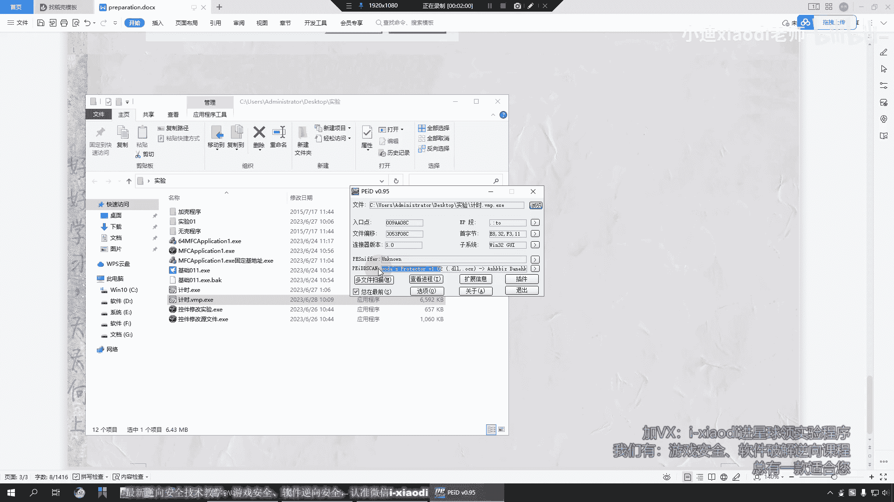
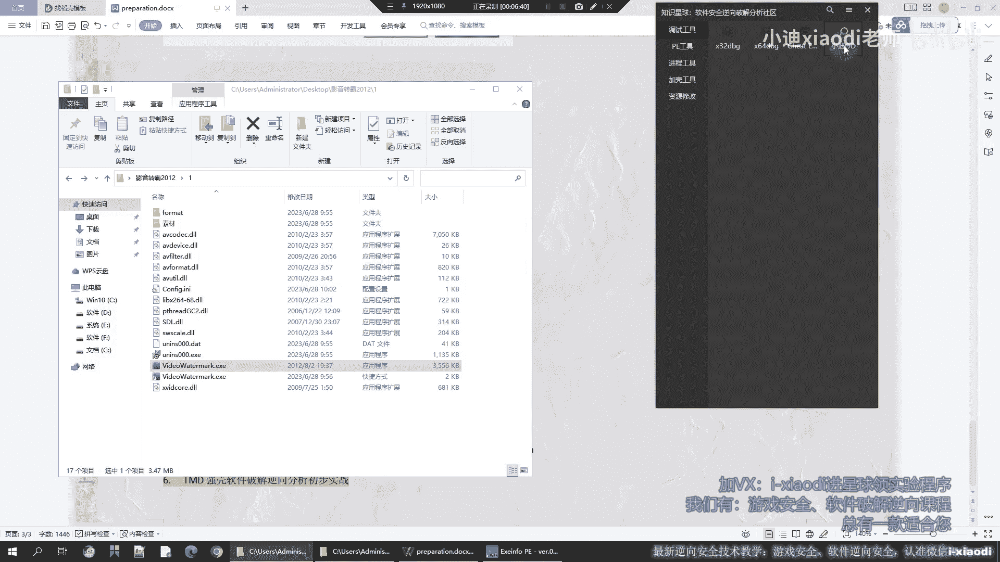
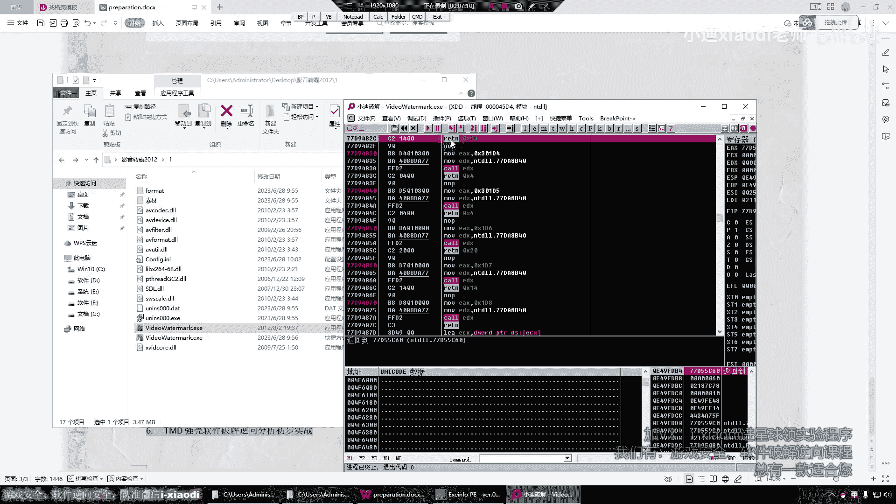

# 🧭 小白软件破解逆向工程师2023最新：3.5：加密与虚拟机强壳的辨析

## 📌 小白软件破解逆向工程师2023最新：3.5.1：本课概述

在本节课中我们将要学习加密壳与虚拟机强壳的辨析。对应视频编号为BV1xg4y1N7Az。欢迎大家收看软件安全逆向破解第一期汇编逆向与破解实战第三章逆向破解理论重点学习第五课。上一节课我们介绍了软件保护壳的初步查壳与推断方案，主要看的是压缩壳。本节中我们来看看加密壳和虚拟机保护软件的特征。这类壳的特征不是特别明显，但往往不是特别明显的特征又会显得非常明显，初学时可能觉得有点绕。下面用直白的方式一步一步说明。

## 🧰 小白软件破解逆向工程师2023最新：3.5.2：先认识强壳与工具初查

上一节我们介绍了保护壳初查思路，本节中我们先认识什么叫强壳，以及拿到样本后应该怎样用工具瞅一眼。所谓强壳，用大白话说就是保护能力比较强的壳，混淆程度比较高，常见类型包括加密壳和虚拟机保护壳。可以把判断思路先记成下面这个简单公式和伪代码，方便初学者建立印象。

```text
强壳 = 加密壳 ∪ 虚拟机保护壳

若 区段名称异常混乱 且 区段长度异常 且 工具识别结果不一致
则 大概率使用强壳
```



以下是本课涉及的核心概念和初查思路，先有一个整体印象即可：

- 强壳不是单一壳名，而是保护能力较强的一类壳的统称。
- 加密壳和虚拟机保护壳都可能表现为区段混乱、数据杂乱、工具识别结果不稳定。
- 初查时可以先上PE类工具查看区段，再用PID类工具看识别结果，最后用ESEin进一步确认。
- DIE工具在这类强壳上可能完全失效，因此不能只依赖一个工具。

拿到工具后可以用PE类工具先瞅一眼。例如样本加了VMPpro壳，这个壳是俄罗斯人做的加密虚拟机保护软件，所以在俄罗斯一些逆向破解论坛中经常能看到它的身影。拿到这样一款强壳后把文件拖过来，会发现它所在区段非常诡异，区段名类似`.text`，点一下区段看，内容非常乱。如果发现这种非常乱的壳，就大概率使用了虚拟机壳或加密壳，这两类都属于强壳类型，能力强，混淆程度也比较厉害。

## 🕵️ 小白软件破解逆向工程师2023最新：3.5.3：VMPpro 强壳的识别

上一节我们认识了强壳的总体特征，本节中我们来看看VMPpro这类壳的实际识别过程。这里工具在这里，再用PID类工具看一下，它会把壳识别成其他壳，也就是说它会伪造自己、伪装自己，表现很强，同时数据乱七八糟，区段也特别乱。

以下是VMPpro强壳的观察步骤，按顺序看即可：

- 用PE类工具拖入样本，观察区段是否异常混乱。
- 点开区段查看内容，若非常乱，先怀疑加密壳或虚拟机强壳。
- 用PID类工具查看，注意它可能把壳识别成其他壳并伪装自己。
- 用ESEin查看，它可能识别出`VMP protect`，并显示官网信息。
- 若前两个工具识别不出来，可以用ESEin进一步看，有可能识别出来。
- 若这两个工具识别不出来，DIE基本更废，可能完全废掉。

例如用ESEin拖过来看，它能识别出来，显示结果类似下面这样。

> VMP protect

它还会把整个官网的信息显示出来。因此如果用强壳，前两个工具识别不出来时，可以用ESEin进一步查看，有可能识别出来。若这两个工具都识别不出来，DIE就更废，完全废掉。这几个工具里比较靠谱的是ESEin，因为该工具一直在更新，所以在接下来的一些实践性或实际性实战中，比较推荐大家用ESEin去看。顺序方面，以后用熟了可以直接上ESEin，看个人能力。ESEin也能显示32位还是64位，例如显示`32 executable`，64位程序拖过来会显示64，位数都能识别出来。VMPpro对应的VMP protect是俄罗斯人开放的一款虚拟机保护软件。

## 🧩 小白软件破解逆向工程师2023最新：3.5.4：TMD 强壳的识别

上一节我们看了VMPpro的识别，本节中我们来看看另一款常见强壳TMD强壳。TMD也是一款强壳，下面通过一个影音转办类软件来看它的特征。这个软件后边会打包放到星球里，如果想获取相关实战性、实际性资源，可以继续看后面的获取方式。资源全部是绿色版本，若在网上下载，有可能下载到病毒木马或带有捆绑的版本，而这里的资源完全可以在真机执行。

以下是TMD强壳的识别步骤和资源获取说明，初学者可以先照着观察：

- 用starDPE类工具拖入样本，观察区段是否直接乱掉。
- 查看区段，若非常乱，大概率是强壳。
- 若区段很长且全是字母，大概率是TMD壳，先建立“全是字母”的印象。
- VMP常见的是特殊符号，TMD常见的是随机字母，这一点可以用来辅助区分。
- 用PID类工具查看，TMD也会伪装自己。
- 用ESEin查看，可能直接显示TMD壳，后边还可能带有同一家公司的信息。
- 用DIE查看，基本也会废掉，直接失效。

例如用starDPE拖过来看，区段乱了，直接就乱，区段非常乱。看到这种非常乱的区段，大概率就是强壳。区段很长且全是字母时，这种字母大概率就是TMD壳。脑子里要有这样一种印象：全是字母；VMP则是一些特殊符号，TMD是一些随机字母。再用PID拖过来看，它也会伪装TMD壳，也会伪装自己。现在如果还不知道TMD壳，可以用ESEin查看，TMD壳就出来了。后边可能还会带有一个东西，这都属于同一家公司，网址都一样，所以可以把它们认为或当作TMD壳即可，它是一款强壳。若用DIE，基本上也废掉了，直接废掉，最终比较靠谱的归宿还是ESEin。

如果想获取相关实战性、实际性资源，可以联系微信，加入或在知识星球App里搜索“软件安全逆向破解分级学习社区”，在里边就可以获取。若搜不到或不知道怎么加，可以联系微信，加上后拉进社区。这个社区仅供内部技术交流，提供温馨的探讨环境。这个影音转办类软件是一个付费软件，这里只是用于识别强壳特征。

## 🛠️ 小白软件破解逆向工程师2023最新：3.5.5：识别顺序与下节预告

上一节我们通过TMD样本看了强壳的区段和伪装特征，本节中我们总结识别顺序并预告下一节内容。今天说的是加密与虚拟机强壳的辨析，可以把结论复制出来：两个比较常见的强壳就是VMP类强壳和TMD类强壳。一般市面上的外挂、辅助或一些商业软件，基本上都会用这两款去进行保护。

以下是本课形成的识别顺序与下节预告，便于后续实战复盘：

- 先看区段是否非常乱，区段名和区段内容是否异常。
- 再看区段长度和字符特征，全字母可先怀疑TMD，特殊符号可先怀疑VMP。
- 然后用PID类工具看是否被伪装，用ESEin进一步确认壳名和官网信息。
- DIE在强壳上可能完全失效，不能把它当成唯一判断依据。
- 下一节课会说明TMD强壳软件破解逆向分析的初步实战，并给出对抗方案。



下节课我们会说明TMD强壳软件破解逆向分析的初步实战，看怎么去处理。可以自己先试一下，例如用“小DOD”拖过来尝试，首先映入眼帘的是压缩代码，可以点否，然后运行。运行后发现程序有明显特征反调试，还会显示一个内部错误，并显示“thank you，谢谢您”，程序直接跑不起来，就没有办法分析。对于这种情况，有相关对抗方案，下一节课会直接把一些干货带给大家。看到这里的同学可以一键三连，把这个内容转发到兴趣群，让大家知道有这样一个好教程，多多分享，支持小蝶老师，下期再见。



## ✅ 小白软件破解逆向工程师2023最新：3.5.6：本课总结

本节课中我们一起学习了加密壳与虚拟机强壳的辨析。核心结论是：强壳常见于加密壳和虚拟机保护壳，区段混乱、数据杂乱、工具识别结果不一致是重要信号；VMPpro常表现为特殊符号和`VMP protect`识别结果，TMD常表现为长区段全字母并可被ESEin识别；工具顺序上可以先用PE和PID初查，再用ESEin确认，DIE在强壳上可能失效。下一节课将进入TMD强壳的初步实战，继续看反调试和对抗方案。

