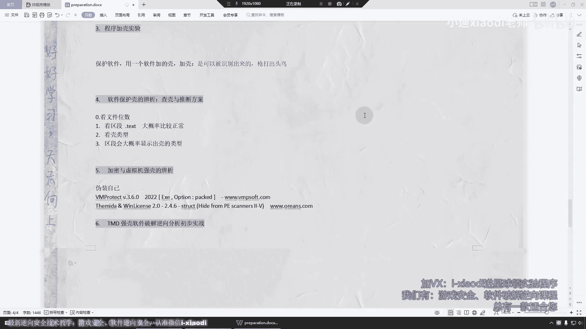
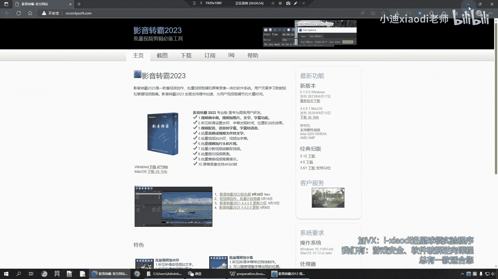
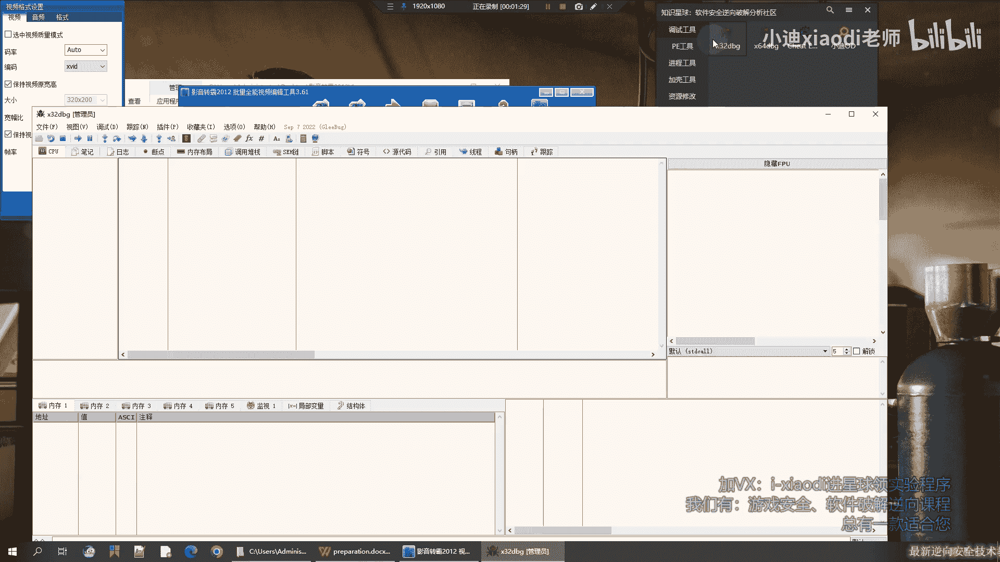
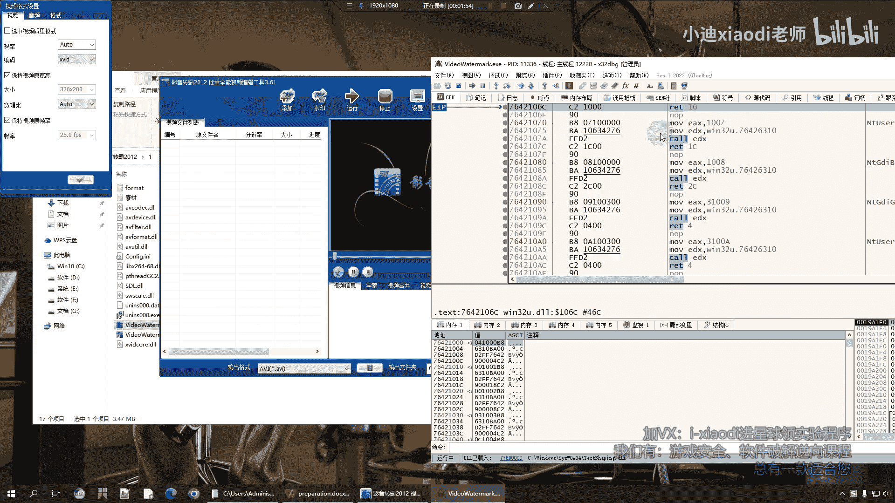
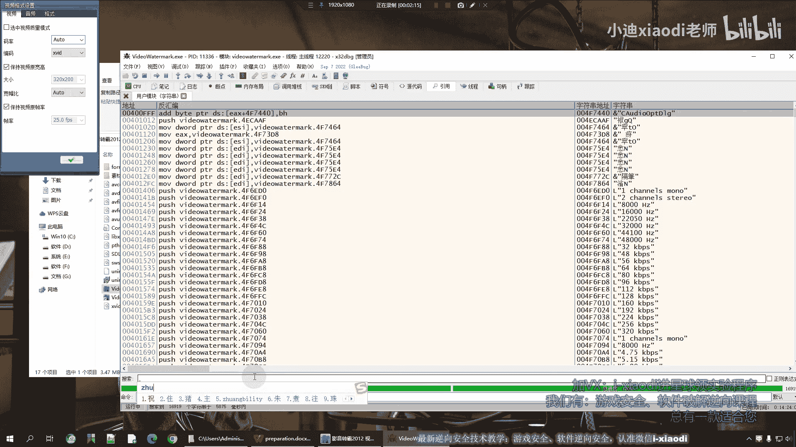
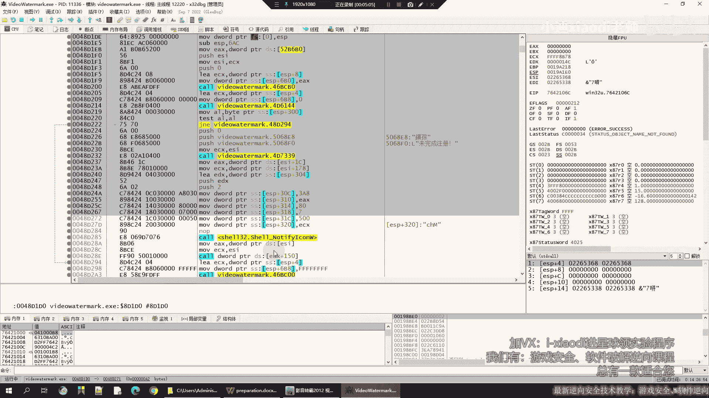
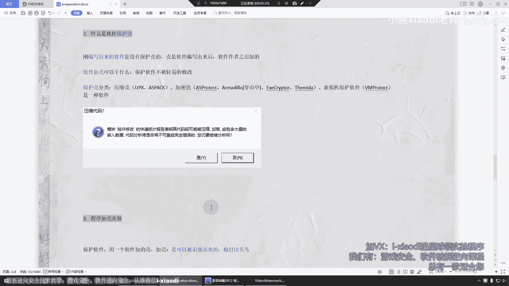

# 小白软件破解逆向工程师：3.6：TMD强壳软件破解逆向分析初步实战 🛡️

在本节课中，我们将初步学习如何对一个带有 TMD 强壳的软件进行破解逆向分析。整个流程将围绕查壳、运行观察、附加调试、搜索关键字符串以及分析跳转逻辑展开。我们会使用一些常见的逆向工具，并尝试理解壳对代码的混淆影响。内容偏入门，旨在让你对强壳破解的流程有一个整体的感知。

首先，拿到软件之后，我们需要先查一下壳。如果你对查壳工具比较熟悉，可以直接使用 Exeinfo PE 这个工具来查看。把软件拖拽到工具窗口中，工具就会自动识别出壳的类型。

这里会显示 TMD 壳，同时还能看到 "A" 这个标志，意思是 "A 32-bit executable"，也就是说这是一个 32 位的程序。查完壳之后，我们就知道这个软件外面包裹了一层 TMD 保护壳。接下来，我们需要看看程序的验证手段是什么，也就是说，它通过什么方式来验证用户是否注册。了解了验证方式，我们才能知道从哪里下手。

比如说这个软件，我们可以点击“注册”按钮，然后在激活码输入框中随便输入一些内容，接着点击“在线激活”按钮。点击之后，程序会弹出一个提示，提示内容是“未完成注册”。这个提示非常关键，因为“未完成注册”这几个字就是一个我们可以着手分析的字符串。接下来我们重新运行一下这个程序，准备进行调试。我们要使用的工具是 x32dbg，这个调试器可以直接绕过强壳，包括 TMD 壳等等。今天我们先以 TMD 壳为例来演示。

打开 x32dbg 后，我们点击“文件”菜单，选择“附加”选项，然后对这个程序进程进行附加。附加成功之后，我们可以点击“符号”标签页，然后在模块上点击右键，选择“搜索所有用户模块字符串”。刚才程序提示了“未完成注册”，所以我们在字符串窗口中直接查找“注册”相关的关键词。

你会发现，这里既有“未完成注册”，也有“注册完成”这样的字符串。另外还有一个提示说“本未注册将在视频中间出现未注册的水印”，这说明破解时不仅要处理注册验证，还可能需要处理水印的问题。我们关注“未完成注册”这个字符串，双击跳转到对应的代码位置。在它的上方会有一个跳转指令，如果这个跳转成立，程序就会跳过“未完成注册”的逻辑，从而进入“注册完成”的分支。当然，具体能不能直接跳过去完成注册，还需要我们进一步分析。

我们可以在“注册完成”字符串处查看它的交叉引用，看看它附近的跳转逻辑。简单浏览一下这些代码，你会发现这里有一个跳转指令，但它并没有跳转到“注册完成”的分支。那么再往上看，有一个 `JMP` 指令，这个 `JMP` 跳转到了地址 `8DF`。刚才那个条件跳转如果成立，也会跳到 `8DF`，所以这个跳转非常可疑，因为它会直接跳过整个“注册完成”的处理过程。另外，还能看到一个 `user.dat` 之类的字符串，这很可能是一个配置文件。程序可能会在注册成功后写入这个配置文件。再看旁边的代码，似乎有一些类似注册码或者计算出来的密钥的字符串。至于那些问号，是因为 TMD 壳对代码进行了混淆，调试器已经无法正确识别这些指令了，壳把代码都打乱了。

因此，在实际破解过程中，你会遇到多方面的困扰，比如水印问题。如果破解不彻底，程序仍然会带有水印。具体更深入的实战演示，我们会在今后的课程中继续展示，今天只是一个初步的演示。更详细的演示会发布在知识星球内部，仅供技术交流，不会对外公开。如果你想要获取这个软件，可以加入知识星球“软件安全逆向破解分析学社区”。如果搜索不到，可以联系我的微信，获取学习资料和实验环境。好的，这就是今天全部的内容，感谢大家收看，我们下期再见。

本节课中，我们一起学习了如何对一个 TMD 强壳软件进行初步的逆向分析。我们回顾了整个流程：首先使用 Exeinfo PE 查壳，确认程序带有 TMD 壳；然后运行程序并观察验证提示，定位到关键字符串“未完成注册”；接着使用 x32dbg 附加进程，搜索所有用户模块字符串，找到注册相关的逻辑；最后通过分析跳转指令，找到了可能跳过验证的关键跳转，同时注意到了壳混淆代码和水印处理等细节。这些内容为后续深入破解 TMD 壳打下了基础。
