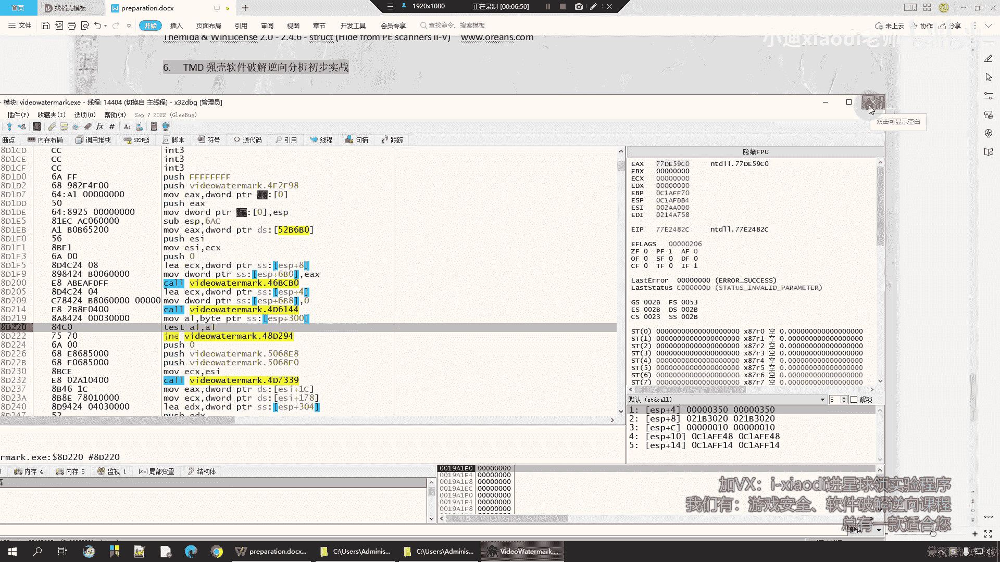

# 🧭 小白软件破解逆向工程师2023最新：3.7：了解调试与反调试，以TMD壳为例

在本节课中，我们将要学习调试与反调试的基本概念，并以 TMD 壳为例观察反调试现象。课程会从工具包里的调试工具讲起，解释什么是调试、什么是调试器，再通过加壳工具和 TMD 壳的实际表现，说明反调试如何阻挠分析。最后会给出初学者的应对思路：先从简单情况练起，把基础打牢，再处理更复杂的情况。

学习逆向分析时，调试和反调试是一对绕不开的概念。理解它们，有助于知道工具在做什么、程序为什么会“不听话”。下面先从最基础的概念开始。

## 🔍 小白软件破解逆向工程师2023最新：3.7.1：调试与调试器的基本概念

上一节概述了本课要讲的内容，本节我们来看看调试和调试器到底是什么。工具包第一列第一行有一个调试工具，顾名思义，如果要破解一些程序，就会用到它。打开这个工具，把程序拖过来进行分析，这个过程就叫做调试。说得直白一点，就是把程序拖进工具里，然后借助工具观察、分析程序。

以下是本节需要记住的两个核心概念，先用公式表示：

```text
调试 = 把程序拖入调试器 + 进行分析
调试器 = 承载程序并进行分析的工具
```

这两个概念很直观，原文也强调它们非常简单、非常好理解。原文口播中把“调试”说成“跳水”，这是口误，实际概念仍然是调试；原文口播中出现“调湿器”，实际指调试器。

以下是具体解释：

- 调试：把程序拖到工具里，然后进行分析的过程。
- 调试器：用来承载程序并进行分析的工具。

以上是调试与调试器的基本概念。理解这两个词之后，接下来我们看看反调试到底在做什么。

## 🛡️ 小白软件破解逆向工程师2023最新：3.7.2：反调试是什么

上一节我们介绍了调试和调试器，本节我们来看看反调试。反调试可以通过一些加壳工具来简单了解。先从字面意思理解：把程序拖到工具里进行分析叫调试，那么反调试的大概意思就是不让程序被拖到工具里，或者不让你顺利分析，或者阻挠你分析的过程。这个过程就叫做反调试。

以下是反调试的核心公式：

```text
反调试 = 阻止程序被拖入调试器 + 阻挠分析过程
```

理解了公式之后，再看工具包里的实际例子会更清楚。以下是工具包中能看到的反调试保护例子：


- 点击加壳工具中的 Ppen（原文口播名称），再点击设置，可以看到“反调试器保护”。它反的是 x32dbg 和 x64dbg 这类调试器，也就是添加对调试器的检测，发现调试器后就退出。
- 发现调试器后退出，就会阻挠分析，或者根本不让你把程序顺利拖进工具里。
- 再点击另一个加壳工具 Uus protector（原文口播名称），查看选项，可以看到反 OllyICE 保护，也就是反 OD 保护。原文口播近似为“反 oftICE 保护”。
- 其他一些保护对调试也有阻挠作用，整体上都会干扰分析过程。


这些保护的目的就是让调试器难以正常工作。以上就是反调试的基本含义。接下来看更极端的 TMD 壳和 VMP 壳。

## 🧰 小白软件破解逆向工程师2023最新：3.7.3：以TMD壳观察反调试现象


上一节我们了解了反调试的基本含义，本节我们以 TMD 壳为例观察实际现象。比较极端的壳有 TMD 壳和 VMP 壳，其中 TMD 壳比较极端。原文提到 TMD 壳和 VMP 壳是一家公司的产品。

先看查壳过程。点击 X info（查壳入口）查壳，之前已经查过，它就是一个 TMD 壳；原文口播先出现 PMD，随后明确为 TMD。再查一遍时，ExeInfo（原文口播近似为“ESE 音控”）第一次打开会比较慢，之后会快一些，需要稍等片刻。把程序拖过来，就能看到它是 TMD 壳。


TMD 壳有一个非常典型的特征。打开 OD，把程序拖过来；如果直接把程序拖进去，可能会出现一些问题。然后直接运行，弹出提示时点击“否”，再运行，会发现程序运行不起来，出现各种各样的问题，最后搞不定。


有没有方法对抗？有，而且方法很多。原文随便演示了第一种方法。以下是原文演示中的具体现象和应对尝试：

- 这里有一个插件，可以把一些关键选项勾选上；原文用“牛逼”来形容这些选项。
- 勾选之后，先运行程序，然后通过附加的方式进行分析，这样会好很多。
- 尝试附加，发现附加好像也不行。
- 这个方式也不行，就换成咱们自己的工具；这个工具好一些。
- 先运行，咱们自己的工具是可以的。
- 还有一个问题：它不允许下断点，下断点后程序会崩溃。因此断点也会阻挠分析。

这些现象说明，TMD 壳会在调试过程中制造麻烦。这里要说明清楚：TMD 壳能够下断点进行调试分析，这一点完全没有问题。接触这类技术后，在网上搜索 TMD 下断点，会发现大部分人碰到下不了断点的问题，但咱们可以下断点。具体方式后边再说，今天不演示能下断点的操作；今天演示一个失败案例，即 TMD 壳下断点会崩溃。

## 🧪 小白软件破解逆向工程师2023最新：3.7.4：TMD壳下断点崩溃的失败案例

上一节我们看到了 TMD 壳在调试中的一些阻挠现象，本节我们看一个具体的失败案例。先搜索字符串，选择所有用户模块字符串，然后搜索“注册”，能看到“未完成注册”。如果正常分析，应该在跳转处下断点，下一个断点，然后进行分析。

以下是这次失败案例的关键步骤和结论：

- 搜索字符串，选择所有用户模块字符串。
- 搜索“注册”，看到“未完成注册”。
- 正常分析时，应该在跳转处下断点，然后分析。
- 点一下注册，随便点一下，程序直接跑飞。
- 程序直接跑崩溃，然后默默退出。
- 断点也没有生效，断点失效。
- 所以这就是调试中的问题：断点会失效，程序也会崩溃。

用公式概括就是：

```text
TMD壳下断点 → 断点失效 / 程序崩溃
```



咱们能下断点，这里给大家做保证：后边课程一定能够让大家把断点打上；原文口播中的“锻炼”实际指断点。这是给大家的终极保证。原文结尾口播的“天地壳O”结合上下文指 TMD 壳。

## 📝 小白软件破解逆向工程师2023最新：3.7.5：课程总结与初学者建议

前面几节我们介绍了调试、调试器、反调试，并用 TMD 壳观察了断点失效和程序崩溃等现象，本节做最后总结。什么是调试？把程序拖到工具里进行分析的过程叫做调试，此时这个工具就叫做调试器。什么是反调试？不让你把程序拖到工具里、阻挠你分析的过程就叫做反调试。如果碰到一些乱七八糟的现象，那就是碰到反调试了。

碰到反调试应该怎么办？后边的课慢慢再处理，刚开始先不要起这么高的高度。因为刚开始不清楚遇到的情况到底有多复杂、到底分几步，有的情况可能分析一两步就完事，有的情况可能需要分析十多步。所以不要浪费自己的生命，不要浪费自己的时间，先从简单的做起。把整个系统和基础搞得比较好之后，再去做其他事，再做深入的事。基础不牢，地动山摇。

以下是给初学者的应对原则：

- 碰到反调试后，后边的课慢慢再处理。
- 刚开始不要起太高的高度。
- 因为不清楚遇到的情况到底有多复杂、到底分几步。
- 有的情况分析一两步就完事。
- 有的情况可能需要分析十多步。
- 不要浪费自己的生命，不要浪费自己的时间。
- 先从简单的做起。
- 把整个系统和基础搞得比较好之后，再去做其他事、做深入的事。
- 基础不牢，地动山摇。

本节课中我们一起学习了调试、调试器和反调试的基本概念，并用 TMD 壳观察了下断点导致程序崩溃等反调试现象；也明确了初学者不要一上来就硬碰复杂壳，而要先从简单样本和基础操作练起。下集再见。

