# 🧩 小白软件破解逆向工程师2023最新：3.8：了解断点与断点练习

本课是第八课，主题是了解断点并进行断点练习。在本节课中我们将要学习断点的基本含义、断点练习实验程序的获取方式、破解最基本的小白流程、如何搜索用户字符串并定位关键字符串、如何观察跳转箭头、如何用F2下断点、如何用F8单步分析，以及如何通过强制修改跳转来观察破解成功的效果。整节课会把断点放在实际破解分析过程中讲解，因为断点不是孤立概念，而是穿插在整个实践流程里的工具。

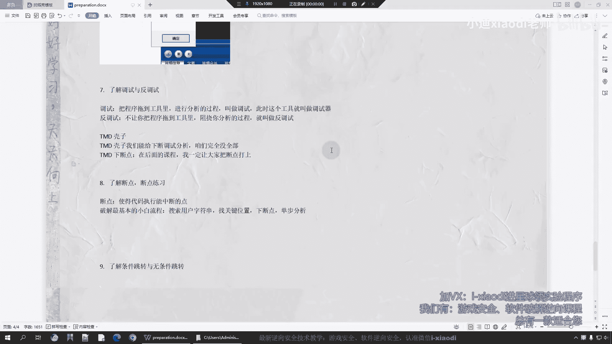

为了完成练习，今天会使用一个断点练习实验程序。以下是实验程序获取方式的说明，便于先准备好环境再进入后续操作。

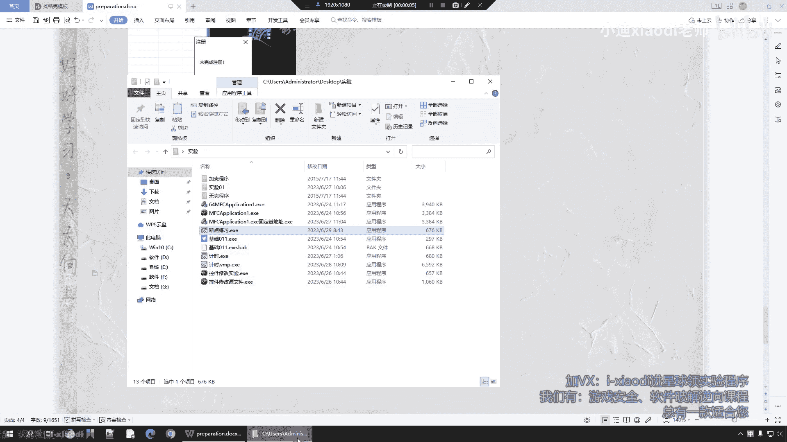

- 想获得断点练习实验程序，可以加入知识星球App并搜索社区。

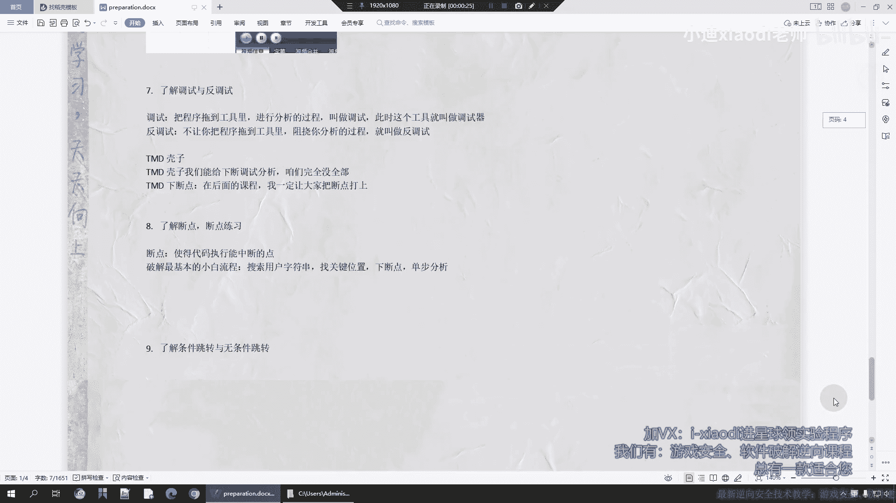

- 如果搜索不到社区，可以联系微信，或者发送私信，加入社区后获取内部技术交流的实验环境和程序。

> 提示：实验程序是后续断点练习的基础，先准备好程序，再跟着课程逐步操作。

上一部分说明了实验程序获取方式，本节我们来看看断点本身是什么。

## 🧠 小白软件破解逆向工程师2023最新：3.8.1：什么是断点

先说明什么是断点。之前已经说过，断点就是使得代码执行能够中断的点。那么代码是怎样执行的？答案是代码一行一行执行。如果在某一行下断点，代码执行到该位置时发生中断，那个位置就叫断点。换句话说，断点就是能够让代码在一行一行执行的流程中停下来、中断下来的点。

刚接触断点时可能觉得比较抽象，不需要一开始就把它想得很复杂。只要把它放到破解的实际应用里，就能逐步理解它的含义。核心概念可以用下面的代码关系表示。

```text
代码执行流程：第1行 -> 第2行 -> ... -> 第N行
在某一行的位置下断点
代码执行到该行时中断
该中断位置称为断点
```

理解了断点定义后，本节梳理破解最基本的小白流程。

## 🛠️ 小白软件破解逆向工程师2023最新：3.8.2：破解最基本的小白流程

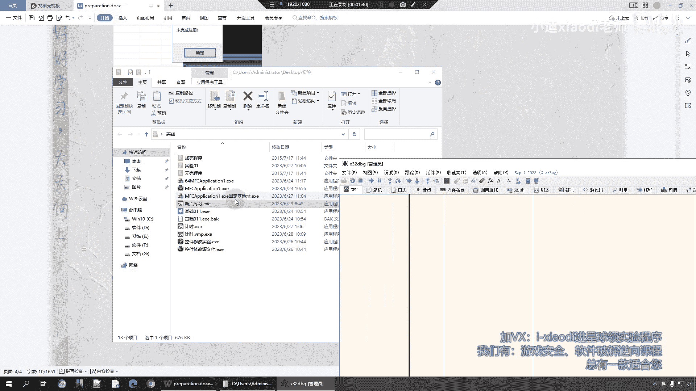

从今天开始，我们要了解破解最基本的小白流程。原文把这个流程分为四步：第一步、第二步、第三步、第四步，并强调四步非常简单。回顾破解标题的流程，就是搜索内存，然后挨个修改测试，最后保存文件。这个流程就是破解软件最基本流程的一个体现。

为了把本课涉及的操作串起来，以下是按照课程内容概括出的四步练习流程。它用于帮助初学者理解从搜索字符串到观察跳转、下断点、单步分析的过程。

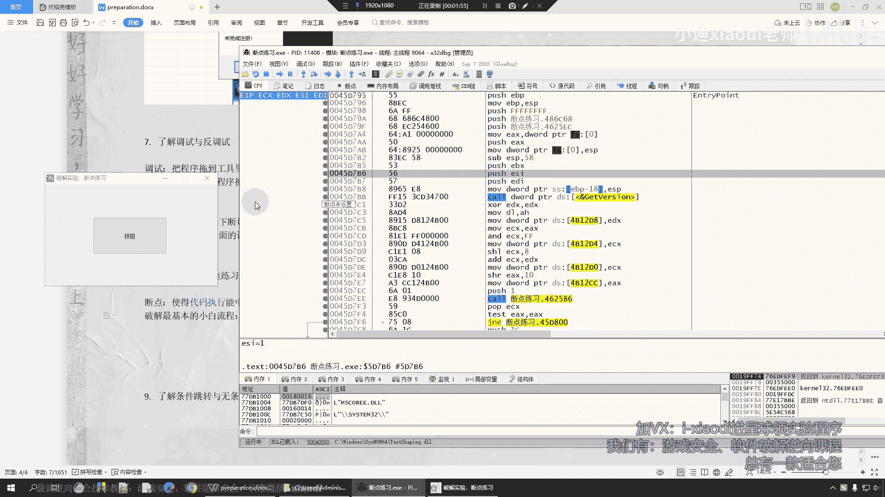

- 第一步，搜索用户字符串。

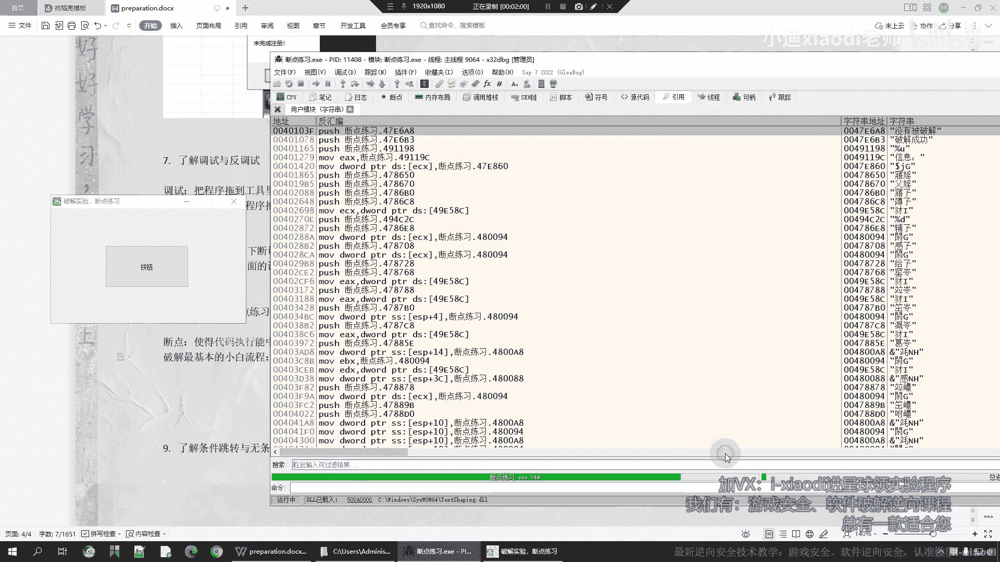

- 第二步，查看关键字符串，并双击进入代码位置。

- 第三步，观察关键位置的小箭头跳转，并在箭头相关位置下断点。

- 第四步，使用F8进行单步分析，理解代码跳转逻辑，并为后续学习修改跳转做准备。

```text
破解标题流程示例：搜索内存 -> 逐个修改测试 -> 保存文件
本课四步练习概括：搜索用户字符串 -> 定位关键字符串 -> 观察箭头并下断点 -> F8单步分析
```

流程梳理完成后，本节打开实验程序，开始实践第一步搜索用户字符串。

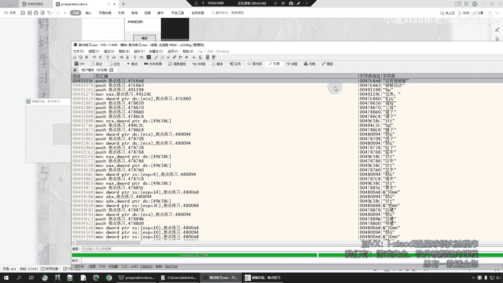

## 🧪 小白软件破解逆向工程师2023最新：3.8.3：打开实验程序并搜索用户字符串

断点练习程序在这里。用x32dbg打开，原文中写作“x32的bug”，然后把程序拖进来，再运行程序，这些基础操作都需要会。运行程序后，下一步就是搜索用户字符串，这是第一步。搜索用户字符串的方法很简单：程序拖进来之后，在鼠标右键菜单中直接搜索所有用户模块字符串。

搜索之后会发现两个结果，一个是没有被破解，一个是破解成功。现在点击按钮，程序提示没有被破解；如果破解成功，它应该提示破解成功。因此最终目标是让它弹出破解成功的字样。搜索结果中会出现两个字符串，这两个字符串可以称为关键字符串。字符串左边是代码位置，当鼠标放在代码位置上时，会出现代码位置信息，所以需要双击该位置。

上一节完成了字符串搜索，本节双击进入代码位置，观察关键位置和跳转箭头。

## 🎯 小白软件破解逆向工程师2023最新：3.8.4：定位关键位置并观察跳转箭头

双击之后，就看到了关键位置，也就找到了关键位置。在关键位置需要观察箭头。箭头表示跳转。关于跳转的详细解释会在下一课说明，本课先了解它是不是跳转。我们需要更改箭头所表示的执行过程，或者需要了解箭头是怎样跳转的。箭头有可能跳到某个位置，另一个箭头也有可能跳到另一个位置。如果它跳过去了，破解成功就不会被执行。这里还有一个跳转，如果它直接往下跳，就会执行破解成功；如果没有被破解，相关流程就会被跳过去。

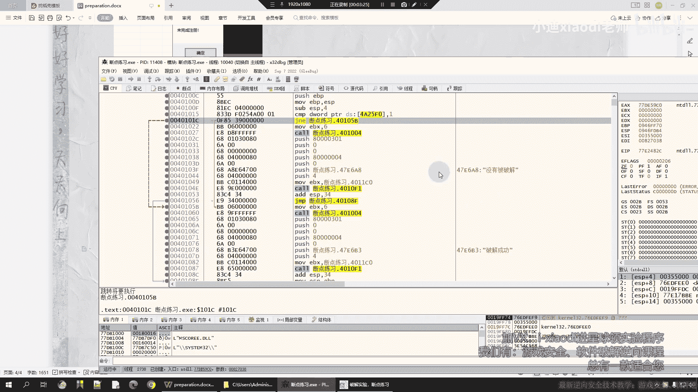

因此现在需要了解跳转流程。了解跳转流程的方法就是下断点。接下来就是下断点。下断点的方法是在目标代码行上按F2。以下是本课下断点与观察断点状态的关键操作说明，便于初学者对照工具界面。

```text
在目标代码行按 F2 -> 下断点
再次按 F2 -> 删除断点
断点可随时设置，也可随时删除
```

找到关键位置并理解需要观察跳转后，本节学习用F2下断点，并通过F8观察单步执行。

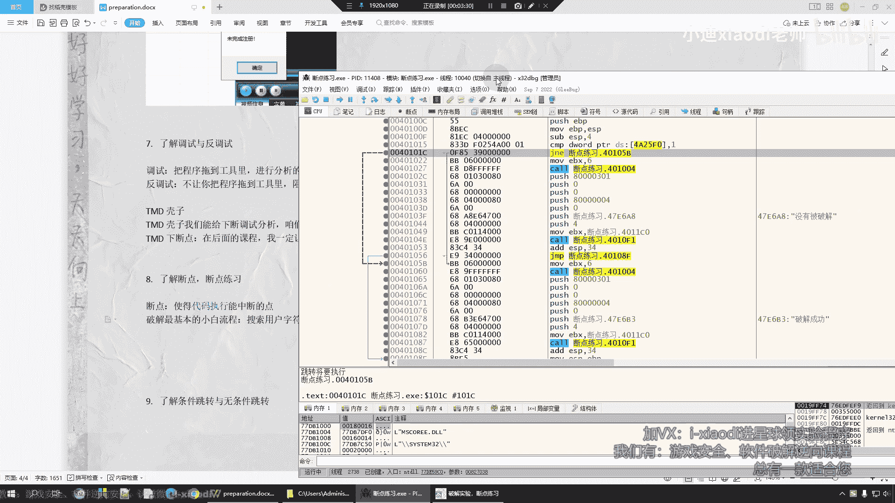

## 🔴 小白软件破解逆向工程师2023最新：3.8.5：F2下断点与F8单步分析

在目标代码行上按F2就可以下断点。按下F2之后，工具界面中该位置会变成红色，这是该工具里下断点的特征。注意左下角也可以看到断点状态，界面会显示“断点已设置在”，再按一次F2会显示“断点已删除”。断点可以随时设置和删除，没有任何问题。

那么怎样观察单步分析？方法很简单：给程序下一个断点，然后回到程序。如果点击按钮，需要回答这边的代码会不会执行。答案是会执行，因为程序要做判断，判断到底有没有被破解。先不管判断的原理和逻辑，程序反正要进行判断，所以有可能断下来。点击一下按钮尝试，如果断下来，界面会加亮，会出现黑色显示，左下角会显示“已暂停”，程序就暂停了。还有一个特征是程序卡住了，整个程序卡住。程序卡住之后，可以观察跳转逻辑，可以先看左下角显示“跳转不会执行”。跳转不会执行，顾名思义就是程序往下走，不往箭头指向的位置跳。箭头不往这边跳，就意味着程序一行一行往下走。

要看出程序是否一行一行往下走，可以使用单步分析F8。回到工具后按F8，再按一下F8，逐步熟悉这个过程。连续按F8，执行到某一句时，没有被破解的提示就被弹出来了；继续往下走，破解成功相关流程就被跳过了。这就是单步分析的作用，它可以用于了解整个程序的跳转逻辑。以下是本课下断点与单步分析的操作要点，便于复习。

- 按F2在目标代码行下断点，界面变红表示断点已设置。

- 再按F2可删除断点，左下角会显示断点设置或删除状态。

- 点击程序按钮后，如果代码执行到断点，程序会暂停，界面会加亮并显示“已暂停”。

- 程序暂停后，可以观察左下角“跳转不会执行”等提示，判断箭头是否跳转。

- 按F8进行单步分析，观察程序一行一行执行的过程。

```text
F2：设置或删除断点
F8：单步分析，逐行观察代码执行
断点状态：已设置 / 已删除
程序暂停状态：已暂停
```

掌握断点与单步分析后，本节验证强制修改跳转后的效果。

## ⚡ 小白软件破解逆向工程师2023最新：3.8.6：强制修改跳转与验证破解效果

有没有办法破解它？当然有办法。先让程序运行起来。现在程序是不跳的，也就是不往下跳，可以强制让它往下跳，这里涉及无条件跳转。原文说可以先改成GMP，先跟着操作，下节课会进行讲解。先改一下，观察效果。修改后点击按钮，程序提示破解成功。

现在想观察它跳转的流程，可以按F2下一个断点，然后激活这个断点。界面显示“已暂停”，点击按钮后断点就被激活，因为这行代码又被执行。然后按F8，会发现程序直接跳下来了。跳下来会执行哪里？会执行破解成功。继续按F8，执行到对应位置就破解成功了。然后运行程序验证。以下是验证强制修改跳转效果的步骤，便于按顺序操作。

- 先让程序运行起来，观察当前程序不往下跳的状态。

- 将相关无条件跳转先改成GMP，原文写作GMP，下节课会详细讲解。

- 修改后点击按钮，观察是否提示破解成功。

- 按F2下断点并激活断点，点击按钮使代码执行到断点。

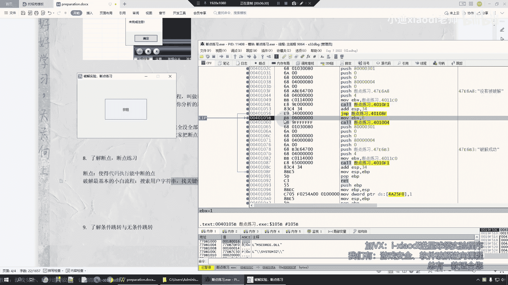

- 按F8观察程序直接跳下并执行破解成功的位置。

- 运行程序，验证最终提示破解成功。

```text
无条件跳转修改示例（原文表述）：改成 GMP
F2：下断点并激活
F8：单步执行，观察跳转后是否执行破解成功
```

这就是断点练习。必须通过实际破解分析才能了解断点的作用，因为断点混合或穿插在整个实践过程中。以下是本课练习步骤的总结，方便初学者复习整套流程。

- 搜索用户字符串，查看关键字符串。

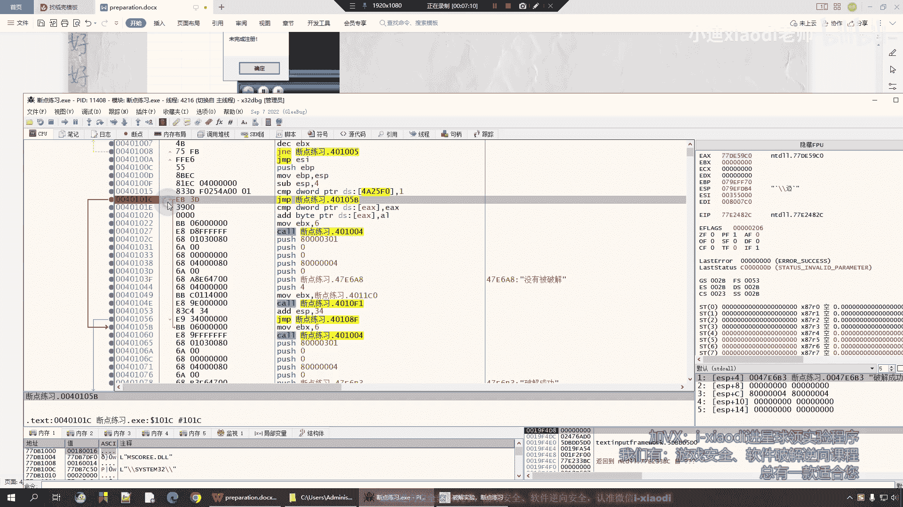

- 双击关键字符串，进入代码位置。

- 观察关键位置的小箭头，小箭头表示跳转之类的流程。

- 在小箭头上或小箭头上下端点下断点。

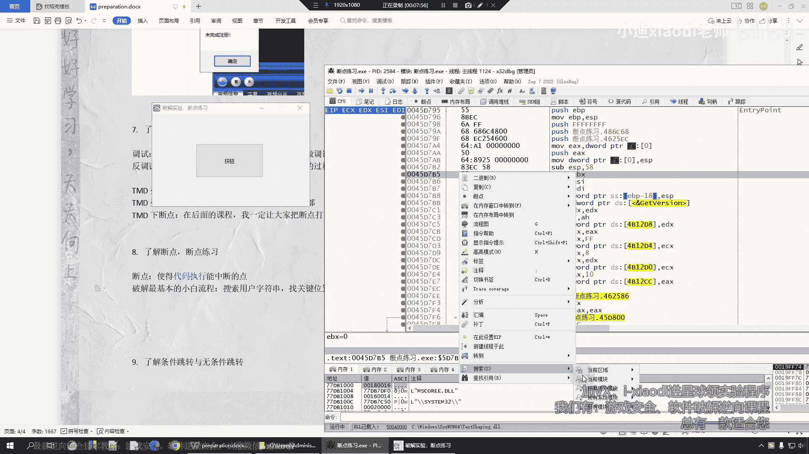

- 查看左下角跳转激活状态，或者直接使用F8单步分析。

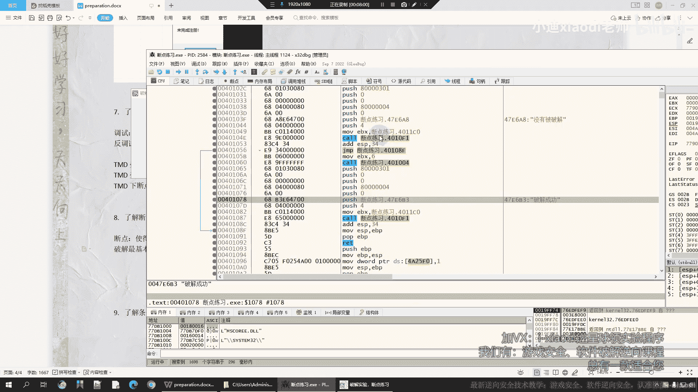

- 单步分析有助于了解整个代码的执行逻辑，之后再学习如何修改跳转。

上一节完成了强制修改跳转和断点验证，本节对整课内容进行总结。

## 📝 小白软件破解逆向工程师2023最新：3.8.7：断点练习总结与下节预告

总结一下本课流程。首先搜索用户字符串，然后会看到一些关键字符串。关键字符串可以双击过去，双击后进入对应位置。接着观察有没有小箭头，观察小箭头是寻找关键位置的一种方式。小箭头就是一些跳转之类的流程。然后在小箭头上、小箭头上下端点下断点。观察时可以看左下角的跳转激活信息，也就是左下角激活。也可以恢复一下，恢复选区，重新跑一遍程序，重新搜索字符串，可以成功进入关键流程。

在关键位置下断点后，可以观察“跳转不会执行”等提示，查看该位置的跳转有没有执行，或者直接进行单步分析。单步分析有助于了解整个代码的执行逻辑。完成这些观察后，再去学习怎么修改，这是下节课的内容。可以先跟着修改，比如把关键位置看一下怎么跳，把关键位置改成GMP，先实现这样一个效果。本课内容到这里，下节课更精彩，下节再见。

> 提示：本课重点是理解断点在破解分析中的作用，并通过F2下断点、F8单步分析、观察跳转箭头和验证强制修改跳转，建立最基本的实践流程。

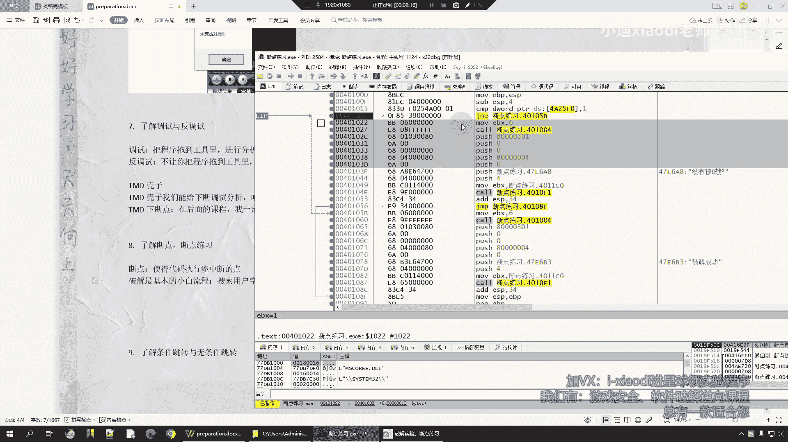

本节课中我们一起学习了断点的含义、断点练习实验程序的获取、破解最基本的小白流程、搜索用户字符串并定位关键字符串、观察跳转箭头、用F2下断点、用F8单步分析，以及通过强制修改跳转验证破解成功效果。下一节课会继续讲解跳转修改的详细内容。

