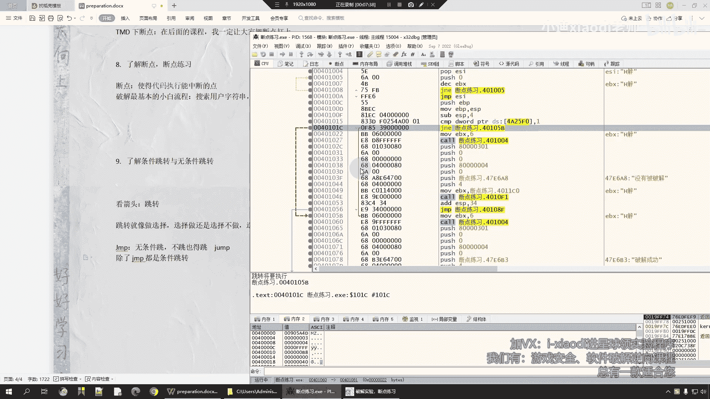

# 🛠️ 小白软件破解逆向工程师2023最新：3.9：条件跳转与无条件跳转破解

在本节课中，我们将学习软件破解中非常重要的两个概念：**条件跳转**和**无条件跳转**。通过实际调试一个程序，你会看到如何利用修改跳转指令来改变程序的执行流程，从而让软件显示“破解成功”。我们还会总结出两种常用的破解方案，帮助你在不同场景下做出正确的修改。

## 🎁 获取实验程序和工具包

在开始操作之前，先说明一下如何拿到这节课的实验程序和工具包。如果你需要这些资源，需要加入“知识星球”这个软件安全逆向破解分析学习社区。如果你搜不到这个社区，可以在App里搜索，或者直接添加我的微信、给我私信，我会邀请你进入，并发送二维码给你。

目前社区的价格是68元。随着课程不断更新，价格会逐渐上涨，等所有课程更新完毕，价格会涨到比较高的水平。毕竟做课程也不是完全无私的，我们需要建立社区进行维护，同时工具包也要不定期更新，实验环节也需要提供给大家，这些都是需要时间和精力成本的，希望大家理解。现在知识星球的名额只剩68元了，想加入的朋友要抓紧。

## 🔍 调试流程概览

拿到程序之后，先不要急着改代码，我们要按照标准的调试流程进行分析。下面是完整的操作步骤，请逐步跟着做：

- 第一步，启动调试器，将目标程序拖入调试器中。
- 第二步，点击运行按钮，让程序跑起来。
- 第三步，在程序界面中，鼠标右键选择“搜索所有用户模块字符串”，开始搜索关键字符串。
- 第四步，在搜索结果中查找类似“破解成功”或“没有被破解”这样的字样，这些通常是判断逻辑的输出。
- 第五步，在关键字符串附近找到跳转指令，并在跳转指令上下断点，方便我们观察程序执行到这里时的状态。

举个例子，比如这个“断点练习”程序，拖入调试器后，先运行起来，然后搜索字符串。你会看到“破解成功”和“没有被破解”这两个明显的字符串，它们就是我们要重点关注的目标。

## 🧭 认识跳转指令

找到字符串之后，怎么定位到跳转指令呢？在调试器的代码窗口中，可以通过图形化的箭头来识别跳转。箭头指向就是跳转的目标位置。比如，你往上看“没有被破解”这个字符串，可以看到一个箭头，这个箭头就代表一个跳转指令。

这里有个小窍门：**实线箭头表示跳转已经发生，虚线箭头表示跳转没有发生**。这个规则要非常熟悉，遇到箭头就条件反射地判断它是实线还是虚线，这样就能快速知道程序当前走了哪条路。

那么跳转指令有什么特点呢？它就像你早上纠结要不要吃早饭一样，会做一个选择：跳还是不跳？但有时候你没得选，比如老师说“你不吃我就揍你”，你只能吃。对应到程序里，也有一种“不吃也得吃”的指令，这就是**无条件跳转**。

在汇编语言中，无条件跳转的助记符是**JMP**，全称是Jump，意思是直接跳转，不需要任何条件，你让它跳它就跳，不让它跳它也跳。而条件跳转则不同，它需要根据某个条件来决定是否跳转，比如比较结果是否相等、大小关系等，常见的条件跳转有`JE`、`JNE`、`JG`、`JL`等等。

## 💡 实战破解：把JE改成JMP

现在我们来看一个具体的破解例子。假设程序的逻辑是这样的：如果某个条件成立，就跳转到“破解成功”的位置；如果不成立，就顺序执行到“没有被破解”的位置。我们想要的结果是——无论条件成不成立，都跳到“破解成功”那边去。

观察代码，你会发现关键位置有一个条件跳转指令，比如`JE`（相等则跳转）。它的意思是：如果前面的比较结果相等，就跳转；不相等就不跳。我们把它改成`JMP`，也就是无条件跳转，这样程序每次执行到这里都会跳到“破解成功”的代码块。

具体操作如下：

- 在调试器中找到那条`JE`指令，选中它。
- 右键选择“汇编”或“修改”，把`JE`改成`JMP`。
- 确认修改，然后重新运行程序。

程序运行后，你会看到界面显示了“破解成功”，说明我们的修改生效了。如果想把程序恢复成原样，只需要在修改过的指令上右键选择“恢复选区”即可，程序就会回到“没有被破解”的状态。

## 🔀 条件跳转的辨别方法

通过上面的例子，我们已经动过一次条件跳转了。那么怎么区分哪些是条件跳转，哪些是无条件跳转呢？方法非常简单：**除了`JMP`以外，其他所有跳转指令都是条件跳转**。

我们来对比一下：

- `JMP`：无条件跳转，不管什么情况都会跳，不跳也得跳。
- `JE`：相等则跳转，属于条件跳转。
- `JNE`：不相等则跳转，属于条件跳转。
- `JG`：大于则跳转，属于条件跳转。
- `JL`：小于则跳转，属于条件跳转。

在代码窗口中，你可以看到不同颜色的箭头或助记符。一般来说，`JMP`会标注为“无条件跳转”，其他跳转都标注为“条件跳转”。多找几个例子看看，很快就能形成直觉。

## 🧩 破解方案总结

最后，我们来总结一下破解过程中最常用的两种方案。理解了这两种方案，你就可以应对大多数简单的爆破场景。

首先，判断“破解成功”的代码块位于跳转指令的哪个方向。假设跳转指令是`JZ`（等于零则跳转），如果“破解成功”在跳转的目标地址上，也就是跳过去才成功，那么我们就希望它无条件跳过去，这时候把`JZ`改成`JMP`即可。

如果“破解成功”在跳转指令的下方，也就是说跳过去反而会错过成功代码，那么我们就不能让它跳转。这时候可以将原来的跳转指令用`NOP`（空操作）填充，让程序不管什么条件都顺序往下执行，这样就能走到“破解成功”的代码块。

用公式来表示：

- 目标在跳转分支：`Jcc` → `JMP`
- 目标在顺序分支：`Jcc` → `NOP`（填充若干个`90`）

实际修改时，要根据程序的具体情况来选择。你可以先观察代码结构，找到“破解成功”到底是在跳转目标上还是当前指令的下方，然后决定是改成`JMP`还是用`NOP`填充。改完之后，运行程序验证结果，如果不满意就恢复选区重新修改。

## 🎓 总结

本节课我们一起学习了条件跳转与无条件跳转在软件破解中的核心作用。我们知道了`JMP`是无条件跳转，其他跳转都是条件跳转；学会了通过观察实线箭头和虚线箭头来判断跳转是否发生；还通过一个实际例子，将`JE`改成`JMP`实现了破解成功。最后我们总结了两种通用破解方案：将条件跳转改为无条件跳转，或者用`NOP`填充掉跳转指令。希望大家在练习时多动手操作，多观察代码结构，这样遇到新的程序时就能快速找到突破口。后续的课程中，我们还会遇到更多复杂的保护机制，不过只要打好跳转指令的基础，后面会轻松很多。这节课就到这里，感谢大家学习，我们下期再见。

