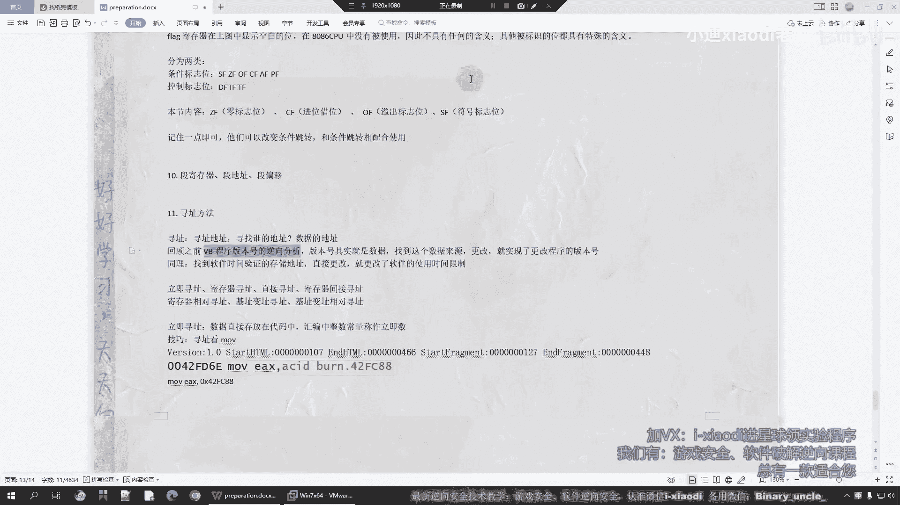
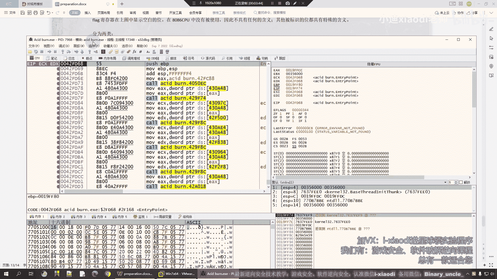

# 🧭 小白软件破解逆向工程师2023最新：4.11：寻址方法-立即寻址

在本节课中我们将要学习寻址方法中的立即寻址。寻址的字面意思是寻找地址，寻找的是数据的地址，尤其是版本号、软件时间这类关键数据的地址。回顾之前讲过的程序版本号逆向分析，版本号本身就是数据，例如 `1.1`、`1.3`、`5.8`。如果能找到版本号数据的来源，就找到了源头，也就可以修改这个数据，从而实现对程序版本号的修改。同理，软件时间也有时间验证，找到软件时间的存储地址后修改倒计时，例如本来能用 `30` 天，改成 `80` 天或 `1000` 天，就可以实现长期使用，每次过期再改一次即可。因此寻址在逆向分析中非常重要，不只软件逆向分析重要，游戏逆向分析也同样重要。寻址方法一共有 `7` 种，本节课先讲第一种：立即寻址。


## 🔍 小白软件破解逆向工程师2023最新：4.11.1：什么是寻址

上一节概述了寻址的重要性，本节先说明寻址的基本含义。寻址就是寻找地址，也就是寻找数据所在的位置。需要寻找的是关键数据的地址，例如版本号数据、软件时间数据，这些数据都会存放在某个地址中。之前发过程序版本号的逆向分析，版本号 `1.1`、`1.3`、`5.8` 本质上都是数据。如果能找到这些数据的来源，就找到了源头，找到源头后就可以更改数据，更改数据后就实现了更改程序版本号。同理，软件时间有验证逻辑，找到软件时间的存储地址后，修改这个时间数据，例如把原本 `30` 天的倒计时改成 `80` 天或 `1000` 天，就可以实现类似无限使用的效果，每次过期修改一次即可。因此寻址在逆向分析中非常重要，软件逆向和游戏逆向都需要使用寻址方法。寻址方法一共有 `7` 种，本节课先学习第一种：立即寻址。

> 寻址 = 寻找数据在程序或内存中的地址


## 📦 小白软件破解逆向工程师2023最新：4.11.2：立即寻址的基本概念

上一节说明了寻址就是寻找数据地址，本节来看看第一种寻址方法：立即寻址。立即寻址是 `7` 种寻址方法中的第一种，它是最快、最直接的方式，特点是数据直接存放在代码里。在汇编代码中，这种直接放在代码里的数据称为立即数。只看概念可能不容易理解，通过代码可以更直观地理解。汇编中的 `MOV` 指令表示把右边的数据放到左边，右边如果是一个数，这个数就可以称为立即数，也可以直接称为一个数，把这个数放到左边的寄存器中，这种方式就叫立即寻址。立即寻址的核心就是数据以最直接的方式写在代码里，指令中直接给出数据。

```asm
; 立即寻址的基本形式
MOV 目标寄存器, 立即数
```

例如 `MOV AX, 3` 表示把右边的数字 `3` 放到左边的 `AX` 寄存器中。右边的 `3` 就是立即数，这种写法就是立即寻址。再看 `MOV BX, 4`，表示把数字 `4` 放到 `BX` 寄存器中，这也是立即寻址。需要区分的是，如果右边是带有括号的内容，例如 `MOV ECX, [ ... ]`，带有括号的内容就不是一个直接的数字，因此不属于立即寻址，这种形式后面会继续说明。先记住一个特征：右边直接是一个数，这种形式就是立即寻址。下面列出立即寻址的核心特征，方便初学者快速判断。

- 操作数直接写在指令中，不通过其他地址间接获取。
- 右边通常是一个明确的数字，例如 `3`、`4`、`42FC88`。
- 汇编中把这种直接写在代码里的数字称为立即数。
- 指令执行时，直接把右边的数字送入左边的寄存器。
- 如果右边带有方括号，通常不是立即寻址，需要结合后续寻址方法判断。

以上特征可以帮助初学者在反汇编中快速识别立即寻址。接下来通过调试器实际写代码，观察立即寻址的执行过程。


## 💻 小白软件破解逆向工程师2023最新：4.11.3：在Debug中写代码观察

上一节介绍了立即寻址的基本形式，本节进入调试器实际写代码观察。可以先进入 Debug，使用 `-D` 查看数据，使用 `-A` 写代码。写入 `MOV AL, 3`，含义是把右边的 `3` 放到左边的 `AL` 寄存器中，这种方式就叫立即寻址。再写入 `MOV BX, 4`，含义是把右边的 `4` 放到 `BX` 寄存器中，这种方式也叫立即寻址。代码写完后可以先查看寄存器，因为还没有执行，所以 `AX`、`BX` 都是 `0`。执行第一条指令后，数字 `3` 就进入对应寄存器；再执行第二条指令后，数字 `4` 就进入 `BX` 寄存器。通过这个过程可以直观看到立即数被直接送入寄存器。

```asm
MOV AL, 3
MOV BX, 4
```

在调试器中可以按下面的思路操作，下面列出观察步骤，便于跟着实践。

- 进入 Debug。
- 使用 `-D` 查看数据。
- 使用 `-A` 写入汇编代码。
- 写入 `MOV AL, 3` 和 `MOV BX, 4`。
- 查看寄存器初始值，确认 `AX`、`BX` 为 `0`。
- 单步执行指令，观察数字进入寄存器。



以上是 `16` 位寄存器的例子，属于以前老操作系统中的形式。现在操作系统中 `AX` 进化成了 `EAX`，`BX` 进化成了 `EBX`，原理相同。接下来可以在实际程序中观察立即寻址的表现。


## 🧩 小白软件破解逆向工程师2023最新：4.11.4：在程序中观察立即数

上一节在 Debug 中写入了立即寻址代码，本节在真实程序中观察立即数。例如之前破解验证登录的程序 `ACIDboard.se`，该程序已经发到星球。在反汇编中可以看到类似 `MOV ES, 立即数` 的指令，在指令后空格观察，右边就是一个数。左边有一个点，这个点是模块点，`ACNIDBURN` 是模块名，表示这个地址位于该模块中，相当于给这个地址做了一个标记。这个标记是 `x64dbg` 的模块标记做的。实际上模块标记本身不表示模块内有额外数据，原本的汇编代码就是直接把右边的一个数放到左边，这种方式就是立即寻址。它和其他寻址方式有差异，例如 `MOV ECX, [ ... ]` 右边是带括号的内容，带括号的内容不是一个直接的数字，因此不是立即寻址，这种形式后面会说明。先记住：右边直接带有一个数，就是立即寻址。

> 立即数示例：`MOV ECX, 42FC88` 中的 `42FC88` 直接写在指令中，因此属于立即数。


## 🧾 小白软件破解逆向工程师2023最新：4.11.5：规律与修改思路

上一节在实际程序中看到了立即数，本节总结立即寻址的规律和修改思路。可以按 `F8` 单步执行，观察寄存器变化。执行前寄存器中还是原来的值，执行后会把 `42FC88` 这样的数字送入对应寄存器。假设这个寄存器保存的是版本号，就可以直接在指令中修改这个立即数，例如把它改成 `1`，就相当于把版本号改成了 `1`。这就是利用立即寻址修改数据的方法。立即寻址的规律可以概括为：右边直接就是一个数，数据直接写在指令中。

```asm
; 修改前
MOV ECX, 42FC88

; 假设该立即数代表版本号，可以改成
MOV ECX, 1
```

下面列出立即寻址在逆向分析中的判断和修改要点，便于初学者形成清晰思路。

- 先观察指令右边是否直接是一个数。
- 如果右边直接是一个数，该数就是立即数。
- 立即数的来源就是指令本身，不需要再通过其他地址查找。
- 如果最终关键数据来源于一个立即数，就可以尝试修改这个数。
- 修改后重新执行程序，观察版本号、时间验证等数据是否发生变化。

以上是立即寻址的判断和修改思路。讲解完成后会对本节内容做高亮标记，下期讲寄存器寻址。


## ✅ 小白软件破解逆向工程师2023最新：4.11.6：本节总结

本节课中我们一起学习了寻址方法中的立即寻址。寻址就是寻找数据地址，版本号、软件时间等关键数据都存放在地址中，找到数据来源后就可以修改数据，从而修改程序版本号或时间验证。立即寻址是 `7` 种寻址方法中的第一种，特点是最快、最直接，数据直接写在代码里，汇编中称为立即数。判断立即寻址的核心规则是：指令右边直接是一个数。通过 Debug 写代码和实际程序观察，可以看到立即数被直接送入寄存器；如果最终关键数据来源于一个立即数，就可以尝试修改这个数。下期将学习寄存器寻址。

