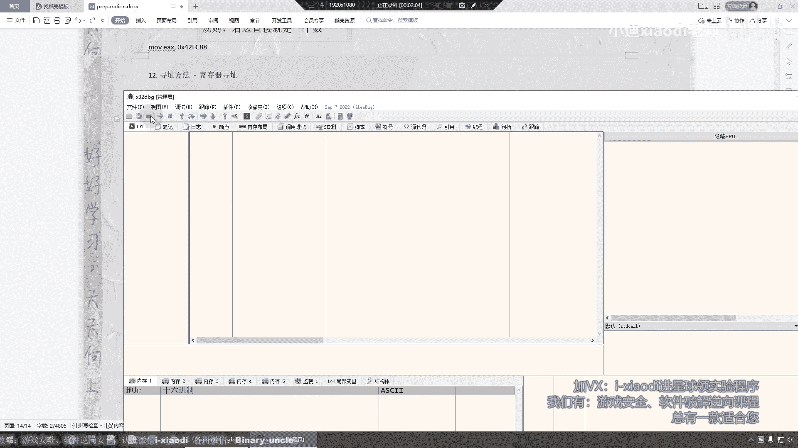
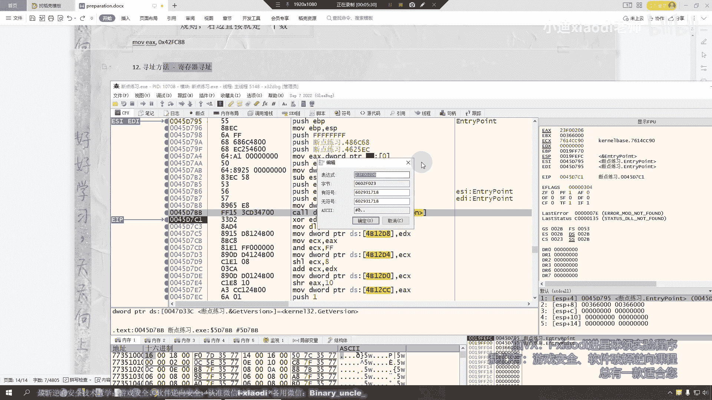
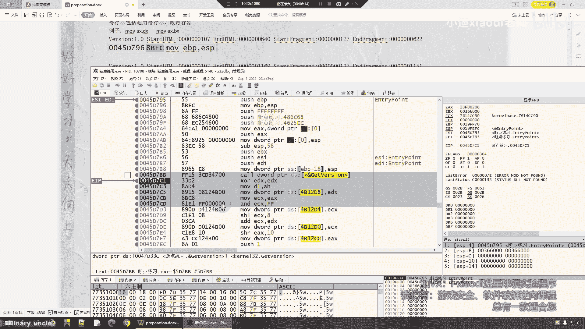

# 小白软件破解逆向工程师2023最新：4.12：寻址方法-寄存器寻址 🧩


在本节课中，我们将要学习寻址方法中的寄存器寻址。简单说，就是操作数的值存放在寄存器里，然后通过寄存器把这个数据传递出去。原文强调，寄存器不只是通用寄存器，也包括段寄存器。寄存器可以理解成暂时存放数据的容器。为了便于初学者理解，先记住一个核心公式：


\[
\text{寄存器寻址} = \text{操作数的值存放在寄存器中，并通过寄存器传递}
\]


也可以写成指令形式：


```asm
mov 目标, 源
```


其中逗号是分界点，通常表示把逗号右边的数据传给逗号左边的位置。下面我们围绕这个核心公式，看看具体的指令和调试现象。


## 🧠 什么是寄存器寻址


上一部分我们给出了寄存器寻址的基本公式，本节中我们来看看它在指令里的具体表现。操作数的值存储在寄存器中，这种寻址方式就称作寄存器寻址。也就是说，数据这个对象放在寄存器中，然后通过寄存器去传递。这里说的寄存器包括通用寄存器，也包括段寄存器。


> 寄存器就是暂时存放数据的容器。


例如，`mov AX, DX` 的含义是把右边 DX 中的数据给 AX。DX 是寄存器，寄存器就是暂时存放数据的容器。再看 `mov AX, BX`，含义是 BX 中本来有一个暂时存放的数，然后通过 BX 把这个数给 AX。通过 DX 给 AX 也是同样的道理。下面列出几个常见示例，方便对照理解。




以下是几个寄存器寻址的直观示例：


- `mov AX, DX`：把右边 DX 中的数据传给 AX。
- `mov AX, BX`：把 BX 中暂存的数据传给 AX。
- `mov EBP, ESP`：ESP 中本来有一个数字，通过 ESP 把这个数据传给 EBP。


## 🔗 段寄存器也能参与传递


上面我们看的是通用寄存器之间的传递，本节中我们来看看段寄存器的情况。前面说过，寄存器包括通用寄存器，也包括段寄存器。看到 `FS` 时，FS 是段寄存器的一个标志。遇到这类情况，主要看逗号右边，因为逗号是中间的分割点，数据是通过逗号右边的东西传给左边的。


例如，右边是段寄存器时，就把右边段寄存器中的数据传给左边。这里可以看到两个都是段寄存器的情况。在分析汇编代码时，以逗号作为分界点，把右边的数据传给左边的段寄存器；这是传送数据的一种方式，只不过它是通过段寄存器完成的。再看另一个例子，原文表述为“A 中有数据，然后给 DL”，可以理解为把 A 相关寄存器中的数据传给 DL；还有“ES 中有数据，然后给 ECX”，也就是把 ES 中的数据传给 ECX。下面用列表概括这类段寄存器传递的观察方法。


以下是分析段寄存器寻址时可以抓住的要点：


- 先看逗号，逗号是分界点。
- 再看逗号右边，右边是源，左边是目标。
- 右边出现段寄存器时，说明数据通过段寄存器传递。
- 两个都是段寄存器时，也按“右边给左边”的方式理解。


## 🛠️ 在 x32dbg 中观察寄存器寻址


理解了指令写法之后，本节中我们打开 x32dbg 简单过一遍，用实际调试来验证前面的结论。随便调一个程序即可。现在观察寄存器状态：ESP 是 `19FF70`，EBP 是 `19FF80`。可以看到 ESP 和 EBP 有差异，二者不一样。ESP 右边是 `70`，也就是 ESP 这个值右边部分是 `70`；EBP 左边显示是 `80`。


执行一次 F8 单步之后，EBP 变成 `70`。也就是说，以前 ESP 是 `70`，以前 EBP 是 `80`；执行完代码之后，ESP 里边保存的数据传递给了 EBP，EBP 这个寄存器里边也变成 `70`。这就是 `mov EBP, ESP` 的一个简单演示。其他程序也是同样的观察方式。下面列出调试时可以直接关注的步骤。


以下是在调试器里观察寄存器寻址的简单步骤：


- 查看执行前的 ESP 和 EBP 数值。
- 记下二者的差异。
- 按 F8 单步执行。
- 观察目标寄存器的值是否变成源寄存器的值。


## 🔍 继续观察断点和低位寄存器


上一节我们通过 ESP 和 EBP 看到了寄存器传递，本节中我们再看一个断点练习。原文提到使用的是 A3ID board，我们再用断点练习观察。按 F8 后，可以看到 ESP 为 `70`，EBP 也发生变化，原文记为“标 0”的状态；继续走，就能看到数据通过寄存器传递。接着观察 AH 和 DL。因为当前是 32 位寄存器，直接看 AH 和 DL 可能看不出来，所以只看变化即可。原文中观察到 EX 相关值为 `206`、`23F0`、`0206`；DL 是 EDX 的低位 low。按 F8 后，可以看到 `02` 被传过去；AH 就是 `02`，这个 `02` 给了低位。看这个变化即可，它说明数据是通过寄存器传递的。16 位寄存器到 32 位寄存器的演化，后面会有专门专题讲解；现在先混着来，先看变化。下面把这一段的观察点列出来。


以下是低位寄存器观察时可以参考的要点：


- 32 位寄存器下，AH、DL 这类低位部分可能不直观。
- 重点看执行前后数值的变化。
- 看到 `02` 被传到低位，就说明发生了寄存器传递。
- 16 位到 32 位的演化先不展开，后面专题再讲。


## 🎯 寄存器寻址有什么用


前面我们一直在看数据怎么通过寄存器传递，本节中我们来看看它有什么用。这个知识其实方便我们追踪数据。例如有一个数据来源于 ES，我们可以顺着寄存器去找它的来源。原文的示例是：看到 ECS 相关计算，就找 ECX；看到 ECX 的一个 `mov`，发现 ECX 的值是通过 ES 传递的；然后再去找 ES，往上找有没有 ES，结果没有，但有一个 `get version`。后面会讲到，如果这个东西是函数，ES 可能来源于上面的东西，这样就找到了来源。




`get version` 是版本的意思。重新调试时，ES 初始是 `19FFCC`，执行完之后变成 `23F00206`，说明这里计算出了 EX 相关值，然后 ES 才能走到这一步，给 ECX 传递数据。这部分后面会再说。现在先做一个课外科普：函数会返回一些数据，返回的数据称为返回值，返回值一般会传递给 ES，先记住这一点即可。这是课外拓展，后面都会讲到，不着急。下面列出追踪数据时可以采用的思路。


以下是利用寄存器寻址追踪数据来源的思路：


- 从目标数据反查相关寄存器。
- 找到该寄存器附近的 `mov` 指令。
- 看逗号右边是谁，判断数据由谁传过来。
- 继续向上查找源寄存器的来源。
- 遇到函数返回值时，先记住 ES 常作为返回值相关寄存器使用。


## 📝 总结




本节课中我们一起学习了寄存器寻址。核心是操作数的值存放在寄存器中，并通过寄存器传递；寄存器包括通用寄存器和段寄存器。我们通过 `mov AX, DX`、`mov AX, BX`、`mov EBP, ESP` 等例子理解了“逗号右边给左边”的读法，也在 x32dbg 中观察了 ESP 到 EBP 的传递、断点练习以及 AH 和 DL 等低位寄存器的变化。最后还做了课外拓展：寄存器寻址方便追踪数据，ES 常与函数返回值相关，先记住即可。下集再见，拜拜。一天消化一点知识，每天都进步，知识星球成员会变得更加强大。
