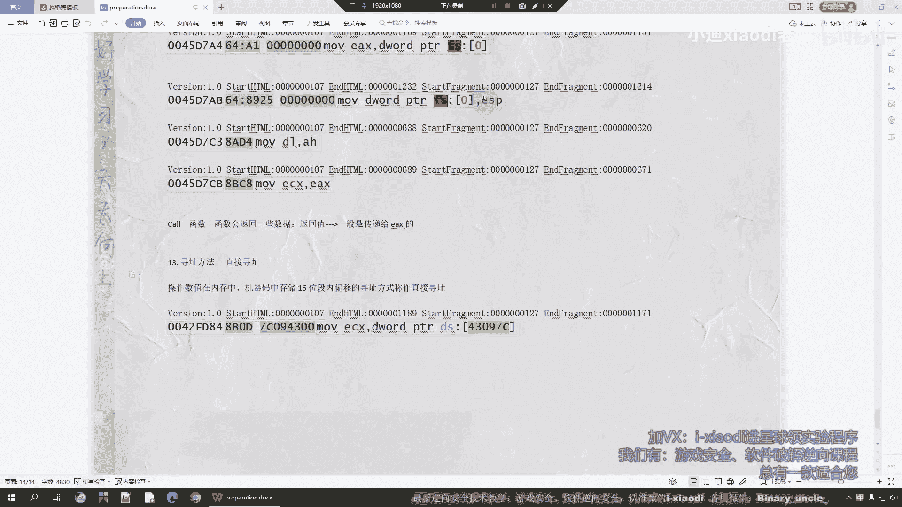
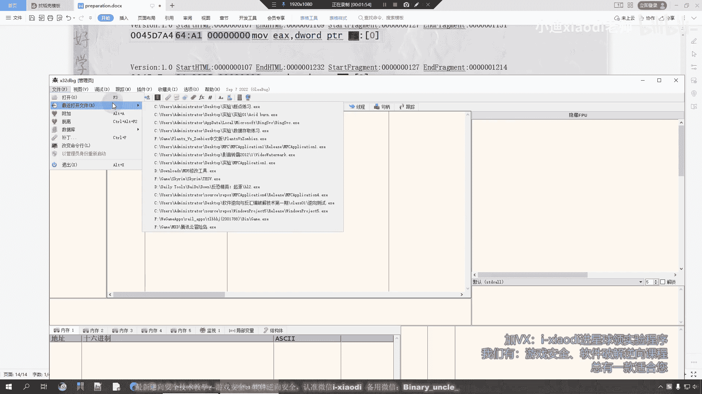

# 🧭 小白软件破解逆向工程师2023最新：4.13：寻址方法-直接寻址




在本节课中我们将要学习寻址方法中的直接寻址。这是第十三节课的内容，我们会先理解直接寻址的基本含义，再看16位CPU中怎样用段基址和段内偏移来描述地址，然后认识方括号在代码里的作用，最后用ACboard调试器做实际验证。通过学习这些内容，初学者也能明白“从内存地址里取数据”到底是怎么回事，并为后面学习其他寻址方式打下基础。


## 📌 直接寻址的基本含义


上一节概述了本节课的目标，本节中我们来看看直接寻址到底是什么意思。简单说，直接寻址就是数据直接放在内存里，而内存需要用内存地址来标识。这里的“数”可以理解成内存中的位置，这个位置里存放着数据；我们想拿到数据，就要先找到它所在的内存地址。下面用公式概括核心含义：


```text
直接寻址 = 从 [内存地址] 中取出数据
```


这个公式里的方括号表示“去这个地址里取数据”。理解这一点后，我们继续看16位CPU中的寻址背景。


## 🧱 16位CPU中的直接寻址背景


前面我们知道了直接寻址是从内存地址取数据，本节中我们来看看它在16位CPU中的描述。在16位CPU里，寻址通常通过“段基址 + 段内偏移”的方式完成，可以写成：


```text
物理地址 = 段基址 + 段内偏移
```


原文中有一句定义：机器码中存储16位段内偏移的寻址方式，称作直接寻址。这里的重点不是把术语背下来，而是理解机器码里会给出一个段内偏移，程序再结合段基址找到内存位置。为了把“从地址取数据”这件事写清楚，我们还需要认识一个特殊符号。下面进入方括号的用法。


## 🔑 方括号的含义：取出地址中的数据


上一节提到了段基址和段内偏移，本节中我们来看看代码里怎样表示“取出地址中的数据”。这个特殊符号就是中括号，也可以叫方括号。方括号里放的是内存地址，整体表示取出这个内存地址中的数据。用代码形式表示如下：


```text
[内存地址]  ->  该内存地址中存放的数据
```


换一种标准说法，方括号的作用是“取内存地址中的数据”。所以看到方括号时，不要把它当成普通数字，而要理解成一次内存访问。理解方括号后，我们来看一段具体代码怎样体现直接寻址。


## 💻 代码中的直接寻址示例


前面我们认识了方括号表示取地址中的数据，本节中我们来看看代码中的写法。示例代码可以写成下面这样：


```asm
mov ecx, dword ptr [430A48]
```




这段代码里，前面的 `mov` 等部分可以先不用纠结，关键是后面的 `[430A48]`。它表示先找到内存地址 `430A48`，再把这个地址里的数据取出来，最后传给 `ECX` 寄存器。也就是说，方括号负责取出地址中的数据，`mov` 负责把取出的数据送到寄存器。下面用几个要点总结这段代码的含义：


- `[430A48]` 表示访问内存地址 `430A48`。

- 方括号的作用是取出该地址中存放的数据。

- `mov ecx, ...` 表示把取出的数据传递给 `ECX`。


通过这段代码可以看到，直接寻址的意义就是：用方括号取出某个内存地址中的数据，再把这个数据交给目标寄存器。理解这个基本形式后，我们进入调试器里做一次实际验证。


## 🛠️ 调试实例一：验证地址中的数据


上一节我们从代码层面理解了直接寻址，本节中我们打开ACboard调试器，实际查看内存地址里的数据。使用 `F8` 单步走到目标代码行，可以看到类似 `mov ES, ... [430A48]` 的指令，其中带有方括号。为了确认 `430A48` 里到底存放了什么，可以打开数据窗口，按 `Ctrl+G`，输入 `430A48` 并跳转。跳转后看到 `B0164300`，它实际上对应 `004316B0`。下面列出这个验证过程的关键步骤：


- 使用 `F8` 单步执行到带方括号的代码行。

- 在数据窗口中按 `Ctrl+G` 跳转到地址 `430A48`。

- 观察该地址中的数据，看到 `B0164300`，实际对应 `004316B0`。

- 猜测该数据会被送入寄存器，再用 `F8` 单步执行验证。


执行 `F8` 后，可以看到寄存器中出现了 `004316B0`，与前面的观察结果对上了。这个过程说明，程序就是把内存地址中的数据通过这种方式直接传递给寄存器，这就是直接寻址。调试到这里，我们已经验证了“地址取数”的基本过程。接下来我们再看一种方括号里出现寄存器的形式。


## 🪆 调试实例二：方括号中的寄存器地址


前面我们验证了固定地址的直接寻址，本节中我们来看看方括号里出现寄存器时的写法。原文提到，后面还会碰到其他形式，但形式差不多，例如方括号中出现 `EX` 这类寄存器。它的意思仍然是取出“这个寄存器所表示地址”中的数据。原文把这种过程描述为给 `ES` 再给 `EX`，像俄罗斯套娃一样一层套一层。可以把它理解成：方括号里的寄存器此时被当作地址，方括号再去取这个地址里的值。用公式表示就是：


```text
[寄存器]  ->  把寄存器中的值当作地址，再取出该地址中的数据
```


原文还提到 `ES` 这个例子：因为方括号要取出地址里的值，所以此时 `ES` 就是一个地址。为了查看这个地址指向哪里，可以对它点击鼠标右键，选择在内存窗口中转到。内存窗口中出现 `0043160` 这样的内容，随后观察到 `024E3158`，说明执行完代码后，`ES` 会变成这个数据。下面列出验证时的操作要点：


- 确认方括号中的寄存器在当前语境下被当作内存地址。

- 对寄存器点击鼠标右键，选择在内存窗口中转到。

- 观察内存窗口中的数据，例如看到 `024E3158`。

- 使用 `F8` 单步执行，检查寄存器值是否与新数据一致。


执行 `F8` 后，可以看到 `024E3158` 对上了，说明前面的理解正确。剩下的内容可以继续用 `F8` 单步跑一下，自己做一些测试。更细节的内容后面再说明。到这里，我们已经把直接寻址的基本含义、代码写法和调试验证串起来了。


## ✅ 总结


本节课中我们一起学习了寻址方法中的直接寻址。我们知道了直接寻址就是把数据放在内存中，再用内存地址去标识它；在16位CPU中，寻址会涉及段基址加段内偏移；机器码中存储16位段内偏移的寻址方式称作直接寻址；方括号表示取出内存地址中的数据；代码 `mov ecx, dword ptr [430A48]` 体现了把地址 `430A48` 中的数据传给 `ECX`；在ACboard调试器中，我们可以通过 `F8`、`Ctrl+G` 和内存窗口验证地址中的数据；当方括号里出现寄存器时，寄存器此时就是地址，整体表示取出该地址中的数据。通过这些内容，我们完成了第十三节课直接寻址的学习，也为后面继续学习其他寻址方式打下了基础。本节课到此结束，下一期继续。
