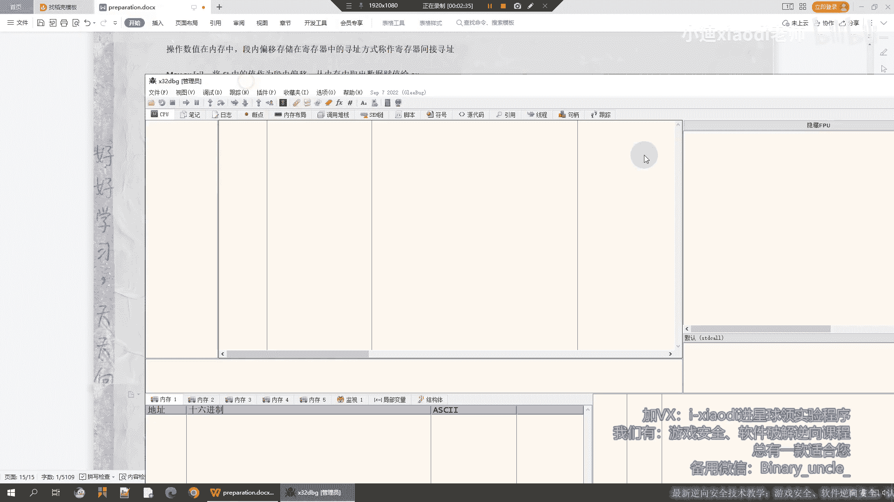

# 小白软件破解逆向工程师2023最新：4.15：寻址方法-寄存器相对寻址 🧭

在本节课中我们将要学习寻址方法中的寄存器相对寻址。简单说，寄存器相对寻址就是操作数所在的内存地址，由“段内偏移”计算得到，而这个偏移值来自寄存器加上一个立即数，或者加上一个可以计算出来的数。上一节我们介绍了寄存器间接寻址，本节中我们来看看在它基础上再加一个数字后会变成什么样子。学习这部分内容时，不需要被中括号里的加减号吓到，核心就是先算地址，再按地址读写内存。

## 小白软件破解逆向工程师2023最新：4.15.1：寄存器相对寻址的概念 📌

上一节我们介绍了寄存器间接寻址，本节中我们来看看寄存器相对寻址的定义。原文说得很直白：操作数值在内存中的段内偏移，是由寄存器加立即数，或者由一个数计算得来的，这种寻址方式就叫寄存器相对寻址。也就是说，它是在寄存器间接寻址的基础上，在寄存器后面再加一个数字或立即数，然后用计算出来的结果去寻找对应数据。核心概念可以用下面的公式表示。

\[
\text{有效地址} = \text{寄存器值} + \text{立即数或位移量}
\]

这个公式也可以写成减法形式，因为寄存器后面不仅可以加一个数，也可以减一个数。理解到这里，寄存器相对寻址就没有那么复杂了，它本质上还是一个地址计算问题。理解概念之后，下面进入具体示例，看看它在汇编指令中如何出现。

## 小白软件破解逆向工程师2023最新：4.15.2：基本读写示例 🧪

前面说明了寄存器相对寻址的概念，本节中我们来看看具体指令中的写法。原文举例说，把 AX 的值放到 SI 这个地址加 30 后得到的内存地址中。这里要记住一个关键点：不管中括号里面写成什么样，中括号表示的始终是内存地址。看到中括号里带加数时不要着急，它只是先做一个简单加法，算出一个数，这个数就是内存地址，然后再把数据放进这个地址或从这个地址取出数据。对应写法可以表示为下面的代码。

```asm
MOV [SI + 30H], AX
```

另一个例子中，BX 本身是一个地址值，这个地址值也是一个数，然后把 BX 加 118，得到一个新的地址，再从中括号表示的新地址中取出值送给 CX。这个过程同样很简单，可以表示为下面的代码。

```asm
MOV CX, [BX + 118H]
```

寄存器相对寻址不光可以加，还可以减，所以形式是多样的。看到里面出现运算符时不要紧张，运算符就是运算符号，出现加减乘除都很正常。下面列出几个加法和减法的读写例子，方便初学者对照理解。

- 加法读取示例：EBX 加 10 得到新地址，再取出该地址中的值送给 EAX，可写作 `MOV EAX, [EBX + 10H]`。

- 减法读取示例：EDX 减 8 得到新地址，再取出该地址中的值送给 ECX，可写作 `MOV ECX, [EDX - 8H]`。

- 减法写入示例：ECX 本身是一个值，把这个值写入 EDX 减 8 得到的内存地址中，从而修改该内存单元的值，可写作 `MOV [EDX - 8H], ECX`。

这些例子的共同点都是先计算地址，再进行读写。通过示例理解后，本节到调试器里核对地址，看看寄存器相对寻址在真实程序中如何体现。



## 小白软件破解逆向工程师2023最新：4.15.3：调试演示与地址核对 🛠️

通过示例理解后，本节中我们到调试器中走一遍地址核对流程。原文提到一时记不清具体是哪个程序，实际调试时只需要让程序运行到目标代码入口即可。如果想快速跑到某一行代码，可以使用一个小技巧：鼠标右键，然后选择“在此设置 EIP”。这里出现了一个重要概念 EIP，原文对它的解释如下。

> EIP 是当前指令执行的位置。

设置完 EIP 后，程序就会跑到目标位置，接着可以使用 F7 或 F8 单步执行。原文在调试中查看了一个类似 EBX 加偏移的写法，并核对了地址。以下是演示中可跟随的操作步骤，初学者可以按顺序理解每一步在做什么。

- 重新运行程序，让程序停在目标代码附近，再准备跳到要观察的指令位置。

- 鼠标右键选择“在此设置 EIP”，让程序直接跑到目标代码行。

- 使用 F7 或 F8 单步执行，并查看相关寄存器的值。

- 原文中先看到一个值为 0019FFCC，同时 EBX 为 365000；指令中的偏移需要按实际写法计算。

- 原文提到加 24 可以得到 365024，也提到 EBX 加 0C 可以得到 36500C，跳转到 36500C 后看到 0019FFCC，核对结果一致。

- 继续往下看 EBX 加 20 的示例，按 F8 返回后查看 EBX，值仍为 365000；原文又说到加 10 得到 365010，于是查看 365010 处的值。

- 查看 365010 处的值为 006F2728，该指令把这个数送给 EAX；执行这行代码后，EAX 变成 006F2728，说明数据确实发生了变化。

通过这一轮核对可以看到，寄存器相对寻址就是先把寄存器值加上或减去一个数，得到内存地址，再对这个地址进行读写。地址核对完成后，下面拓展一下调试中遇到的 EIP。

## 小白软件破解逆向工程师2023最新：4.15.4：EIP小拓展与用途 🧩

调试中我们已经用到了 EIP，本节中我们对它做一个小拓展。EIP 就是当前指令执行的位置，我们可以随意更改 EIP，从而快速跑到某一行代码，让程序直接执行那一行代码。原文提到，EIP 在前面已经提过一次，这里再次拓展。它的用途包括快速跳转和绕过一些校验、调试检测，具体场景以后遇到再说明。关于 EIP 的作用，可以先用下面这句话记住。

> EIP 是当前指令执行的位置，修改 EIP 可以改变接下来要执行的指令位置。

下面列出 EIP 在学习逆向时的常见理解方向，方便初学者建立印象。

- 快速跳到某行代码：通过修改 EIP，让程序直接跑到目标指令位置。

- 绕过部分校验：在某些情况下，改变执行位置可以跳过校验逻辑。

- 绕过部分调试检测：原文提到它可用于过掉一些调试检测，具体用法后续遇到再展开。

EIP 非常重要，现阶段先理解“它表示当前指令执行位置”即可。EIP 的拓展说明完成后，本节内容进入最后总结。

## 小白软件破解逆向工程师2023最新：4.15.5：本课总结 ✅

本节课中我们一起学习了寄存器相对寻址。我们知道了它的有效地址由寄存器值加上立即数或位移量计算得到，也可以做减法；中括号表示的始终是内存地址，看到加减号时先算地址再读写；我们还通过示例理解了 `MOV [SI + 30H], AX`、`MOV CX, [BX + 118H]`、`MOV EAX, [EBX + 10H]`、`MOV ECX, [EDX - 8H]` 等写法。调试部分我们学习了用鼠标右键“在此设置 EIP”快速跳到某行代码，并核对了寄存器值、偏移计算和内存数据变化。最后我们拓展了 EIP 的含义和用途，理解了它表示当前指令执行的位置，也可以用于快速跳转和绕过部分校验、调试检测。本节课内容到此结束，下期再见。

