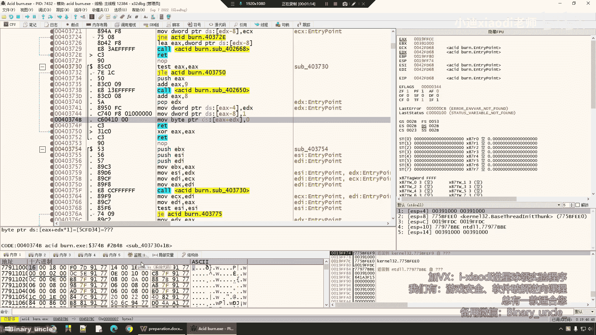

# 🧭 小白软件破解逆向工程师2023最新：4.16：寻址方法-基址变址寻址

在本节课中我们将要学习基址变址寻址。原文中把“基址变址寻址”也写成了“机值变值寻址”等口语形式，这里统一按“基址变址寻址”来理解。我们会先看它的定义，再看公式和指令写法，然后通过一个例子理解地址如何由两个寄存器相加得到，最后比较常量与变量的区别。这些内容看起来涉及寄存器、内存地址和指令，实际可以拆成两步：先算地址，再按地址访问数据。理解这个思路后，后面的内容会更容易看懂。

## 🔍 小白软件破解逆向工程师2023最新：4.16：基址变址寻址的概念

在理解了寻址方式的基本思路后，本节我们来看看基址变址寻址到底指什么。所谓基址变址寻址，就是操作数所在的内存地址，在段内偏移由两个寄存器计算得来。可以把寄存器理解成CPU内部存放数据的小盒子，两个盒子里各有一个数，这两个数相加后得到一个地址。这个地址就是后面要访问的内存位置。理解定义后，下面通过公式和指令格式看它如何工作。

核心概念可以用下面的公式表示：

```text
内存地址 = 寄存器A的值 + 寄存器B的值
操作数 = [寄存器A + 寄存器B]
```

上一节给出了概念，本节我们来看看它在指令里怎样体现。例如 `BP + SI` 就是两个寄存器，这两个寄存器里都有各自存放的数据。两个数据相加后得到一个地址。为什么相加结果是一个地址？因为外面有中括号，中括号里的内容表示内存地址。中括号里不可能是别的东西，只可能是一个内存地址。有了地址之后，还要把该地址里的数据取出来。为什么要取出来？因为中括号本身就有取出数据的意思。取出来之后赋值给 `AX`。为什么能赋值给 `AX`？因为 `mov` 是移动数据或者赋值的指令。

以下是两个典型写法，用来帮助理解“寄存器加寄存器得到地址”的过程：

```asm
mov ax, [bp + si]
mov ax, [bp + di]
```


`BP + DI` 的道理与 `BP + SI` 一样。两个寄存器各有自己的数据，两个数据相加得到一个地址，然后把该地址里的数据取出来，再给到 `AX`。这个过程很简单，核心就是先算地址，再按地址取数，再完成赋值。理解这些指令后，下面看一个具体例子。



## 💻 小白软件破解逆向工程师2023最新：4.16：基址变址寻址的例子

上一节我们看了指令格式，本节我们来看看课程中的具体例子。课程中给出的例子是 `ACID burn`，并给出了对应的内存地址，大家可以自行跳转到该地址查看。这里要观察的指令仍然是 `mov`，`mov` 的作用是移动数据。移动什么数据？以逗号为分界点，逗号前是目标位置，逗号后是源数据。原文描述为把零放到前面去，意思就是把数字 `0` 写入逗号前那个由地址表示的内存位置。

以下是这个例子的写法示意，重点看目标地址如何由两个寄存器相加得到：

```asm
mov [es + edi], 0
```

前面是什么？前面是 `ES` 加 `EDI` 这样的两个寄存器。`ES` 里有一个数据，`EDI` 里有一个数据。两个数据相加后会得到一个数，这个数就是一个内存地址。然后以这两个数相加的结果作为内存地址，把 `0` 放进这个内存地址对应的内存区间中。原文中的 `EDS` 可以按一个可变寄存器来理解，核心仍然是寄存器加寄存器。这个例子体现了基址变址寻址的基本过程：先算地址，再把数据写到该地址。它和之前接触的各种寻址形式很接近，只是把某些固定数字换成了 `EDX`、`EDS` 这类寄存器。看完例子后，下面比较常量和变量的区别。

## ⚖️ 小白软件破解逆向工程师2023最新：4.16：常量与变量的区别

上一节通过例子看到了寄存器参与地址计算，本节我们来看看常量和变量的差异。这个差异是理解基址变址寻址的关键。例如 `10` 是常量。常量就是不会变的量，`10` 这个数没法变成别的数。再比如 `EBX + 10` 中的 `10` 也是常量。`EDS` 则不同，`EDS` 是变量，它有可能取 `1`，有可能取 `3`，有可能取 `4`，有可能取 `8`，它可以变化。因此它们有很多相似的地方，也有本质差异：一个是变量，一个不是变量；一个可以变，一个不能变。

以下是常量与变量在寻址中的对比，便于初学者快速区分：

- 常量：固定数字，例如 `10`，不会变化。
- 变量：寄存器中的值，例如 `EDS`，可能取 `1`、`3`、`4`、`8` 等。
- 相对寻址：使用相对固定的值。
- 变址寻址：使用的值可以变化，是不定的值。

掌握这个区别即可。相对寻址中的值是固定的，变址寻址中的值是不定的。理解这一点后，就能明白为什么基址变址寻址要用两个寄存器来计算地址。本节内容到这里结束，下一节再见。

## 📝 小白软件破解逆向工程师2023最新：4.16：本节总结

本节课中我们一起学习了基址变址寻址。我们知道了它的地址由两个寄存器相加得到，公式是 `内存地址 = 寄存器A的值 + 寄存器B的值`，操作数写作 `[寄存器A + 寄存器B]`。我们也看了 `mov ax, [bp + si]`、`mov ax, [bp + di]` 以及 `mov [es + edi], 0` 这样的写法，理解了中括号表示内存地址并执行取数或写数操作。最后我们比较了常量和变量：`10` 这类常量不能变，`EDS` 这类寄存器变量可以变；相对寻址使用固定值，变址寻址使用不定值。把这些内容连起来看，基址变址寻址并不复杂，本质上就是先算地址，再按地址访问数据。

