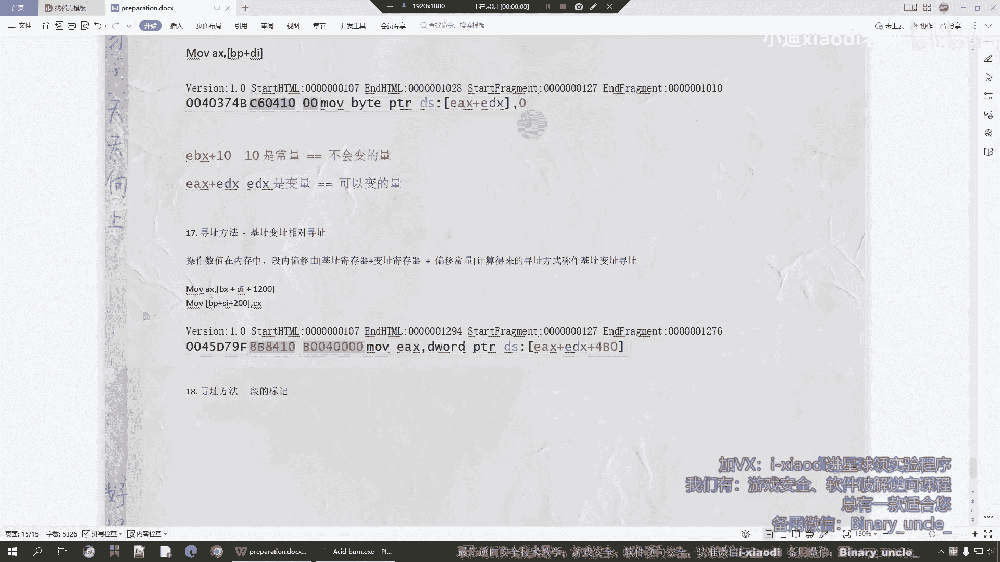

# 🧭 小白软件破解逆向工程师2023最新：第17集（4.17）：寻址方法——基址变址相对寻址


在本节课中我们将要学习第17集的内容，主题是寻址方法中的基址变址相对寻址。原文把这种寻址方式称为基址变址寻址，核心意思是：操作数在内存中的段内偏移，由寄存器参与计算得到，计算方式是基址寄存器加变址寄存器再加偏移常量。对初学者来说，可以先把寄存器理解成CPU内部用来临时存放数据的小格子，把中括号理解成“按照里面的地址去内存里取数据”。本节会从概念、取数例子、存数例子、基址与偏移的意义，以及练习建议几个方面展开，帮助初学者把这一种寻址方式看明白。


## 📌 小白软件破解逆向工程师2023最新：第17集（4.17）：本节概述


上一段已经把本集主题点出来了，本节先把整体路线说明白。本集讲的是寻址方法，具体是基址变址相对寻址。原文说明，这种寻址方式的操作数在内存中的段内偏移，由寄存器计算得到，公式可以写成“基址寄存器 + 变址寄存器 + 偏移常量”。也就是说，先在这个“寄存器加寄存器”的基础上，再加一个常量，这个常量是不会变的量，再加上一个数，这样的寻址方式就称为基址变址寻址。下面我们进入具体概念。


## 🧱 小白软件破解逆向工程师2023最新：第17集（4.17）：什么是基址变址相对寻址


上一节说明了本集要讲的内容，本节我们来看看这个名称到底是什么意思。原文用“基址变址相对寻址”来描述一种地址计算方式：操作数的内存段内偏移由寄存器参与计算，计算来源是基址寄存器、变址寄存器和偏移常量。把这句话用公式写出来就是下面这样。


```text
有效地址 = 基址寄存器 + 变址寄存器 + 偏移常量
操作数 = [有效地址]
```


这里的“中括号”很关键，它的作用是取出这个地址中的数据。用大白话说，先把几个部分加起来算出一个内存地址，再用中括号按这个地址去内存里取数据。原文还特别说明，这种寻址方式是在“寄存器加寄存器”的基础上再加一个常量，常量就是不会变的量，加上这个数之后得到地址，这种寻址方式就叫基址变址寻址。理解了这个公式，后面的例子就会顺很多。


## 🧩 小白软件破解逆向工程师2023最新：第17集（4.17）：用 BX+DI+1200 理解取数


上一节给出了公式，本节我们用一个具体表达式来理解取数过程。原文举了“BX + DI + 1200”的例子，原文中写作“BS + DI + 1200”，按上下文应理解为基址寄存器加变址寄存器再加偏移常量。它的含义是：BX 加 DI 得到一个数，这个数再加上 1200，得到的是一个内存地址，然后中括号取出这个地址中的数据，再把取出的数据给到 AX。为了直白展示，可以写成下面的代码示意。


```asm
; 原文示例的含义：先算地址，再按地址取数，最后送给 AX
MOV AX, [BX + DI + 1200]
```


下面把取数步骤拆开说明。以下是这个例子的理解步骤，读者可以按顺序对照公式来看。


1. 先计算 BX + DI，得到一个中间结果。

2. 再把中间结果加上常量 1200，得到最终的内存地址。

3. 用中括号按这个地址去内存中取数据。

4. 把取出的数据送给 AX。


这个例子说明，基址变址相对寻址并不是直接给出一个固定地址，而是通过“基址 + 变址 + 偏移”算出一个地址。上一节讲的是公式，这一节讲的是取数，接下来我们看看把数据存到内存里的情况。


## 📥 小白软件破解逆向工程师2023最新：第17集（4.17）：把 CX 存入 BP+SI+200 指向的内存


前面讲的是从内存取数据，本节我们来看看把数据写入内存的例子。原文继续举例：再看 CX，把它放到以 BP + SI + 200 的结果为内存地址的内存区域中。也就是说，BP、SI 和 200 三者加起来，它们的结果是一个内存地址，然后把 CX 放到这个内存地址所标记的内存区域中。原文后文写作“把 CS 放到这个内存地址标记的内存区域中”，按上下文可以理解为：把这次要写入的数据放到该地址指向的内存区域。用代码示意可以写成下面这样。


```asm
MOV [BP + SI + 200], CX
```


这个例子和前面的取数例子非常相似，区别只是数据流动方向不同：前面是把内存里的数据取到寄存器，这里是把寄存器里的数据写到内存。原文也说明，这个内容和上节课以及之前讲的内容都非常相似。上一节我们看了取数，本节看了存数，接下来我们回到具体例子中，分清基址寄存器、变址寄存器和偏移常量。


## 🔍 小白软件破解逆向工程师2023最新：第17集（4.17）：具体例子中的基址、变址和偏移


上一节说明了存数过程，本节我们来看看具体例子中各个部分分别叫什么。原文给出一个类似“MOV EX，逗号后面是 EAX + EDS + 4B0”的例子，并用逗号作为分界线。原文说明，EX + EDS 是可以变的，因此可以称之为变址寄存器；而 ES 一般不会变，谁会变，后边这个就跟着变，所以第一个一般称为基址寄存器，第二个称为变址寄存器。原文后面又写作“ES 加 EDS”，前面写作“EAX 加 EDS”，教学时可以把它们理解为同一类表达式，核心都是“基址寄存器 + 变址寄存器 + 偏移常量”。


为了把概念说清楚，下面列出这个寻址表达式中的三个组成部分。以下是基址、变址和偏移在大白话里的理解，读者可以对照原文例子记忆。


- 基址寄存器：一般是不怎么变的那个寄存器，原文把它理解为第一个寄存器。

- 变址寄存器：一般是跟着变化的那个寄存器，原文把它理解为第二个寄存器。

- 偏移常量：就是后面直接加上的数字，比如 4B0，这种常量称为偏移常量，也可以简称为偏移。


原文还说明，后边加上一个常量，看到数字就是常量，直接的一个数字是常量；加上一个偏移常量，这种常量称为偏移常量，或者简称为偏移。今后在逆向分析里，直接称它为“偏移”就可以。把这个例子写成公式和代码，就是下面的样子。


```text
结果 = ES + EDS + 4B0
新地址 = 结果
数据 = [新地址]
```


```asm
; 按原文表达整理：核心是基址 + 变址 + 偏移，再用中括号取数
MOV EX, [EAX + EDS + 4B0]
```


原文对这个过程的解释是：ES 加 EDS 得到一个结果，这个结果再加上 4B0 这个偏移，得到一个新的结果，这个新结果是一个地址，然后中括号取出这个地址里的数据，再给到 EX。上一节我们分清了三个组成部分，本节也看到了具体表达式，接下来我们看看基址和偏移为什么在逆向分析中这么重要。


## 🧠 小白软件破解逆向工程师2023最新：第17集（4.17）：为什么基址和偏移在逆向分析中重要


前面已经多次出现基址和偏移，本节我们来说明它们在逆向分析中的位置。原文指出，从这里开始，我们终于接触到了逆向分析过程中非常重要的一个概念：一个叫基址，一个叫偏移。不管是软件逆向还是游戏逆向，基址和偏移这两个东西总是围绕着被讨论，因为它们揭示了数据存取的规律和本质。用大白话说，很多数据并不是靠死记一个地址来找到，而是靠“从哪个底子出发，再加多少偏移”来定位。


这句话可以记成下面这个引用。以下是本集最值得记住的一句话，它把基址和偏移的作用概括了出来。


> 基址和偏移揭示数据存取的规律和本质，逆向分析经常围绕它们展开。


原文还提醒，从今天开始可以自己做总结，后边也会做总结。把这几种寻址方式看一遍还不够，最好自己手动操作一下，争取完全理解。下面给出几条练习建议。以下是学习本集内容时可以采用的练习方式，目的是把看懂变成会做。


- 自己动手总结本集出现的寻址表达式。

- 把这几种寻址方式自己再看一遍。

- 手动操作一遍取数和存数的例子。

- 尽量做到完全理解“基址 + 变址 + 偏移”的含义。


上一节我们理解了基址和偏移的重要性，本节也给出了练习方向，最后我们对本集内容做一个收束。


## ✅ 小白软件破解逆向工程师2023最新：第17集（4.17）：本节总结


本节课中我们一起学习了第17集的寻址方法，重点是基址变址相对寻址。我们知道了它的核心公式是“有效地址 = 基址寄存器 + 变址寄存器 + 偏移常量”，也知道了中括号表示按地址取数据。通过 BX + DI + 1200 的例子，我们理解了先算地址再取数并送给 AX 的过程；通过 BP + SI + 200 的例子，我们理解了把 CX 写入该地址指向内存区域的过程；通过具体表达式，我们分清了基址寄存器、变址寄存器和偏移常量；最后我们明白了基址和偏移在软件逆向与游戏逆向中的重要性，并给出了手动练习的建议。本集内容到此结束，我们下期再见。

