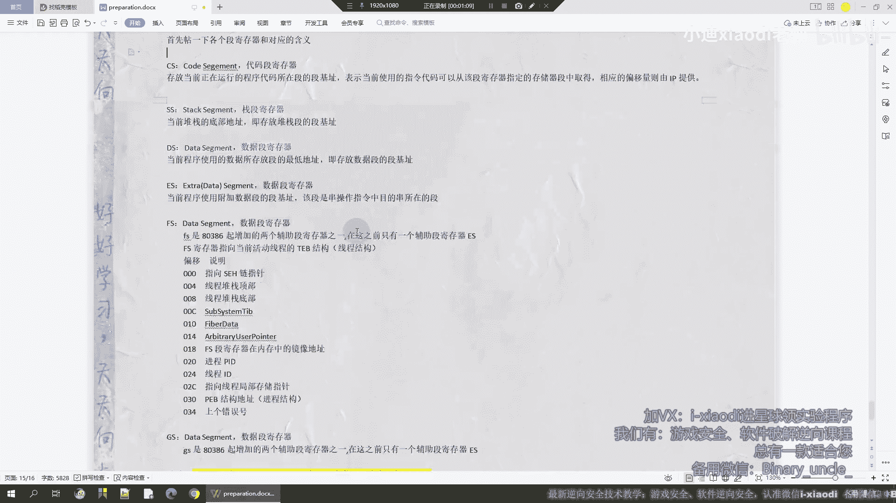

# 🧭 小白软件破解逆向工程师2023最新：4.18：寻址方法-段的标记


在本节课中，我们将要学习寻址方法中的“段的标记”。本节是第十八讲，主题是段的标记。我们会说明用调试器查看反汇编代码时看到的红色标记，例如 DS，它到底是什么；也会说明这些标记和段寄存器如何对应；然后总结 DS 与 SS 两种最常见的段标记情形；最后说明 PTR、DWORD 等还没有讲到的单词会在后续补充。这个知识点偏基础，但它是看懂汇编代码细节的一部分，所以先把它弄清楚。

## 🧩 小白软件破解逆向工程师2023最新：4.18：认识段的标记


在进入具体判断规则之前，我们先来看段的标记是什么。当我们用调试器查看反汇编代码时，会发现反汇编代码里有红色标记，例如 DS。很多地方都会出现这种 DS，这个 DS 就是段的标记。之前我们已经说过段寄存器，这些标记实际上对应调试器里的段寄存器位置；在对应位置可以看到 DS、SS、GS、SS、ES、CS 等段寄存器。DS 对应数据段寄存器，数据段的英文是 data segment，原文口述为 date segment，其中 data 是数据的意思，也就是数据段。另一个比较常见的是 SS，也就是 stack segment，表示栈段寄存器。DS 和 SS 是我们最常见的两个段寄存器标记，其他段寄存器标记不常见。大家可以暂停视频，截图了解这些标记。

以下是常见段寄存器标记与含义的对照，先有个大致印象即可。

- DS：数据段寄存器，常见于普通数据访问。
- SS：栈段寄存器，常见于栈相关访问。
- GS、ES、CS 等：其他段寄存器，出现频率相对低，先了解即可。

了解这些对应关系后，下面总结两种最常见的段标记情形。

## 📊 小白软件破解逆向工程师2023最新：4.18：DS 段标记的判断




上一节我们认识了段寄存器标记，本节中我们来看看 DS 段标记怎么判断。常见情形有两种：一种是用 SS 段标记，一种是用 DS 段标记。DS 段标记其实很简单，就是把一个数据取出来给到前边寄存器：看到中括号，就是取出这个内存地址里的数据，然后给到前边的寄存器。前边是什么寄存器不用管，只要用逗号隔开，就是把这个内存地址里的数据给到前边。例如 ES 里是一个数，把这个数给到前边，这种普通数据就用 DS 标记。核心概念可以写成下面的公式。

```text
DS 标记：[内存地址] -> 前边寄存器
```

以下是 DS 段标记的判断要点，重点是看中括号和普通数据访问。

- 看到中括号：表示取出内存地址里的数据。
- 逗号隔开：把取出的数据给到前边的寄存器。
- 前边寄存器类型不用管：普通数据访问使用 DS 标记。
- 例如 ES 里是一个数并把这个数给到前边：属于普通数据，使用 DS 标记。

DS 段标记理解后，再看 SS 段标记，SS 的规则会更固定一些。

## 🧱 小白软件破解逆向工程师2023最新：4.18：SS 段标记与 EBP/ESP


上一节我们介绍了 DS 段标记，本节中我们来看看 SS 段标记。谁使用 SS 段标记？EBP 和 ESP。但凡看到 EBP、ESP 这种形式，都是用 SS 段标记；其他普通数据都用 DS 段。EBP 和 ESP 的规则非常规整，也非常死板，就是一定要用 SS，EBP 和 ESP 一定使用 SS 段。不管它是哪种汇编段（原文口述为“木”），还是没见过这种浮点栈，只要出现 EBP 和 ESP，都是 SS，因为它们是栈里的东西，SS 是栈段寄存器。普通数据除了栈段，其他通用寄存器常见都在通用寄存器区域，都用 DS 段。核心判断可以写成下面的公式。

```text
SS 标记：EBP / ESP -> SS
普通数据 -> DS
```

以下是判断口诀，记住这几条就能处理大部分情况。

- 看到 EBP、ESP：使用 SS 段标记。
- 看到普通数据、通用寄存器数据：使用 DS 段标记。
- EBP、ESP 与栈相关：因为它们是栈里的东西，SS 是栈段寄存器。
- 规则很死板：不管汇编段是什么样，只要出现 EBP、ESP，就归到 SS。

记住这个口诀即可，整条汇编代码里没几个单词，先抓住主要规则。接下来补充还没有讲到的单词和后续安排。

## 🧷 小白软件破解逆向工程师2023最新：4.18：还没讲到的单词与后续安排


上一节我们总结了 DS 和 SS 的判断口诀，本节中我们来看看还有哪些内容没有讲。已经讲了 DS，也讲了中括号，PTR 还没有讲，DWORD 还没有讲。不要着急，后面都会讲到。DWORD 涉及数据宽度，PTR 涉及指针以及其他英文单词。后面会慢慢补充这些内容，让大家了解整条汇编代码里没有让人困惑的地方，所有东西都能知道，这样再看汇编代码时就会更加了解。不要落下任何一个细节。

以下是后续会补充的内容，先知道它们大概负责什么即可。

- PTR：后面会讲，涉及指针等英文单词。
- DWORD：后面会讲，涉及数据宽度。
- 其他英文单词：后面会逐步补充，目标是看懂整条汇编代码。

这些内容补上以后，段标记和汇编代码里的英文单词就能串起来。下面做本节总结。

## ✅ 小白软件破解逆向工程师2023最新：4.18：本节总结


上一节我们说明了后续安排，本节中我们一起总结。本节课中我们一起学习了寻址方法中的段的标记：用调试器查看反汇编代码时会看到 DS 等红色标记，这些标记对应段寄存器；DS 对应数据段寄存器 data segment，SS 对应栈段寄存器 stack segment；DS 和 SS 是最常见的两个标记。常见情形有两种：DS 段标记和 SS 段标记。DS 段标记用于普通数据访问，看到中括号就是取出内存地址里的数据并给到前边寄存器；SS 段标记用于 EBP、ESP，看到 EBP、ESP 就使用 SS 段，其他普通数据使用 DS 段。我们还提到 PTR、DWORD 等内容后面会继续补充，学习时不要落下细节。今天的内容就是这些，下期再见。
