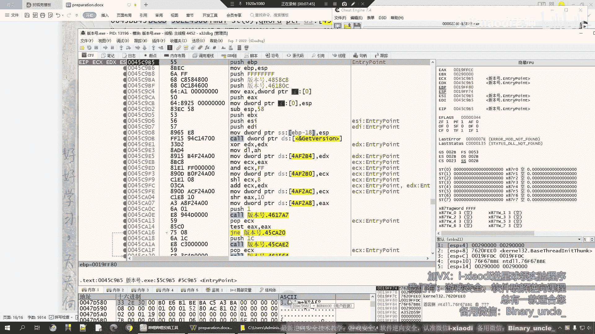
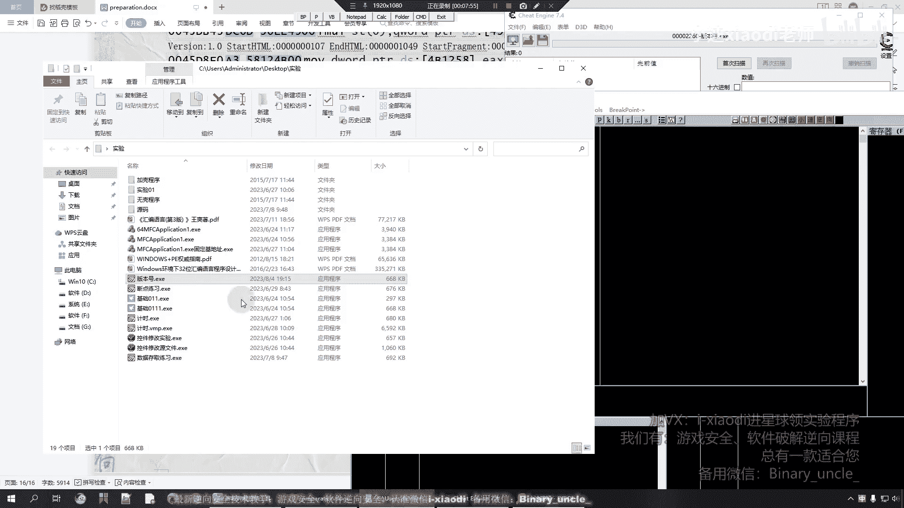
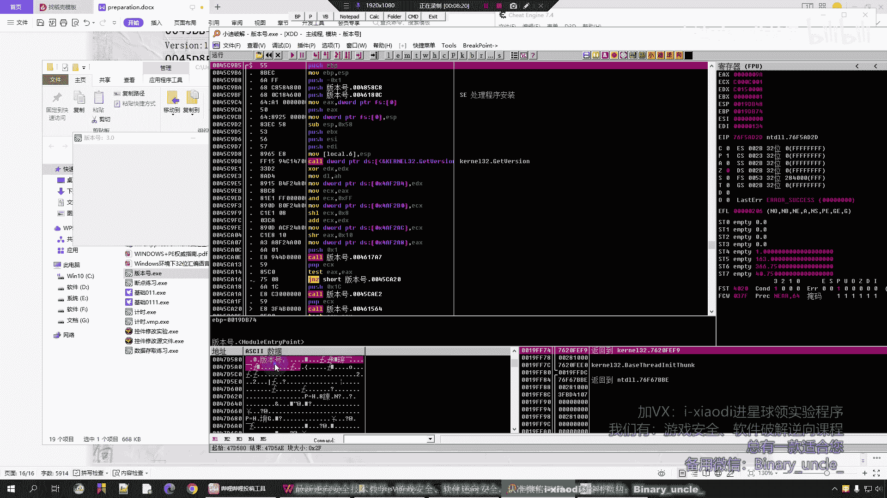
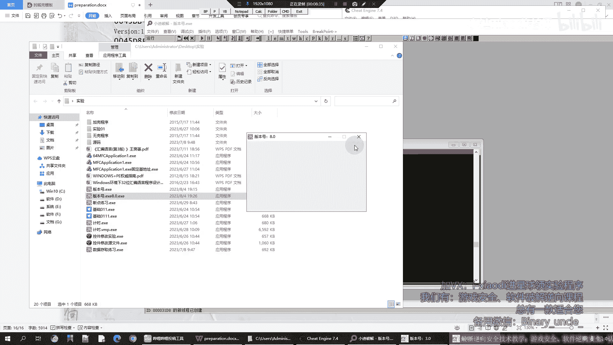
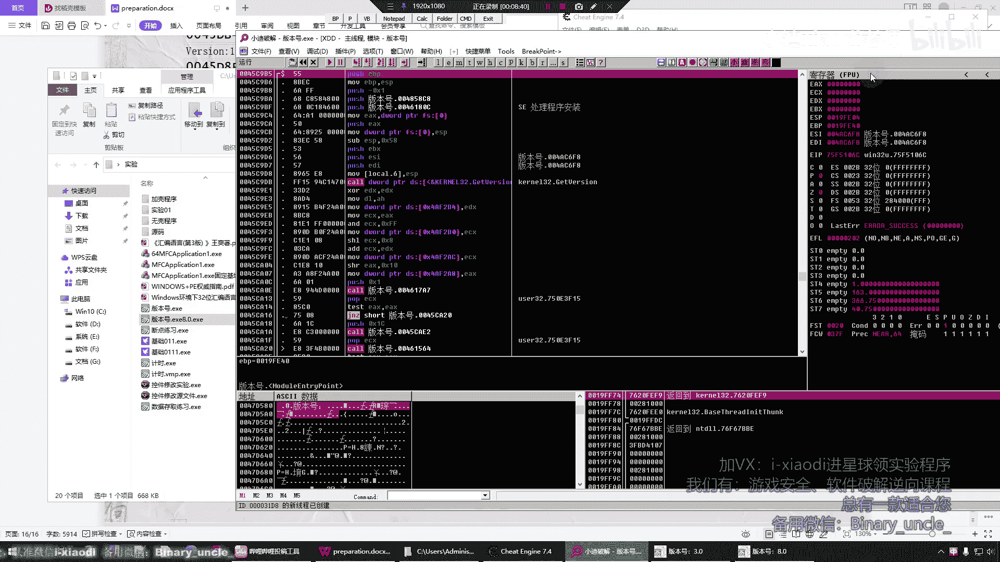

# 小白软件破解逆向工程师2023最新：4.19：寻址方法总结与应用——版本号修改 🔍


## 📘 课程概述

本节是第十九课，主要总结常见的七种寻址方法，并通过修改程序版本号的实例，说明如何在逆向分析中寻找关键数据的来源。

本节还会演示如何使用调试器、二进制编辑器和 Cheat Engine（CE）修改内存中的版本号，并使用 OllyDbg（OD）将修改结果保存到程序文件中。学习这些内容时，应仅在自己编写或获得合法授权的程序上进行测试。


## 🧭 一、七种常见的寻址方法

上一节我们已经接触了部分寻址概念。本节先对常见寻址方法进行统一总结，理解这些基础形式后，后面的版本号分析会更加容易。

在汇编语言中，方括号 `[]` 通常表示访问内存地址。可以把它简单理解为：

```text
[地址] = 取出某个内存地址中的数据
```

常见的七种寻址方法如下：

1. 立即寻址

2. 寄存器寻址

3. 直接寻址

4. 寄存器间接寻址

5. 寄存器相对寻址

6. 基址变址寻址

7. 基址变址相对寻址

下面依次说明这些寻址方式的基本含义。


### 1. 立即寻址

立即寻址就是把一个具体数值直接放入目标寄存器或操作数中。

```asm
MOV EAX, 123
```

上面的代码表示把数值 `123` 直接交给 `EAX`。这里的 `123` 是一个立即数，它本身就是数据，不需要再通过地址寻找。


### 2. 寄存器寻址

寄存器寻址是把一个寄存器中的数据交给另一个寄存器。

```asm
MOV EAX, EBX
```

上面的代码表示：

```text
EAX ← EBX中的数据
```

这种方式访问的是寄存器内部的数据，不需要访问内存。


### 3. 直接寻址

直接寻址是通过一个明确的内存地址访问数据。

```asm
MOV EAX, [0047D580]
```

其中，方括号中的内容永远表示一个内存地址：

```text
EAX ← 内存地址0047D580中的数据
```

无论方括号中填写的是哪种形式，只要它最终表示一个地址，就可以理解为对该内存地址进行访问。


### 4. 寄存器间接寻址

寄存器间接寻址中，寄存器里保存的不是普通数据，而是一个内存地址。

```asm
MOV EAX, [EBX]
```

这段代码可以拆解为：

```text
EBX中保存一个地址
读取该地址中的数据
把读取到的数据交给EAX
```

也就是：

```text
EAX ← [EBX]
```

这里的 `EBX` 是地址的来源，`[EBX]` 表示访问这个地址对应的内存内容。


### 5. 寄存器相对寻址

寄存器相对寻址是在寄存器保存的地址基础上，再加上一个固定偏移量。

```asm
MOV EAX, [EBX+40]
```

其计算过程可以表示为：

```text
有效地址 = EBX + 0x40
EAX ← [有效地址]
```

这里的 `0x40` 是一个固定常量。只要 `EBX` 的值不变，访问位置就会按照这个偏移量计算。


### 6. 基址变址寻址

基址变址寻址是在一个基址寄存器和一个变址寄存器的基础上共同计算地址。

```asm
MOV EAX, [EBX+ESI]
```

其核心公式如下：

```text
有效地址 = 基址寄存器 + 变址寄存器
EAX ← [有效地址]
```

与固定偏移量不同，变址寄存器中的内容可以发生变化，因此最终访问的地址也会随之变化。


### 7. 基址变址相对寻址

基址变址相对寻址是在基址寄存器、变址寄存器之外，再增加一个固定常量。

```asm
MOV EAX, [EBX+ESI+40]
```

其计算公式为：

```text
有效地址 = 基址寄存器 + 变址寄存器 + 固定偏移量
EAX ← [有效地址]
```

这种方式同时包含可变化的寄存器地址和固定的偏移量，因此比前面几种形式更加灵活。


## 🧩 二、寻址方法在逆向分析中的作用

前面介绍了七种寻址方式，接下来说明它们在逆向分析中的实际用途。

这些寻址方式虽然形式不同，但在分析程序时往往都指向同一个目标：找到关键数据真正来源的位置。也就是说，看到一个版本号、时间限制或登录状态时，不能只停留在当前指令，而要继续向上追踪数据是从哪里来的。

在实际分析中，可以把数据流理解为：

```text
数据源
  ↓
寄存器或内存
  ↓
相关指令处理
  ↓
程序界面或功能结果
```

因此，寻址方法的核心应用可以概括为：

```text
通过地址计算和数据传递关系，寻找关键数据的源头
```

下面以修改程序版本号为例，说明如何应用这一思路。


## 🖥️ 三、分析程序中的版本号

上一节我们总结了寻址方式，本节开始进行实际应用。需要说明的是，每个程序的编写方式不同，因此不同程序中的版本号位置、数据格式和调用过程可能不一样。

本例中的程序启动后，会在窗口中显示：

```text
版本号 3.0
```

也就是说，程序界面会显示当前程序的版本号。我们的目标是找到 `3.0` 的数据来源，并在授权测试环境中将其修改为 `8.0`。


### 1. 运行程序确认现象

首先运行目标程序，确认程序当前显示的版本号。

程序启动后，窗口显示：

```text
版本号 3.0
```

这一步的作用是确认待分析的目标数据。只有先确定程序确实显示了 `3.0`，后续搜索和修改才有明确的参照。


### 2. 在当前模块中搜索字符串

接下来打开调试工具，可以通过符号窗口进行搜索，也可以直接使用搜索功能。

搜索范围可以选择：

```text
当前模块
```

当前模块通常就是正在分析的程序模块。如果程序只有一个可执行文件，那么直接搜索当前模块即可。

也可以选择：

```text
所有用户模块
```

本例中的程序只有一个可执行文件，因此选择当前模块进行搜索就可以。搜索字符串时，可以输入：

```text
3.0
```

搜索结果中可能会出现多个与版本号相关的字符串或数据。


### 3. 查看版本号附近的指令

找到版本号字符串后，选中相关结果并查看它附近的汇编指令。

在示例中，可以看到类似下面的指令结构：

```asm
PUSH 0047D584
PUSH 004A0510
```

其中：

```text
0047D584
```

对应“版本号”这几个字。

另一个地址：

```text
004A0510
```

对应版本号的实际数值：

```text
3.0
```

因此，可以初步得到以下关系：

```text
0047D584 → “版本号”
004A0510 → “3.0”
```

这里需要注意，指令中出现的地址可能是数据地址，也可能是经过计算后得到的有效地址。分析时应继续向上查看数据来源，不能只根据一条指令直接下结论。


## 🔎 四、向上追踪版本号的数据来源

确认版本号所在位置后，下一步是继续向上查看相关指令，寻找这个地址或数据是如何产生的。

在代码中可以看到，某个寄存器中的内容被交给了后续指令使用。为了便于理解，可以抽象为：

```asm
MOV EAX, 004A0510
PUSH EAX
```

这表示：

```text
先把版本号数据地址放入EAX
再使用EAX中的内容
```

如果寄存器中保存的是地址，那么后续对该寄存器的使用就可能属于寄存器间接寻址或相关的地址计算。

继续向上查看可以发现，版本号数据的源头位于更早的一条指令中。示意结构如下：

```asm
MOV EAX, 004A0510
```

这说明：

```text
EAX ← 004A0510
```

而地址 `004A0510` 中保存的内容就是：

```text
3.0
```

因此，分析结果可以表示为：

```text
004A0510 → 3.0
EAX ← 004A0510
后续指令使用EAX中的地址
程序最终显示3.0
```

通过这种方式，就可以从程序显示结果反向追踪到关键数据的源头。


## 🧱 五、理解“寻找关键数据源头”

上一节已经找到版本号的具体地址，本节进一步总结这种分析方法。

在逆向分析中，寻址方法最重要的应用之一，就是寻找关键数据的源头。

可以把整个过程概括为：

```text
界面显示的结果
        ↓
负责显示的指令
        ↓
使用的寄存器或内存地址
        ↓
地址的计算过程
        ↓
最终保存关键数据的位置
```

本例中的关键数据是：

```text
版本号 = 3.0
```

最终找到的关键地址是：

```text
004A0510
```

该地址中保存着版本号数据，因此可以对这个位置进行进一步测试。


## 🛠️ 六、使用调试器尝试修改版本号

找到关键地址后，可以先在调试器中下断点。

以下是基本操作流程：

1. 在负责读取或使用版本号的指令处下断点。

2. 重新运行程序。

3. 程序运行到断点后，观察相关寄存器和内存地址。

4. 确认此时版本号数据是否已经被读取或传递。

5. 尝试修改保存版本号的数据位置。

在断点处，可以看到程序已经运行到相关指令，但版本号数据可能还没有完成赋值或传递。

单步执行后，可以观察寄存器中的内容。例如：

```text
EAX中仍然保存着与3.0相关的数据
```

此时，可以尝试使用二进制编辑功能，把：

```text
3.0
```

修改为：

```text
8.0
```

修改完成后，再使用单步执行，例如按下 `F8`，继续观察程序执行结果。


### ⚠️ 修改没有立即生效的情况

第一次修改后，可能会发现结果没有生效，寄存器中仍然显示原来的：

```text
3.0
```

这可能有多种原因，例如：

- 修改的位置不是最终使用的地址。

- 程序在后续执行过程中重新写入了原始数据。

- 调试器修改的是文件内容，而程序当前使用的是已经加载到内存中的副本。

- 程序存在数据复制过程，修改源数据后，目标位置仍然保存旧数据。

- 使用的调试工具对当前程序格式或架构支持不完整。

因此，修改没有立即生效时，需要重新确认地址、数据流和写入时机，不能简单认为地址一定错误。


## 🧪 七、使用 Cheat Engine 修改内存中的版本号

如果调试器中的修改没有生效，可以使用 Cheat Engine（CE）直接修改程序运行时的内存数据。

这种方法适合进行临时测试。它通常只影响当前运行的程序进程，关闭程序后，修改结果可能会消失。

以下是基本操作流程：

1. 打开 Cheat Engine。

2. 选择正在运行的目标程序。

3. 搜索当前版本号：

   ```text
   3.0
   ```

4. 在结果中找到与程序版本号对应的地址。

5. 将该地址添加到地址列表。

6. 将数据类型设置为文本或字符串。

7. 把数值修改为：

   ```text
   8.0
   ```

8. 返回程序窗口，确认版本号是否发生变化。

在本例中，将版本号从 `3.0` 修改为 `8.0` 后，程序窗口可以显示：

```text
版本号 8.0
```

这说明运行时内存中的数据已经被成功修改。

CE 的特点是可以直接对进程内存进行强制修改，因此有时比调试器中的普通编辑操作更容易看到效果。但这种修改通常是临时的，程序关闭后一般不会自动保存到文件。


## 💾 八、使用 OllyDbg 保存修改后的程序

如果希望把修改结果保存到程序文件中，就不能只修改运行时内存，还需要在调试器中修改对应的文件数据。

本例中，重新启动程序后，版本号仍然恢复为：

```text
3.0
```

这说明之前使用 CE 的修改只存在于运行时内存中，并没有写入程序文件。

在某些情况下，直接使用二进制编辑器修改数据也可能失败。例如，将：

```text
3.0
```

修改为：

```text
8.0
```

后，程序仍然显示原来的版本号。这可能与程序重新覆盖数据、编辑器处理方式或工具兼容性有关。


### 1. 在OD中定位版本号地址

首先在 OllyDbg（OD）中定位之前找到的地址，例如：

```text
004A0510
```

查看该地址中的数据，确认其中保存的是：

```text
3.0
```

如果地址内容与程序显示的版本号一致，就可以继续进行文件修改。


### 2. 修改文本数据

在 OD 的数据窗口中，将原来的文本：

```text
3.0
```



修改为：

```text
8.0
```

修改后，应再次检查数据窗口，确认内容已经发生变化。


### 3. 将修改复制到可执行文件



修改完成后，在相关位置单击鼠标右键，选择类似下面的功能：

```text
复制到可执行文件
```

这个操作的作用是把调试器内存中的修改同步到可执行文件数据中。


### 4. 保存修改后的文件

将修改后的内容保存到新的程序文件中。建议不要直接覆盖原始文件，而是使用新的文件名保存，这样便于出现问题时恢复原始版本。

保存完成后，重新运行保存后的程序。如果修改成功，程序窗口会显示：

```text
版本号 8.0
```

这说明版本号修改已经写入文件，并且程序启动时读取到了新的版本号数据。


## 🧯 九、工具兼容性与常见问题

在实际操作中，某些工具可能出现兼容性问题。例如，针对 64 位程序或特定文件格式的工具可能存在缺陷，导致编辑失败、保存异常或修改无法生效。

因此，实际操作中需要注意以下问题：

- 某些工具可能存在与 64 位程序相关的兼容性问题。

- 同一个地址在程序重新运行后可能发生变化。



- 修改运行时内存不等于修改程序文件。

- 数据可能在程序启动后被重新计算或覆盖。

- 保存修改时应优先使用调试器提供的“复制到可执行文件”功能。

- 测试前应保存原始文件，避免修改失败后无法恢复。

- 对于不同程序，需要根据实际代码结构重新分析，不能机械套用固定地址。

这些问题属于逆向分析中的常见情况。遇到修改不成功时，应重新检查数据来源、有效地址、写入时机和文件保存过程。


## 🌐 十、寻址方法的其他应用场景

版本号只是寻址方法的一种应用。只要程序中的某个功能依赖特定数据，就可以通过类似的方式追踪其数据来源。

常见应用场景包括：

1. 版本号限制

   程序可能根据版本号决定是否启用某些功能，或者限制旧版本运行。

2. 更新限制

   程序可能通过版本号、更新时间或服务器返回值判断是否允许更新。



3. 登录时间限制

   程序可能保存登录时间、试用期限或过期时间，并根据这些数据决定是否允许继续使用。

4. 功能开关

   程序可能通过布尔值、整数或字符串控制某个功能是否开启。

5. 状态判断

   程序可能通过内存中的状态值判断用户是否登录、授权是否有效或操作是否完成。

这些场景的具体实现方式各不相同，需要根据目标程序的代码结构进行分析。虽然数据类型、地址和调用流程可能不同，但基本思路仍然一致：



```text
定位程序结果
    ↓
查找相关指令
    ↓
追踪寄存器和内存地址
    ↓
寻找关键数据源头
    ↓
在合法授权范围内进行测试
```

可以把这种方法概括为：

```text
万变不离其宗：通过数据流和寻址关系，定位关键数据的来源
```


## ✅ 本节总结

本节课中，我们一起学习了七种常见的寻址方法：

```text
立即寻址
寄存器寻址
直接寻址
寄存器间接寻址
寄存器相对寻址
基址变址寻址
基址变址相对寻址
```

我们还学习了寻址方法在逆向分析中的核心作用：

```text
根据指令和地址关系，寻找关键数据的源头
```

随后，我们以程序版本号 `3.0` 为例，完成了以下分析过程：

- 运行程序并确认版本号。

- 在当前模块中搜索版本号字符串。

- 查看版本号附近的汇编指令。

- 追踪寄存器和内存地址之间的数据传递。

- 找到保存版本号的关键地址。

- 使用 CE 临时修改运行时内存中的版本号。

- 使用 OD 将修改结果保存到可执行文件。

- 重新运行程序，确认版本号变为 `8.0`。

最终，这个案例说明了一个重要方法：

```text
先找到程序显示结果对应的数据，
再沿着指令和寻址关系向上追踪，
最后定位并测试关键数据的来源。
```

掌握这种思路后，就可以更好地分析版本号、更新条件、登录时间、功能开关等程序数据。具体实现仍然需要结合目标程序的实际结构，并且应始终在自己拥有或获得授权的环境中进行分析。

