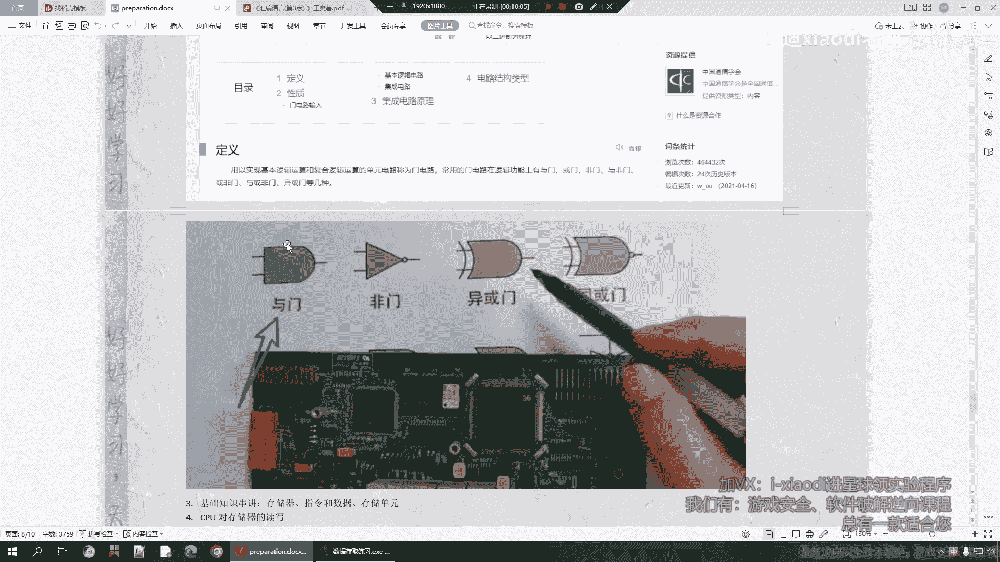

# 小白软件破解逆向工程师2023最新：4.2：基础知识串讲：机器语言、汇编语言产生和组成 🚀

在本节课中，我们将学习汇编语言的基础知识，包括机器语言、汇编语言的产生和组成，以及硬件最底层的逻辑电路。这些内容虽然看起来偏理论，但它们是理解逆向工程和软件破解的基石。只有搞清楚计算机底层是如何工作的，后续的学习才会更加顺利。

## 什么是汇编语言 🧠


我们首先打开教材，进入第一章基础知识的讲解。当前学习的主题是汇编语言，更准确地说，是汇编基础。那么，什么是汇编语言？这里需要画一个重点：**汇编语言是直接在硬件之上工作的编程语言**。


首先，它是一门编程语言。什么是编程？编程就是编写程序。什么是语言？语言就是把代码性的东西像人类说话一样说给计算机听。因此，编程语言就是编写程序、给计算机看的语言。汇编语言并不是给普通用户看的，而是给硬件看的，而且直接给硬件看。正因为如此，如果你想真正精通汇编语言，就必须了解硬件系统的结构。

什么是硬件？PC机、CPU的物理结构、编程等，这些都属于硬件，属于硬件系统结构。那么，学习这些需要接触什么课程？需要学习“微机原理与接口”这门课。如果你正在读大学，学校一般会有电子系。当然，计算机系也可能学这门课，但通常没有电子系学得深入。电子系会专门学习微机原理与接口。如果你是高中生，将来对这方面感兴趣，可以报考电子系，这个专业就是专门和硬件打交道的。

## 机器语言与汇编语言的产生 ⚙️

说到汇编语言的产生，就必须先讲机器语言。**机器语言是机器指令的集合**。机器指令展开来说，就是一台机器可以正确执行的指令。机器语言是给机器看的，而给机器看的东西就是零和一。例如，有一种硬件叫CPU，型号是8086。CPU是一个硬件，硬件能够识别什么？它只能识别零和一。所以机器语言本质上就是一串串的零和一。

那么，为什么会有汇编语言的产生？我们来设想一个场景：如果别人用零和一写了一个程序，让你找出其中的错误，你能一眼看出来吗？显然不能。两个程序放在一起，你根本看不出问题在哪里。在最初的时候，编程是用零和一进行的。如果程序出了错，很难一下子就找到出错的某个位置。因此，人们要进化、要创新。早期的程序员也发现了机器语言带来的麻烦，于是他们发明了汇编语言。

整个进化的流程是这样的：

\[
\text{机器语言} \rightarrow \text{汇编语言}
\]

这就是编程语言发展的一个流程。

## 汇编指令的本质 📜

汇编语言的主体是汇编指令。汇编指令实际上就是英文，简单来说就是英文单词，而不是句子。你不需要认识句子，只需要认识单词。比如，一个机器指令是一串零和一，它表示把一个东西的内容放到另一个东西里，就像把一个杯子里的水倒进另一个杯子。这两个杯子的名字一个叫BX，一个叫AX。用汇编语言怎么写？直接写：

```asm
MOV AX, BX
```

这条指令的意思是把右边的BX放到左边的AX里。MOV是英文单词move（移动）的缩写。两个杯子或者说两个容器之间，用逗号隔开。这个例子中，左边是汇编指令，右边是机器指令。从这时起，程序员们开始用汇编指令来编写程序，而不必再面对枯燥的零和一了。

但计算机能直接读懂汇编指令吗？不能。计算机只能读懂零和一。所以程序员的实际工作流程是：先用汇编指令编写程序，然后汇编指令通过一个翻译器（也就是编译器）转换成零和一，变成计算机能识别的东西。也就是说，汇编指令无法被计算机直接识别，必须通过编译器把英文单词转换成零和一，然后交给计算机去执行。这个过程可以先做个大概了解，后续课程会深入。

## 汇编语言的组成 🧩

汇编语言的组成很简单，你只需要记住英文单词和符号就行了。汇编指令就是英文单词和符号。符号麻烦吗？不麻烦。我们继续看例子。

比如在某个数据存取练习中，有这样一个指令：


```asm
MOV ESP, EBP
```

这条指令实际上就是把右边的东西放到左边。右边是什么并不重要，反正它是一个容器（可以理解为一个杯子或寄存器），它把右边容器的内容放到左边容器中，中间用逗号隔开。类似地，还有很多指令，都是把右边的东西放到左边。它们的底层逻辑是一样的，只不过不同的场景会使用不同的特殊容器。就像生活中有啤酒杯、扎啤杯、盛汤的大碗、电饭锅、空气炸锅等，不同的容器能装的东西不一样。但归根结底，它们的底层逻辑都是同一个：都是存放东西。所以看到`MOV`，就要知道它是“把右边放到左边”，只是容器不同而已。

## 拓展：硬件最底层的逻辑电路 🔌


接下来讲一个拓展内容，我们来了解一下硬件的最底层。硬件最底层实际上是一种叫二极管的电子器件，它是由半导体材料做成的。二极管有一个特性：单向导电性。什么是单向导电性？就是电流只能从一端流向另一端，这一端一般称为阳极，另一端称为阴极。计算机或者其他硬件设备都是通电的，电流从阳极走向阴极，或者说只能从正极走向负极。乍一听，这好像没有什么用，但是二极管和其他器件结合起来，就可以产生一种逻辑电路的效果。

我们来看一个最基础的门电路——与门。与门的逻辑是：只有当两个输入端都为高电平时，输出才为高电平。我们用电压来说明：

- 如果一端通3V，另一端通0V，输出是0V。
- 如果两端都通3V，输出是3V。


用公式表示就是：




\[
Y = A \land B
\]

其中A和B是输入，Y是输出。可以看到，它实现了一种状态的判断或运算。硬件最底层的逻辑就是这样，通过一个个基本电路组合，实现复杂的计算和控制。这个内容大家先简单了解即可。

## 总结 ✅

本节课中，我们一起学习了汇编语言的基础知识：首先明确了汇编语言是直接在硬件之上工作的编程语言；然后了解了机器语言是零和一的集合，以及汇编语言是如何从机器语言进化而来的；接着学习了汇编指令本质上就是英文单词，并通过`MOV`指令的例子理解了“把右边放到左边”的核心思想；最后拓展了解了硬件底层二极管和与门电路的逻辑。这些知识是后续学习汇编编程和逆向工程的必要铺垫。下节课我们将继续深入学习更多基础内容。
