# 🧰 小白软件破解逆向工程师2023最新：4.21：汇编指令专题讲解——数据传送指令

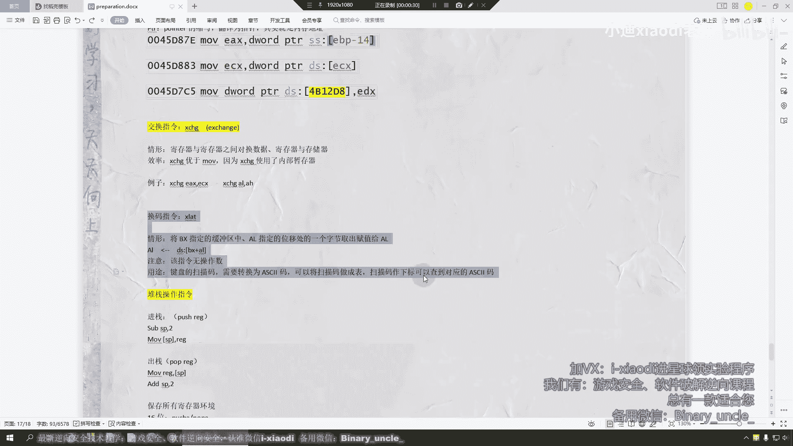

在本节课中，我们将学习第21课“汇编指令专题讲解——数据传送指令”的核心内容。课程主要围绕MOV指令和交换指令展开，同时简单了解标志寄存器传送指令的应用，并认识地址传送指令。对于堆栈操作指令，本课只做科普，因为当前阶段还用不到；还有一些比较麻烦的指令，暂时同样用不到。下面从最基础的数据传送开始。

## 📦 小白软件破解逆向工程师2023最新：4.21.1：课程范围与MOV指令基础

本课先从数据传送里最常见的MOV指令说起。MOV指令在之前的课程中已经遇到很多次，它是最简单的数据传送方式，基本形式就是把后面的数据给前面的位置，例如 `MOV EAX, ...` 这种写法。之前我们已经讲过MOV，也讲过与ES相关的寻址方式，讲过蓝色中括号表示内存访问，还讲过SS段标记。还没有展开讲的是 `DWORD PTR` 这一类标记，本节先把它补上。理解这些标记以后，再看调试器里的汇编代码就不容易迷糊。

`DWORD PTR` 实际上也是标记，它标记的是传送数据的长度，也就是告诉CPU这个数据有多长。在调试器里，可以看到以十六进制显示的小方格，一个小方格按一个字节理解，两个小方格是两个字节，四个小方格是四个字节。`BYTE` 表示一个字节，`WORD` 表示双字节，也就是两个字节，`DWORD` 是 `double word` 的缩写，`double` 是双倍的意思，双倍的双字节就是四个字节。换句话说，`BYTE` 是一个字节，`WORD` 是两个字节，`DWORD` 是四个字节。

一般内存地址有多长，也可以从调试器里的长度看出来。32位程序的内存地址都是四个字节，即使第一个字节是 `00`，也要按四个字节看；即使地址变大到 `7`，也不能用三个字节表示，只能保持四个字节。只要程序能够在x32dbg这类32位调试器里调试，它全部都是32位程序，地址全部都是四个字节。这一点在分析32位程序时要记牢。

`PTR` 是 `pointer` 的缩写，翻译过来就是指针。什么是指针，指针其实就是内存地址。谭浩强那本C语言书里就讲过指针，如果懂编程，理解起来会很自然；如果不懂编程，把指针直接理解为内存地址就可以。指针不是穿针引线的那个针，它表示的是内存地址。理解这一点以后，再看带 `PTR` 的代码就清楚了。

下面列出MOV指令在本课需要掌握的几个点，便于把数据长度和地址标记串起来。

- MOV指令负责把后面的数据传送到前面的位置，是最基础的数据传送指令。
- `BYTE` 标记一个字节，`WORD` 标记两个字节，`DWORD` 标记四个字节。
- 32位程序里的内存地址都是四个字节，调试时不要只看开头是否为 `00`。
- `PTR` 是指针缩写，可以理解为内存地址标记，表示从某个内存地址取数据。
- 在x32dbg里能够调试的程序，都是32位程序。

例如原文中提到的 `EBP - 14`，由于它是栈里的数据，而EBP和ESP比较特殊，它们都使用SS段标识。又因为这里是从一个内存地址里取数据，所以需要带上 `PTR` 标识。整理成代码可以写成：

```asm
MOV EAX, DWORD PTR SS:[EBP-14]
```

这段代码表示从 `SS:[EBP-14]` 这个内存地址取出数据，再给EAX。这里的数据长度是 `DWORD`，也就是四个字节，`PTR` 则体现了指针和内存地址的含义。这样MOV指令的基本用法、数据长度标记和PTR标记就完整了。上一节我们说明了MOV和数据长度，本节继续看交换指令。

## 🔄 小白软件破解逆向工程师2023最新：4.21.2：交换指令XCHG与XLAT

交换数据当然也可以用MOV来实现。例如先写 `MOV EAX, 1`，再写 `MOV ECX, 2`，现在要让EAX和ECX里的数据交换，就需要借助临时寄存器。可以先 `MOV EDX, EAX`，把EAX放到EDX里，再把ECX给EAX，最后把EDX给ECX。这样虽然能完成交换，但需要多写很多代码。两个寄存器交换一次数据就要绕一圈，代码显得很啰嗦。为了减少这种情况，CPU提供了一条专门的交换指令。

交换指令是 `XCHG`，它实际上就是英文单词 `exchange` 的缩写。它可以在寄存器与寄存器之间交换数据，也可以在寄存器与存储器之间交换数据，也就是寄存器与内存地址交换数据。它有一个好处，效率比MOV高，因为它使用了内部暂存器。内部暂存器不用深入理解，只需要知道它是底层实现的一部分。底层实现的东西往往效率更高，例如汇编语言的执行效率比C语言高，而Python的执行效率又比C语言、汇编语言这些更底层的语言慢。越底层，效率通常越快。

例如要把EAX和ECX里的数据交换，不要再用以前那种借助临时寄存器的老代码，直接用 `XCHG` 做交换即可。想让AL和AH交换，同样用 `XCHG` 就可以。类似地，还有一个 `XLAT` 指令，这是一个老指令。在早期计算机操作系统、老汇编、单片机、DOS操作系统等环境里，键盘输入需要进行各种转换，那时会用到这类指令。现在只需简单了解。

`XLAT` 的含义是：把BX指定的缓冲区中、由AL指定的位移处的一个字节取出来，赋值给AL。用公式表示就是：

```text
AL = 字节内存[BX + AL]
```

实际效果就是把 `BX + AL` 这个地址里的数据取出来给AL。这个指令没有操作数，因此比较特殊，它的含义就是直接完成上述动作。当前阶段已经用不到它，了解即可。

下面列出交换指令和XLAT在本课中的几个要点，方便快速回顾。

- `XCHG` 用于寄存器与寄存器、寄存器与存储器之间交换数据。
- `XCHG` 的效率比MOV高，因为它使用内部暂存器，属于底层实现。
- 越底层的语言或实现，执行效率通常越高，例如汇编高于C，C高于Python。
- `XLAT` 是老指令，常见于早期操作系统、单片机、键盘转换等场景。
- `XLAT` 没有操作数，作用是把 `[BX + AL]` 处的一个字节给AL。

交换指令理解以后，下一节我们看看堆栈操作指令。堆栈操作在当前阶段只做科普，后期保存寄存器环境时会用到。

## 🧱 小白软件破解逆向工程师2023最新：4.21.3：堆栈操作指令与PUSHAD、POPAD

堆栈操作指令现在暂时不用，但需要先了解，因为它比较重要。后期可能会用到它来保存寄存器环境，它的应用场景之一就是过检测，也就是过环境上下文检测。修改别人的程序时，在修改反汇编代码的过程中，可能会破坏寄存器。比如临时用EAX去传一个数据，但改完之后，内存里的修改是永久的，想还原寄存器环境就需要借助堆栈操作。`PUSHAD` 和 `POPAD` 就是这样的指令。32位程序里常用 `PUSHAD` 和 `POPAD`，它们可以把寄存器环境压入堆栈，再弹出来还原。

在调试器里执行 `PUSHAD` 后，可以看到EAX、ECX、EBX、EBP等寄存器里的值被压入右下角的堆栈窗口。例如会看到类似 `19FFCC`、`45D795`、`D795`、`19FF70` 这样的数值出现在堆栈窗口里。堆栈窗口显示的是临时数据的存取情况，可以存入，也可以取出。`POPAD` 则把堆栈里的值弹出来。演示时可以把某个值手动改成 `286`，再执行 `POPAD`，对应寄存器就会变成 `286`，堆栈窗口看起来也干净了。

但这里要注意，堆栈窗口看起来干净了，不代表这些数据在内存里完全不存在。数据只是被丢出去了，临时数据仍可能以残余形式留在里面。如果做了一些需要隐蔽的操作，比如游戏外挂相关的操作，堆栈里的残余数据不清理干净，仍然可能被检测。这个点在本课只需简单科普，先建立印象。

下面列出堆栈操作在本课需要了解的要点，便于理解它为什么后期重要。

- `PUSHAD` 把32位通用寄存器的值压入堆栈，用于保存寄存器环境。
- `POPAD` 把堆栈里保存的值弹回寄存器，用于还原寄存器环境。
- 堆栈窗口显示临时数据的存取情况，既可以存入，也可以取出。
- 弹出后堆栈窗口变干净，不代表内存里没有残余数据。
- 残余数据可能被检测，游戏外挂等场景要特别注意清理。

> 堆栈窗口显示的是临时数据的存取情况，可以存入，也可以取出。

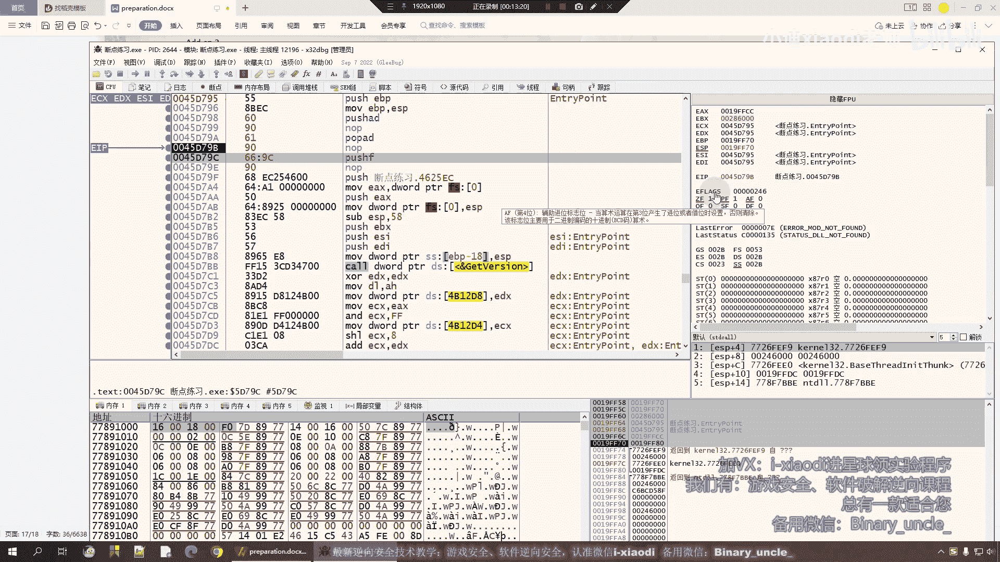

理解堆栈窗口和寄存器环境以后，下一节我们看标志寄存器传送指令，重点了解 `LAHF`、`SAHF`、`PUSHF` 和 `POPF`。

## 🚩 小白软件破解逆向工程师2023最新：4.21.4：标志寄存器传送与PUSHF、POPF

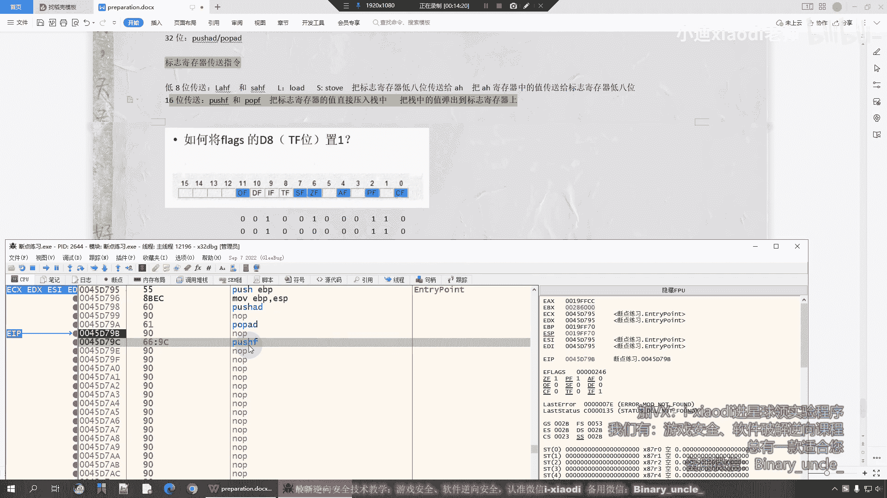

标志寄存器传送指令里，有低8位传送和16位传送。之前讲过标志寄存器是一个16位的寄存器。低8位传送涉及 `LAHF` 和 `SAHF`。`LAHF` 是把标志寄存器的低8位传给AH，`SAHF` 是把AH里的值再还给标志寄存器的低8位。所谓低8位，就是0到7位这一部分。除了低8位传送，还有16位传送，涉及 `PUSHF` 和 `POPF`。`PUSHF` 和 `PUSHAD` 类似，它把标志寄存器的值直接压入栈里；`POPF` 则把栈里的值全部弹出来，恢复标志寄存器。

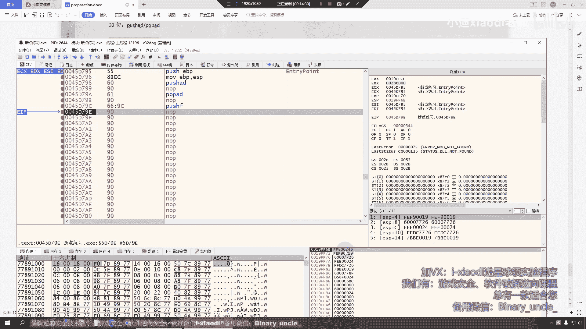

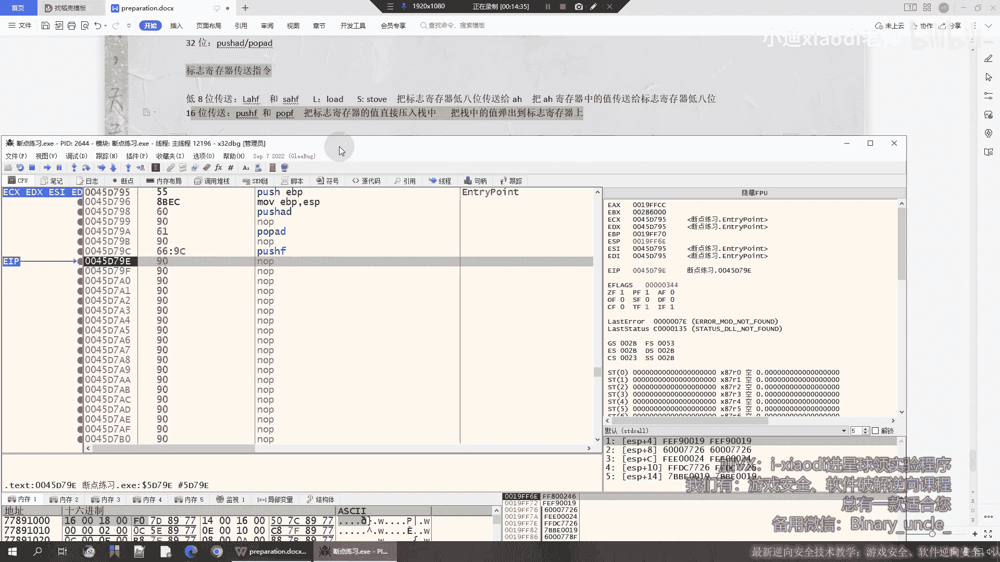

`PUSHF` 和 `POPF` 的用途之一，是修改标志位。例如在调试器里写一个 `PUSHF`，它会把OF、DF、IF、TF、SF、ZF、AF、PF、CF等标志位压进去，但压入时不是按每个标志位单独摆放，而是把这些标志位组成二进制值，再以十六进制形式压入堆栈。演示中得到的值是 `0246`。因为标志寄存器是16位，而当前地址是32位，所以只看后边这部分16位，`0246` 就是压入堆栈窗口的结果。

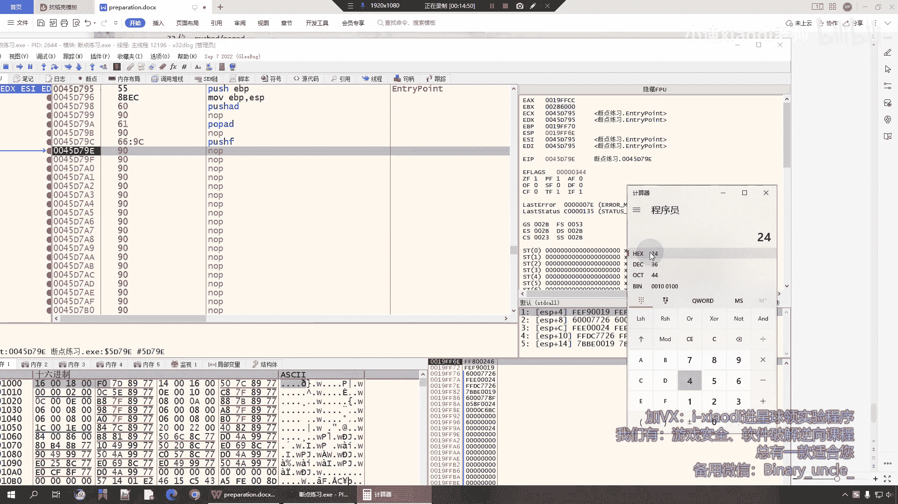

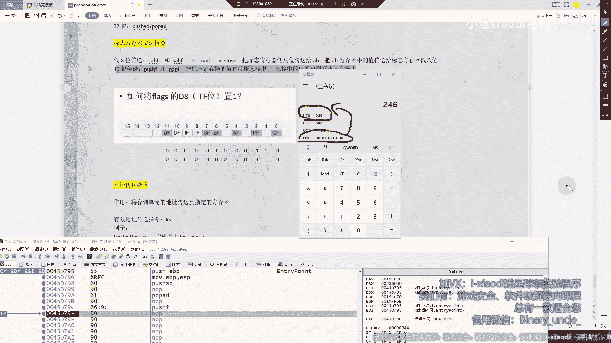

下面列出标志寄存器传送在本课需要掌握的几个点，方便把低8位和16位传送区分开。

- `LAHF` 把标志寄存器低8位传给AH。
- `SAHF` 把AH里的值还给标志寄存器低8位。
- `PUSHF` 把标志寄存器的值压入堆栈。
- `POPF` 把堆栈里的值弹出，恢复标志寄存器。
- 通过 `PUSHF` 压栈、修改栈中值、再 `POPF`，可以更改标志位。

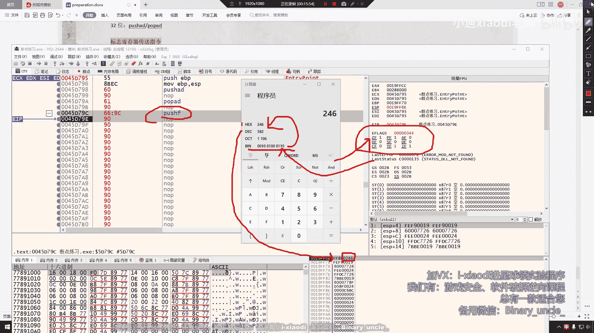

例如演示时，标志位可以记录为OF=0、DF=0、IF=1、TF=0、SF=0、ZF=1、AF=0、PF=1、CF=0，空着的位置默认是1，最终压入堆栈的值是 `0246`。堆栈窗口第一行、也就是发黑的位置，永远是ESP。想修改标志位，可以从ESP指向的位置入手。比如要把ZF从1改成0，计算后可以把后16位改成 `0206`。此时不能只写 `MOV [ESP], 0206`，因为指令没有指定长度，会提示指令编码错误。正确写法需要带上 `WORD`：

```asm
MOV WORD PTR SS:[ESP], 0206
```

这里用 `WORD`，是因为要修改的是后边两个字节的部分。执行这条指令后，再执行 `POPF`，ZF就会变成0。通过这种方式，可以更改标志位。这个方法在今后的游戏逆向分析或软件破解中比较常用。

`LAHF` 也可以单独演示。执行 `LAHF` 后，值会给到AH，而不是走堆栈。例如看到 `06CC` 给到AH，AH位于倒数第二个字节位置，因为右边是低、左边是高，`06` 就对应到相应位置。如果想修改，也可以直接改AH，再通过 `SAHF` 还回去。比如把ZF改回1，计算出的值可以是 `46`，于是直接给AH写入 `46`，再执行 `SAHF`，ZF就会变回1。低8位传送可以自己动手试一下，本课不展开全部细节。

下面再列出一组修改标志位的操作思路，便于把流程记住。

- 先用 `PUSHF` 把标志寄存器压入堆栈。
- 再用带 `WORD` 的MOV修改ESP指向的栈顶内容。
- 最后用 `POPF` 弹出，标志位就按修改后的值恢复。
- `LAHF` 和 `SAHF` 也可以配合AH直接修改低8位标志。

标志寄存器传送理解以后，下一节我们看地址传送指令，重点是 `LEA`，同时简单了解 `LDS` 和 `LES`。

## 📍 小白软件破解逆向工程师2023最新：4.21.5：地址传送指令LEA、LDS、LES

地址传送指令的作用，是把存储单元的地址传送到指令的寄存器里。这里重点讲 `LEA`，因为后面两个指令用得比较少，基本很少见到。`LEA` 的典型例子是 `LEA BX, [BX+SI]`。其中BX是基址，SI相当于偏移，或者说是可以变化的部分，两者加起来仍然是一个内存地址。这个写法看起来和MOV很像，但含义不同。MOV会先取出地址里的数据，而LEA不取数据，它直接把 `BX+SI` 这个地址给BX。用公式表示就是：

```text
LEA BX, [BX + SI]  =>  BX = BX + SI 这个地址
```

在调试器里演示 `LEA EAX, [EBP-5C]` 时，可以右键选择在栈中转到，再双击减 `5C` 的位置往上看。`EBP-5C` 是一个地址，里面存放着 `45D795`。执行 `LEA EAX, [EBP-5C]` 后，EAX得到的是 `19FF14` 这个地址，而不是地址里的 `45D795`。所以LEA给的是地址，不是值。MOV给的是后边地址中的值，这是两者的关键区别。

`LDS` 和 `LES` 简单了解即可。例如 `LDS` 会把连续两个地址中的内容作为地址，分别传给SI寄存器和DS段寄存器；`LES` 则把连续两个地址中的内容分别传给DI寄存器和ES段寄存器。原文中举的例子是，把 `1000` 这个地址相关内容给SI，同时把下一个连续地址的内容给DS。段寄存器目前还用不到，所以这两个指令很难见到，先知道它们的作用方向即可。

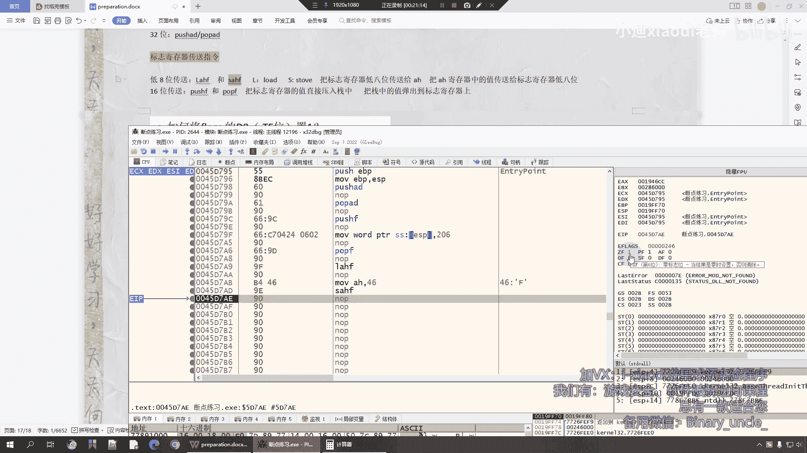

下面列出地址传送指令在本课需要认识的几个点，方便和MOV做区分。

- `LEA` 把存储单元的地址传送到寄存器，不取地址里的数据。
- `MOV` 取的是后边地址中的值，`LEA` 给的是地址本身。
- `LEA BX, [BX+SI]` 中BX是基址，SI是偏移，两者相加是内存地址。
- `LDS` 把连续两个地址的内容分别传给SI和DS。
- `LES` 把连续两个地址的内容分别传给DI和ES。
- 段寄存器目前用不到，所以 `LDS` 和 `LES` 很少见到。

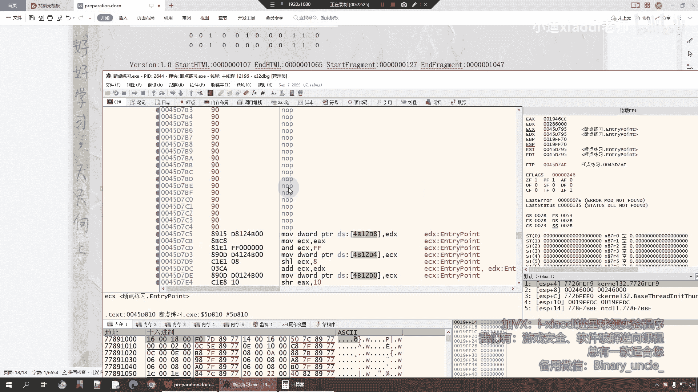

到这里，数据传送相关的主要指令已经串起来了。最后布置作业，并用总结收束本课。

## 📝 小白软件破解逆向工程师2023最新：4.21.6：作业与课程总结

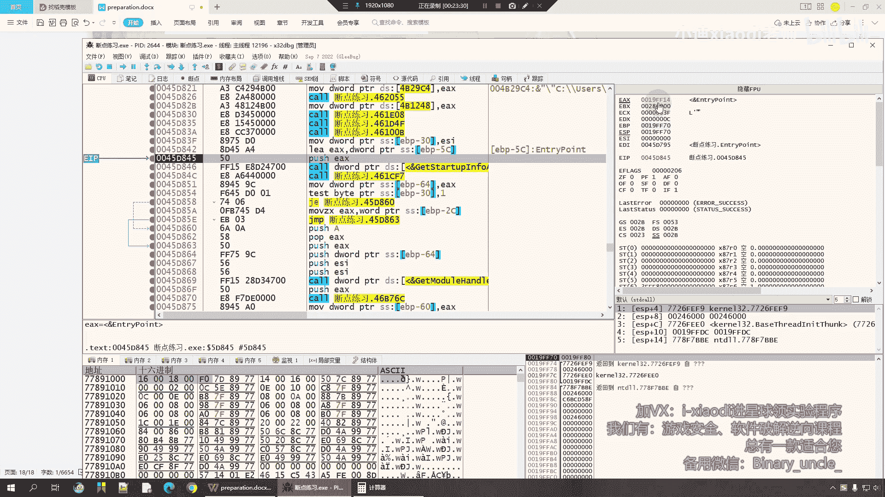

本课作业是用两种更改标志寄存器的方式，修改TF标志的值。第一种方式可以借助 `PUSHF` 把标志寄存器压栈，再修改栈顶内容，最后用 `POPF` 弹出；第二种方式可以借助 `LAHF` 和 `SAHF`，通过AH修改低8位标志，再还回标志寄存器。做完作业以后，可以在群里讨论，方便对照操作过程。

下面列出本课作业和回顾要点，便于课后练习。

- 作业要求：用两种方式更改TF标志的值。
- 方式一：`PUSHF` 压栈，修改栈顶，`POPF` 弹出。
- 方式二：`LAHF` 取低8位到AH，修改AH，`SAHF` 还回。
- 完成作业后可以在群里讨论操作过程和结果。

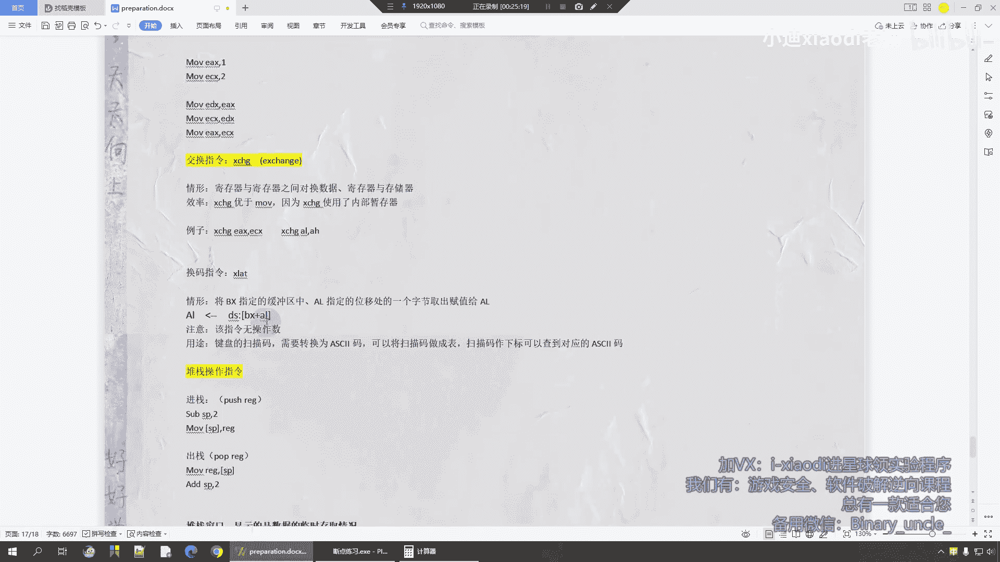

本节课中我们一起学习了数据传送指令专题的主要内容，包括MOV指令与 `BYTE`、`WORD`、`DWORD`、`PTR` 等标记，交换指令 `XCHG`，老指令 `XLAT`，堆栈操作 `PUSHAD` 和 `POPAD`，标志寄存器传送 `LAHF`、`SAHF`、`PUSHF`、`POPF`，以及地址传送指令 `LEA`、`LDS`、`LES`。同时了解了32位程序内存地址为四个字节、堆栈窗口显示临时数据、标志位可以通过压栈修改后再恢复等关键点。本节结束，下期再见。
