# 🧑‍💻 小白软件破解逆向工程师2023最新：4.22：汇编指令专题讲解——算术运算指令

## 📚 课程概述

本节课是汇编语言算术运算指令专题的第二十二节，主要学习汇编语言中的加法、减法、乘法、除法、求补和比较指令。

算术运算指令本质上就是对数据进行数学运算，例如加法、减法、乘法和除法。虽然这些指令看起来比较基础，但它们在程序逆向、破解分析和调试过程中非常常见，因此需要掌握每条指令的运算规则、结果保存位置以及对标志位的影响。

上一节内容介绍了基础的汇编知识，本节我们重点学习算术运算指令的具体使用方法。


## ➕ 一、加法指令 ADD

汇编语言中的加法指令主要包括以下三种：

以下是本节需要掌握的加法指令：

- `ADD`：普通加法指令。
- `ADC`：带进位加法指令。
- `INC`：自增指令，每次加一。

这些指令虽然都与加法有关，但它们是否使用进位标志位，以及是否影响进位标志位，存在一定区别。


### 1. ADD 指令的基本规则

`ADD` 指令的基本格式如下：

```asm
ADD 目标操作数, 源操作数
```

它的计算规则是：

```text
目标操作数 = 目标操作数 + 源操作数
```

也可以写成：

```text
左边的数 = 左边的数 + 右边的数
```

例如：

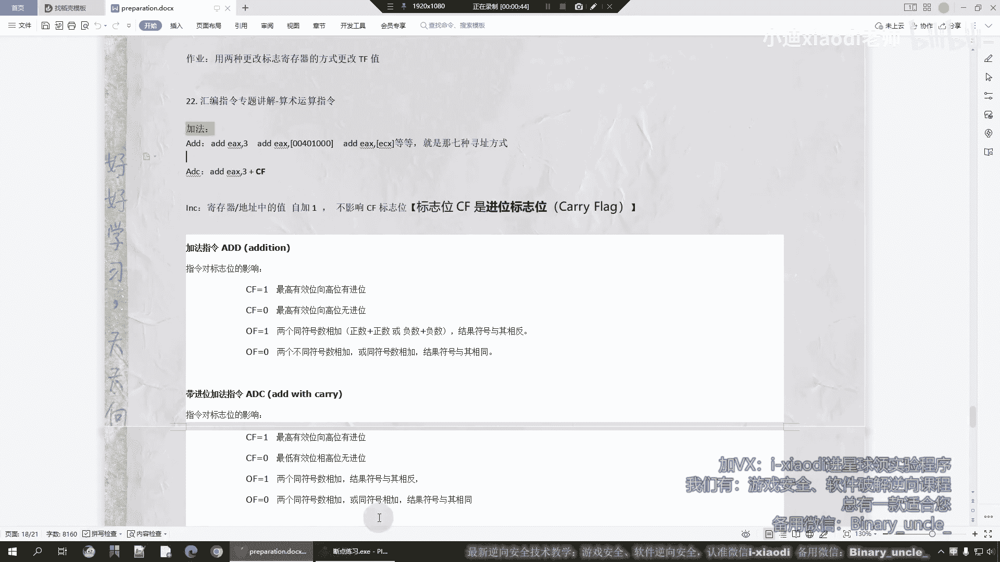

```asm
ADD EAX, EBX
```

这条指令表示：

```text
EAX = EAX + EBX
```

需要注意的是，运算结果会保存到逗号左边的操作数中，而不是保存到右边的操作数中。


### 2. ADD 指令示例

下面通过一个简单示例观察 `ADD` 指令的执行过程：

```asm
MOV EAX, 1
MOV EBX, 2
ADD EAX, EBX
```

执行过程如下：

```text
EAX = 1
EBX = 2

EAX = EAX + EBX
EAX = 1 + 2
EAX = 3
```

因此，执行完成后：

```text
EAX = 3
EBX = 2
```

可以看到，最终结果保存在 `EAX` 中，也就是逗号左边的寄存器中。汇编指令的操作数顺序非常重要，分析代码时不能把左右操作数的位置弄反。


### 3. ADD 的寻址方式

`ADD` 指令可以使用多种操作数形式，并遵循汇编语言中的寻址方式规则。

无论使用哪一种寻址方式，基本运算逻辑都没有改变：

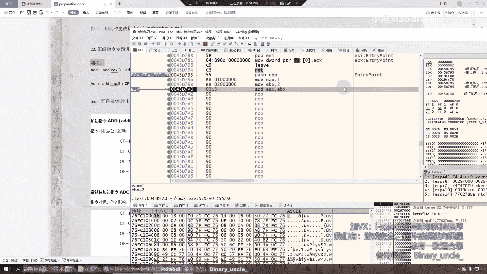

```text
左操作数 = 左操作数 + 右操作数
```

操作数可以是寄存器、立即数或内存数据，但具体能否使用某种形式，要根据指令的编码规则和处理器支持情况决定。


## 🔁 二、带进位加法指令 ADC

了解普通加法之后，接下来学习带进位加法指令 `ADC`。

`ADC` 的含义是 Add with Carry，也就是“带进位加法”。它不仅会计算两个操作数的和，还会额外加上进位标志位 `CF`。

### 1. ADC 的计算规则

`ADC` 指令的基本格式如下：

```asm
ADC 目标操作数, 源操作数
```

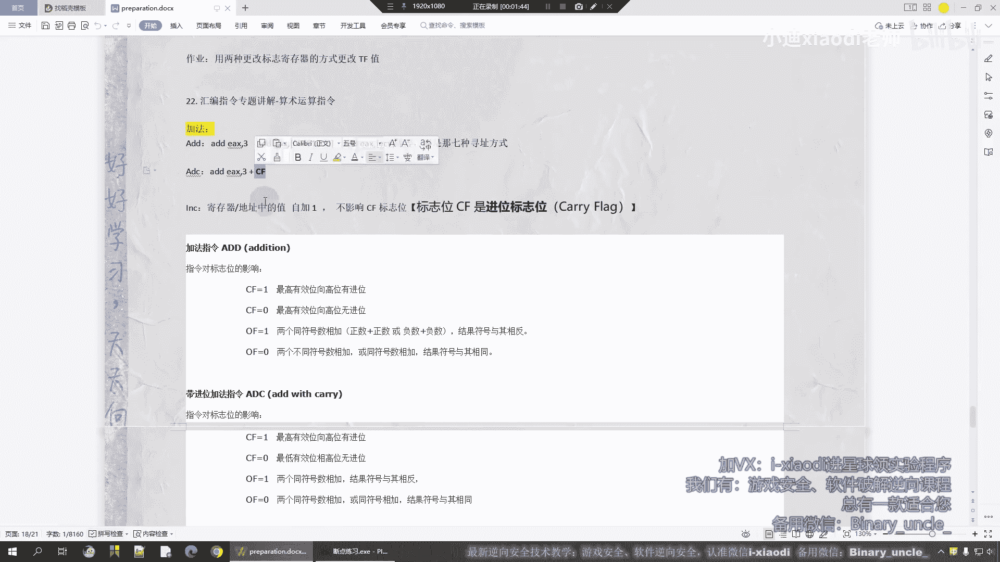

它的计算公式是：

```text
目标操作数 = 目标操作数 + 源操作数 + CF
```

其中：

- `CF = 0` 时，相当于普通加法。
- `CF = 1` 时，结果会额外加一。

例如：

```asm
ADC EAX, EBX
```

它执行的运算是：

```text
EAX = EAX + EBX + CF
```


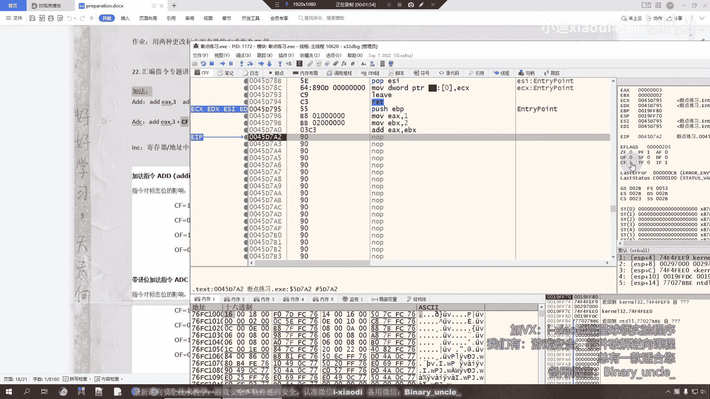

### 2. ADC 指令示例

假设当前寄存器状态如下：

```text
EAX = 3
EBX = 1
CF = 1
```

执行：

```asm
ADC EAX, EBX
```

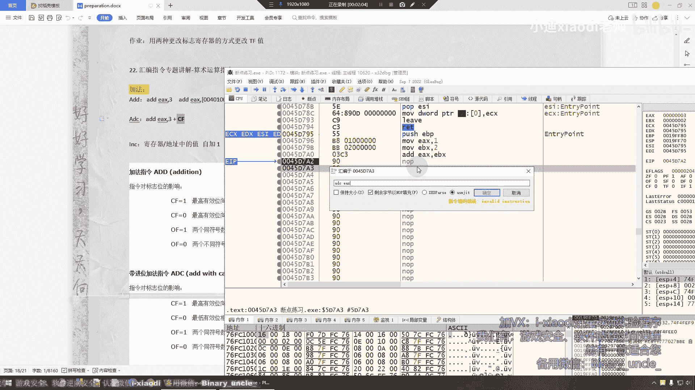

计算过程为：

```text
EAX = 3 + 1 + 1
EAX = 5
```

因此，执行后：

```text
EAX = 5
```

如果此时 `CF = 0`，那么计算结果就是：

```text
EAX = 3 + 1 + 0
EAX = 4
```

所以，`ADC` 和 `ADD` 的主要区别是：`ADC` 会额外加上 `CF` 标志位。


## 1️⃣ 三、自增指令 INC

接下来学习 `INC` 指令。`INC` 的含义是 Increment，即“自增”。

它的计算规则非常简单：

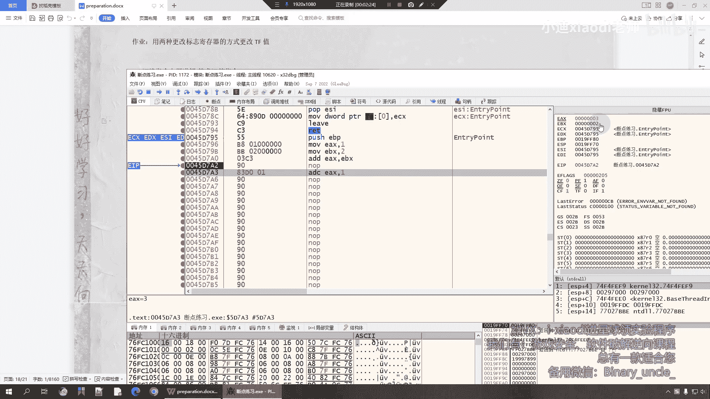

```text
目标操作数 = 目标操作数 + 1
```

使用示例如下：

```asm
INC EAX
```

如果执行前：

```text
EAX = 5
```

执行后：

```text
EAX = 6
```

`INC` 指令相当于给操作数加一，但它不会影响进位标志位 `CF`。

```asm
INC EAX
```

可以理解为：

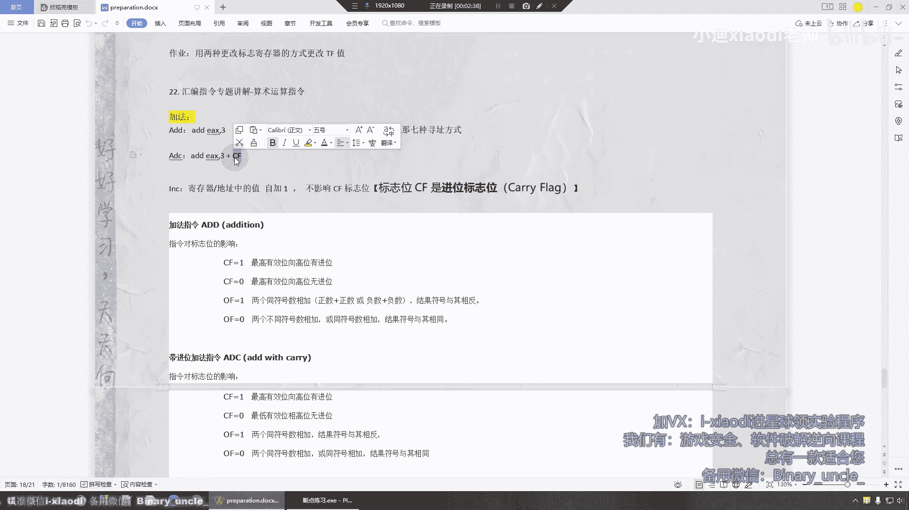

```text
EAX = EAX + 1
```

但执行完成后，`CF` 保持原来的状态不变。


## 🚩 四、进位标志位 CF 与溢出标志位 OF

在学习加法和自增指令时，需要理解标志位的作用。标志位可以看作处理器根据运算结果自动设置的一组状态信息，后续的条件跳转指令会根据这些状态决定程序走向。

以下是本节涉及的主要标志位：

- `CF`：Carry Flag，进位标志位。
- `OF`：Overflow Flag，溢出标志位。
- `ZF`：Zero Flag，零标志位。
- `SF`：Sign Flag，符号标志位。
- `AF`：辅助进位标志位。
- `PF`：奇偶标志位。


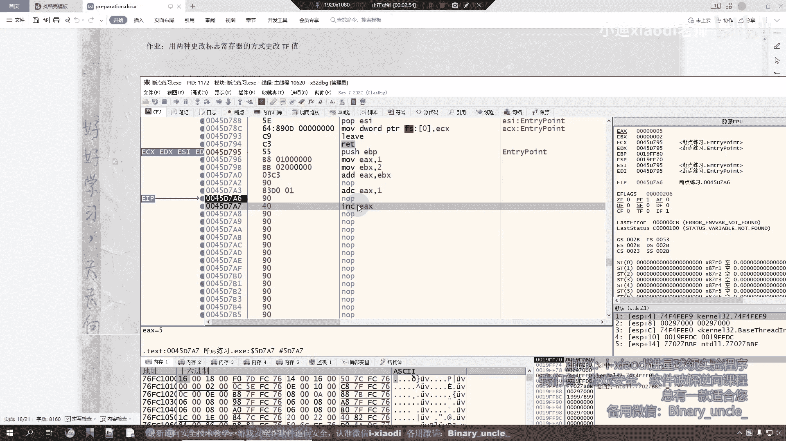

### 1. 什么是进位

当两个数进行运算后，结果超出了当前位数能够表示的范围，就可能产生进位。

例如，使用十进制的一位数表示时：

```text
1 + 9 = 10
```

原本只能表示一位数字，结果变成了两位数字，多出来的这一位就可以理解为进位。

在处理器中，如果无符号加法产生了最高位之外的进位，通常会将 `CF` 设置为一：

```text
有进位：CF = 1
没有进位：CF = 0
```


### 2. 什么是溢出

溢出表示运算结果超出了当前数据类型能够表示的范围。

现实中的数字可以持续增大，但计算机中的寄存器容量是固定的。例如，一个寄存器只有固定数量的二进制位，因此它只能保存有限范围内的数据。

当结果太大，超出了寄存器的表示能力时，就会出现溢出。对于有符号数来说，溢出可能表现为正数变成负数，或者负数变成正数。

溢出通常由 `OF` 标志位表示：

```text
发生有符号溢出：OF = 1
没有发生有符号溢出：OF = 0
```

`CF` 主要用于表示无符号运算中的进位或借位，`OF` 主要用于表示有符号运算中的溢出。两者含义不同，分析程序时不能混为一谈。


## ➖ 五、减法指令 SUB

学习完加法后，接下来进入减法指令。

`SUB` 指令的基本格式如下：

```asm
SUB 目标操作数, 源操作数
```

它的计算规则是：

```text
目标操作数 = 目标操作数 - 源操作数
```

例如：

```asm
SUB EAX, 3
```

如果执行前：

```text
EAX = 4
```

执行后：

```text
EAX = 4 - 3
EAX = 1
```

最终结果仍然会保存到逗号左边的操作数中，也就是 `EAX`。


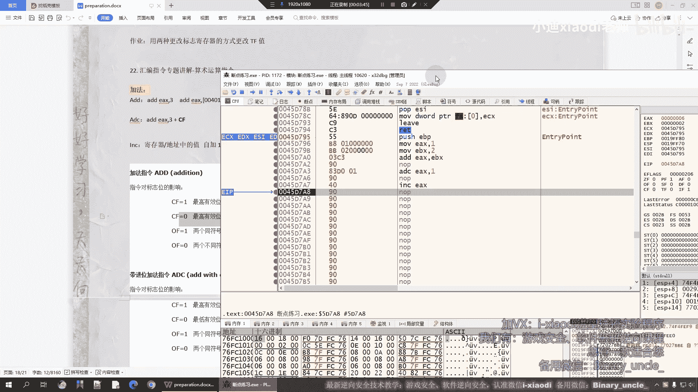

## 🔻 六、带借位减法指令 SBB

`SBB` 的含义是 Subtract with Borrow，即“带借位减法”。

它和 `SUB` 类似，但会额外减去进位标志位 `CF`。虽然名称中使用的是“进位标志位”，但在减法运算中，`CF` 可以表示借位状态。

`SBB` 的计算公式如下：

```text
目标操作数 = 目标操作数 - 源操作数 - CF
```

例如：

```asm
SBB EAX, EBX
```

它执行的计算是：

```text
EAX = EAX - EBX - CF
```

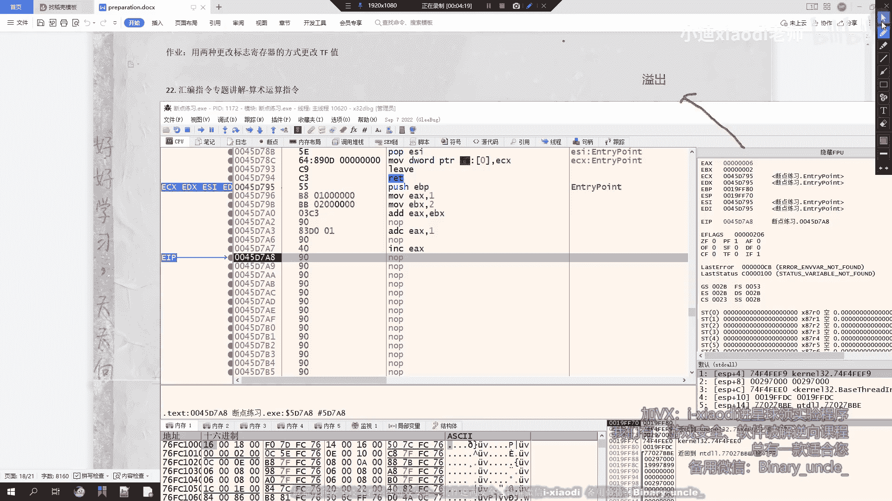

如果：

```text
EAX = 10
EBX = 3
CF = 1
```

那么：

```text
EAX = 10 - 3 - 1
EAX = 6
```

`SBB` 中的字母 `B` 表示 Borrow，意思是“借位”，不是其他含义。


## 1️⃣ 七、自减指令 DEC

`DEC` 的含义是 Decrement，即“自减”。

它的计算规则如下：

```text
目标操作数 = 目标操作数 - 1
```

例如：

```asm
DEC EAX
```

如果执行前：

```text
EAX = 6
```

执行后：

```text
EAX = 5
```

`DEC` 和 `INC` 是相反的操作：

```text
INC：操作数加一
DEC：操作数减一
```

与 `INC` 类似，`DEC` 也不会影响 `CF` 标志位。是否影响某个标志位，是处理器指令设计时规定好的行为，并不是程序员临时决定的。


## 🔄 八、求补指令 NEG

接下来学习求补指令 `NEG`。

`NEG` 的作用是取得操作数的相反数。它的本质是用零减去操作数：

```text
目标操作数 = 0 - 目标操作数
```

因此，`NEG` 可以理解为求一个数的负数。

例如：

```asm
NEG EAX
```

如果：

```text
EAX = 5
```

执行后：

```text
EAX = 0 - 5
EAX = -5
```

如果操作数为零：

```text
操作数 = 0
```

那么：

```text
CF = 0
```

如果操作数不为零：

```text
操作数 ≠ 0
```

那么：

```text
CF = 1
```

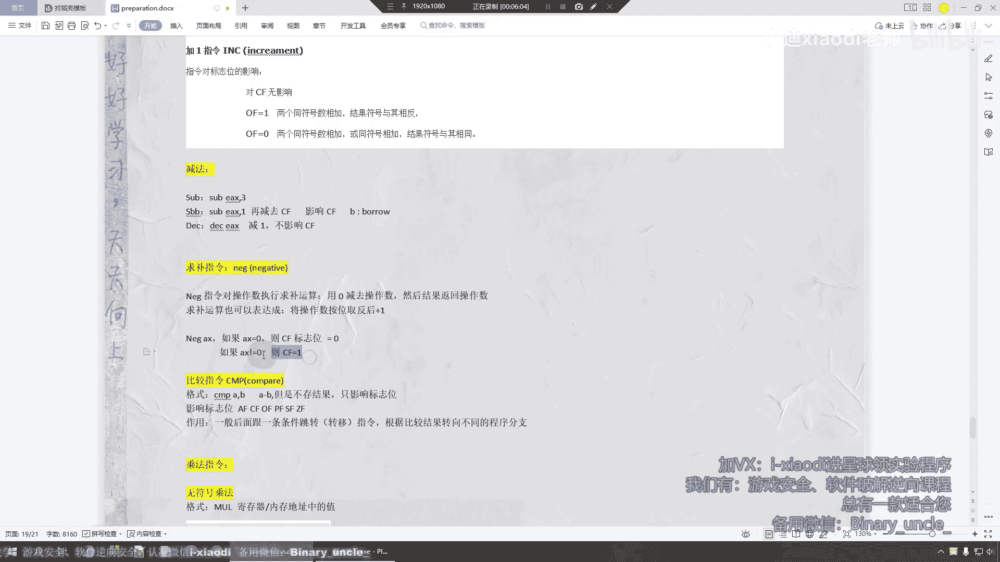

可以整理为以下规则：

```text
NEG 操作数为 0：CF = 0
NEG 操作数不为 0：CF = 1
```


## ⚖️ 九、比较指令 CMP

学习完实际的加减运算后，接下来学习比较指令 `CMP`。

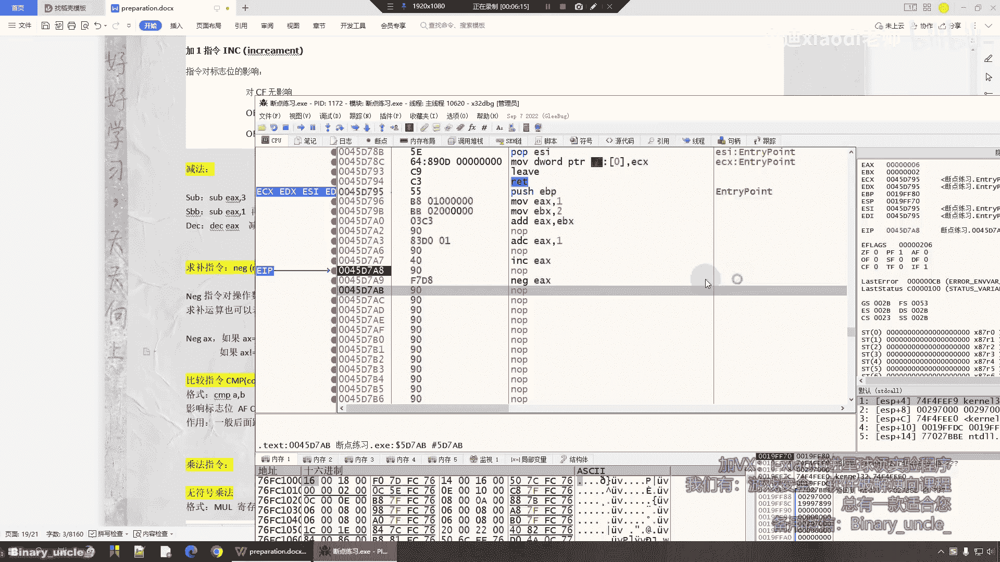

`CMP` 的计算方式与 `SUB` 相似，都是用左边的操作数减去右边的操作数：

```text
CMP A, B
```

等价于执行：

```text
A - B
```

但是，`CMP` 不会保存减法结果，只会根据计算结果修改标志位。

### 1. CMP 与 SUB 的区别

假设：

```asm
MOV EAX, 4
SUB EAX, 3
```

执行后：

```text
EAX = 1
```

因为 `SUB` 会把计算结果保存到 `EAX`。

如果改为：

```asm
MOV EAX, 4
CMP EAX, 3
```

处理器仍然会计算：

```text
4 - 3 = 1
```

但不会把 `1` 保存到 `EAX` 中。`EAX` 仍然保持为 `4`，只有标志位会发生变化。


### 2. CMP 的常见用途

`CMP` 通常会和条件跳转指令配合使用。

以下是常见的代码结构：

```asm
CMP EAX, EBX
JE  target
```

这里的 `CMP` 负责比较两个值，后面的条件跳转指令根据比较结果决定是否跳转。

常见的条件跳转指令包括：

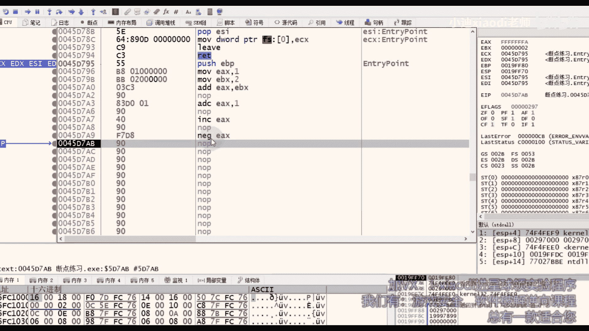

- `JE`：相等时跳转。
- `JNE`：不相等时跳转。
- `JG`：有符号大于时跳转。
- `JL`：有符号小于时跳转。
- `JA`：无符号大于时跳转。
- `JB`：无符号小于时跳转。
- `JZ`：结果为零时跳转。
- `JNZ`：结果不为零时跳转。

`CMP` 会影响多种标志位，包括：

```text
AF、CF、OF、PF、SF、ZF
```

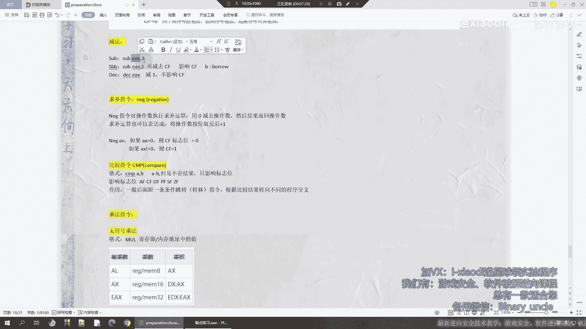

在逆向分析中，经常会看到 `CMP` 指令下面紧接着一条条件跳转指令。分析这种代码时，需要先理解比较结果，再判断条件跳转是否成立。


## ✖️ 十、无符号乘法指令 MUL

接下来学习乘法指令。

`MUL` 表示无符号乘法，也就是不考虑负数的乘法。无符号数通常只表示零和正数，不表示负数。

`MUL` 的一个重要特点是：被乘数通常由处理器预先规定，不能像普通表达式一样随意指定两个操作数。

### 1. 8 位无符号乘法

对于 8 位操作数，处理器会自动使用 `AL` 作为被乘数：

```text
AX = AL × 8位操作数
```

例如：

```asm
MOV AL, 5
MOV BL, 10
MUL BL
```

实际计算过程是：

```text
AX = AL × BL
AX = 5 × 10
AX = 50
```

结果保存在 `AX` 中，而不是只保存在 `BL` 中。因为两个 8 位数相乘后，结果最多需要 16 位来保存。

如果以十六进制表示：

```text
50 = 32H
```

因此，执行后：

```text
AX = 0032H
```


### 2. 16 位无符号乘法

对于 16 位乘法，处理器会自动使用 `AX` 作为被乘数，结果保存在 `DX:AX` 中：

```text
DX:AX = AX × 16位操作数
```

其中：

- `AX` 保存结果的低 16 位。
- `DX` 保存结果的高 16 位。

使用冒号表示组合寄存器：

```text
DX:AX
```

它代表一个 32 位整体。


### 3. 32 位无符号乘法

对于 32 位乘法，处理器会自动使用 `EAX` 作为被乘数，结果保存在 `EDX:EAX` 中：

```text
EDX:EAX = EAX × 32位操作数
```

其中：

- `EAX` 保存结果的低 32 位。
- `EDX` 保存结果的高 32 位。

例如：

```asm
MOV EAX, 64H
MOV EBX, 12CH
MUL EBX
```

处理器实际执行：

```text
EDX:EAX = EAX × EBX
```

乘法结果可能需要 64 位保存，因此会拆分到 `EDX` 和 `EAX` 两个寄存器中。


### 4. MUL 对标志位的影响

`MUL` 主要影响以下两个标志位：

```text
CF
OF
```

如果乘法结果需要使用高半部分寄存器保存，通常表示结果超出了目标操作数的宽度，此时 `CF` 和 `OF` 会被设置。

如果结果完全可以放入低半部分寄存器，则 `CF` 和 `OF` 通常为零。

无符号乘法与有符号乘法的具体规则不同，因此分析乘法代码时，需要先判断使用的是 `MUL` 还是 `IMUL`。


## ✖️ 十一、有符号乘法指令 IMUL

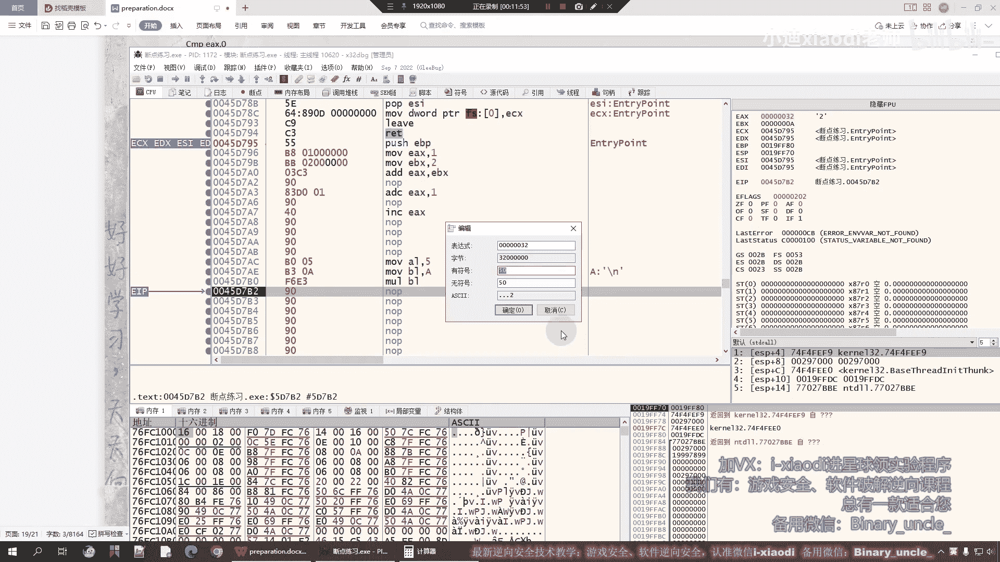

`IMUL` 表示有符号乘法。

它与 `MUL` 的乘法形式基本相似，但会按照有符号数进行运算，因此可以处理正数和负数。

两者的区别如下：

```text
MUL：无符号乘法
IMUL：有符号乘法
```

有符号乘法会按照操作数的符号位解释数据。例如，最高位可能表示负数，而不是普通的数值位。

`IMUL` 的结果也可能使用扩展寄存器保存，并且会影响一些标志位，尤其是：

```text
CF、OF
```

学习阶段只需要先记住两点：

```text
MUL 处理无符号数
IMUL 处理有符号数
```

在后续真正分析有符号数运算时，还需要结合补码和符号扩展进一步理解。


## ➗ 十二、无符号除法指令 DIV

接下来学习除法指令。

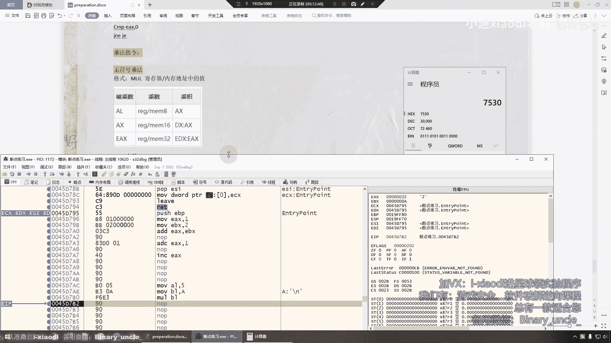

`DIV` 表示无符号除法。除法与乘法类似，也有固定的被除数、商和余数保存位置。

除法包含三个基本概念：

```text
被除数 ÷ 除数 = 商 …… 余数
```

例如：

```text
83 ÷ 2 = 41 …… 1
```

其中：

```text
被除数 = 83
除数 = 2
商 = 41
余数 = 1
```


### 1. 8 位无符号除法

对于 8 位除数，处理器会把 `AX` 作为被除数：

```text
AX ÷ 8位除数
```

执行结果保存位置如下：

```text
AL = 商
AH = 余数
```

示例代码：

```asm
MOV AX, 83
MOV BL, 2
DIV BL
```

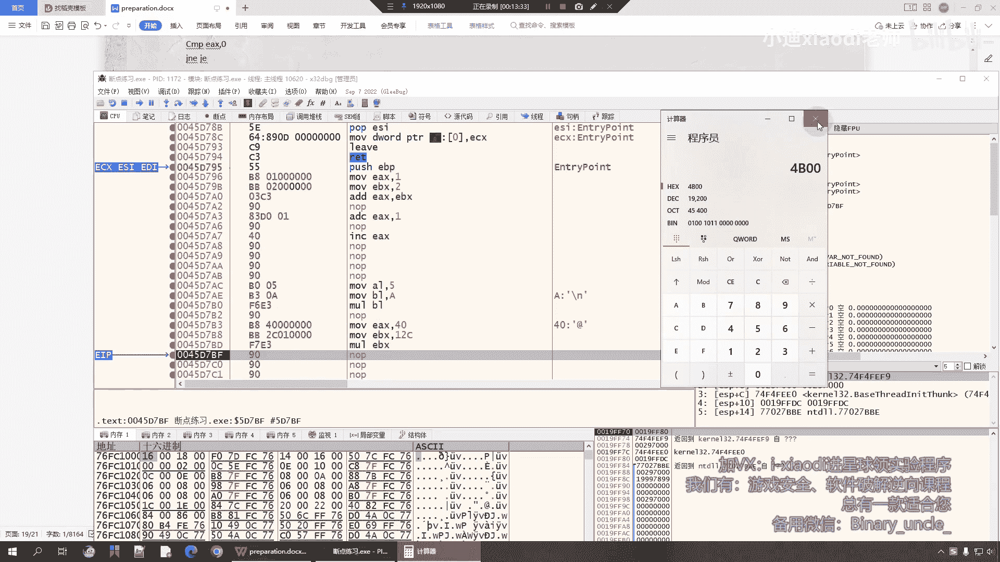

计算过程为：

```text
AX ÷ BL = 83 ÷ 2
```

执行后：

```text
AL = 41
AH = 1
```

商放到 `AL` 中，余数放到 `AH` 中。


### 2. 16 位无符号除法

对于 16 位除数，被除数由 `DX:AX` 共同组成：

```text
DX:AX ÷ 16位除数
```

执行结果如下：

```text
AX = 商
DX = 余数
```


### 3. 32 位无符号除法

对于 32 位除数，被除数由 `EDX:EAX` 共同组成：

```text
EDX:EAX ÷ 32位除数
```

执行结果如下：

```text
EAX = 商
EDX = 余数
```

这里的 `EDX:EAX` 代表一个 64 位被除数。除法指令对寄存器的使用有严格规定，不能随意更换商和余数的保存位置。


### 4. DIV 对标志位的影响

`DIV` 指令执行后，部分标志位的状态没有明确规定，因此不能依赖这些标志位判断除法结果。

也就是说，除法完成后，这些标志位可能是任意状态：

```text
CF、OF、SF、ZF、AF、PF
```

这是处理器指令设计时规定的行为。因此，如果程序需要判断除法结果，通常应直接检查商或余数，而不能依赖除法结束后的标志位。


## ➗ 十三、有符号除法指令 IDIV

`IDIV` 表示有符号除法。

它与 `DIV` 的寄存器使用方式基本相似，但会按照有符号数进行运算：

```text
DIV：无符号除法
IDIV：有符号除法
```

执行有符号除法前，必须先对被除数进行符号扩展，否则计算结果可能不正确。


## 🧩 十四、符号扩展

符号扩展的作用是：在扩大数据位数时，保留原数据的正负符号。

例如，将一个字节扩展成一个字时，需要根据原数据最高位的符号进行扩展，而不是简单地全部补零。

常见的位数转换关系如下：

```text
字节 → 字
字 → 双字
双字 → 更高位数
```

其中：

- 字节通常为 8 位。
- 字通常为 16 位。
- 双字通常为 32 位。


### 1. 字节扩展为字

例如，一个 8 位数据：

```text
00000001
```

扩展为 16 位后，可以表示为：

```text
00000000 00000001
```

如果原数据是正数，通常在高位补零；如果原数据是负数，则在高位补一，以保持原来的符号。


### 2. CBW 指令

`CBW` 表示 Convert Byte to Word，即“字节转换为字”。

它会将 `AL` 中的有符号数据进行符号扩展，并扩展到 `AX` 中：

```text
AL → AX
```

可以理解为：

```asm
CBW
```

执行后，`AL` 中的符号会被扩展到 `AH` 中。


### 3. CWD 指令

`CWD` 表示 Convert Word to Doubleword，即“字转换为双字”。

它会将 `AX` 中的有符号数据进行符号扩展，并扩展到 `DX:AX` 中：

```text
AX → DX:AX
```

例如：

```text
AX = 0001H
```

符号扩展后：

```text
DX:AX = 00000001H
```

这里的 `DX:AX` 一共组成 32 位数据：

```text
DX = 高 16 位
AX = 低 16 位
```


### 4. CDQ 指令

对于 32 位数据，可以使用 `CDQ` 指令进行符号扩展：

```text
EAX → EDX:EAX
```

`CDQ` 会根据 `EAX` 的符号位，将符号扩展到 `EDX` 中。

这些指令通常会在执行 `IDIV` 之前使用：

```asm
CWD
IDIV BX
```

或者：

```asm
CDQ
IDIV ECX
```

因此，看到 `CBW`、`CWD` 或 `CDQ` 时，可以先判断它们是在进行哪一种位数的符号扩展。


## 🧠 十五、算术指令的重点总结

上一节我们分别介绍了加法、减法、乘法、除法和符号扩展。为了方便记忆，下面将主要指令整理如下：

以下是常用算术指令的核心规则：

| 指令 | 含义 | 基本运算 |
|---|---|---|
| `ADD` | 普通加法 | `目标 = 目标 + 源` |
| `ADC` | 带进位加法 | `目标 = 目标 + 源 + CF` |
| `INC` | 自增 | `目标 = 目标 + 1` |
| `SUB` | 普通减法 | `目标 = 目标 - 源` |
| `SBB` | 带借位减法 | `目标 = 目标 - 源 - CF` |
| `DEC` | 自减 | `目标 = 目标 - 1` |
| `NEG` | 求补、取相反数 | `目标 = 0 - 目标` |
| `CMP` | 比较 | 执行减法但不保存结果 |
| `MUL` | 无符号乘法 | 无符号数相乘 |
| `IMUL` | 有符号乘法 | 有符号数相乘 |
| `DIV` | 无符号除法 | 无符号数相除 |
| `IDIV` | 有符号除法 | 有符号数相除 |

还需要特别记住不同位数运算时的寄存器组合：

```text
8位乘法：AL × 操作数 → AX
16位乘法：AX × 操作数 → DX:AX
32位乘法：EAX × 操作数 → EDX:EAX
```

```text
8位除法：AX ÷ 操作数 → AL为商，AH为余数
16位除法：DX:AX ÷ 操作数 → AX为商，DX为余数
32位除法：EDX:EAX ÷ 操作数 → EAX为商，EDX为余数
```

标志位方面，需要重点记忆以下内容：

```text
CF：进位或借位
OF：有符号溢出
ZF：结果是否为零
SF：结果的符号
```

同时需要注意：

```text
INC 和 DEC 不影响 CF
DIV 的标志位状态通常未定义
IDIV 执行前通常需要符号扩展
CMP 只修改标志位，不保存减法结果
```


## ✅ 十六、本节总结

本节课我们一起学习了汇编语言中的算术运算指令，包括 `ADD`、`ADC`、`INC`、`SUB`、`SBB`、`DEC`、`NEG`、`CMP`、`MUL`、`IMUL`、`DIV` 和 `IDIV`。

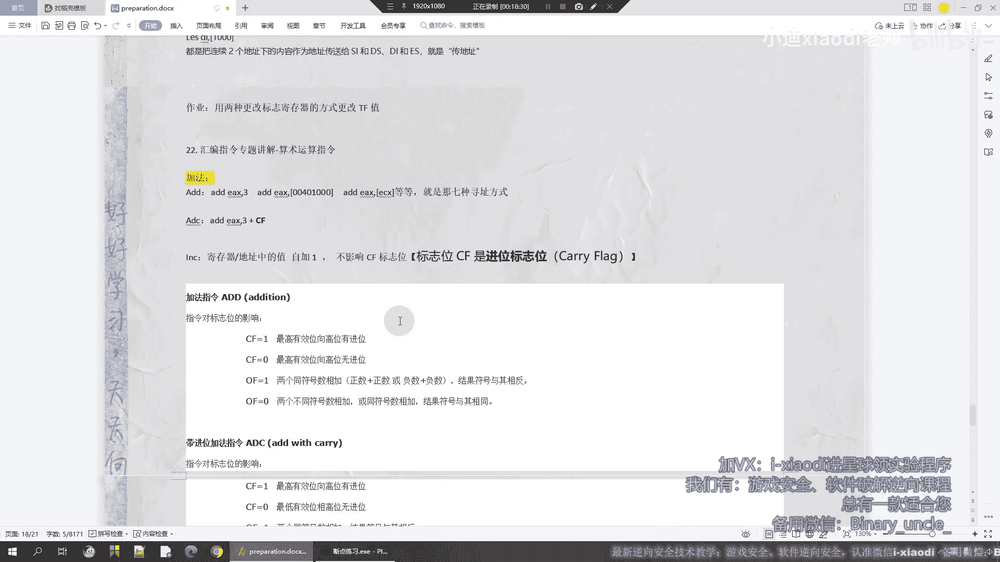

我们了解了普通加法、带进位加法、自增、普通减法、带借位减法和自减的基本规则，也学习了进位标志位 `CF`、溢出标志位 `OF` 以及其他常见标志位的作用。

随后，我们分析了求补指令和比较指令，明确了 `CMP` 虽然会执行减法，但不会保存运算结果，而是通过修改标志位配合条件跳转指令使用。

最后，我们学习了无符号乘法、有符号乘法、无符号除法、有符号除法以及符号扩展。分析这些指令时，必须注意操作数的位数、结果保存位置、寄存器组合和标志位影响。掌握这些内容后，后续在逆向分析中遇到算术运算和条件跳转代码，就可以根据寄存器变化和标志位状态还原程序的真实逻辑。

