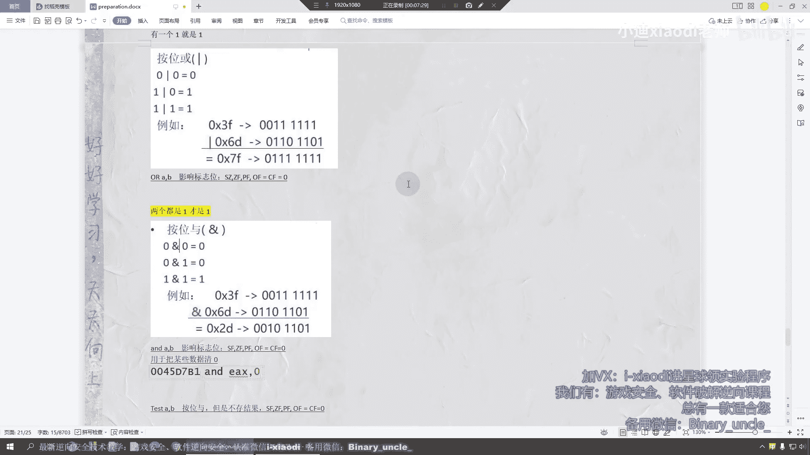

# 🧮 小白软件破解逆向工程师2023最新：4.23：汇编指令专题讲解-逻辑运算指令


在本节课中我们将要学习汇编指令专题中的逻辑运算指令。逻辑运算可以先用大白话理解：它处理的是0和1，也就是要么开、要么关，要么0、要么1。它还有一个名字叫位运算，位指二进制比特位，每一位只能是0或1。本课会围绕按位取反、按位或、按位与、TEST、按位异或以及常见用法展开，最后用计算器辅助理解二进制运算。学习时先记住规则，再看汇编代码和标志位，就能把逻辑运算和后续跳转联系起来。


## 📘 小白软件破解逆向工程师2023最新：4.23.1：逻辑运算与位运算基础


在进入具体指令之前，我们先把逻辑运算和位运算的概念说清楚。逻辑运算就是0和1的运算，二进制里只有两个数，不是0就是1，所以这种运算也叫位运算。位就是二进制比特位，每一位只有0或1两种状态，理解这一点以后再看后面的指令会轻松很多。


以下是位运算加法的基础例子。


```text
0001 + 0000 = 0001
0001 + 0001 = 0010
```


第一个例子中，0001加0000，对应位置相加，结果还是0001。第二个例子中，0001加0001，1和1在二进制里不可能变成2，所以要进位；这就像十进制里1加9等于10要进位一样，只不过这里是二进制。进位后，1加1变成0，前面的1进到更高位，最终得到0010。位运算相关的一个重要内容就是逻辑运算，接下来我们看第一个逻辑运算指令。


## 🔄 小白软件破解逆向工程师2023最新：4.23.2：按位取反指令NOT


上一节我们说明了位运算的基本规则，本节来看看按位取反。按位取反就是把每一位反过来：原来是0就变成1，原来是1就变成0。这个规则很直白，看到二进制数以后逐位翻转即可。


以下是一个按位取反的例子。


```text
NOT 0011 1111 = 1100 0000
```


按位取反对应的汇编代码是`NOT`。`NOT EAX`就是对一个寄存器做取反运算，在调试工具里可以直接写`NOT EAX`观察结果。这个指令不影响标志位，因此它只改变数据本身，不改变后续跳转常用的标志状态。了解NOT以后，下一节我们看按位或指令。


## ➕ 小白软件破解逆向工程师2023最新：4.23.3：按位或指令OR


上一节我们介绍了按位取反，本节来看看按位或。按位或的规则是：两个数中只要有一个1，结果就是1；只有两个都是0，结果才是0。这个规则可以用一句话记住：有一个1就是1。


以下是按位或的四种基本结果。


- `0 OR 0 = 0`
- `1 OR 0 = 1`
- `0 OR 1 = 1`
- `1 OR 1 = 1`


按位或对应的汇编代码是`OR`，例如`OR EAX, EBX`就是把两个数按位做或运算。它影响的标志位包括SF、ZF、PF，同时在这个运算过程中OF和CF都是0。按位或的规则了解以后，下一节我们看按位与指令，它与清零操作关系很密切。


## 🧹 小白软件破解逆向工程师2023最新：4.23.4：按位与指令AND与数据清零


上一节我们介绍了按位或，本节来看看按位与。按位与的规则是：两个都是一，结果才是1；只要出现一个0，结果就是0。这个规则在清零操作里非常有用，因为任何数和0做按位与，结果都会变成0。


以下是按位与的基本规则。


- `1 AND 1 = 1`
- `1 AND 0 = 0`
- `0 AND 1 = 0`
- `0 AND 0 = 0`


按位与对应的汇编代码是`AND`，例如`AND EAX, EBX`。它影响的标志位包括SF、ZF、PF，同时OF和CF在这个运算过程中都是0。按位与的一个实际作用是把某些数据清零：寄存器里有数据时，给它和0做AND运算，因为只要出现0结果就是0，所以数据会被清零。


以下是用AND清零和用MOV清零的对比。


```asm
AND EAX, 0    ; 占3个字节
MOV EAX, 0    ; 占5个字节，操作码B8，后面4个字节是操作数
```


`AND EAX, 0`只占3个字节，用3个字节就能完成清零操作。`MOV EAX, 0`占5个字节，其中后面4个字节是操作数，操作码是B8，长度更长。如果想用更短的代码、更少的内存完成清零，就可以写`AND EAX, 0`。在有检测逻辑的场景中，如果要把EAX清零，也可以写`AND EAX, 0`，按F8单步执行后可以看到EAX变成0。按位取反和按位或在本课暂时不展开实际应用，后续遇到真正应用场景再讲。了解AND的清零作用后，下一节我们看TEST指令。


## 🧪 小白软件破解逆向工程师2023最新：4.23.5：TEST指令与标志位跳转


上一节我们介绍了AND和清零操作，本节来看看TEST。TEST也是按位与运算，只不过它不保存结果：AND会把结果写回寄存器，TEST只做运算并影响标志位，不修改原来的数据。TEST主要和跳转指令结合使用，用来判断寄存器是否为零，或者判断左右两个数是否满足某种相等关系。


以下是TEST常见的判断方式。


- `TEST EDI, EDI`：判断EDI是否为0。两个都是一才是一，有一个0就是0；如果EDI为0，相与结果就是0，如果EDI不为0，相与结果就不是0。
- `TEST EAX, 1`：右边已经有一个1，可以判断左边这个数对应位是不是1，也可以配合跳转判断左右是否相等。
- `TEST EAX, 某数`：如果左边和右边相等，结果可能为1，后面跟一个跳转就可以做判断；如果左边是0，结果就是0，也可以判断左边是否等于右边这个数。


TEST不存结果，但会影响标志位，因此它常出现在条件判断和跳转之前。理解TEST以后，下一节我们看按位异或指令。


## 🔁 小白软件破解逆向工程师2023最新：4.23.6：按位异或指令XOR与寄存器清零


上一节我们介绍了TEST和标志位跳转，本节来看看按位异或。按位异或的规则是：两个都是0时结果是0，一边是0一边是1时结果是1，两个都是1时结果是0。换句话说，相同为0，不相同为1。


以下是按位异或的四种基本结果。


- `0 XOR 0 = 0`
- `1 XOR 0 = 1`
- `0 XOR 1 = 1`
- `1 XOR 1 = 0`


按位异或对应的汇编代码是`XOR`，例如`XOR EAX, EBX`。它影响的标志位包括SF、ZF、PF，同时OF等于0、CF等于0。XOR的一个常见用法是寄存器清零：`XOR ESI, ESI`，不管ESI里面原来是0还是1，只要两个操作数相同，按位异或的结果就是0，所以寄存器会被清零。了解XOR以后，下一节我们把本课常用用法集中总结一下。


## 📌 小白软件破解逆向工程师2023最新：4.23.7：常用逻辑运算用法总结


上一节我们介绍了XOR和寄存器清零，本节把常用逻辑运算的用法集中梳理。学习汇编指令不需要一次记住所有细节，先把最常用的几个场景记牢，后面遇到其他逻辑运算再逐步补充即可。


以下是本课需要记住的几个常用用法。


- 寄存器清零：使用`XOR ESI, ESI`。
- 某些数据清零：使用`AND EAX, 0`。
- 判断寄存器是否为0、判断左右是否相等：使用`TEST EDI, EDI`、`TEST EAX, 1`、`TEST EAX, 某数`。


其他逻辑运算简单了解即可，碰到时不要不知道，它们本质上都是二进制运算。如果二进制搞不懂，可以打开计算器辅助理解，例如输入3F会得到00111111；如果对3F做NOT取反，就会得到11000000。下面用代码形式再看一遍这个例子。


```text
3F      = 0011 1111
NOT 3F  = 1100 0000
```


这些用法看起来简单，但它们在后续调试、判断和跳转中会反复出现。把二进制规则和汇编指令对应起来，就能逐步看懂逻辑运算在程序里的作用。


## 🧾 小白软件破解逆向工程师2023最新：4.23.8：本课总结




本节课中我们一起学习了汇编指令专题中的逻辑运算指令。我们先用大白话理解了逻辑运算和位运算，知道它们处理的是0和1；然后学习了按位取反NOT、按位或OR、按位与AND、TEST和按位异或XOR，并说明了它们对应的汇编代码、标志位影响和常见用途。最后我们总结了寄存器清零用XOR、数据清零用AND、判断寄存器是否为0或左右是否相等用TEST，并演示了用计算器辅助理解二进制取反。掌握这些内容以后，再看后续汇编指令和跳转逻辑会更容易上手。

