# 小白软件破解逆向工程师2023最新：4.24：🧩 汇编指令专题讲解-移位运算指令

在本节课中我们将要学习移位运算指令。今天对应课程的第二十四节课，主要内容是把“移位”这件事讲清楚。这里的“移位”不是移动别的对象，而是移动二进制位，例如二进制`0001`左移一位后变成`0010`，移动的对象就是二进制中的比特位。移位运算指令一共有4类，每类再分左右两个方向，原文用“4乘2”的方式记忆，合计就是8种。接下来会先认识英文缩写，再看逻辑移位、算术移位、循环移位以及标志位之间的关系，目标是先混个脸熟，为后续实际案例分析打基础。

## 小白软件破解逆向工程师2023最新：4.24.1：🔤 移位指令英文缩写速记

上一节我们说明了移位就是移动二进制位，本节中我们来看看这些移位指令名称里的英文缩写分别代表什么。原文强调要逐个拆开每个字母的含义，因为看懂缩写以后，再看到汇编指令就不会觉得是一串陌生符号。下面把常见的字母和单词含义逐项列出来，先建立一个直观印象。

- `S`、`SH`以及原文提到的`SS`：对应`shift`，意思是移动。
- `H`：对应`logic`，表示逻辑移位；逻辑移位就是按照二进制0和1的位置规则去移动。
- `A`：对应`arithmetic`，表示算术移位；算术移位里面带有计算含义，看到`A`就想到算术，看到`H`就想到逻辑。
- `R`：对应`rotate`，表示循环移位；原文用圆圈`O`帮助记忆循环，看到`O`也能联想到循环。
- `C`：对应`carry`，表示带进位；看到`C`就是带进位循环移位，看到`O`就是循环。
- `L`：对应`left`，表示往左移。
- `R`：在方向含义里对应`right`，表示往右移；`R`在`rotate`里表示循环，需要结合上下文区分。

这些缩写并不需要一次死记硬背，先把“移动、逻辑、算术、循环、进位、左、右”这些关键词对应起来即可。掌握这些名称以后，本节接下来看最直观的逻辑移位示例，因为逻辑移位最适合用二进制过程来理解。

## 小白软件破解逆向工程师2023最新：4.24.2：➡️ 逻辑移位与乘除法的关系

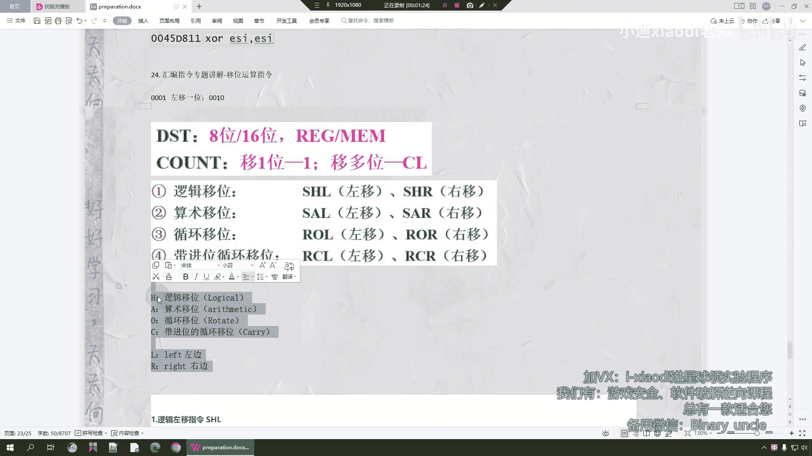

上一节我们介绍了移位指令名称里的英文缩写，本节中我们来看看逻辑移位具体怎么移动。原文用`SHL`举例，`SHL`表示逻辑左移，指令写法可以表示为`SHL ES, 5`，意思就是让`ES`这个数左移5位。理解这条指令时，可以拿计算器辅助验证，也可以直接写出二进制过程，这样更直观。

```asm
SHL ES, 5
```

原文说不用取10，直接取1来演示。数字1的二进制是`00000001`，把它连续左移5位，过程如下。

```text
00000001
左移1位 -> 00000010
左移2位 -> 00000100
左移3位 -> 00001000
左移4位 -> 00010000
左移5位 -> 00100000
```

移动过程中最低位补零，所以原来最低位的位置会变成0。左移5位后得到`00100000`，这个数写成十六进制是`0x20`，写成十进制是`32`。因此可以得到一个很实用的关系：左移5位相当于乘以2的5次方，而2的4次方是16，16再乘以2就是32；右移5位则相当于除以2的5次方。公式可以写成下面这样。

```text
1 << 5 = 0x20 = 32
x << n = x × 2^n
x >> n = x ÷ 2^n
```

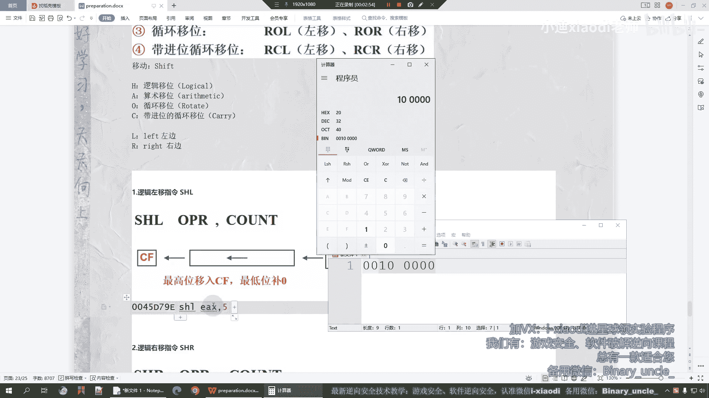

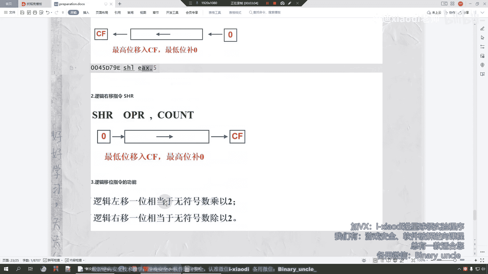

下面把逻辑移位的核心要点归纳出来，方便初学者把“移位”和“乘除法”联系起来。

- 逻辑左移`SHL`按照二进制位向左移动，最低位补0。
- 左移1位相当于乘以2，左移2位相当于乘以2的2次方，左移3位相当于乘以2的3次方。
- 右移1位相当于除以2，右移3位相当于除以2的3次方。
- 看逻辑左移和逻辑右移时，可以直接把它当成乘除法运算来理解。

把逻辑移位看成乘除法以后，很多计算就变得直白。理解了逻辑移位，本节接下来看算术移位，因为算术移位和逻辑移位大体相似，但在右移时有一个关键区别。

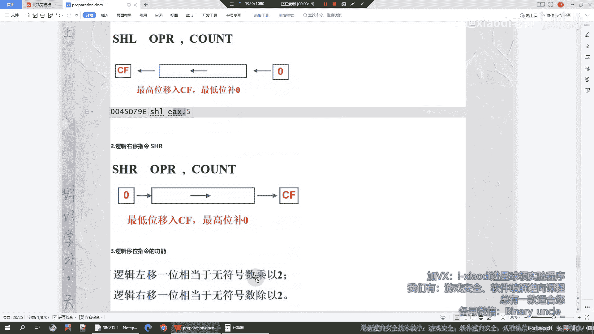

## 小白软件破解逆向工程师2023最新：4.24.3：🧮 算术移位与逻辑移位的区别

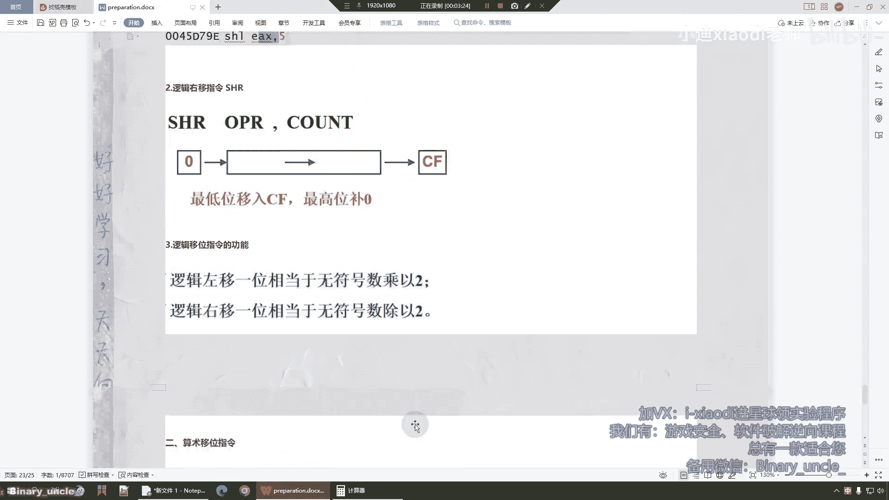

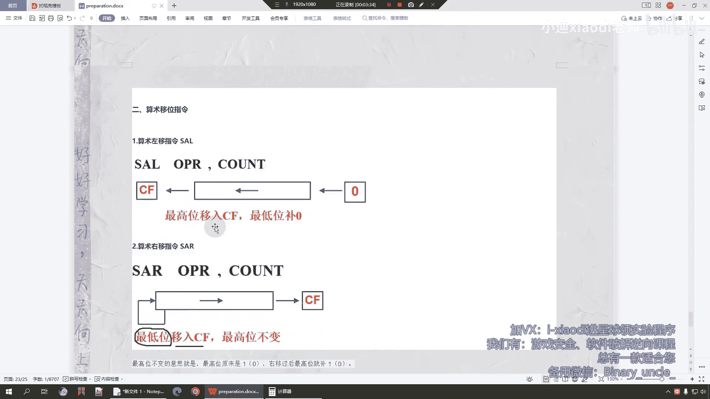

上一节我们把逻辑移位和乘除法联系了起来，本节中我们来看看算术移位。算术移位基本上跟逻辑移位一样，左移同样可以理解为乘以2的几次方，右移同样可以理解为除以2的几次方。原文提醒，算术移位一般不会用到，只需要简单了解，重点知道它和逻辑右移的区别即可。

下面用列表对比逻辑右移和算术右移的差异，先抓住最高位和CF标志位这两个点。

- 逻辑右移：最低位移入CF标志位，最高位补0。
- 算术右移：最低位移入CF标志位，最高位保持不变。
- 算术左移：相当于乘以2的几次方。
- 算术右移：相当于除以2的几次方。
- 算术移位一般不会用到，简单了解即可。

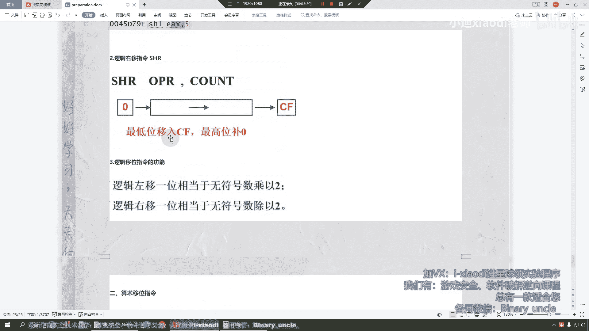

这里的CF可以理解为进位标志位，原文主要用它来说明移出的位去了哪里。算术右移最高位不变这个特点，和逻辑右移最高位补0形成对比，记住这一条就能区分两者。了解算术移位以后，本节接下来看循环移位，因为循环移位的特点是“移出去以后还会转回来”。

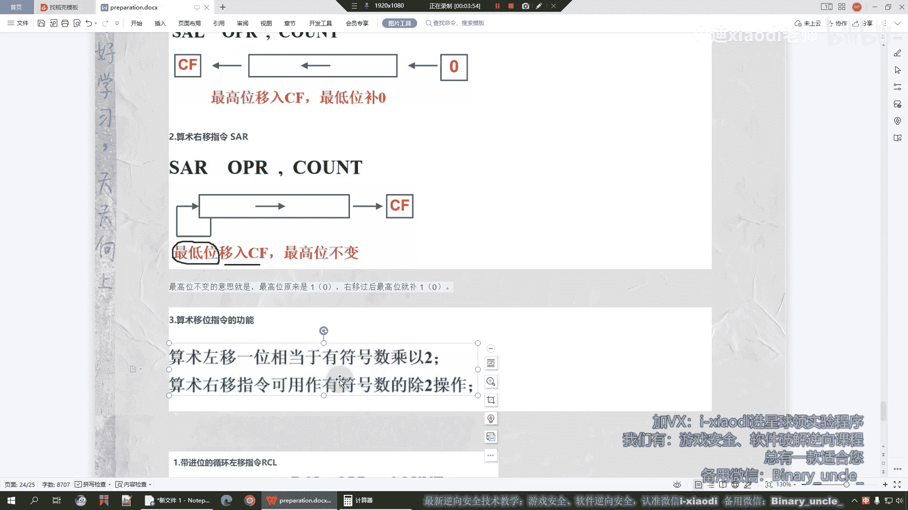

## 小白软件破解逆向工程师2023最新：4.24.4：🔄 循环移位与带进位循环

上一节我们对比了算术移位和逻辑移位，本节中我们来看看循环移位和带进位循环。循环移位的核心特点是“转圈”：左移时如果某一位一直往左移动，移动到数据表达范围的尽头，前面没有位置了，就跑到最后面去，形成一个循环。原文用画圈的方式帮助理解，也就是说数据超过表达极限后不是简单丢掉，而是从另一端转回来。

下面把循环移位和带进位循环的要点列出来，同时说明标志位的大致观察位置。

- 循环左移：向左移动时，移出的一端会从另一端转回来，形成循环。
- 循环右移：向右移动时同样会转圈，原理与循环左移对应。
- 带进位循环：带`C`也就是`carry`参与循环，看到`C`就想到带进位。
- 循环移位中一般主要看CF标志位。
- 在循环移位里，SF和ZF不受影响。
- 算术移位和逻辑移位中CF影响比较明显，主要也是看CF。

原文特别说明，循环移位到底会发生怎样的具体情形，是否影响后续跳转，需要放到后面的实际案例中才能真正体会。今天只需要知道它是什么、怎么转圈、主要看哪个标志位，先混个脸熟。下面进入标志位和后续案例的过渡说明，把今天的内容收个尾。

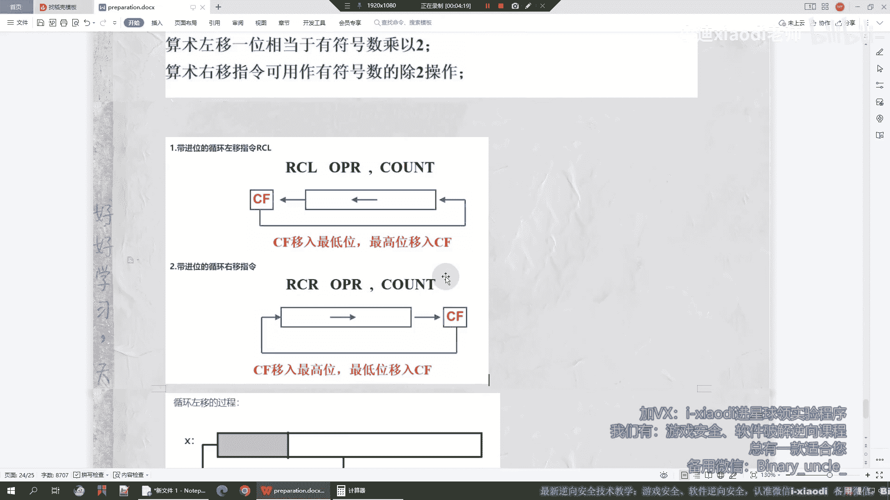

## 小白软件破解逆向工程师2023最新：4.24.5：🚩 标志位观察与后续案例提示

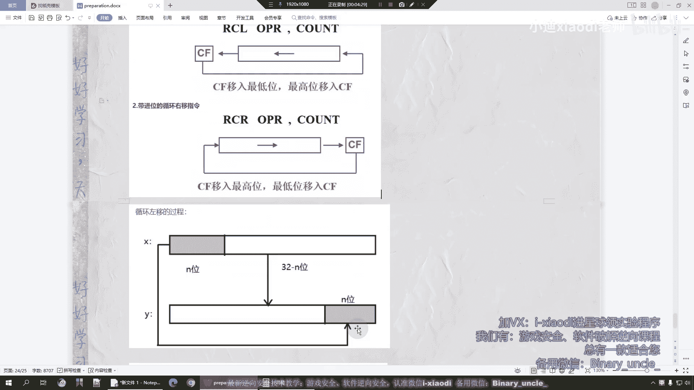

上一节我们介绍了循环移位以及CF、SF、ZF这些标志位的大致关系，本节中我们来看看今天应该记住到什么程度。原文强调，循环移位里主要看CF标志位，SF和ZF不受影响；算术和逻辑移位里CF影响比较明显，主要看的还是CF。至于具体会影响哪些跳转、在实际程序中表现成什么样，需要结合后面的实际案例才能真正理解。

所以今天的目标不是把所有细节一次吃透，而是先知道移位指令有哪些、英文缩写怎么认、逻辑移位怎么算、算术右移和逻辑右移差在哪里、循环移位怎么转圈。把这些基础概念混个脸熟，后续遇到真实汇编代码时再回头对照，会更容易理解。原文最后提示下期再见，本节内容到这里就完成了。

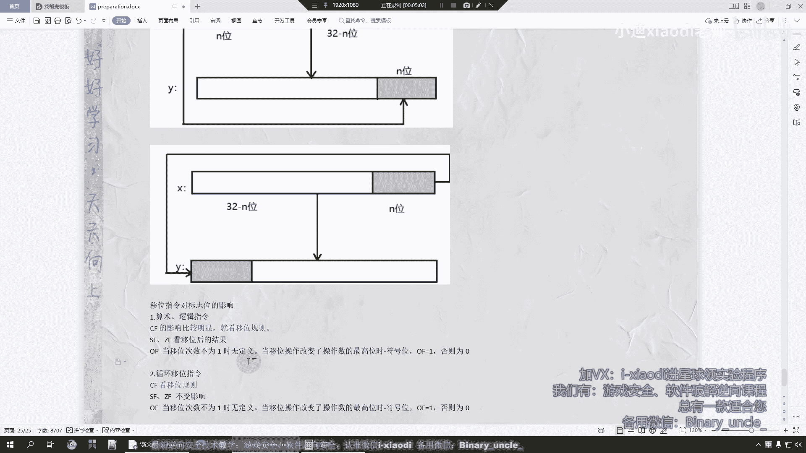

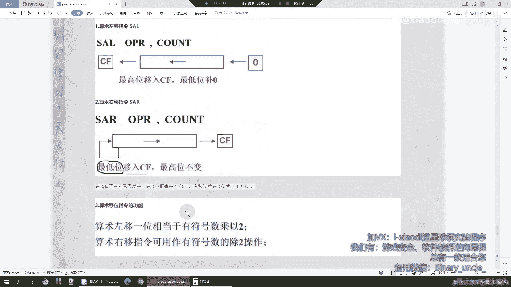

## 小白软件破解逆向工程师2023最新：4.24.6：📌 本节总结

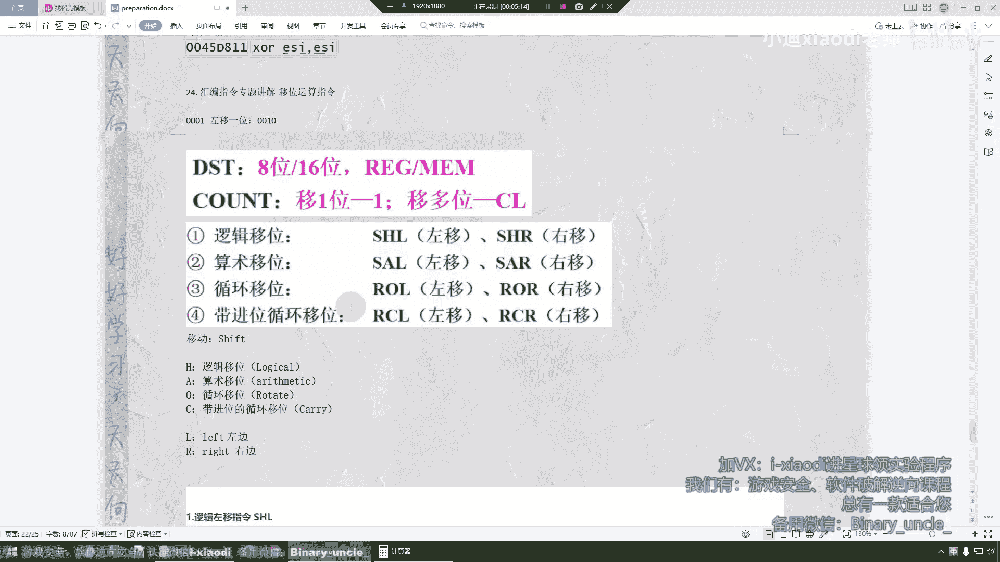

本节课中我们一起学习了移位运算指令。移位就是移动二进制位，例如`0001`左移一位变成`0010`；移位指令按4类、每类左右两个方向来记，一共8种。我们还认识了`shift`、`logic`、`arithmetic`、`rotate`、`carry`、`left`、`right`等缩写，理解了逻辑移位可以当成乘除法，左移N位相当于乘以2的N次方，右移N位相当于除以2的N次方，例如1左移5位得到`0x20`也就是32。算术移位和逻辑移位大体相似，区别在于逻辑右移最高位补0，算术右移最高位不变，最低位都会移入CF。循环移位的特点是转圈，主要看CF标志位，SF和ZF在循环移位中不受影响。具体影响跳转的情形需要后续实际案例体会，今天先混个脸熟，下期再见。

